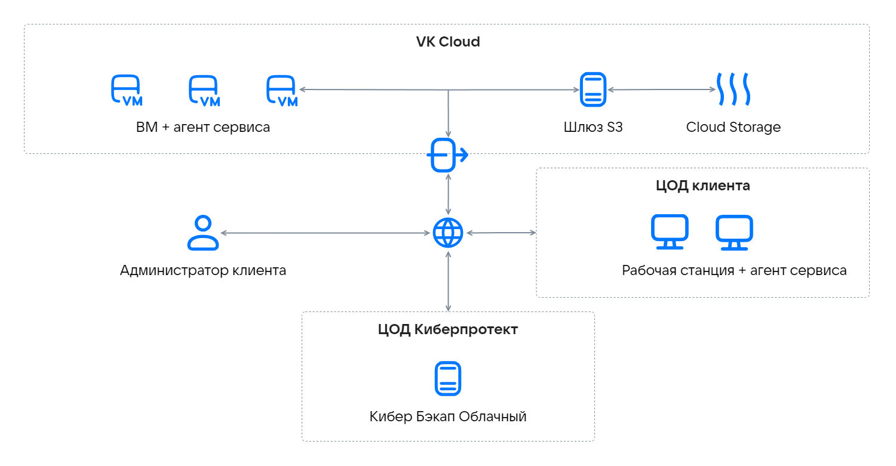

# {heading(About the service)[id=s3-cyber-backup-about]}

{include(/en/_includes/_translated_by_ai_en.md)}

The S3 Gateway allows the {linkto(../../../../applications-and-services/marketplace/initial-configuration/cyber-backup-quick-start#marketplace-cyber-backup-quick-start)[text=Cyber Backup Cloud]} service to use the public cloud service {linkto(../../../../storage/s3#s3-main)[text=VK Object Storage]} for storing backups. This provides the ability to access backups over the internet.

When connecting the S3 Gateway for Cyber Backup Cloud in the VK Cloud infrastructure, a cluster for storing backups is created, consisting of the following elements:

- Virtual machines. When configuring and connecting the gateway, at least one server will be deployed on a VM. To achieve fault tolerance, a cluster of several VMs is created.
- Virtual disks.
- A VK Object Storage bucket for storing backups.
- A network load balancer with an external IP address for distributing load between VMs (for a fault-tolerant configuration).

Service architecture:

{params[noBorder=true]}

Data intended for uploading to the public cloud is first saved locally and only then sent to the destination.

{note:err}
Use permanent local storage for storing intermediate copies. Using temporary disks may result in data loss.
{/note}

The local storage cluster must have enough logical space. For example, with daily backups, there should be enough space for backups not just for one day, but for at least a day and a half.

Backups are cold data with a specific access pattern: these data are rarely accessed, but they must be immediately available when requested. To store backups in {linkto(../../../../storage/s3#s3-main)[text=VK Object Storage]}, buckets with the Hotbox and Icebox storage classes are used.

The table shows the minimum VM configurations for creating a storage cluster.

[cols="1,2,2", options="header"]
|===
|Resources
|One server
|Three servers (fault-tolerant configuration)

|vCPU
|4
|12

|RAM (GB)
|8
|24

|SSD (GB)
|120
|360

|VM type
|Standart-4-8
|Standart-4-8
|===

The number of servers for configuring the gateway directly affects the performance of transferring backups to the cloud. For large projects with a large amount of data and infrastructure, it is recommended to create a fault-tolerant cluster.

To connect and configure the S3 Gateway for Cyber Backup Cloud, contact [technical support](/en/contacts). To calculate the cost, provide information about the volume of infrastructure (VMs) and data (GB) for which backups need to be performed. A request for gateway deployment is processed within one working week.

During the gateway deployment process in your VK Cloud project, the necessary cloud resources will be created, as well as accounts, tenants, and {linkto(../../../../tools-for-using-services/account/concepts/quotasandlimits#tools-account-concepts-quotasandlimits)[text=quotas]} configured.

After deployment, the Cyber Backup Cloud service panel is used for management.