{include(/en/_includes/_translated_by_ai_en.md)}

{note:info}

Author: Mikhail Volynov

{/note}

This article will help you install an ELK monitoring server and connect filebeat agents to it for Nginx application logs, and will also introduce some Kibana capabilities for working with logs.

## Test bench diagram

An ELK server will be deployed in the VK Cloud, and Nginx monitoring agents will be connected on remote nodes:

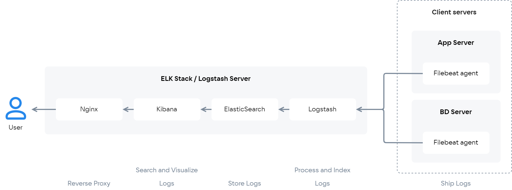{params[noBorder=true]}

In this article, we will assume that we have several nodes on which Nginx needs to be configured to export logs to ELK. To enable interaction between the machines, these nodes must be combined into a single network.

## Connecting the ELK server

1. [Install the ELK stack](/en/cases/cases-logs/elk-u18) on the target instance.
2. Remember the instance IP address, the username and password for accessing Kibana. You will need them later when checking functionality on the node with ELK.
3. Connect to the instance via ssh using a pem file. To do this, run the command:

```console
ssh -i /path/to/key.pem ubuntu@<instance_ip>
```

4.  Install the `ingest-geoip` and `ingest-user-agent` plugins for Elasticsearch; they are required for Kibana and Nginx logs to work together. To do this, while in the directory with the installed elasticsearch (by default for Ubuntu it is `/usr/share/elasticsearch/`), run the commands:

```console
bin/elasticsearch-plugin install ingest-geoip
bin/elasticsearch-plugin install ingest-user-agent

```

5.  To enable the installed modules, restart Elasticsearch by running the command:

```console
sudo service elasticsearch restart
```

## Settings on remote nodes

1.  Connect to the remote node you want to connect to ELK.
2.  Since an ELK and Nginx connection is being created, install Nginx from the standard Ubuntu repositories by running the command:

```console
sudo apt update
sudo apt install nginx
```

3.  For real-time log analysis, [install Filebeat](https://www.elastic.co/guide/en/beats/filebeat/6.4/filebeat-installation.html)
4.  Open the configuration file `/etc/filebeat/filebeat.yml` for editing and specify your settings in it:

    ```yaml
    output.elasticsearch:
        hosts: ["<es_url>"]
    setup.kibana:
        host: "<kibana_url>"
    ```

- `<es_url>` — the IP address of elasticsearch with the port number `9200`;
- `<kibana_url>` — the IP address of the instance with Kibana.

Examples for `<es_url>`:

- a direct address:

```yaml
output.elasticsearch:   
hosts: ["https://localhost:9200"]
```

- an explicit protocol specification:

```yaml
output.elasticsearch:  
hosts: ["localhost:9200"]   
protocol: "https"
```

- multiple host specification:

```yaml
output.elasticsearch:   
hosts: ["10.45.3.2:9220", "10.45.3.1:9200"]   
protocol: https
```

{note:info}

For more information about the settings in the `filebeat.yml` file, read [here](https://www.elastic.co/guide/en/beats/filebeat/current/elasticsearch-output.html)

{/note}

5.  Enable the Nginx module for Filebeat by running the command:

```console
sudo filebeat modules enable nginx
```

6.  To configure filebeat flexibly, edit the file `/etc/filebeat/modules.d/nginx.yml`. The default view of this file:

```yaml
- module: nginx

# Access logs
  access:
    enabled: true

# Set custom paths for the log files. If left empty,

# Filebeat will chose the paths depending on your OS.
    #var.paths:

# Error logs
  error:
    enabled: true

# Set custom paths for the log files. If left empty,

# Filebeat will choose the paths depending on your OS.
    #var.paths
```

7.  If the dashboards for Kibana have not been configured previously, load them using the command:

```console
sudo filebeat setup
```

8.  To start Filebeat, run the command:

```console
sudo service filebeat start
```

One node is configured. Additional nodes are configured similarly.

## Checking functionality on the node with ELK

1. To work with logs conveniently and effectively, connect to Kibana using the corresponding instance IP address, username and password (use https):

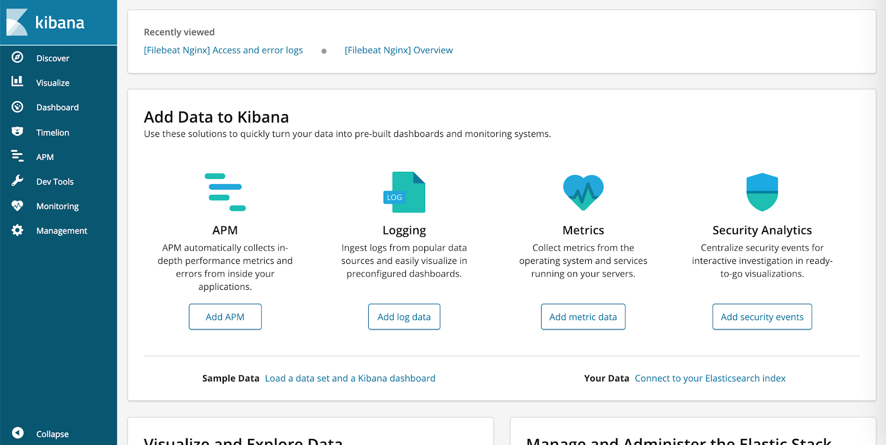

{note:info}

VK Cloud Marketplace uses self-signed certificates. To use SSL, add the certificate to exceptions or use your own certificate.

{/note}

2.  To make sure everything is configured correctly, go to the **Logging** section. To do this, click the **Add log data** button and select the **Nginx logs** subsection.

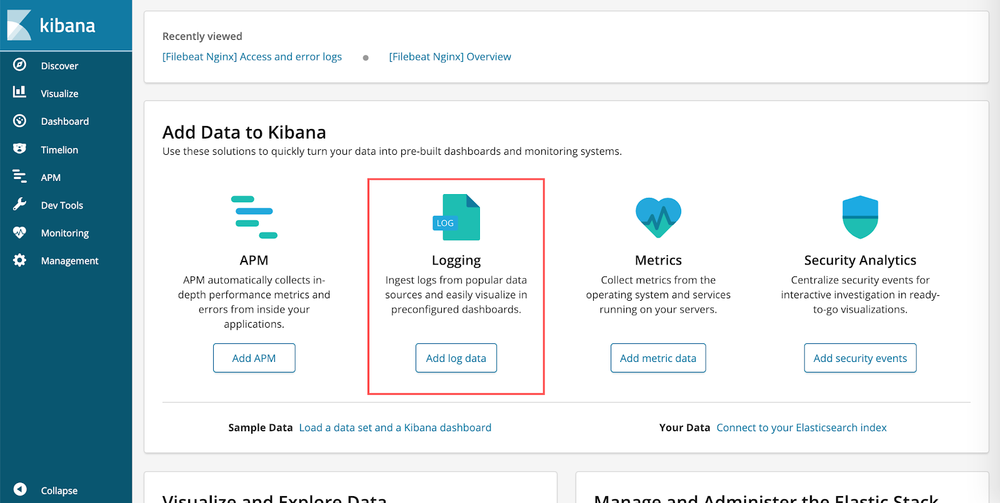

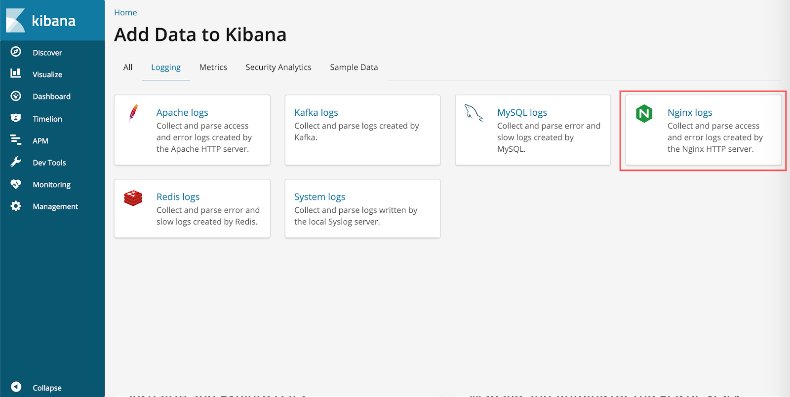

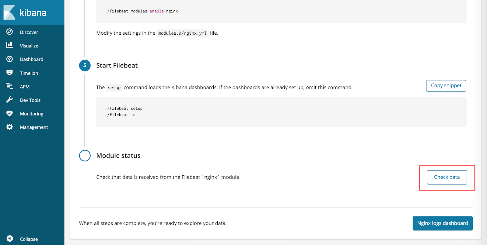

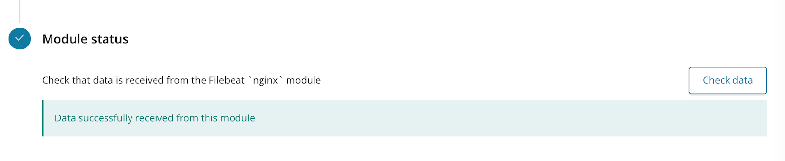

If everything is done correctly, the message **Data successfully received from this module** will appear when you click the **Check data** button.

## Working with Kibana dashboards

Kibana dashboards allow you to view details on Nginx logs from a remote node and, if necessary, perform filtering and search. Therefore, working with dashboards makes sense only if there are Nginx logs available for viewing.

In the side menu, select **Dashboard**. As a result, the standard Dashboard for Nginx Filebeat will be displayed with a variety of data about requests. It allows building clear diagrams and also shows a world map of the IP addresses that accessed the server.

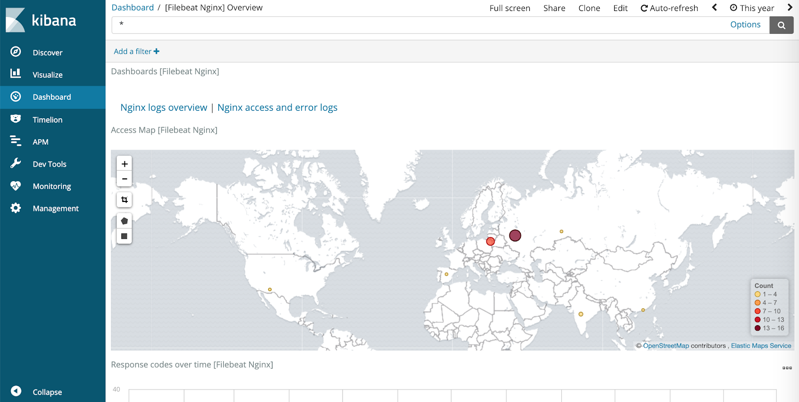

To view the list of all requests to the server for the period specified in the upper right corner, click the **Nginx access and error logs** button.

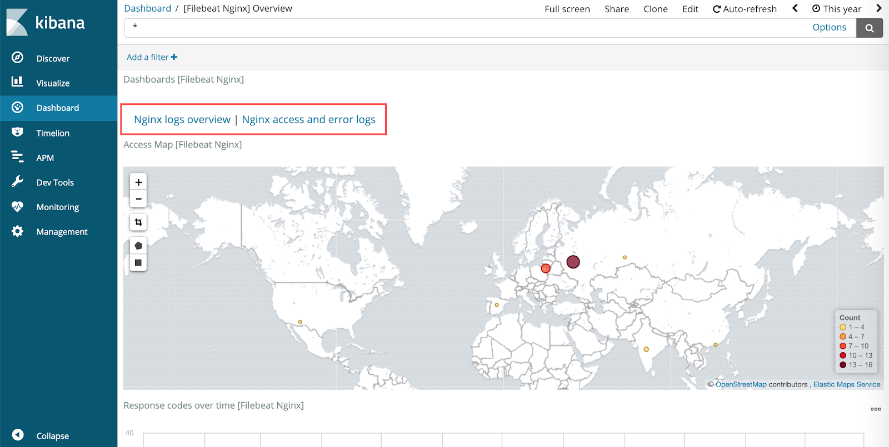

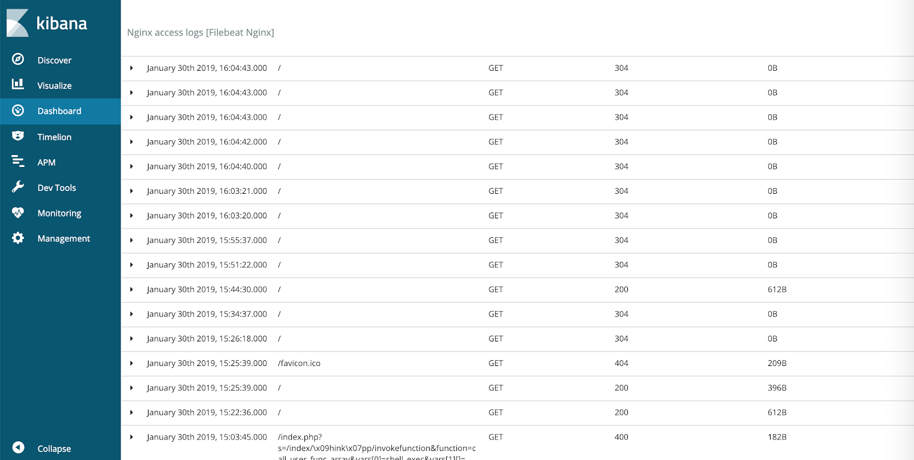

To view the details of a request, click the triangle on the left side of the corresponding row:

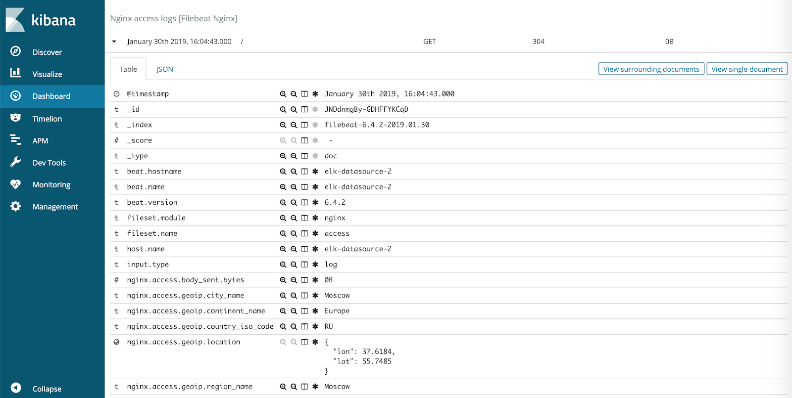

For a quick search, you can use filtering by clicking the **Add filter** button in the upper left.

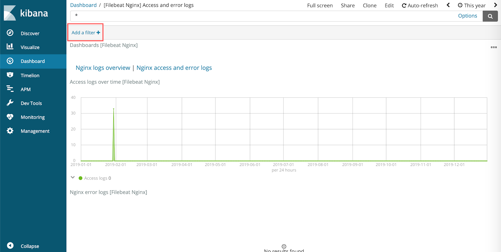

When configuring a filter, you need to select a field from the available ones and specify a search condition (for example, in the screenshot below, all requests with the response code `200`).

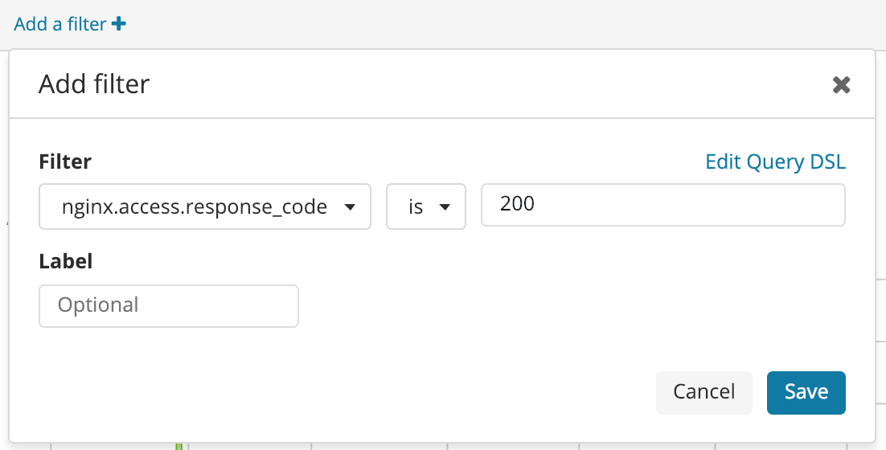