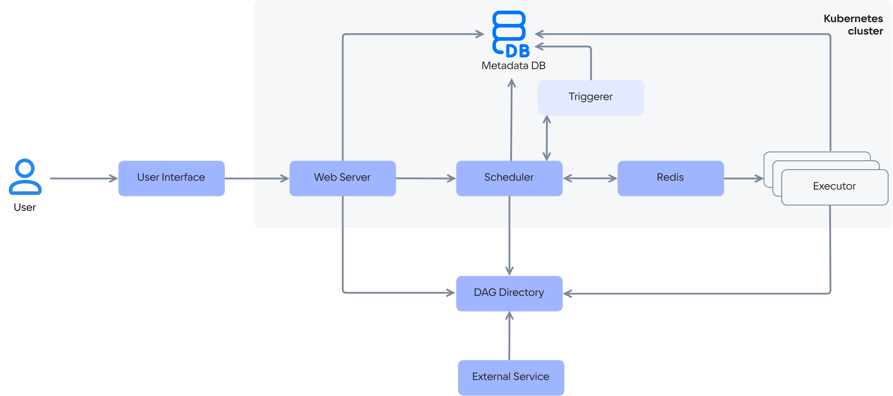

# {heading(Airflow service architecture)[id=airflow_architecture]}

{include(/en/_includes/_translated_by_ai_en.md)}

The Cloud Airflow service can be deployed in the following configurations:

{include(../../../_includes/_airflow.md)[tags=conf]}

Cloud Airflow represents workflows as directed acyclic graphs (DAG — Directed Acyclic Graph). The graphs are DAG files with Python scripts and are stored in the DAG file storage. For workflows to run correctly, DAG file names must be unique. The DAG file storage is the central element of the service architecture and provides interconnection between all other components.

Components of the Cloud Airflow service architecture:

- Web Server — a web application for managing and visualizing workflows.
- Metadata DB — a service database that stores the task execution history, the tasks themselves, and system settings, ensuring workflow consistency. Cloud Airflow uses a PostgreSQL database.
- Scheduler — responsible for launching tasks according to the DAG. It regularly checks which tasks are ready to be executed (every minute by default) and sends them to the specified Executor via the task queue (Redis).
- Triggerer — an architecture component that waits for external events from the scheduler to resume deferred tasks.
- Task queue (Redis) — a queue for asynchronous communication between the scheduler and the executors.
- Executor — responsible for executing tasks from the DAG on worker nodes. The executor picks tasks from the queue and determines where and how they will be run. Executors come in various types. The Cloud Airflow service uses the CeleryExecutor type, a distributed task executor based on the Celery (Python) library.
- DAG Directory — a directory with Python files that describe the workflows.
- External Service — external services that the tasks interact with (for example, PostgreSQL, AWS S3, HTTP API).

The diagram of interaction between Cloud Airflow components is shown in {linkto(#airflow_schema)[text=figure %number]}.

{caption(Figure {counter(pic)[id=numb_airflow_schema]} — Diagram of interaction between Cloud Airflow components)[align=center;position=under;id=airflow_schema;number={const(numb_airflow_schema)}]}

{params[noBorder=true]}

{/caption}

General workflow with the service:

1. The user uploads a DAG file to the storage (DAG Directory).
1. The scheduler detects the new DAG file and starts scheduling its runs.
1. When the execution time comes, the scheduler puts the tasks into the queue (Redis).
1. The executor picks the task from the queue and executes it.
1. The result (success or error) is written to the metadata database (Metadata DB).
1. The web server displays the execution status in the UI.