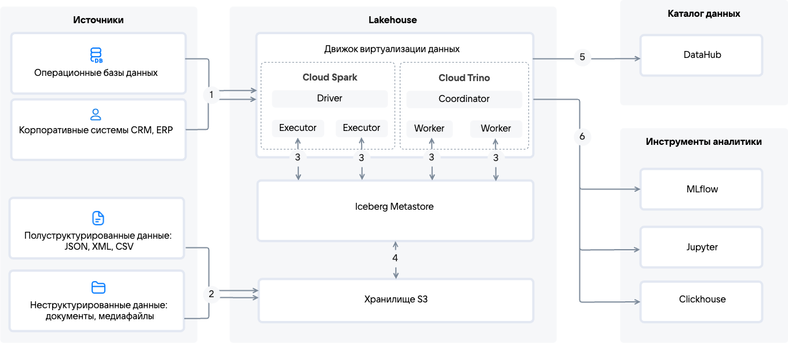

# {heading(Data Platform Architecture)[id=dlh_architecture]}

{include(/en/_includes/_translated_by_ai_en.md)}

{linkto(../about#dlh_info)[text=Data Lakehouse (DLH)]} collects structured and unstructured data from various sources, processes it via {linkto(../components/spark#dlh_spark)[text=Cloud Spark]} ([ETL](https://en.wikipedia.org/wiki/Extract,_transform,_load) or ELT) or {linkto(../components/trino#dlh_trino)[text=Cloud Trino]} (SQL queries), stores it in {linkto(../components/s3#dlh_s3)[text=S3 storage]} with cataloging in {linkto(../components/iceberg#dlh_iceberg)[text=Cloud Iceberg Metastore]}, manages metadata in DataHub, and provides data for analytics, BI, and ML via Cloud Trino, Cloud Spark, or {linkto(../components/clickhouse#dlh_clickhouse)[text=Cloud ClickHouse]}.

{params[noBorder=true]}

1. Structured data from operational ([OLTP](https://en.wikipedia.org/wiki/Online_transaction_processing)) and enterprise (CRM, ERP) systems arrives in Cloud Trino directly or via Cloud Spark for executing complex ETL and ELT processes.
 
1. Semi-structured (JSON, XML, CSV) and unstructured (media files, documents) data is transferred to S3 storage as streams or in batches.

1. {linkto(../components/trino#dlh_trino)[text=Cloud Trino]} and {linkto(../components/spark#dlh_spark)[text=Cloud Spark]} use the Iceberg Metastore API to exchange data with S3 storage.

    In Cloud Trino, the query processing workflow includes receiving ([PULL model](#dlh_data_processing_models)) and optimizing SQL queries by the Coordinator, which then distributes them among Workers, providing functionality similar to traditional DBMSs.

    Cloud Spark is used to run complex ETL and ELT processes. This service supports both batch and stream data processing:

    - In [stream processing](https://en.wikipedia.org/wiki/Stream_processing), data is processed continuously, in mini-batches or event-by-event, in real time. Stream processing is performed using the [PUSH model](#dlh_data_processing_models).

    - In [batch processing](https://en.wikipedia.org/wiki/Batch_processing), data is accumulated in batches (files, tables) and processed all at once. The extraction process is started on a schedule or manually ([PULL model](#dlh_data_processing_models)).

1. Cloud Iceberg Metastore catalogs the objects of {linkto(../components/s3#dlh_s3)[text=S3 storage]} and provides an API for accessing it.

    Data storage is organized with support for [ACID](https://en.wikipedia.org/wiki/ACID) transactions via the {linkto(../components/iceberg#dlh_iceberg)[text=Cloud Iceberg Metastore]} service, which allows representing S3 storage objects as database tables. Using S3 storage significantly reduces storage costs.

1. The overall list of objects and the rules for processing them is published in the data catalog based on DataHub (with support for Data Discovery, Data Quality, Metadata Management, Data Governance, Data Lineage functionality) for access management and data lineage tracking.
1. Processed data from Cloud Trino and Cloud Spark can be used in various external analytical systems: MLflow, Jupyter, ClickHouse. These systems allow performing in-depth data analysis, creating detailed visualizations, and managing the machine learning model lifecycle.

## {heading(Data processing models)[id=dlh_data_processing_models]}

Depending on the task, data can be processed in the following ways:

- _PULL model_ — an approach in which data is extracted from the source on a schedule by running batch processes, which are convenient to manage in Cloud Airflow. This approach is used for simple ETL and ELT processes, analytics in S3 storage, BI integration, SQL queries to databases, and when the load on the source needs to be controlled.

- _PUSH model_ — an approach in which data is automatically sent from the source to Cloud Spark or Cloud Trino. This approach is used for tasks where continuous delivery and processing of large volumes of data are critical: complex ETL and ELT processes, data preparation for analytics, machine learning on big data.

When designing the Data Lakehouse architecture, it is important to determine which types of data will be processed and how:

[cols="<,<,<",options="header"]
|===
| Criterion
| PULL model
| PUSH model

| Service
| {linkto(../components/airflow#dlh_airflow)[text=Cloud Airflow]}, {linkto(../components/trino#dlh_trino)[text=Cloud Trino]}, {linkto(../components/spark#dlh_spark)[text=Cloud Spark]} (batch processing)
| {linkto(../components/spark#dlh_spark)[text=Cloud Spark]} (stream processing, micro-batches)

| Source support
| API, databases, files
| For each source, a component must be developed that will send data via the Producer API

| Update frequency
| On a schedule
| In real time

| Data latency  
| 5–60 minutes
| < 1 second

| Load on the source
| High (50–500 connections per hour)
| Low (1–5 permanent connections)

| Scalability
| Limited (up to 100 parallel operations per second)
| High (up to 10,000 parallel operations per second)

| Integration complexity
| Low (1–2 days for configuration)
| High (Producer development required)
|===