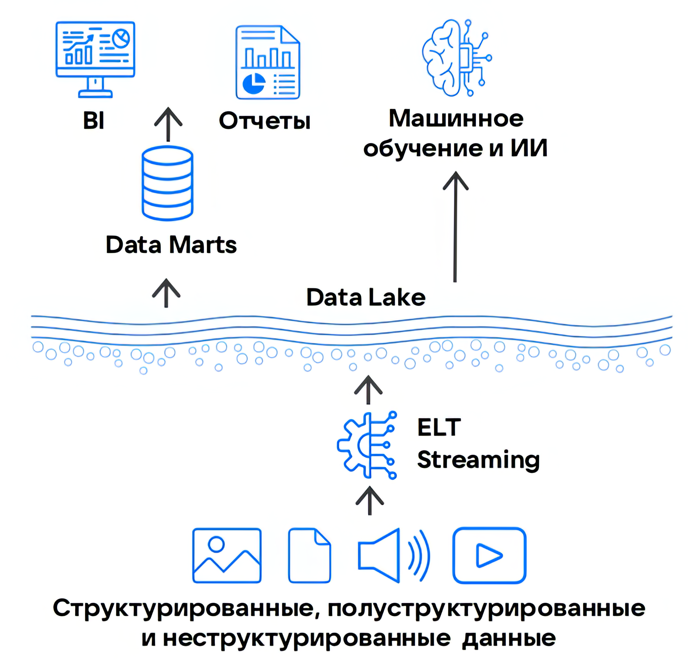

# {heading(Data Lake)[id=dlh_data-lake]}

{include(/en/_includes/_translated_by_ai_en.md)}

Data Lake or *data lakes* is an enterprise data warehouse (EDW) architecture that emerged as an alternative to {linkto(../dwh#dlh_dwh)[text=%text]} (DWH) for storing large volumes of data in their original format.

Unlike Data Warehouse, in the Data Lake architecture data can be structured, semi-structured, and unstructured. Therefore, in a Data Lake there is no need to predefine a data storage schema and process data at the loading stage.

{params[width=40%; noBorder=true]}

## {heading(Data storage models in a Data Lake)[id=dlh_data-lake_models]}

Processing large arrays of unstructured data requires fundamentally different storage methods compared to Data Warehouse. There are several storage models suitable for building a data lake, but two solutions are the most common:

- Object storage — stores any data types as objects with metadata.

     As a rule, it is implemented as a cloud solution with a pay-as-you-go billing model and does not require spending on infrastructure administration.

     Most such services support the S3 API, which makes it possible to connect object storage for working with analytical, ETL, BI, and ML platforms. {var(cloud)} also provides such a service — {linkto(../../components/s3#dlh_s3)[text=VK Object Storage]}.

- An [HDFS](https://hadoop.apache.org/docs/stable/hadoop-project-dist/hadoop-hdfs/HdfsDesign.html) cluster (Hadoop Distributed File System).

     It is implemented mostly on-premise in owned or rented infrastructure with self-administration.

     It supports integration with the Hadoop stack (MapReduce, Hive, HBase, Pig, Spark, etc.), which can be deployed in the same infrastructure as the HDFS cluster. This allows data to be localized within a closed system and improves processing performance due to lower latency.

## {heading(Advantages of a Data Lake over a DWH)[id=dlh_data-lake_advantages]}

- High performance in data processing due to the use of columnar data storage based on ELT approaches.
- The ability to work with raw data, for example, for preparing datasets in ML tasks.
- Cost-effective storage of any data types in a data lake.
- Flexibility in choosing tools depending on the data type. For example, {linkto(../../components/trino#dlh_trino)[text=Cloud Trino]} for building ETL/ELT processes, or creating a full ML cycle using the MLlib library in {linkto(../../components/spark#dlh_spark)[text=Cloud Spark]}.

## {heading(Data Lake limitations)[id=dlh_data-lake_restrictions]}

- Lack of built-in SQL compatibility, which complicates integration with BI systems.
- Duplication of data and business logic when using additional DBMSs for analytics.
- Redundant data movement between systems, increasing latency and security risks.

## {heading(Data Lake alternatives)[id=dlh_data-lake_alternatives]}

Data Lake and the preceding {linkto(../dwh#dlh_dwh)[text=%text]} architecture have some drawbacks and do not fully cover all business needs. Therefore, a more universal solution for working with big data has emerged — {linkto(../dlh#dlh_dlh)[text=%text]}, which combines the advantages of both architectures and minimizes their drawbacks.