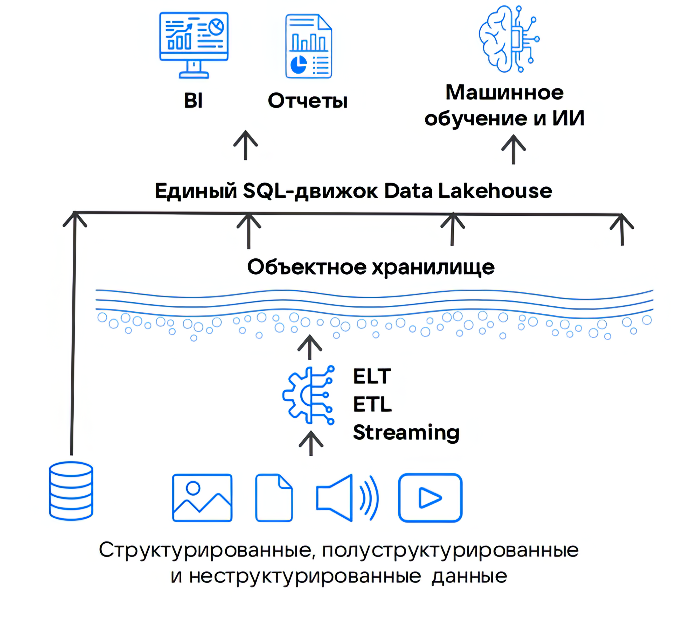

# {heading(Data Lakehouse)[id=dlh_dlh]}

{include(/en/_includes/_translated_by_ai_en.md)}

Data Lakehouse (DLH) is a modern hybrid architecture that combines the advantages of {linkto(../dwh#dlh_dwh)[text=%text]} (DWH) and {linkto(../data-lake#dlh_data-lake)[text=%text]}, while eliminating their key drawbacks.

Data Lakehouse, unlike DWH, allows storing not only tabular data but also other formats (images, logs, JSON files, etc.). At the same time, Data Lakehouse efficiently organizes the management of such data through advanced metadata handling mechanisms, preventing their degradation into an uncontrolled "data swamp," which is often typical of storage built on the Data Lake architecture.

In addition, Data Lakehouse provides the ability to connect BI tools directly to "raw" data, which gives three key advantages compared to the Data Lake and DWH architectures:

- Instant relevance — analysts work with data in its current state without transformation delays.
- Reduced processing time — the preliminary ETL transformation stage is eliminated, speeding up the delivery of results.
- Resource savings — no additional capacity is required to transform and store prepared data.

{params[width=40%; noBorder=true]}

## {heading(Data storage model in Data Lakehouse)[id=dlh_dlh_models]}

In Data Lakehouse, an S3-compatible object storage plays a key role in organizing the storage of heterogeneous data. Including this relatively inexpensive solution in the data storage model as the primary storage makes it possible to significantly reduce storage costs.

The integration of S3 and [Apache Iceberg](https://iceberg.apache.org/) makes it possible to implement ACID transaction support as in regular DBMSs and to configure interaction with compute components such as [Apache Spark](https://spark.apache.org/) and [Trino](https://trino.io/).

## {heading(Advantages of the Data Lakehouse architecture)[id=dlh_dlh_advantages]}

- Infinite scalability (no volume limits).
- Cost reduction (pay-as-you-go billing only for actually used space).
- Support for "raw" data without the need for preprocessing.
- Simultaneous use of SQL and AI/ML.
- ACID support.
- High SQL query speed without additional add-ons.
- Metadata management that prevents the data lake from turning into a "data swamp."