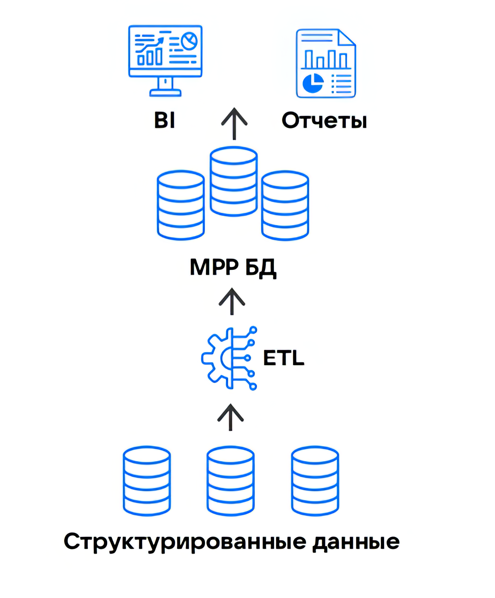

# {heading(Data Warehouse)[id=dlh_dwh]}

{include(/en/_includes/_translated_by_ai_en.md)}

Data Warehouse (DWH) is the first architectural concept implementing the idea of an *enterprise data warehouse* (EDW). An EDW is a central repository that stores a large volume of an organization's data collected from various sources and manages this data.

In enterprise data warehouses, information is collected from different departments (systems), meaning it has different structures. In addition, such warehouses contain not only current but also archived data, so their volumes are usually significant. This creates two main tasks that need to be solved when organizing an EDW:
- preliminary processing and normalization of data (bringing it to uniform formats, eliminating duplicates and contradictions) before placing it in the warehouse;
- distributed storage of large volumes of data on different servers and combining them into a single system.

In DWH, structured data from relational DBMSs is collected into a multidimensional [OLAP](https://ru.wikipedia.org/wiki/OLAP) warehouse that provides access to data via SQL queries for subsequent processing. The result of the data transformation is passed to BI systems and analytical reporting services.

{params[width=40%; noBorder=true]}

## {heading(Data storage models in DWH)[id=dlh_wdh_models]}

The choice of data storage structure plays an important role in building the EDW architecture. Data Warehouse has strict restrictions on structure, so not every data storage model is suitable for building a DWH architecture.

The following models are standard:

- The Kimball model, in which one central table (fact table) stores aggregated data about facts or events, and several related auxiliary dimension tables contain descriptive attributes of various entities.
- The Inmon model, which uses a [normalized](https://ru.wikipedia.org/wiki/%D0%9D%D0%BE%D1%80%D0%BC%D0%B0%D0%BB%D1%8C%D0%BD%D0%B0%D1%8F_%D1%84%D0%BE%D1%80%D0%BC%D0%B0) structure with minimal data redundancy. This model is most often used in pilot and MVP projects, where fast implementation is important and the requirements for the data warehouse are minimal.
- Data Vault 2.0 — a hybrid approach to data structure design that combines the principles of the Kimball and Inmon models.

[cols="1,3,3", options="header"]
|===
| Model
| Advantages
| Disadvantages

| Kimball
| - Fast data extraction due to the specific structure of the warehouse.
- Ease of use (the structure is obvious to most data specialists)
| - Adding new parameters to the fact table reduces performance.
- Difficult to adapt to rapidly changing business needs

| Inmon
| - A single source of data in the form of a central warehouse.
- Low data redundancy
| - Any change in business processes requires redesigning the schema.
- Difficult to add new data sources without modifying ETL pipelines

| Data Vault 2.0
| - The system is resilient to changes in data sources and business rules.
- New data can be integrated without significantly affecting existing structures.
- Works with any data types (structured, semi-structured, raw).
| - Joining a large number of tables with the `JOIN` operator increases the risk of errors and slows down query execution compared to the Kimball and Inmon models.
- Complexity of data validation due to the large number of entities and complex relationships between them.
- Working with such a model requires specialists with specific skills and developed abstract thinking
|===

## {heading(DWH limitations)[id=dlh_dwh_restrictions]}

The specifics of the data models used when designing the warehouse structure in DWH form the limitations of the DWH architecture itself:

- high cost of storage and scaling;
- lack of access to raw data;
- complex logic in ETL processes;
- limited scaling capabilities;
- high development and maintenance costs;
- difficulties in technical support and troubleshooting.

As a result, the IT infrastructure does not have time to adapt to changing business needs, since any infrastructure change (connecting a new data source or changing the storage structure) entails large-scale rework of ETL processes.

## {heading(DWH alternatives)[id=dlh_dwh_alternatives]}

The need to simplify interaction with the EDW by reducing the requirements for the data loading and organization process led to the emergence of new solutions:

- {linkto(../data-lake#dlh_data-lake)[text=%text]} — an architectural component that allows storing semi-structured data in their original form, without the strict regulation typical of DWH.
- {linkto(../dlh#dlh_dlh)[text=%text]} — a universal solution for working with big data, combining the advantages of the Data Warehouse and Data Lake architectures.