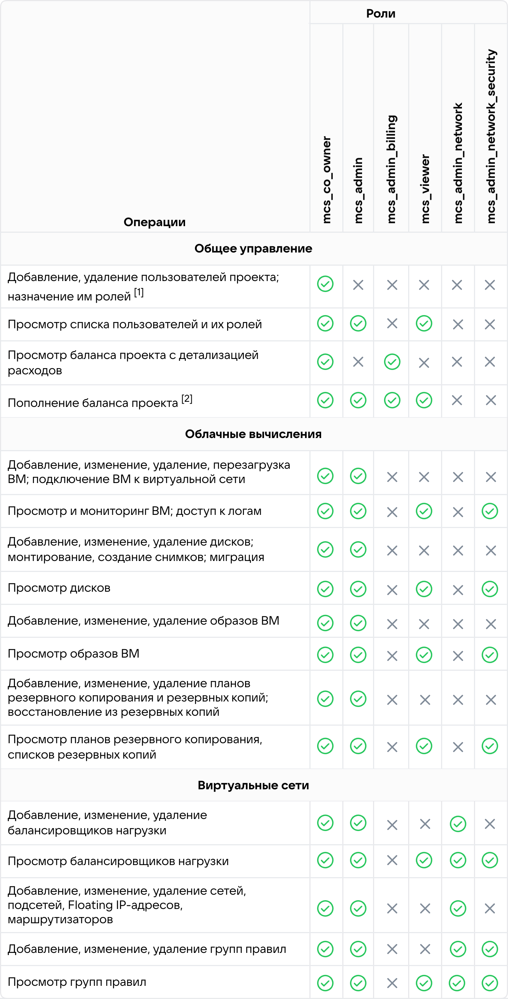

# {heading(Introduction)[id=intro-about]}

{include(/en/_includes/_translated_by_ai_en.md)}

## {heading(General information)[id=intro-about-general]}

The full name of the system: {var(cloud)}.

{var(cloud)} is a convenient tool for building a reliable and secure cloud infrastructure. It provides access to high-quality cloud services on which you can build your business, launch applications and services, and accelerate development. Working with {var(cloud)} helps save financial and time resources.

{ifndef(private-cert)}
{var(cloud)} is available in two editions:

* Light Cloud — an edition of {var(cloud)} with a reduced set of components and lower hardware requirements.
* Enterprise Cloud — an edition of {var(cloud)} with a full set of components, suitable for all usage scenarios.

Each edition offers configurations with a different component composition.

This document describes the maximum possible composition of {var(cloud)}. The actual composition of a specific installation depends on the selected configuration and may not include all the components and features described in the document.
{/ifndef}

The primary graphical interface of {var(cloud)} is the management console (dashboard). You can use it to manage the main services of {var(cloud)}.

Access to the management console is performed via a web browser at:

{ifndef(private-cert)}
```console
lk.<ДОМЕННОЕ_ИМЯ>
```
{/ifndef}

{ifdef(private-cert)}
```console
LK<ДОМЕННОЕ_ИМЯ>
```
{/ifdef}

Here `<ДОМЕННОЕ_ИМЯ>` is the domain name of your company where {var(cloud)} is deployed.

{ifndef(private-cert)}

## {heading(Advantages of {var(cloud)})[id=intro-about-advantages]}

The main advantages of {var(cloud)} are:

- Innovative technologies in a private installation.

  {var(cloud)} evolves together with the public cloud for business VK Cloud Solutions. Thus, {var(cloud)} receives, among other things, updates and services whose reliability has been proven in the projects of thousands of public cloud customers.

- Integrated PaaS.

  {var(cloud)} is a full-fledged technology platform for building a private cloud with integrated PaaS solutions and a catalog of corporate IT applications.

- Proven operational tools.

  The server hardware management, monitoring, and log processing tools in {var(cloud)} have been refined over 20 years of VK infrastructure operation and 5 years of building and using a local private cloud.

- Customization and support.

  {var(cloud)} is customized to the goals and objectives of each customer. A dedicated team of experts helps implement the cloud, properly organize processes, and ensure optimal operation.

- Reduced TCO.

  {var(cloud)} provides cost optimization and a lower total cost of ownership compared to the private clouds of most international vendors.
{/ifndef}

{ifdef(private-cert)}

## {heading(Operation modes)[id=intro-about-work-mode]}

{var(cloud)} can operate in one of the following modes:

- Normal.
- Restricted.
- Emergency.
- Maintenance.

For more details, see the **{var(cloud)} Administrator Guide** document in the **Operation Modes** section.

## {heading(User rights and accounts)[id=intro-about-rbac]}

Each user has a personalized account.

For management console users, a set of roles is supported, assigned within a separate project. A user can be assigned one or more roles from {linkto(#tab_roles_mcs)[text=table %number]}.

{caption(Table {counter(table)[id=numb_tab_roles_mcs]} — Personal account user roles)[align=right;position=above;id=tab_roles_mcs;number={const(numb_tab_roles_mcs)}]}
[cols="2,2,3", options="header"]
|===
|Role ID
|Role name
|Description

|`mcs_viewer`
|Observer
|Allows viewing most of the project information, but without edit access

|`mcs_co_owner`
|Project co-owner
|Provides access to all project resources. Can be assigned manually

|`mcs_admin_network`
|Network administrator
|Provides access to all objects of the network subsystem

|`mcs_admin_billing`
|Project billing administrator
|Provides access only to the **Balance** item and billing functions

|`mcs_admin`
|Project administrator
|Provides access to all project resources, except user groups and balance

|`mcs_admin_network_security`
|Network security administrator
|Performs control over network settings
|===
{/caption}

Each role corresponds to a specific set of rights listed in {linkto(#tab_rbac_mcs)[text=table %number]}.

[1] This functionality is disabled in the {var(cloud)} management console. Interaction with users and roles is performed in the Administrator Portal.

[2] In the {var(cloud)} implementation, all write operations are performed in the Administrator Portal. Example: changing the balance or prices.

{caption(Table {counter(table)[id=numb_tab_rbac_mcs]} — Personal account user rights)[align=center;position=under;id=tab_rbac_mcs;number={const(numb_tab_rbac_mcs)}]}
{params[width=100%;noBorder=true]}
{/caption}

## {heading(Password security)[id=intro-about-security-pass]}

Password security is ensured by {var(cloud)}.

When creating passwords, follow these rules:

- Length and complexity.

  Passwords must be at least 8 characters long. They must include uppercase and lowercase letters and digits. Avoid words that can be found in dictionaries. Try not to use personal information that is easy to guess.

- Uniqueness.

  Create unique passwords. Using the same password increases the risk of compromising all your data.

- Regular updates.

  Update your passwords regularly. It is recommended to change passwords every 3–6 months.

- Avoiding common mistakes.

  Do not write passwords down on notes or cards. Also avoid using simple passwords such as `12345678` or `qwerty12`.

## {heading(Security event log)[id=intro-about-security-log]}

The {var(cloud)} security event log is available only to the {var(cloud)} administrator.

For more details, see the **{var(cloud)} Administrator Guide** document in the **Security Event Log** section.

## {heading(Security settings)[id=intro-about-security-param]}

For more information about the security settings available in the management console:

- {linkto(../../tools-for-using-services/account/instructions/account-manage-private/keypairs-private#private-account-manage-keypairs)[text=%text]}.
- {linkto(../../storage/backups/instructions/create-backup-plan/create-backup-plan.md#backup-plan-create-vm)[text=%text]}.

{/ifdef}