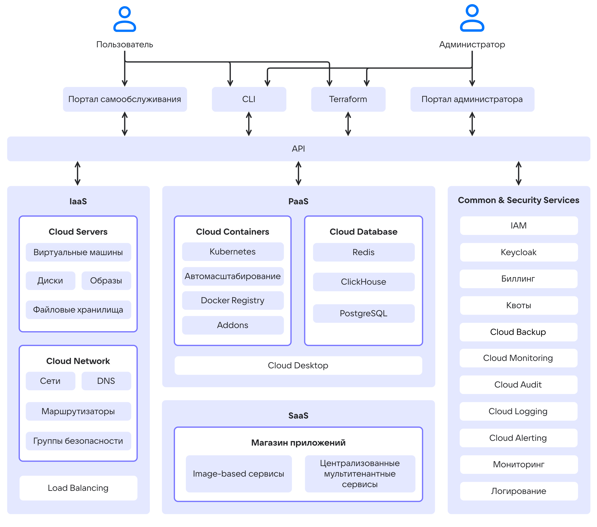

# {heading(About {var(cloud)} services)[id=service-list]}

{include(/en/_includes/_translated_by_ai_en.md)}

{var(cloud)} can host virtualization, monitoring, container, and data storage services. The architecture is based on four groups of services:

- **Infrastructure as a Service (IaaS)**. IaaS services are built on [OpenStack](https://www.openstack.org/software) and in-house developed components. They manage dynamic resource allocation, scaling, and fault tolerance. IaaS provides basic components: virtual servers, network, data storage, and access to dedicated hardware.

  {cut(List of IaaS services)}

  - {linkto(../../computing/iaas#iaas)[text=Cloud Servers]} — manages the compute resources of {var(cloud)}, virtual machines, virtual disks, and file storage.
  - {linkto(../../networks/vnet#vnet)[text=Cloud Networks]} — provides network interaction within the selected {linkto(../../tools-for-using-services/account/concepts/projects#tools-account-concepts-projects)[text=project]} using SDN (Software Defined Network) technology. It runs on OpenStack Neutron. It includes the following components:

    - {linkto(../../networks/vnet/concepts/dns#vnet-dns)[text=DNS]} — supports private DNS, providing name resolution for {var(cloud)} services.
    - {linkto(../../networks/balancing/concepts/about#balancing-load-balancer)[text=Load Balancer]} — distributes the load on the infrastructure, ensuring fault tolerance and flexible scaling of applications.

  {/cut}

- **Platform as a Service (PaaS)**. These include solutions for managing Kubernetes clusters, scalable DBMSs, and virtual workstations.

  {cut(List of PaaS services)}

  - {linkto(../../kubernetes#kubernetes)[text=Managed Containers]} — allows you to create and manage Kubernetes clusters where you can run services and applications.
  - {linkto(../../dbs/dbaas#dbaas-dbaas)[text=Cloud Databases]} — provides scalable DBMSs: PostgreSQL,{ifdef(private-pg)} Postgres Pro,{/ifdef} ClickHouse, Redis.
  - {linkto(../../monitoring-services/alerting#alerting)[text=Cloud Alerting]} — configures notifications about changes in key metrics of {var(cloud)} services.
  - {linkto(../../monitoring-services/logging#logging)[text=Cloud Logging]} — aggregates and analyzes logs of services in {var(cloud)}.
  - {linkto(../../monitoring-services/monitoring#monitoring)[text=Cloud Monitoring]} — provides monitoring of metrics specific to PaaS services, such as analytics on K8s container pods and DBMS transaction statistics.
  - {linkto(../../computing/cloud-desktops#cloud-desktops)[text=Cloud Desktop]} — managed virtual workstations.

  {/cut}

- **Software as a Service (SaaS)**. A corporate marketplace with a catalog of ready-made solutions for businesses and IT teams, which reduces implementation time and costs.

  {cut(List of SaaS services)}

  - [Marketplace](../../applications-and-services/marketplace) — allows you to quickly deploy web development and administration environments based on virtual machines.
  {/cut}

- **Common&Security services** ensure secure operation of users and support the role-based model when using {var(cloud)} resources. They support built-in monitoring of {var(cloud)} services and individual entities.

  {cut(List of Common&Security services)}

  - Billing — tracks resource usage and monitors expenses.
  - Quotas — provides quota management functions.
  - {linkto(../../monitoring-services/event-log#event-log)[text=Cloud Audit]} — generates an audit log of user actions in {var(cloud)}.
  - {linkto(../../storage/backups#cloud-backup)[text=Cloud Backup]} — manages backup plans for virtual machines and managed DBMSs.
  - IAM — manages authentication and authorization of {var(cloud)} users, administrators, and services.
  - Keycloak — provides storage of user accounts and integration with external directory services.
  - Monitoring — implements monitoring of the {var(cloud)} state.
  - Logging — implements storage of logs of {var(cloud)} components.

  {/cut}

The general diagram of {var(cloud)} components and services is shown below.

{params[noBorder=true]}