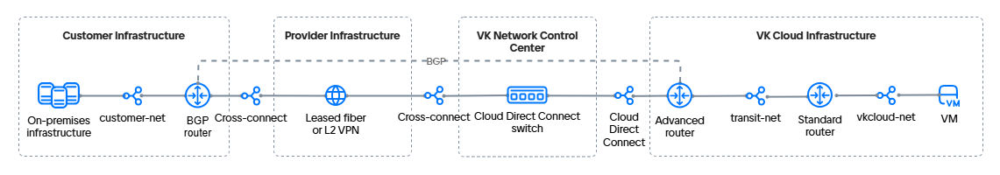

# {heading(Connecting to {var(cloud)} via the Cloud Direct Connect network and an additional standard router)[id=directconnect-dc-standard-router]}

{include(/en/_includes/_translated_by_ai_en.md)}

Cloud Direct Connect allows you to organize different {linkto(../../../../networks/vnet/concepts/onpremise-connect#vnet-onpremise-connect)[text=connection options]} between a network located in your on-premises infrastructure and the {var(cloud)} virtual networks. In this example, the connection will be established using a dedicated Cloud Direct Connect communication channel, an advanced router with dynamic routing via the [BGP](https://datatracker.ietf.org/doc/html/rfc1163) protocol, and an additional standard router.

In this example, the advanced router handles the integration and provides connectivity to the remote infrastructure. The network hosting the virtual machines is served by the {var(cloud)} standard router.

{note:info}
Using the BGP protocol for this connection option is not mandatory. Your connection scheme may differ from the one used in this guide.
{/note}

The connection option described here involves the use of three virtual networks:

- a network interconnect network (Cloud Direct Connect);
- a network for connecting the standard router to the advanced router (transit network);
- a network for hosting virtual machines.

The network connectivity scheme for the option using the BGP protocol looks as follows:

{params[noBorder=true]}

Using a combination of a standard router and an advanced router makes it possible to work around the limitations of the {linkto(../../../../networks/directconnect/how-to-guides/dc-advanced-router#directconnect-dc-advanced-router)[text=connection]} that does not use a standard router.

{note:info}
{var(cloud)} allows you to configure different {linkto(../../../../networks/vnet/concepts/onpremise-connect#vnet-onpremise-connect)[text=connection options]} to the remote infrastructure. The choice of option depends on the project's SDN, internet access from the remote infrastructure, and the fault tolerance requirements for the connection.
{/note}

## {heading(Preparatory steps)[id=directconnect-dc-standard-router-prep]}

1. {linkto(../../../../tools-for-using-services/api/rest-api/enable-api#rest-api-enable-activate)[text=Activate API access]} if you have not done so yet.
1. Make sure the OpenStack client is {linkto(../../../../tools-for-using-services/cli/openstack-cli#openstack-install)[text=installed]}, and {linkto(../../../../tools-for-using-services/cli/openstack-cli#openstack-authorize)[text=authenticate]} in the project.
1. Make sure the [curl](https://curl.se/docs) and [jq](https://jqlang.org) packages are installed on your computer.
1. Select or create a network in your on-premises infrastructure. The network may not have internet access, but it must be connected to a router that:

   - supports a BGP protocol connection;
   - (optionally) supports the BFD protocol: this will reduce the routing recovery time in case of a failure;
   - can be either a physical device or a virtual machine in the client network.

   Write down the following information:

   - the subnet name and IP address;
   - the name of the network that contains the subnet;
   - the IP address of a machine in the subnet that will be used to verify connectivity between the networks;
   - the name of the BGP router.

   For example, a network with a Router OS 7.10 (MikroTik) virtual machine acting as the BGP router will be used.

1. Select or {linkto(../../../../networks/vnet/instructions/net#vnet-net-add)[text=create]} a virtual network in your project in {var(cloud)}. The network must not be connected to a router.

   Write down the following information:

   - the subnet name and IP address;
   - the name of the network that contains the subnet.

1. {linkto(../../../../computing/iaas/instructions/vm/vm-create#iaas-vm-create)[text=Create a virtual machine]} in the selected network. Write down the IP address of the created VM.
1. {linkto(../../../../networks/vnet/instructions/net#vnet-net-add)[text=Create]} a transit virtual network in your project in {var(cloud)}. The network must not be connected to a router.
1. {linkto(../../../../networks/vnet/instructions/net#vnet-net-view)[text=Get the UUID]} of the transit network. In this example: `323d97cf-aaaa-bbbb-cccc-deaa6a11ab25`.
1. {linkto(../../../../networks/directconnect/connect#directconnect-connect)[text=Connect]} to the [Cloud Direct Connect](/en/networks/directconnect) service if you have not done so yet.
1. Get the UUID of the connected network interconnect network (Cloud Direct Connect):

    1. In the [management console](https://msk.cloud.vk.ru/app/), go to **Virtual networks** → **Networks**.
    1. In the list of networks, find the network interconnect network named `external-vni-10XXX`. Here `XXX` is the individual sequential number of your connection.
    1. Save the UUID of this network. In this example, the network interconnect UUID is `b2b8468e-aaaa-bbbb-cccc-327c8c2670d4`.
1. Make sure you have collected all the information needed for the subsequent steps. The following data is used as an example below:

   [cols="1,1,1,1,1", options="header"]
   |===
   |Object
   |Client network
   |Virtual network
   |Transit network
   |Cloud Direct Connect network

   |Network
   |`customer-net`
   |`vkcloud-net`
   |`transit-net`, `323d97cf-aaaa-bbbb-cccc-deaa6a11ab25`
   |`external-vni-10XXX`, `b2b8468e-aaaa-bbbb-cccc-327c8c2670d4`

   |Subnet
   |`customer-subnet`, `10.0.0.0/24`
   |`vkcloud-subnet`, `172.17.0.0/24`
   |
   |

   |Virtual machine
   |`client-vm`, `10.0.0.5`
   |`vkcloud-vm`, `172.17.0.8`
   |
   |

   |BGP router
   |`MikroTik`
   |
   |
   |
   |===

{note:info}
The example below considers the option where subnets with a `/30` mask are used for the network interconnect and the transit network. You can also {linkto(../../../../networks/vnet/instructions/net#vnet-net-subnet-add)[text=create]} standard subnets with a `/24` mask.
{/note}

## {heading(1. Add a subnet for Cloud Direct Connect)[id=directconnect-dc-standard-router-add-cdc-subnet]}

Add a {linkto(../../../../networks/vnet/how-to-guides/custom-subnet#vnet-custom-subnet)[text=subnet with a `/30` mask]} to the Cloud Direct Connect network interconnect network.
When adding environment variables, specify the parameters:

- `N_CIDR="192.168.0.0/30"`;
- `N_ID="<NETWORK_INTERCONNECT_UUID>"`.

Write down the subnet name and CIDR. In this example: `dc-subnet`, `192.168.0.0/30`.

## {heading(2. Add a subnet for the transit network)[id=directconnect-dc-standard-router-add-transit-subnet]}

Add a {linkto(../../../../networks/vnet/how-to-guides/custom-subnet#vnet-custom-subnet)[text=subnet with a `/30` mask]} to the transit network.
When adding environment variables, specify the parameters:

- `N_CIDR="192.168.1.0/30"`;
- `N_ID="<TRANSIT_NETWORK_UUID>"`.

When creating the subnet via the API, pass the `"gateway_ip": <GATEWAY_IP_ADDRESS_FOR_STANDARD_ROUTER>` parameter.
In the Cloud Direct Connect subnet, this parameter is set to `null`.

Write down the subnet name and CIDR. In this example: `transit-subnet`, `192.168.1.0/30`.

## {heading(3. Add the standard router)[id=directconnect-dc-standard-router-add-standart-router]}

{linkto(../../../../networks/vnet/instructions/router#vnet-router-add)[text=Create]} a standard router with the following parameters:

- **SDN**: `Sprut`. The field is displayed if both the Sprut and Neutron SDNs are connected to the project.
- **Name**: in this example, `Standard router`.
- **External network connection**: the option is enabled.

## {heading(4. Add the advanced router)[id=directconnect-dc-standard-router-add-advanced-router]}

{linkto(../../../../networks/vnet/instructions/advanced-router/manage-advanced-routers#vnet-manage-advanced-routers-add)[text=Create]} an advanced router with the following parameters:

- **Name**: in this example, `Advanced router`.
- **SNAT**: the option is disabled.

## {heading(5. Configure the network interfaces of the advanced router)[id=directconnect-dc-standard-router-advanced-router-network-configure]}

1. {linkto(../../../../networks/vnet/instructions/advanced-router/manage-interfaces#vnet-manage-interfaces-add)[text=Add]} an interface of the advanced router pointing to the virtual network:

   - **Name**: `transit-net-iface`;
   - **Subnet**: `transit-subnet`;
   - **Interface IP address**: `192.168.1.1`.
1. {linkto(../../../../networks/vnet/instructions/advanced-router/manage-interfaces#vnet-manage-interfaces-add)[text=Add]} an interface of the advanced router pointing to the Cloud Direct Connect network:

   - **Name**: `dc-iface`;
   - **Subnet**: `dc-subnet`;
   - **Interface IP address**: `192.168.0.1`.

## {heading(6. Configure the network interfaces of the client network BGP router)[id=directconnect-dc-standard-router-client-network-configure]}

1. Add the network interfaces:

   - One pointing to the Cloud Direct Connect network — `dc-subnet`. This interface will help establish connectivity between {var(cloud)} and the client network.
   - One pointing to the client network where the BGP router is located. This interface is used to connect to resources within the network. The number of such interfaces depends on the network structure.

   In this example:

   - `192.168.0.2` — interface to the `dc-subnet` subnet;
   - `10.0.0.15` — interface to the client network towards the virtual machine `10.0.0.5`.

1. Configure the interfaces using DHCP.

1. Configure the system identifier (System ID).

1. Prepare a list of networks for BGP advertisement.

1. (Optional) If the router supports BFD, configure the BFD protocol.

{cut(MikroTik configuration example)}

1. To add the network interfaces, connect to MikroTik via SSH and run the command:

   ```console
    /ip address add address=192.168.0.2/30 interface ether1
    /ip address add address=10.0.0.15/24 interface ether2
   ```

1. Configure the interfaces using DHCP:

   ```console
    /ip dhcp-client
    add add-default-route=no interface=ether1
    add add-default-route=no interface=ether2
   ```

1. Configure the system identifier (System ID):

   ```console
    /system identity
    set name=bgp-customer
   ```

1. Prepare a list of networks for BGP advertisement:

   ```console
    /ip firewall address-list
    add address=10.0.0.0/24 list=bgp_networks
   ```

1. Configure the BFD protocol:

   ```console
    /routing bfd configuration
    add disabled=no interfaces=ether1
   ```

{/cut}

## {heading(7. Connect the transit network to the standard router)[id=directconnect-dc-standard-router-connect-transit-network]}

1. In the [management console](https://msk.cloud.vk.ru/app), go to **Virtual networks** → **Networks**.
1. Click the name of the transit network `transit-net` and go to the **Network settings** tab.
1. Select the standard router `Standard router`.
1. Enable the **Internet access** option.
1. Click **Save changes**.
1. Verify the gateway registration for the subnet:

   1. In the management console, go to **Virtual networks** → **Networks**.
   1. Click the name of the transit network `transit-net`, then the name of the subnet `transit-subnet`, and go to the **Ports** tab.
   1. Make sure the port with the gateway IP address is registered in the subnet and has the **Connected** status.

## {heading(8. Configure eBGP peering for the advanced router)[id=directconnect-dc-standard-router-bgp-advanced-router]}

To establish connectivity via the BGP protocol, you need to add dynamic routes and specify BGP neighbors. To configure dynamic routing, use private autonomous system numbers (ASN) from the `64512`–`65534` range. The ASN numbers on the routers in {var(cloud)} and on the remote infrastructure side must be different. The example uses the following numbers:

- `65512` for the `customer-net` network;
- `64512` for the `vkcloud-net` network.

To configure dynamic routes on the advanced router:

1. In the [management console](https://msk.cloud.vk.ru/app/), go to **Virtual networks** → **Routers**.
1. Open the added advanced router and go to the **Dynamic routing** tab.
1. Click **Create BGP router**.
1. Specify the BGP router parameters:

   - **Name**: `to-MikroTik`;
   - **Router ID**: `192.168.0.1`;
   - **ASN**: `64512`.

1. Click **Create**.
1. Open the added BGP router and go to the **BGP neighbors** tab.
1. Add a BGP neighbor. Specify the parameters:

   - **Name**: `MikroTik`;
   - **Remote neighbor**: `192.168.0.2`;
   - **Remote ASN**: `65512`.

1. Click **Create**.

Make sure the router has established a connection with the neighbor: the marker next to the name is green. If you use BFD, make sure the BFD marker is also green.

The advanced router will start sending BGP advertisements to its neighbor immediately after the BGP peering is successfully established. Go to the **BGP advertisements** tab and make sure the router advertises all the networks its interfaces point to:

- `172.17.0.0/24`;
- `192.168.0.0/30`;
- `192.168.1.0/30`.

All advertisements must have green markers.

## {heading(9. Configure BGP peering for the client network router)[id=directconnect-dc-standard-router-bgp-client-network]}

1. Connect to the router in your on-premises network.
1. Specify the parameters for the BGP protocol connection:

   - on-premises network ASN: `65512`;
   - router ID: `192.168.0.2`;
   - external network ASN: `64512`;
   - BGP neighbor ID: `192.168.0.1`;
   - use BFD.

1. (Optional) Verify that a BFD protocol connection has been established.
1. Verify that a connection with the BGP neighbor has been established. If the BGP connection is established, the response should include non-zero `keepalive-time` and `uptime` values.
1. View all available BGP routes. The list of routes must include the `172.17.0.0/24` and `192.168.0.0/30` networks.

{cut(MikroTik configuration example)}

1. Connect to MikroTik via SSH and run the command:

    ```console
    /routing bgp connection
    add address-families=ip as=65512 local.address=192.168.0.2 .role=ebgp name=bgp-customer output.network=bgp_networks remote.address=192.168.0.1 .as=64512 router-id=192.168.0.2 use-bfd=yes
    ```
1. Verify that a BFD protocol connection has been established. Run the command:

   ```console
   /routing bfd session print
   ```

   Example response:

   ```console
      Flags: U - up, I - inactive 
   0 U multihop=no vrf=main remote-address=192.168.0.1%ether1 local-address=192.168.0.2 state=up state-changes=1 uptime=3h27m12s desired-tx-interval=200ms actual-tx-interval=100ms 
     required-min-rx=200ms remote-min-rx=10ms multiplier=5 hold-time=1s packets-rx=75343 packets-tx=72203
   ```

1. Verify that a connection with the BGP neighbor has been established on the MikroTik side. Run the command:

   ```console
   /routing bgp session print
   ```

   Example response:

   ```console
      Flags: E - established
   0 E name="tw-bgp-mikrotik-1"
        remote.address=192.168.0.1 .as=64512 .id=192.168.0.1 .capabilities=mp,rr,gr,as4,ap,err,llgr .hold-time=4m
       .messages=5 .bytes=131 .gr-time=120 .eor=ip
      local.address=192.168.0.2 .as=65512 .id=192.168.0.2 .capabilities=mp,rr,gr,as4 .messages=4 .bytes=105 .eor=""
        output.procid=20 .network=bgp_networks
       input.procid=20 ebgp
      hold-time=3m keepalive-time=1m uptime=2m51s380ms last-started=aug/28/2023 07:27:15
   ```
1. Run the command to view all MikroTik routes:

   ```console
   /ip route print where bgp
   ```

   Example response:

   ```console
   Flags: D - DYNAMIC; A - ACTIVE; b, y - BGP-MPLS-VPN
   Columns: DST-ADDRESS, GATEWAY, DISTANCE
       DST-ADDRESS    GATEWAY       DISTANCE
   DAb 172.17.0.0/24  192.168.0.1        20
   D b 192.168.0.0/30 192.168.0.1        20
   ```

{/cut}

## {heading(10. Configure static routes to the client network on the standard router)[id=directconnect-dc-standard-router-standart-static-routs]}

1. In the [management console](https://msk.cloud.vk.ru/app/), go to **Virtual networks** → **Routers**.
1. Click the name of the standard router `Standard router` and go to the **Static routes** tab.
1. Click **Add static route**.
1. Specify the destination network: the address prefix of the client network, in this example `10.0.0.0/24`.
1. Specify the intermediate node (Next HOP): the IP address of the advanced router.
1. Click **Add route**.

## {heading(11. Configure static routes to the virtual machine network on the advanced router)[id=directconnect-dc-standard-router-advanced-static-routs]}

1. In the [management console](https://msk.cloud.vk.ru/app/), go to **Virtual networks** → **Routers**.
1. Click the name of the advanced router `Advanced router` and go to the **Static routes** tab.
1. Click **Add static route**.
1. Specify the destination network: the address prefix of the virtual machine network, in this example `172.17.0.0/24`.
1. Specify the intermediate node (Next HOP): the IP address of the standard router.
1. Click **Add**.

## {heading(12. Add a static route to the virtual machine network to the BGP advertisement)[id=directconnect-dc-standard-router-bgp-static-route]}

1. In the [management console](https://msk.cloud.vk.ru/app/), go to **Virtual networks** → **Routers**.
1. Click the name of the advanced router `Advanced router` and go to the **Dynamic routing** tab.
1. Click the previously created BGP configuration and go to the **BGP advertisements** tab.
1. Click **Add new advertisement**.
1. Specify the parameters:

   - **Advertisement type**: static.
   - **Destination network**: the address prefix of the virtual machine network, in this example `172.17.0.0/24`.
   - **Default gateway**: the IP address of the standard router.

1. Click **Add**.
1. Reboot the machines `172.17.0.8` and `10.0.0.5` so that the routes get into their routing tables.

## {heading(Verify the operation)[id=directconnect-dc-standard-router-check]}

To verify, send a `ping` or run a `traceroute` from one network to a machine in the connected network. If a response arrives from the other network, the network connectivity has been configured correctly.

For example, ping the machine `10.0.0.5` in the client network from the machine `172.17.0.8` in the virtual network:

1. Open a terminal session with the VM `vkcloud-vm`.
1. Ping the internal IP address of the machine in the client network:

   ```console
   ping 10.0.0.5
   ```

The IP address must respond to the ping.

## {heading(Delete unused resources)[id=directconnect-dc-standard-router-delete]}

If you no longer need the created resources, delete them:

1. {linkto(../../../../computing/iaas/instructions/vm/vm-manage#iaas-vm-manage-delete)[text=Delete]} the virtual machine.
1. {linkto(../../../../networks/vnet/instructions/router#vnet-router-delete)[text=Delete]} the routers.
1. Delete the {linkto(../../../../networks/vnet/instructions/net#vnet-net-subnet-delete)[text=subnets]} and {linkto(../../../../networks/vnet/instructions/net#vnet-net-delete)[text=networks]}: the transit network and the virtual machine hosting network.