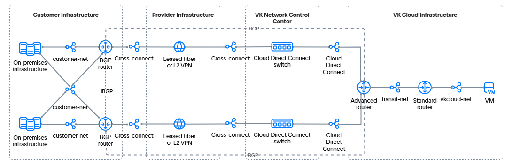

# {heading(Connection to {var(cloud)} via two Cloud Direct Connect channels)[id=directconnect-dc-two-channels]}

{include(/en/_includes/_translated_by_ai_en.md)}

Cloud Direct Connect allows you to connect the networks of your on-premises infrastructure to the virtual networks of {var(cloud)}. The following will show how to create a connection using:

- two dedicated Cloud Direct Connect communication channels;
- an advanced router with dynamic routing via the [BGP](https://datatracker.ietf.org/doc/html/rfc1163) protocol;
- an additional standard router.

Two dedicated Cloud Direct Connect communication channels are laid with independent cables to two independent data centers of {var(cloud)} and form a fault-tolerant configuration.

The advanced router in this example is responsible for integration and provides communication with the remote infrastructure. The network hosting virtual machines is served by a standard router of {var(cloud)}.

The connection option under consideration involves the use of four virtual networks:

- two independent network interconnect networks (Cloud Direct Connect);
- a network for connecting the standard router to the advanced router (transit network);
- a network for hosting virtual machines.

The network connectivity scheme looks as follows:

{params[noBorder=true]}

{note:info}
{var(cloud)} allows you to configure different {linkto(../../../../networks/vnet/concepts/onpremise-connect#vnet-onpremise-connect)[text=connection options]} to the remote infrastructure. The choice of option depends on the project SDN, internet access from the remote infrastructure, and the fault tolerance requirements for the connection.
{/note}

## {heading(Preparation steps)[id=directconnect-dc-two-channels-prep]}

1. {linkto(../../../../tools-for-using-services/api/rest-api/enable-api#rest-api-enable-activate)[text=Activate API access]} if this has not been done yet.
1. Make sure that the OpenStack client is {linkto(../../../../tools-for-using-services/cli/openstack-cli#openstack-install)[text=installed]}, and {linkto(../../../../tools-for-using-services/cli/openstack-cli#openstack-authorize)[text=pass authentication]} in the project.
1. Make sure that the [curl](https://curl.se/docs) and [jq](https://jqlang.org) packages are installed on your computer.
1. Select or {linkto(../../../../networks/vnet/instructions/net#vnet-net-add)[text=create]} a network in your on-premises infrastructure. The network may not have internet access, but it must be connected to two routers that:

   - support connection via the BGP protocol;
   - (optionally) support the BFD protocol: this will reduce the routing recovery time in case of a failure;
   - can be a device or a virtual machine in the customer network;
   - communicate with each other using the iBGP protocol.

   Write down the following information:

   - the name and IP address of the subnet;
   - the name of the network where the subnet is located;
   - the IP address of a machine in the subnet that will be used to verify connectivity between networks;
   - the names of the BGP routers.

   For example, a network with two Router OS 7.10 (MikroTik) virtual machines acting as BGP routers will be used.

1. Select or {linkto(../../../../networks/vnet/instructions/net#vnet-net-add)[text=create]} a virtual network in your project in {var(cloud)}. The network must not be connected to a router.

   Write down the following information:

   - the name and IP address of the subnet;
   - the name of the network where the subnet is located.

1. {linkto(../../../../computing/iaas/instructions/vm/vm-create#iaas-vm-create)[text=Create a virtual machine]} in the selected network. Write down the IP address of the created VM.
1. {linkto(../../../../networks/vnet/instructions/net#vnet-net-add)[text=Create]} a transit virtual network in your project in {var(cloud)}. The network must not be connected to a router.
1. {linkto(../../../../networks/vnet/instructions/net#vnet-net-view)[text=Obtain the UUID]} of the transit network. In this example: `323d97cf-aaaa-bbbb-cccc-deaa6a11ab25`.
1. {linkto(../../../../networks/directconnect/connect#directconnect-connect)[text=Connect]} to the Cloud Direct Connect service if this has not been done yet.
1. Obtain the UUIDs of the connected Cloud Direct Connect network interconnect networks:

   1. In your [management console](https://msk.cloud.vk.ru/app/), go to **Virtual networks** → **Networks**.
   1. In the list of networks, find two interconnect networks with names like `external-vni-10XXX`. Here `XXX` is the individual sequence number of your connection.
   1. Save the UUIDs of these networks. In this example, the UUIDs of the interconnect networks are:
      - the first interconnect network `external-vni-10XX1`: `b2b8468e-aaaa-bbbb-cccc-327c8c2670d4`;
      - the second interconnect network `external-vni-10XX2`: `a2b8967e-aaaa-bbbb-cccc-327f9a2670e5`.
1. Make sure that all information necessary for further work has been collected. The following data is used as an example below:

   [cols="1,1,1,1,1", options="header"]
   |===
   |Object
   |Customer network
   |Virtual network
   |Transit network
   |Cloud Direct Connect network

   |Network
   |`customer-net`
   |`vkcloud-net`
   |`transit-net`, `323d97cf-aaaa-bbbb-cccc-deaa6a11ab25`
   |`external-vni-10XX1`, `b2b8468e-aaaa-bbbb-cccc-327c8c2670d4`
   `external-vni-10XX2`, `a2b8967e-aaaa-bbbb-cccc-327f9a2670e5`

   |Subnet
   |`customer-subnet`, `10.0.0.0/24`
   |`vkcloud-subnet`, `172.17.0.0/24`
   |
   |

   |Virtual machine
   |`client-vm`, `10.0.0.5`
   |`vkcloud-vm`, `172.17.0.8`
   |
   |

   |BGP router
   |`MikroTik`
   |
   |
   |
   |===

{note:info}
The example below considers an option in which subnets with a `/30` mask are used for the network interconnect and the transit network. You can also {linkto(../../../../networks/vnet/instructions/net#vnet-net-subnet-add)[text=create]} standard subnets with a `/24` mask.
{/note}

## {heading(1. Add subnets for Cloud Direct Connect)[id=directconnect-dc-two-channels-add-cdc-subnets]}

1. To the Cloud Direct Connect interconnect network `external-vni-10XX1`, add a {linkto(../../../../networks/vnet/how-to-guides/custom-subnet#vnet-custom-subnet)[text=subnet with a `/30` mask]}.
When adding environment variables, specify the parameters:

   - `N_CIDR="192.168.0.0/30"`;
   - `N_ID="<INTERCONNECT_NETWORK_1_UUID>"`.

   Write down the name and CIDR of the subnet.

   In this example, for the `external-vni-10XX1` network:

   - subnet name: `dc-subnet1`;
   - CIDR: `192.168.0.0/30`;
   - UUID: `b2b8468e-aaaa-bbbb-cccc-327c8c2670d4`.

1. To the Cloud Direct Connect interconnect network `external-vni-10XX2`, add a {linkto(../../../../networks/vnet/how-to-guides/custom-subnet#vnet-custom-subnet)[text=subnet with a `/30` mask]}.
When adding environment variables, specify the parameters:

   - `N_CIDR="192.168.1.0/30"`;
   - `N_ID="<INTERCONNECT_NETWORK_2_UUID>"`.

   Write down the name and CIDR of the subnet.

   In this example, for the `external-vni-10XX2` network:

   - subnet name: `dc-subnet2`;
   - CIDR: `192.168.1.0/30`;
   - UUID: `a2b8967e-aaaa-bbbb-cccc-327f9a2670e5`.

## {heading(2. Add a subnet for the transit network)[id=directconnect-dc-two-channels-add-transit-subnet]}

To the transit network, add a {linkto(../../../../networks/vnet/how-to-guides/custom-subnet#vnet-custom-subnet)[text=subnet with a `/30` mask]}.
When adding environment variables, specify the parameters:

- `N_CIDR="192.168.2.0/30"`;
- `N_ID="<TRANSIT_NETWORK_UUID>"`.

When creating the subnet via the API, pass the parameter `"gateway_ip": <GATEWAY_IP_ADDRESS_FOR_THE_STANDARD_ROUTER>`.
In a Cloud Direct Connect subnet, this parameter is set to `null`.

Write down the name and CIDR of the subnet. In this example: `transit-subnet`, `192.168.2.0/30`.

## {heading(3. Add a standard router)[id=directconnect-dc-two-channels-add-standart-router]}

{linkto(../../../../networks/vnet/instructions/router#vnet-router-add)[text=Create]} a standard router with the following parameters:

- **SDN**: `Sprut`. The field is displayed if both Sprut and Neutron SDNs are connected to the project.
- **Name**: in this example, `Standard router`.
- **Connection to external network**: the option is enabled.

## {heading(4. Add an advanced router)[id=directconnect-dc-two-channels-add-advanced-router]}

{linkto(../../../../networks/vnet/instructions/advanced-router/manage-advanced-routers#vnet-manage-advanced-routers-add)[text=Create]} an advanced router with the following parameters:

- **Name**: in this example, `Advanced router`.
- **SNAT**: the option is disabled.

## {heading(5. Configure the network interfaces of the advanced router)[id=directconnect-dc-two-channels-advanced-network-configure]}

1. {linkto(../../../../networks/vnet/instructions/advanced-router/manage-interfaces#vnet-manage-interfaces-add)[text=Add]} an interface of the advanced router directed to the virtual network:

   - **Name**: `transit-net-iface`;
   - **Subnet**: `transit-subnet`;
   - **Interface IP address**: `192.168.2.1`.

1. {linkto(../../../../networks/vnet/instructions/advanced-router/manage-interfaces#vnet-manage-interfaces-add)[text=Add]} an interface of the advanced router directed to the Cloud Direct Connect network `external-vni-10XX1`:

   - **Name**: `dc-iface1`;
   - **Subnet**: `dc-subnet1`;
   - **Interface IP address**: `192.168.0.1`.

1. {linkto(../../../../networks/vnet/instructions/advanced-router/manage-interfaces#vnet-manage-interfaces-add)[text=Add]} an interface of the advanced router directed to the Cloud Direct Connect network `external-vni-10XX1`:

   - **Name**: `dc-iface2`;
   - **Subnet**: `dc-subnet2`;
   - **Interface IP address**: `192.168.1.1`.

## {heading(6. Configure the network interfaces of the BGP routers in the customer network)[id=directconnect-dc-two-channels-client-network-configure]}

1. Add network interfaces for the first router:

   - One directed to the Cloud Direct Connect networks `dc-subnet1`. This interface will help establish connectivity between {var(cloud)} and the customer network.
   - One directed to the customer network where the BGP router is located. This interface is used to connect to resources within the network. The number of such interfaces depends on the network structure.

   In this example:

   - `192.168.0.2` — an interface to the `dc-subnet1` subnet;
   - `10.0.0.15` — an interface to the customer network towards the virtual machine `10.0.0.5`.

1. Configure the interfaces of the first router using DHCP.

1. Configure the system identifier (System ID).

1. Prepare a list of networks for BGP advertisement.

1. (Optional) If the router supports BFD, configure the BFD protocol.

   {cut(Configuration example for MikroTik)}

   1. To add network interfaces, connect to MikroTik via SSH and run the command:

      ```console
      /ip address add address=192.168.0.2/30 interface ether1
      /ip address add address=10.0.0.15/24 interface ether2
      ```

   1. Configure the interfaces using DHCP:

      ```console
      /ip dhcp-client
      add add-default-route=no interface=ether1
      add add-default-route=no interface=ether2
      ```

   1. Configure the system identifier (System ID):

      ```console
      /system identity
      set name=bgp-customer
      ```

   1. Prepare a list of networks for BGP advertisement:

      ```console
      /ip firewall address-list
      add address=10.0.0.0/24 list=bgp_networks
      ```

   1. Configure the BFD protocol:

      ```console
      /routing bfd configuration
      add disabled=no interfaces=ether1
      ```

   {/cut}

1. Add network interfaces for the second router:

   - One directed to the Cloud Direct Connect networks `dc-subnet2`. This interface will help establish connectivity between {var(cloud)} and the customer network.
   - One directed to the customer network where the BGP router is located. This interface is used to connect to resources within the network. The number of such interfaces depends on the network structure.

   In this example:

   - `192.168.1.2` — an interface to the `dc-subnet2` subnet;
   - `10.0.0.16` — an interface to the customer network towards the virtual machine `10.0.0.5`.

1. Configure the interfaces of the second router using DHCP.

1. Configure the system identifier (System ID).

1. Prepare a list of networks for BGP advertisement.

1. (Optional) If the router supports BFD, configure the BFD protocol.

   {cut(Configuration example for MikroTik)}

   1. To add network interfaces, connect to MikroTik via SSH and run the command:

      ```console
      /ip address add address=192.168.1.2/30 interface ether1
      /ip address add address=10.0.0.16/24 interface ether2
      ```

   1. Configure the interfaces using DHCP:

      ```console
      /ip dhcp-client
      add add-default-route=no interface=ether1
      add add-default-route=no interface=ether2
      ```

   1. Configure the system identifier (System ID):

      ```console
      /system identity
      set name=bgp-customer
      ```

   1. Prepare a list of networks for BGP advertisement:

      ```console
      /ip firewall address-list
      add address=10.0.0.0/24 list=bgp_networks
      ```

   1. Configure the BFD protocol:

      ```console
      /routing bfd configuration
      add disabled=no interfaces=ether1
      ```

   {/cut}

## {heading(7. Connect the transit network to the standard router)[id=directconnect-dc-two-channels-connect-transit-network]}

1. In your [management console](https://msk.cloud.vk.ru/app), go to **Virtual networks** → **Networks**.
1. Click the name of the transit network `transit-net` and go to the **Network configuration** tab.
1. Select the standard router `Standard router`.
1. Enable the **Internet access** option.
1. Click the **Save changes** button.
1. Verify the gateway registration for the subnet:

   1. In your [management console](https://msk.cloud.vk.ru/app), go to **Virtual networks** → **Networks**.
   1. Click the name of the transit network `transit-net`, then the name of the subnet `transit-subnet`, and go to the **Ports** tab.
   1. Make sure that the port with the gateway IP address is registered in the subnet and has the **Connected** status.

## {heading(8. Configure eBGP peering for the advanced router via the first interconnect network)[id=directconnect-dc-two-channels-ebgp-advanced-first]}

To establish communication via the BGP protocol, you need to add dynamic routes and specify BGP neighbors. To configure dynamic routing, use private autonomous system numbers (ASN) from the `64512`–`65534` range. The ASN numbers on the routers in {var(cloud)} and on the remote infrastructure side must differ. The example will use the following numbers:

- `65512` for the `customer-net` network;
- `64512` for the `vkcloud-net` network.

To configure dynamic routes on the advanced router via the `external-vni-10XX1` interconnect network:

1. In your [management console](https://msk.cloud.vk.ru/app/), go to **Virtual networks** → **Routers**.
1. Open the added advanced router and go to the **Dynamic routing** tab.
1. Click the **Create BGP router** button.
1. Specify the BGP router parameters:

   - **Name**: `to-MikroTik1`;
   - **Router ID**: `192.168.0.1`;
   - **ASN**: `64512`.

1. Click the **Create** button.
1. Open the added BGP router and go to the **BGP neighbors** tab.
1. Add a BGP neighbor. Specify the parameters:

   - **Name**: `MikroTik1`;
   - **Remote neighbor**: `192.168.0.2`;
   - **Remote ASN**: `65512`.

1. Click the **Create** button.

Make sure that the router has established a connection with the neighbor: the marker next to the name is green. If you use BFD, make sure that the BFD marker is also green.

The advanced router will start sending BGP advertisements to its neighbor immediately after successful BGP peering negotiation. Go to the **BGP advertisements** tab and make sure that the router sends advertisements for all networks to which its interfaces are directed:

- `172.17.0.0/24`;
- `192.168.0.0/30`;
- `192.168.2.0/30`.

All advertisements must have green markers.

## {heading(9. Configure eBGP peering for the advanced router via the second interconnect network)[id=directconnect-dc-two-channels-ebgp-advanced-second]}

To establish communication via the BGP protocol, you need to add dynamic routes and specify BGP neighbors. To configure dynamic routing, use private autonomous system numbers (ASN) from the `64512`–`65534` range. The ASN numbers on the routers in {var(cloud)} and on the remote infrastructure side must differ. The example will use the following numbers:

- `65512` for the `customer-net` network;
- `64512` for the `vkcloud-net` network.

To configure dynamic routes on the advanced router via the `external-vni-10XX2` interconnect network:

1. In your [management console](https://msk.cloud.vk.ru/app/), go to **Virtual networks** → **Routers**.
1. Open the added advanced router and go to the **Dynamic routing** tab.
1. Click the **Create BGP router** button.
1. Specify the BGP router parameters:

   - **Name**: `to-MikroTik2`;
   - **Router ID**: `192.168.1.1`;
   - **ASN**: `64512`.

1. Click the **Create** button.
1. Open the added BGP router and go to the **BGP neighbors** tab.
1. Add a BGP neighbor. Specify the parameters:

   - **Name**: `MikroTik`;
   - **Remote neighbor**: `192.168.1.2`;
   - **Remote ASN**: `65512`.

1. Click the **Create** button.

Make sure that the router has established a connection with the neighbor: the marker next to the name is green. If you use BFD, make sure that the BFD marker is also green.

The advanced router will start sending BGP advertisements to its neighbor immediately after successful BGP peering negotiation. Go to the **BGP advertisements** tab and make sure that the router sends advertisements for all networks to which its interfaces are directed:

- `172.17.0.0/24`;
- `192.168.1.0/30`;
- `192.168.2.0/30`.

All advertisements must have green markers.

## {heading(10. Configure BGP peering for the customer network router via the first interconnect network)[id=directconnect-dc-two-channels-bgp-client-first]}

1. Connect to the router in your local network.
1. Specify the parameters for connecting via the BGP protocol through the `external-vni-10XX1` network:

   - Local network ASN: `65512`;
   - Router ID: `192.168.0.2`;
   - External network ASN: `64512`;
   - BGP neighbor ID: `192.168.0.1`;
   - Use BFD.

1. (Optional) Verify that a BFD protocol session has been established.
1. Verify that a session with the BGP neighbor has been established. If the BGP connection is established, the response should contain non-zero `keepalive-time` and `uptime` values.
1. View all available BGP routes. The route list should include the `172.17.0.0/24` and `192.168.0.0/30` networks.

{cut(MikroTik configuration example)}

1. Connect to MikroTik via SSH and run the command:

    ```console
    /routing bgp connection
    add address-families=ip as=65512 local.address=192.168.0.2 .role=ebgp name=bgp-customer output.network=bgp_networks remote.address=192.168.0.1 .as=64512 router-id=192.168.0.2 use-bfd=yes
    ```
1. Verify that a BFD protocol session has been established. Run the command:

   ```console
   /routing bfd session print
   ```

   Example response:

   ```console
      Flags: U - up, I - inactive 
   0 U multihop=no vrf=main remote-address=192.168.0.1%ether1 local-address=192.168.0.2 state=up state-changes=1 uptime=3h27m12s desired-tx-interval=200ms actual-tx-interval=100ms 
     required-min-rx=200ms remote-min-rx=10ms multiplier=5 hold-time=1s packets-rx=75343 packets-tx=72203
   ```

1. Verify that a session with the BGP neighbor has been established on the MikroTik side. Run the command:

   ```console
   /routing bgp session print
   ```

   Example response:

   ```console
      Flags: E - established
   0 E name="tw-bgp-mikrotik-1"
        remote.address=192.168.0.1 .as=64512 .id=192.168.0.1 .capabilities=mp,rr,gr,as4,ap,err,llgr .hold-time=4m
       .messages=5 .bytes=131 .gr-time=120 .eor=ip
      local.address=192.168.0.2 .as=65512 .id=192.168.0.2 .capabilities=mp,rr,gr,as4 .messages=4 .bytes=105 .eor=""
        output.procid=20 .network=bgp_networks
       input.procid=20 ebgp
      hold-time=3m keepalive-time=1m uptime=2m51s380ms last-started=aug/28/2023 07:27:15
   ```
1. Run the command to view all MikroTik routes:

   ```console
   /ip route print where bgp
   ```

   Example response:

   ```console
   Flags: D - DYNAMIC; A - ACTIVE; b, y - BGP-MPLS-VPN
   Columns: DST-ADDRESS, GATEWAY, DISTANCE
       DST-ADDRESS    GATEWAY       DISTANCE
   DAb 172.17.0.0/24  192.168.0.1        20
   D b 192.168.0.0/30 192.168.0.1        20
   ```

{/cut}

## {heading(11. Configure BGP peering for the customer network router via the second interconnect network)[id=directconnect-dc-two-channels-bgp-client-second]}

1. Connect to the router in your local network.
1. Specify the parameters for connecting via the BGP protocol through the `external-vni-10XX2` network:

   - Local network ASN: `65512`;
   - Router ID: `192.168.1.2`;
   - External network ASN: `64512`;
   - BGP neighbor ID: `192.168.1.1`;
   - Use BFD.

1. (Optional) Verify that a BFD protocol session has been established.
1. Verify that a session with the BGP neighbor has been established. If the BGP connection is established, the response should contain non-zero `keepalive-time` and `uptime` values.
1. View all available BGP routes. The route list should include the `172.17.0.0/24` and `192.168.0.0/30` networks.

{cut(MikroTik configuration example)}

1. Connect to MikroTik via SSH and run the command:

    ```console
    /routing bgp connection
    add address-families=ip as=65512 local.address=192.168.1.2 .role=ebgp name=bgp-customer output.network=bgp_networks remote.address=192.168.1.1 .as=64512 router-id=192.168.1.2 use-bfd=yes
    ```

1. Verify that a BFD protocol session has been established. Run the command:

   ```console
   /routing bfd session print
   ```

   Example response:

   ```console
      Flags: U - up, I - inactive 
   0 U multihop=no vrf=main remote-address=192.168.1.1%ether1 local-address=192.168.1.2 state=up state-changes=1 uptime=3h27m12s desired-tx-interval=200ms actual-tx-interval=100ms 
     required-min-rx=200ms remote-min-rx=10ms multiplier=5 hold-time=1s packets-rx=75343 packets-tx=72203
   ```

1. Verify that a session with the BGP neighbor has been established on the MikroTik side. Run the command:

   ```console
   /routing bgp session print
   ```

   Example response:

   ```console
      Flags: E - established
   0 E name="tw-bgp-mikrotik-1"
        remote.address=192.168.1.1 .as=64512 .id=192.168.1.1 .capabilities=mp,rr,gr,as4,ap,err,llgr .hold-time=4m
       .messages=5 .bytes=131 .gr-time=120 .eor=ip
      local.address=192.168.1.2 .as=65512 .id=192.168.1.2 .capabilities=mp,rr,gr,as4 .messages=4 .bytes=105 .eor=""
        output.procid=20 .network=bgp_networks
       input.procid=20 ebgp
      hold-time=3m keepalive-time=1m uptime=2m51s380ms last-started=aug/28/2023 07:27:15
   ```

1. Run the command to view all MikroTik routes:

   ```console
   /ip route print where bgp
   ```

   Example response:

   ```console
   Flags: D - DYNAMIC; A - ACTIVE; b, y - BGP-MPLS-VPN
   Columns: DST-ADDRESS, GATEWAY, DISTANCE
       DST-ADDRESS    GATEWAY       DISTANCE
   DAb 172.17.0.0/24  192.168.1.1        20
   D b 192.168.1.0/30 192.168.1.1        20
   ```

{/cut}

## {heading(12. Configure static routes to the customer network on the standard router)[id=directconnect-dc-two-channels-standart-static-routs]}

1. In the [personal dashboard](https://msk.cloud.vk.ru/app/), go to the **Virtual networks** → **Routers** section.
1. Click the name of the standard router `Standard router` and go to the **Static routes** tab.
1. Click the **Add static route** button.
1. Specify the destination network: the address prefix of the customer network, in this example `10.0.0.0/24`.
1. Specify the next hop (Next HOP): the IP address of the advanced router.
1. Click the **Add route** button.

## {heading(13. Configure static routes to the VM network on the advanced router)[id=directconnect-dc-two-channels-advanced-static-routs]}

1. In the [personal dashboard](https://msk.cloud.vk.ru/app/), go to the **Virtual networks** → **Routers** section.
1. Click the name of the advanced router `Advanced router` and go to the **Static routes** tab.
1. Click the **Add static route** button.
1. Specify the destination network: the address prefix of the VM network, in this example `172.17.0.0/24`.
1. Specify the next hop (Next HOP): the IP address of the standard router.
1. Click the **Add** button.

## {heading(14. Add a static route to the VM network to the BGP announcement)[id=directconnect-dc-two-channels-bgp-static-route]}

1. In the [personal dashboard](https://msk.cloud.vk.ru/app/), go to the **Virtual networks** → **Routers** section.
1. Click the name of the advanced router `Advanced router` and go to the **Dynamic routing** tab.
1. Click the previously created BGP configuration and go to the **BGP announcements** tab.
1. Click the **Add new announcement** button.
1. Specify the parameters:

    - **Announcement type**: static.
    - **Destination network**: the address prefix of the VM network, in this example `172.17.0.0/24`.
    - **Default gateway**: the IP address of the standard router.
1. Click the **Add** button.
1. Reboot the machines `172.17.0.8` and `10.0.0.5` so that the routes are added to their routing tables.

## {heading(15. Verify that everything works)[id=directconnect-dc-two-channels-check]}

Send a `ping` or `traceroute` from one network to a machine in the connected network. If a response arrives from the other network, the network connectivity has been configured correctly.

For example, ping the machine `10.0.0.5` in the customer network from the machine `172.17.0.8` in the virtual network:

1. Open a terminal session to the VM `vkcloud-vm`.
1. Ping the internal IP address of the machine in the customer network:

   ```console
   ping 10.0.0.5
   ```

The IP address should respond to the ping.

## {heading(Delete unused resources)[id=directconnect-dc-two-channels-delete]}

If you no longer need the created resources, delete them:

1. {linkto(../../../../computing/iaas/instructions/vm/vm-manage#iaas-vm-manage-delete)[text=Delete]} the virtual machine.
1. {linkto(../../../../networks/vnet/instructions/router#vnet-router-delete)[text=Delete]} the routers.
1. Delete the {linkto(../../../../networks/vnet/instructions/net#vnet-net-subnet-delete)[text=subnets]} and {linkto(../../../../networks/vnet/instructions/net#vnet-net-delete)[text=networks]}: the transit network and the network for hosting virtual machines.