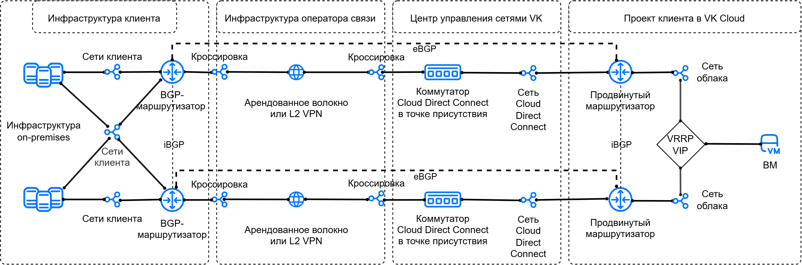
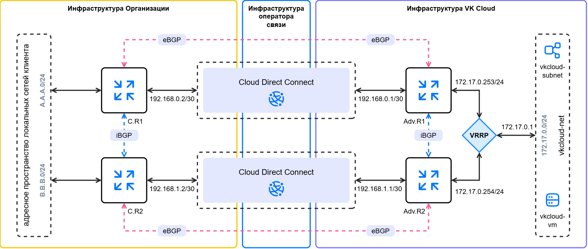

# {heading(Connection to {var(cloud)} via Cloud Direct Connect in a fault-tolerant VRRP configuration)[id=directconnect-dc-vrrp]}

{include(/en/_includes/_translated_by_ai_en.md)}

{note:info}
{var(cloud)} allows you to configure different {linkto(../../../vnet/concepts/onpremise-connect#vnet-onpremise-connect)[text=connection options]} to remote infrastructure. The choice of option depends on the project SDN, internet access from the remote infrastructure, and the connection fault tolerance requirements.
{/note}

Cloud Direct Connect allows you to establish a connection between {var(cloud)} virtual networks and external network infrastructure (for example, your local networks) using a fault-tolerant L3 connection based on the VRRP protocol. For this purpose, a virtual IP address of the network gateway is used (VRRP VIP). If the active router fails, traffic directed to the VRRP VIP is switched to the backup router.

Fault tolerance of the L2 connection is ensured by physically duplicating the communication channel in two independent points of presence.

When organizing a Cloud Direct Connect connection with VRRP, the following are used:

- two dedicated Cloud Direct Connect communication channels;
- two advanced routers with dynamic routing via the [BGP](https://datatracker.ietf.org/doc/html/rfc1163) protocol;
- the VRRP protocol for creating a virtual IP address to serve as the gateway in the cloud network.

Advanced routers in this configuration are responsible for integration and provide communication with the remote infrastructure, as well as serve the network where virtual machines are hosted.

The connection option under consideration involves the use of three virtual networks:

- two independent network junction networks (Cloud Direct Connect);
- the cloud network where virtual machines are hosted and the virtual gateway IP address is formed.

This option assumes that each of the network junction networks is brought to its own advanced router individually and has the following features:

- exchange of address prefixes between the remote infrastructure and the cloud is performed using the eBGP protocol;
- exchange of address prefixes between advanced routers is performed using the iBGP protocol.

All together, this makes it possible to build a reliable fault-tolerant network integration of the cloud with external infrastructure.

The network connectivity scheme looks as follows:

{params[noBorder=true]}

## {heading(Preparation steps)[id=directconnect-dc-vrrp-prep]}

1. {linkto(../../../../networks/directconnect/connect#directconnect-connect)[text=Connect]} to the Cloud Direct Connect service if you have not done so already.
1. {linkto(../../../../tools-for-using-services/api/rest-api/enable-api#rest-api-enable-activate)[text=Activate API access]} if you have not done so already.
1. Make sure the OpenStack client is {linkto(../../../../tools-for-using-services/cli/openstack-cli#openstack-install)[text=installed]}, and {linkto(../../../../tools-for-using-services/cli/openstack-cli#openstack-authorize)[text=authenticate]} in the project.
1. Make sure the [curl](https://curl.se/docs) and [jq](https://jqlang.org) packages are installed on your computer.
1. Find out the UUIDs of the connected Cloud Direct Connect network junction networks:

    1. In the [management console](https://msk.cloud.vk.com/app/), go to the **Virtual networks** → **Networks** section.
    1. In the list of networks, find two network junction networks with names like `external-vni-10XXX`. Here `XXX` is the individual sequential number of your connection.
    1. Save the UUIDs of these networks. In this example, the UUIDs of the network junction networks are:
        - the first junction network `external-vni-10XX1` — `b2b8468e-aaaa-bbbb-cccc-327c8c2670d4`;
        - the second junction network `external-vni-10XX2`— `a2b8967e-aaaa-bbbb-cccc-327f9a2670e5`.
1. Determine the address prefixes (CIDRs) of the subnets in the local infrastructure that will be announced to the cloud using BGP routing.
1. Make sure that the routers of the local infrastructure connected to the Cloud Direct Connect service:

    - are aware of the previously defined address prefixes and can announce them toward the cloud using BGP routing;
    - interact with each other using the iBGP protocol;
    - (optional) support the BFD protocol: this will reduce the routing recovery time in case of a failure.

1. Write down the IP address of the machine in the local infrastructure that will be used to verify connectivity between the networks.

1. Select or {linkto(../../../../networks/vnet/instructions/net#vnet-net-add)[text=create]} a virtual network in your project in {var(cloud)}. The network must not be connected to a router.

    Write down the following information:

    - The subnet name and CIDR.
    - The IP address that is defined as the default gateway, for example `172.17.0.1`. This address will be used when {linkto(#directconnect-dc-vrrp-set-vrrp)[text=configuring VRRP]}.
    - The name of the network where the subnet resides.

1. {linkto(../../../../computing/iaas/instructions/vm/vm-create#iaas-vm-create)[text=Create]} a virtual machine in the selected network. Write down the IP address assigned to it.
1. Make sure all the information required for further work has been collected. In the following steps, the example uses the following data:

   [cols="1,1,1", options="header"]
   |===
   |Object
   |Cloud network
   |Cloud Direct Connect network

   |Network
   |`vkcloud-net`
   |- `external-vni-10XX1`, `b2b8468e-aaaa-bbbb-cccc-327c8c2670d4`;
- `external-vni-10XX2`, `a2b8967e-aaaa-bbbb-cccc-327f9a2670e5`

   |Subnet
   |`vkcloud-subnet`, `172.17.0.0/24`
   |

   |Virtual machine
   |`vkcloud-vm`, `172.17.0.8`
   |
   |===

{note:info}
In the example below, an option is considered in which subnets with a `/30` mask are used for the network junction. You can also {linkto(../../../vnet/instructions/net#vnet-net-subnet-add)[text=create]} standard subnets with a `/24` mask.
{/note}

After completing the steps described below, the resulting network connectivity scheme, taking addressing into account, should look as follows:

{params[noBorder=true]}

Here:

- `C.R1` (`ClientRouter1`) is the first BGP router in the local infrastructure;
- `C.R2` (`ClientRouter2`) is the second BGP router in the local infrastructure;
- `A.A.A.0/24` is the first announced CIDR from the address space of the local networks;
- `B.B.B.0/24` is the second announced CIDR from the address space of the local networks;
- `Adv.R1` (`AdvancedRouter1`) is the first advanced router in the cloud;
- `Adv.R2` (`AdvancedRouter2`) is the second advanced router in the cloud;
- `172.17.0.0/24` is the announced CIDR from the cloud.

## {heading({counter(dc-vrrp)}. Add subnets for Cloud Direct Connect)[id=directconnect-dc-vrrp-add-cdc-subnets]}

1. To the Cloud Direct Connect network junction network `external-vni-10XX1`, add a {linkto(../../../vnet/how-to-guides/custom-subnet#vnet-custom-subnet)[text=subnet with a `/30` mask]}.
When adding environment variables, specify the parameters:

    - `N_CIDR="192.168.0.0/30"`;
    - `N_ID="<UUID_СЕТЕВОГО_СТЫКА_1>"`.

    Write down the subnet name and CIDR.

    In this example, for the network `external-vni-10XX1`:

    - subnet name: `dc-subnet1`;
    - CIDR: `192.168.0.0/30`;
    - UUID: `b2b8468e-aaaa-bbbb-cccc-327c8c2670d4`.

1. To the Cloud Direct Connect network junction network `external-vni-10XX2`, add a {linkto(../../../vnet/how-to-guides/custom-subnet#vnet-custom-subnet)[text=subnet with a `/30` mask]}.
When adding environment variables, specify the parameters:

    - `N_CIDR="192.168.1.0/30"`;
    - `N_ID="<UUID_СЕТЕВОГО_СТЫКА_2>"`.

    Write down the subnet name and CIDR.

    In this example, for the network `external-vni-10XX2`:

    - subnet name: `dc-subnet2`;
    - CIDR: `192.168.1.0/30`;
    - UUID: `a2b8967e-aaaa-bbbb-cccc-327f9a2670e5`.

## {heading({counter(dc-vrrp)}. Add advanced routers)[id=directconnect-dc-vrrp-add-routers]}

1. {linkto(../../../vnet/instructions/advanced-router/manage-advanced-routers#vnet-manage-advanced-routers-add)[text=Create]} the first advanced router with the following parameters:

    - **Name**: in this example, `AdvancedRouter1`;
    - **SNAT**: the option is disabled.
1. {linkto(../../../vnet/instructions/advanced-router/manage-advanced-routers#vnet-manage-advanced-routers-add)[text=Create]} the second advanced router with the following parameters:

    - **Name**: in this example, `AdvancedRouter2`;
    - **SNAT**: the option is disabled.

## {heading({counter(dc-vrrp)}. Configure the network interfaces of the advanced routers)[id=directconnect-dc-vrrp-set-advanced-routers]}

1. {linkto(../../../vnet/instructions/advanced-router/manage-interfaces#vnet-manage-interfaces-add)[text=Add]} an interface of the first advanced router directed to the cloud network:

    - **Name**: `vkcloud-net-iface1`;
    - **Subnet**: `vkcloud-subnet`;
    - **Interface IP address**: `172.17.0.253`.
1. {linkto(../../../vnet/instructions/advanced-router/manage-interfaces#vnet-manage-interfaces-add)[text=Add]} an interface of the first advanced router directed to the Cloud Direct Connect network `external-vni-10XX1`:

    - **Name**: `dc-iface1`;
    - **Subnet**: `dc-subnet1`;
    - **Interface IP address**: `192.168.0.1`.
1. {linkto(../../../vnet/instructions/advanced-router/manage-interfaces#vnet-manage-interfaces-add)[text=Add]} an interface of the second advanced router directed to the cloud network:

    - **Name**: `vkcloud-net-iface2`;
    - **Subnet**: `vkcloud-subnet`;
    - **Interface IP address**: `172.17.0.254`.

1. {linkto(../../../vnet/instructions/advanced-router/manage-interfaces#vnet-manage-interfaces-add)[text=Add]} an interface of the second advanced router directed to the Cloud Direct Connect network `external-vni-10XX2`:

    - **Name**: `dc-iface2`;
    - **Subnet**: `dc-subnet2`;
    - **Interface IP address**: `192.168.1.1`.

## {heading({counter(dc-vrrp)}. Configure the network interfaces of the local network BGP routers)[id=directconnect-dc-vrrp-set-client-routers]}

1. Make sure the interfaces of the local infrastructure routers (`ClientRouter1`, `ClientRouter2`) connected to the Cloud Direct Connect service are active.
1. Configure static IP addressing on the routers using free IP addresses from the CIDRs of the Cloud Direct Connect networks.

   In this example:

    - `192.168.0.2` is the interface of the first router into the `dc-subnet1` subnet of the junction network `external-vni-10XX1`;
    - `192.168.1.2` is the interface of the second router into the `dc-subnet2` subnet of the junction network `external-vni-10XX2`;

1. (Optional) If the router supports BFD, configure the BFD protocol.

   {note:info}
   The {var(cloud)} virtual routers support the BFD protocol, which can be used on routers in the local infrastructure to speed up convergence.
   {/note}

## {heading({counter(dc-vrrp)}. Configure eBGP peering for the first advanced router via the first junction network)[id=directconnect-dc-vrrp-set-first-bgp]}

To establish a BGP connection, you need to add dynamic routes and specify BGP neighbors. To configure dynamic routing, use private autonomous system numbers (ASN) from the range `64512`–`65534`. The ASN numbers on the routers in {var(cloud)} and on the remote infrastructure side must be different. The example uses the following numbers:

- `65512` for the local infrastructure network;
- `64512` for the cloud network `vkcloud-net`.

To configure dynamic routes on the advanced router via the junction network `external-vni-10XX1`:

1. In the [management console](https://msk.cloud.vk.com/app/), go to the **Virtual networks** → **Routers** section.
1. Open the advanced router `AdvancedRouter1` and go to the **Dynamic routing** tab.
1. Click the **Create BGP router** button.
1. Specify the BGP router parameters:

    - **Name**: `to-ClientRouter1`;
    - **Router ID**: `192.168.0.1`;
    - **ASN**: `64512`.

1. Click the **Create** button.
1. Open the added BGP router and go to the **BGP neighbors** tab.
1. Add a BGP neighbor. Specify the parameters:

    - **Name**: `ClientRouter1`;
    - **Remote neighbor**: `192.168.0.2`;
    - **Remote ASN**: `65512`.

1. Click the **Create** button.
1. Make sure the router has established a connection with the neighbor: the marker next to the name is green. If you use BFD, make sure the BFD marker is also green.

    The advanced router will start sending BGP announcements to its neighbor immediately after successful BGP peering negotiation. Go to the **BGP announcements** tab and make sure the router sends announcements of all the networks its interfaces are directed to:

    - `172.17.0.0/24`;
    - `192.168.0.0/30`.

    All announcements must have green markers.

## {heading({counter(dc-vrrp)}. Configure eBGP peering for the second advanced router via the second junction network)[id=directconnect-dc-vrrp-set-second-bgp]}

To establish a BGP connection, you need to add dynamic routes and specify BGP neighbors. To configure dynamic routing, use private autonomous system numbers (ASN) from the range `64512`–`65534`. The ASN numbers on the routers in {var(cloud)} and on the remote infrastructure side must be different. The example uses the following numbers:

- `65512` for the local network;
- `64512` for the cloud network `vkcloud-net`.

To configure dynamic routes on the advanced router via the junction network `external-vni-10XX2`:

1. In the [management console](https://msk.cloud.vk.com/app/), go to the **Virtual networks** → **Routers** section.
1. Open the advanced router `AdvancedRouter2` and go to the **Dynamic routing** tab.
1. Click the **Create BGP router** button.
1. Specify the BGP router parameters:

    - **Name**: `to-ClientRouter2`;
    - **Router ID**: `192.168.1.1`;
    - **ASN**: `64512`.

1. Click the **Create** button.
1. Open the added BGP router and go to the **BGP neighbors** tab.
1. Add a BGP neighbor. Specify the parameters:

    - **Name**: `ClientRouter2`;
    - **Remote neighbor**: `192.168.1.2`;
    - **Remote ASN**: `65512`.

1. Click the **Create** button.
1. Make sure the router has established a connection with the neighbor: the marker next to the name is green. If you use BFD, make sure the BFD marker is also green.

    The advanced router will start sending BGP announcements to its neighbor immediately after successful BGP peering negotiation. Go to the **BGP announcements** tab and make sure the router sends announcements of all the networks its interfaces are directed to:

    - `172.17.0.0/24`;
    - `192.168.1.0/30`.

    All announcements must have green markers.

## {heading({counter(dc-vrrp)}. Configure BGP peering for the first local network router via the first junction network)[id=directconnect-dc-vrrp-set-third-bgp]}

1. Connect to the router in your local network.
1. Specify the parameters for connecting via the BGP protocol through the network `external-vni-10XX1`:

    - Local network ASN: `65512`.
    - (Optional) Router ID: `192.168.0.2`.

       {note:warn}
       The ID can be assigned only once.
       {/note}
    - External network ASN: `64512`.
    - BGP neighbor ID: `192.168.0.1`.
    - Use BFD — enable the option if you previously enabled it for the advanced routers of the cloud network. If the BFD protocol is used, make sure the BFD session is established.
1. Verify that a connection with the BGP neighbor has been established. If the BGP connection is established, the response should contain non-zero `keepalive-time` and `uptime` values.
1. View all available BGP routes. The route list should include the networks `172.17.0.0/24` and `192.168.0.0/30`.

## {heading({counter(dc-vrrp)}. Configure BGP peering for the second local network router via the second junction network)[id=directconnect-dc-vrrp-set-fourth-bgp]}

1. Connect to the router in your local network.
1. Specify the parameters for connecting via the BGP protocol through the network `external-vni-10XX2`:

    - Local network ASN: `65512`.
    - (Optional) Router ID: `192.168.1.2`.

       {note:warn}
       The ID can be assigned only once.
       {/note}
    - External network ASN: `64512`.
    - BGP neighbor ID: `192.168.1.1`.
    - Use BFD — enable the option if you previously enabled it for the advanced routers of the cloud network. If the BFD protocol is used, make sure the BFD session is established.
1. Verify that a connection with the BGP neighbor has been established. If the BGP connection is established, the response should contain non-zero `keepalive-time` and `uptime` values.
1. View all available BGP routes. The route list should include the networks `172.17.0.0/24` and `192.168.0.0/30`.

## {heading({counter(dc-vrrp)}. Configure iBGP peering between the advanced routers)[id=directconnect-dc-vrrp-set-bgp-advanced-routers]}

1. In the [management console](https://msk.cloud.vk.com/app/), go to the **Virtual networks** → **Routers** section.
1. Configure BGP peering for the first advanced router:

    1. Open the advanced router `AdvancedRouter1` and go to the **Dynamic routing** tab.
    1. Open the {linkto(#directconnect-dc-vrrp-set-first-bgp)[text=previously added]} BGP router and go to the **BGP neighbors** tab.
    1. Specify the parameters:
        - **Name**: a logical name that makes it easy to identify the BGP neighbor, in this example `to-AdvancedRouter2`;
        - **Remote neighbor**: the IP address of the BGP neighbor in {var(cloud)}, in this example `172.17.0.254`;
        - **Remote ASN**: the remote ASN number used on the router in {var(cloud)}, in this example `64512`.
    1. Click the **Create** button.
1.	Configure BGP peering for the second advanced router:

    1. Open the advanced router `AdvancedRouter2` and go to the **Dynamic routing** tab.
    1. Open the {linkto(#directconnect-dc-vrrp-set-second-bgp)[text=previously added]} BGP router and go to the **BGP neighbors** tab.
    1. Specify the parameters:
        - **Name**: a logical name that makes it easy to identify the BGP neighbor, in this example `to-AdvancedRouter1`;
        - **Remote neighbor**: the IP address of the BGP neighbor in {var(cloud)}, in this example `172.17.0.253`;
        - **Remote ASN**: the remote ASN number used on the router in {var(cloud)}, in this example `64512`.
    1. Click the **Create** button.

## {heading({counter(dc-vrrp)}. Configure the VRRP address)[id=directconnect-dc-vrrp-set-vrrp]}

1.	In the [management console](https://msk.cloud.vk.com/app/), go to the **Virtual Networks** → **Routers** section.
1.	Go to the **VRRP** tab and click the **Add VRRP group** button.
1.	Specify the VRRP group name. In this example: `vrrp-group`.
1.	Specify the subnet for which the virtual IP address will be created.
1.	(Optional) Change the suggested **Advertise timer** parameter — the interval at which the master sends VRRP advertisement packets.
1. (Optional) Add a description for the VRRP group.
1.	(Optional) Change the suggested **Group number** parameter.
1.	Enable the VRRP group using the toggle switch.
1.	Click the **Add** button.
1.	Click the name of the created VRRP group in the list and go to the **Interfaces** tab.
1. Add an interface for the first router:

    1. Click the **Add interface** button.
    1. Specify the name of the interface that belongs to the first router in the group.
    1. Specify the desired state: `Master` or `Slave`.
    1. (Optional) Change the priority value in the range from 0 to 255.
    1. (Optional) Change the **Preempt** option. When this option is enabled, the router with the highest priority will always become the master.
    1. Select the address of the interface that belongs to the first router from the list.
    1. Click the **Add** button.
1.	Add an interface for the second router in the same way.
1.	Go to the **IP addresses** tab and click the **Add virtual IP** button.
1.	(Optional) Specify the name of the virtual IP address.
1. Specify the IP address that will be used as the virtual IP address of the VRRP group. Use the IP address that was set as the default gateway when creating the subnet. In this example, `172.17.0.1`.

## {heading({counter(dc-vrrp)}. Verify operability)[id=directconnect-dc-vrrp-check]}

Send a `ping` or `traceroute` from one network to a machine in the connected network. If a response comes from the other network, the network connectivity setup was performed correctly.

For example, ping from the machine `172.17.0.8` in the virtual network to the machine `10.0.0.5` in the local network:

1. Open a terminal session with the VM `vkcloud-vm`.
1. Ping the internal IP address of the machine in the local network:

      ```console
      ping 10.0.0.5
      ```

The IP address should respond to the ping.

## {heading(Delete unused resources)[id=directconnect-dc-vrrp-delete]}

If you no longer need the created resources, delete them:

1. {linkto(../../../../computing/iaas/instructions/vm/vm-manage#iaas-vm-manage-delete)[text=Delete]} the virtual machine.
1. {linkto(../../../../networks/vnet/instructions/router#vnet-router-delete)[text=Delete]} the routers.
1. Delete the {linkto(../../../../networks/vnet/instructions/net#vnet-net-subnet-delete)[text=subnets]} and {linkto(../../../../networks/vnet/instructions/net#vnet-net-delete)[text=networks]}: the transit one and the one for hosting virtual machines.