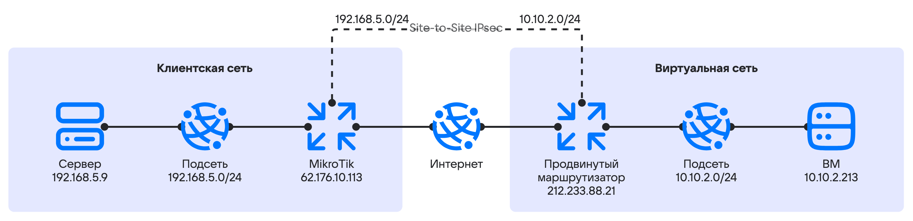

# {heading(Setting up a VPN tunnel using SDN Sprut)[id=vnet-site-to-site-vpn]}

{include(/en/_includes/_translated_by_ai_en.md)}

Using the {linkto(../../../../../networks/directconnect/how-to-guides/dc-advanced-router#vnet-dc-advanced-router)[text=advanced router]}, you can set up a VPN tunnel between your on-premises infrastructure network and the virtual networks of {var(cloud)}.

To demonstrate the advanced router configuration, two independent networks will be connected:

- Client network — the customer's internal network.
- Virtual network — located in {var(cloud)} and connected to the platform router.

To demonstrate the connection setup, the following will be created in the {var(cloud)} management console:

- the `vRouter01` advanced router;
- a router interface for internet access with the address `212.233.88.21`;
- the `priv_net_demo` private network;
- the `priv_subnet_demo` private subnet with the address `10.10.2.0/24`;
- a VM: `test-vm` with the address `10.10.2.213`;
- the `permit-remote-cidr-in` security group.

The client network will use:

- a MikroTik router running RouterOS 7.19.3;
- a server with Debian 12 OS;
- IKEv2 for IPsec configuration;
- a pre-shared key (PSK) for negotiating the IKE phase.

The network topology is as follows:

{params[noBorder=true]}

## {heading(Preparatory steps)[id=vnet-site-to-site-vpn-prep]}

1. Make sure the OpenStack CLI {linkto(../../../../../tools-for-using-services/cli/openstack-cli#openstack-install)[text=is installed]}, and {linkto(../../../../../tools-for-using-services/cli/openstack-cli#openstack-authorize)[text=authenticate]} in the project.
1. [Go to](https://cloud.vk.ru/app/) the {var(cloud)} management console.
1. Select the project.
1. {linkto(../../../../../networks/vnet/instructions/net#vnet-net-add)[text=Create]} a network with the following parameters:

   - **Network name**: `priv_net_demo`.
   - **SDN**: `Sprut`.
   - **Private DNS zone**: `mcs.local`.
   - **Router**: `Do not use`.
   - **List of subnets**: edit the only subnet in the list. Set the following parameters for the subnet:

     - **Name**: `priv_subnet_demo`.
     - **Address**: `10.10.2.0/24`.
     - **Gateway**: `10.10.2.1`.
     - **Enable DHCP**: make sure this option is selected.
     - **DHCP IP address pool**: `10.10.2.100 - 10.10.2.200`.
     - **Private DNS**: make sure this option is selected.

1. {linkto(../../../../../networks/vnet/instructions/advanced-router/manage-advanced-routers#vnet-manage-advanced-routers-add)[text=Create]} an advanced router with the following parameters:

   - **Router type**: `Advanced`.
   - **Name**: `vRouter01`.
   - **Availability zone**: `Москва ME1`.
   - **SNAT**: enable the option.

1. {linkto(../../../../../networks/vnet/instructions/advanced-router/manage-interfaces#vnet-manage-interfaces-add)[text=Add]} two interfaces to the created router:

   - for connecting to the private subnet;
   - for connecting to the subnet with internet access.

   When creating the interface for connecting to the private subnet, set the following parameters:

   - **Name**: `internal`.
   - **Subnet**: `priv_subnet_demo`.
   - **Specify interface IP address**: enable the option.
   - **Interface IP address**: `10.10.2.1`.

1. {linkto(../../../../../computing/iaas/instructions/vm/vm-create#iaas-vm-create)[text=Create]} a virtual machine with the following parameters:

   - **VM name**: `test-vm`.
   - **Network**: `priv_net_demo`.
   
   Note the internal IP address of the virtual machine. The example will use `10.10.2.213`.

1. {linkto(../../../../../networks/vnet/instructions/secgroups#vnet-secgroups-add)[text=Create]} the `permit-remote-cidr-in` security group.

1. In the `permit-remote-cidr-in` security group, {linkto(../../../../../networks/vnet/instructions/secgroups#vnet-secgroups-add-rule)[text=add]} a rule for incoming traffic with the following parameters:

   - **Type**: `All protocols and all ports`.
   - In the **Remote address** block, go to the **IP address range** tab and specify the CIDR of the private subnet: `192.168.5.0/24`.

1. {linkto(../../../../../networks/vnet/instructions/secgroups#vnet-secgroups-instance-add-sg)[text=Apply]} the `permit-remote-cidr-in` security group to the `test-vm` VM.

## {heading(1. Configure the VPN tunnel on the cloud network side)[id=vnet-site-to-site-vpn-cloud-network-tunnel]}

1. Go to **Virtual networks** → **VPN**.
1. Click the **Add VPN** or **Add** button.
1. Specify the VPN parameters:

   - **SDN**: `Sprut`.
   - **IKE policy**: create an IKE policy with the parameters:

     - **Policy name**: `Demo_IKEv2_Policy`.
     - **Key lifetime**: `28800`.
     - **Authentication algorithm**: `sha256`.
     - **Encryption algorithm**: `aes-256`.
     - **IKE version**: `v2`.
     - **Diffie-Hellman group**: `group14`.

1. Click the **Next step** button.

1. Configure the IPsec policy:

   - **Policy name**: `Demo_IPSec_Policy`.
   - **Key lifetime**: `7200`.
   - **Authentication algorithm**: `sha256`.
   - **Encryption algorithm**: `aes-256`.
   - **Diffie-Hellman group**: `group14`.

1. Configure the endpoint groups:

   - **Router**: `vRouter01`.
   - **Local Endpoint**: create a local endpoint group with the parameters:

     - **Name**: `my_local_demo_endpoint`.
     - **Subnet address**: `10.10.2.0/24`.

   - **Remote Endpoint**: create a remote endpoint group with the parameters:

     - **Group name**: `my_remote_demo_endpoint`.
     - **Subnet address**: `192.168.5.0/24`.

1. Click the **Next step** button.

1. Configure the VPN tunnel:

   - **Settings**: `Advanced`.
   - **Tunnel name**: `demo_tun`.
   - **Peer public IPv4 address (Peer IP)**: `62.176.10.113`.
   - **Pre-shared key (PSK)**: generate the key by clicking the corresponding button. Write down the key value for configuring the client network side.
   - **Peer router identifier for authentication (Peer ID)**: `62.176.10.113`.
   - **Traffic flow selector**: `Split`.
   - **Initiator state**: `bi-directional`
   - Dead Peer Detection (DPD) settings:

     - **Action on dead peer detection**: `restart`.
     - **Dead peer detection interval**: `15`.
     - **Time to detect a dead peer**: `60`.

1. Click the **Create VPN tunnel** button.

## {heading(2. Configure the VPN tunnel on the client network side)[id=vnet-site-to-site-vpn-client-network-tunnel]}

Configure the MikroTik equipment using WinBox 4 or the CLI.

1. Prepare the IPSec Profile:

   {tabs}

   {tab(WinBox)}

   1. Go to **IP** → **IPsec**.
   1. Go to the **Profile** tab.
   1. Click the **New** button.
   1. Specify the parameter values:

      - **Name**: `vk-dc-prof`.
      - **Hash Algorithms**: `sha256`.
      - **PRF Algorithms**: `auto`.
      - **Encryption Algorithms**: `aes-256`.
      - **DH Group**: `modp2048`.
      - **Proposal Check**: `obey`.
      - **Lifetime**: `28800`.
      - **NAT Traversal**: enable the option.
      - **DPD Interval**: `15`.
      - **DPD Maximum Failures**: `4`.

   1. Click the **OK** button.

   {/tab}

   {tab(CLI)}

   Run the command:

   ```console
   /ip ipsec profile
   add dh-group=modp2048 enc-algorithm=aes-256 hash-algorithm=sha256 lifetime=8h name=vk-dc-prof
   ```

   {note:info}Some parameters use default values. They are not specified in the command line.{/note}

   {/tab}

   {/tabs}

1. Prepare the IPSec Proposal:

   {tabs}

   {tab(WinBox)}

   1. Go to **IP** → **IPsec**.
   1. Go to the **Proposal** tab.
   1. Click the **New** button.
   1. Specify the parameter values:

      - **Name**: `vk-dc-prof`.
      - **Hash Algorithms**: `sha256`.
      - **Encryption Algorithms**: `aes-256-cbc`.
      - **Lifetime**: `7200`.
      - **PFS Group**: `modp2048`.

   1. Click the **OK** button.

   {/tab}

   {tab(CLI)}

   Run the command:

   ```console
   /ip ipsec proposal
   add auth-algorithms=sha256 enc-algorithms=aes-256-cbc lifetime=2h name=vk-dc-prop pfs-group=modp2048
   ```

   {note:info}Some parameters use default values. They are not specified in the command line.{/note}

   {/tab}

   {/tabs}

1. Configure the IPsec Peer:

   {tabs}

   {tab(WinBox)}

   1. Go to **IP** → **IPsec**.
   1. Go to the **Peer** tab.
   1. Click the **New** button.
   1. Specify the parameter values:

      - **Enabled**: enable the option.
      - **Name**: `vk-dc-peer`.
      - **Address**: `212.233.88.21`.
      - **Local address**: `62.176.10.113`.
      - **Profile**: `vk-dc-prof` (created earlier).
      - **Exchange mode**: `IKE2`
      - **Send INITAL_CONTRACT**: enable the option.

   1. Click the **OK** button.

   {/tab}

   {tab(CLI)}

   Run the command:

   ```console
   /ip ipsec peer
   add address=212.233.88.21/32 exchange-mode=ike2 local-address=62.176.10.113 name=vk-dc-peer profile=vk-dc-prof
   ```

   {/tab}

   {/tabs}

1. Configure the IPsec Identity:

   {tabs}

   {tab(WinBox)}

   1. Go to **IP** → **IPsec**.
   1. Go to the **Identities** tab.
   1. Click the **New** button.
   1. Specify the parameter values:

      - **Enabled**: enable the option.
      - **Peer**: `vk-dc-peer`.
      - **Auth. Method**: `pre shared key`.
      - **Secret**: specify the value of the **Pre-shared key (PSK)** parameter set when configuring the VPN tunnel on the cloud network side.

   1. Click the **OK** button.

   {/tab}

   {tab(CLI)}

   Run the command:

   ```console
   /ip ipsec identity
   add peer=vk-dc-peer secret=<PSK>
   ```
   
   Here `<PSK>` is the value of the **Pre-shared key (PSK)** parameter set when configuring the VPN tunnel on the cloud network side.

   {/tab}

   {/tabs}

1. Prepare the IPSec Policy:

   {tabs}

   {tab(WinBox)}

   1. Go to **IP** → **IPsec**.
   1. Go to the **Policy** tab.
   1. Click the **New** button.
   1. On the **General** tab, specify the parameter values:

      - **Enabled**: enable the option.
      - **Peer**: `vk-dc-peer`.
      - **Src. Address**: `192.168.5.0.24`.
      - **Dst. Address**: `10.10.2.0/24`.

   1. Go to the **Action** tab and specify the parameter values:

      - **Action**: `encrypt`.
      - **Level**: `require`.
      - **IPsec Protocol**: `esp`.
      - **Proposal**: `vk-dc-prop`.

   1. Click the **OK** button.

   {/tab}

   {tab(CLI)}

   Run the command:

   ```console
   /ip ipsec policy
   add dst-address=10.10.2.0/24 peer=vk-dc-peer proposal=vk-dc-prop src-address=192.168.5.0/24 tunnel=yes
   ```
   
   {/tab}

   {/tabs}

1. Configure the exceptions:

   1. Configure the NAT exceptions.

      NAT translation exceptions must be placed above the SNAT rule for routing traffic to the internet (rules such as `action = masquerade` and `action = src-nat to address`).
   
      Run the command:

      ```console
      /ip firewall nat
      add action=accept chain=srcnat comment=srcnat_fix_for_vk_dc_router dst-address=10.10.2.0/24 src-address=192.168.5.0/24
      ```

   1. Configure the Firewall allow rule in the Forward chain to allow traffic to pass from the {var(cloud)} network to the local network through the IPsec VPN tunnel.

      The allow rule must be placed above the rule that blocks unknown traffic arriving at the interface.

      Run the command:

      ```console
      /ip firewall filter
      add action=accept chain=forward src-address=10.10.2.0/24 dst-address=192.168.5.0/24 ipsec-policy=in,ipsec in-interface=ether1
      ```

      Here `ether1` is the name of the MikroTik physical interface (port) connected to the internet.

   1. Configure the Mangle rules for MSS Window optimization:

      ```console
      /ip firewall mangle
      add action=change-mss chain=forward dst-address=192.168.5.0/24 new-mss=1360 protocol=tcp src-address=10.10.2.0/24 tcp-flags=syn tcp-mss=!0-1360
      add action=change-mss chain=forward dst-address=10.10.2.0/24 new-mss=1360 protocol=tcp src-address=192.168.5.0/24 tcp-flags=syn tcp-mss=!0-1360
      ```

## {heading(3. Check the VPN tunnel status)[id=vnet-site-to-site-vpn-check]}

1. Check the status on the cloud network side:

   1. List the VPN services in the project:

      ```console
      openstack vpn service list
      ```

      {cut(Example of command output)}
      ```console
      +--------------------------------------+------+--------------------------------------+--------+--------+-------+--------+
      | ID                                   | Name | Router                               | Subnet | Flavor | State | Status |
      +--------------------------------------+------+--------------------------------------+--------+--------+-------+--------+
      | 7a60f4c3-5684-43d8-b5d7-a0********** |      | 9556d397-97e7-4daf-8ee4-f9********** | None   |        | True  | ACTIVE |
      +--------------------------------------+------+--------------------------------------+--------+--------+-------+--------+
      ```
      {/cut}

   1. Display detailed information about the service:

      ```console
      openstack vpn service show 7a60f4c3-5684-43d8-b5d7-a0**********
      ```

      {cut(Example of command output)}
      ```console
      +--------------+--------------------------------------+
      | Field        | Value                                |
      +--------------+--------------------------------------+
      | Description  |                                      |
      | Ext v4 IP    | 212.233.88.21                        |
      | Ext v6 IP    | None                                 |
      | Flavor       |                                      |
      | ID           | 7a60f4c3-5684-43d8-b5d7-a0********** |
      | Name         |                                      |
      | Project      | 366fdd4249984226a023f1**********     |
      | Router       | 9556d397-97e7-4daf-8ee4-f9********** |
      | State        | True                                 |
      | Status       | ACTIVE                               |
      | Subnet       | None                                 |
      | created_at   | 2024-12-27T18:36:27                  |
      | interface_id | 6bcaacdb-54e0-452a-9f1a-3f********** |
      | sdn          | sprut                                |
      | updated_at   | 2024-12-27T18:36:27                  |
      +--------------+--------------------------------------+
      ```
      {/cut}

      The `Active` status means that the service is active and traffic can be transmitted between the remote sites.

1. Check the status on the client network side:

   {tabs}

   {tab(WinBox)}

   1. Go to **IP** → **IPsec**.
   1. Go to the **Policy** tab.
   1. Check the status of the configured policy: the **PH2 State** column should display `established`.

   {/tab}

   {tab(CLI)}

   Run the command:

   ```console
   ip ipsec policy print detail where peer=vk-dc-peer
   ```

   {cut(Example of command output)}
   ```console
   Flags: T - template; B - backup; X - disabled, D - dynamic, I - invalid, A - active; * - default
   0   A  peer=vk-dc-peer tunnel=yes src-address=192.168.5.0/24 src-port=any dst-address=10.10.2.0/24 dst-port=any protocol=all action=encrypt level=require ipsec-protocols=esp
   sa-src-address=62.176.10.113 sa-dst-address=212.233.88.21 proposal=vk-dc-prop ph2-count=1 ph2-state=established
   ```
   {/cut}

   {/tab}

   {/tabs}

1. Check connectivity between the `192.168.5.0/24` and `10.10.2.0/24` subnets using ICMP Ping:

   1. Open a terminal session on the VM or server in the client network with the address `192.168.5.9`.
   1. Ping the internal IP address of the machine in the cloud network `10.10.2.213`.

      ```console
      ping 10.10.2.213 -c 3
      ```

      {cut(Example of command output)}
      ```console
      PING 10.10.2.213 (10.10.2.213) 56(84) bytes of data.
      64 bytes from 10.10.2.213: icmp_seq=1 ttl=64 time=4.715 ms
      64 bytes from 10.10.2.213: icmp_seq=2 ttl=64 time=4.249 ms
      64 bytes from 10.10.2.213: icmp_seq=3 ttl=64 time=4.282 ms

      --- 10.10.2.213 ping statistics ---
      3 packets transmitted, 3 received, 0% packet loss, time 2026ms
      rtt min/avg/max/mdev = 4.249/4.415/4.715/0.212 ms
      ```
      {/cut}

      The IP address should respond to the ping.

{note:info}
If the connection is established and its status is `established`, but no traffic is transmitted between the nodes in the subnets:

- in the {var(cloud)} management console, check the NAT and security group settings;
- in the client network, check the settings of the physical or virtual equipment used to set up the IPsec VPN.
{/note}

## {heading(Delete unused resources)[id=vnet-site-to-site-vpn-delete]}

If you no longer need the created resources, delete them:

1. {linkto(../../../../../computing/iaas/instructions/vm/vm-manage#iaas-vm-manage-delete)[text=Delete]} the virtual machine.
1. {linkto(../../../../../networks/vnet/instructions/router#vnet-router-delete)[text=Delete]} the router.
1. Delete the {linkto(../../../../../networks/vnet/instructions/net#vnet-net-subnet-delete)[text=subnet]} and the {linkto(../../../../../networks/vnet/instructions/net#vnet-net-delete)[text=network]} in which the VM was located.