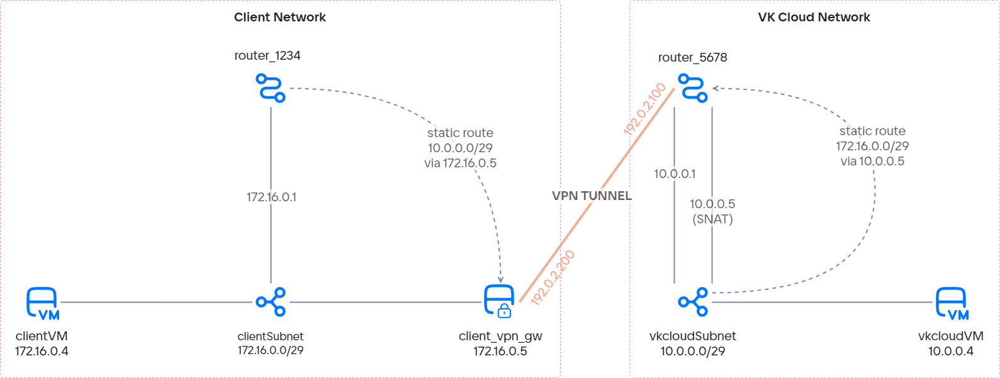

# {heading(Setting up a VPN tunnel using SDN Neutron)[id=vnet-vpn-tunnel]}

{include(/en/_includes/_translated_by_ai_en.md)}

{var(cloud)} allows you to establish network connectivity between on-premises infrastructure and a {var(cloud)} virtual network with {linkto(../../../../../networks/vnet/concepts/sdn#vnet-sdn-neutron)[text=SDN Neutron]} using a VPN tunnel.

As an example, a VPN tunnel will be built based on a standard router to another network in {var(cloud)}. A virtual machine will be used as the VPN endpoint. The instructions for setting up the VPN tunnel can be adapted to work with any other VPN endpoint, such as a corporate firewall or other network equipment.

The VPN tunnel in the example will connect the following networks:

- Client network — a network in {var(cloud)} that simulates a network in on-premises infrastructure.
- Virtual network — a network in {var(cloud)} connected to a standard router.

Virtual machines will be created in each network to verify the tunnel's operability.

{note:warn}
Below is an example of setting up a VPN tunnel for networks with SDN {linkto(../../../../../networks/vnet/concepts/sdn#vnet-sdn-neutron)[text=Neutron]}.
In networks with SDN {linkto(../../../../../networks/vnet/concepts/sdn#vnet-sdn-sprut)[text=Sprut]}, the connection between the {var(cloud)} virtual network and the client network is configured using the {linkto(../../../../../networks/directconnect/how-to-guides/dc-advanced-router#vnet-dc-advanced-router)[text=advanced router]}.
{/note}

## {heading(Preparatory steps)[id=vnet-vpn-tunnel-prep]}

1. Make sure that the OpenStack CLI is {linkto(../../../../../tools-for-using-services/cli/openstack-cli#openstack-install)[text=installed]}, and {linkto(../../../../../tools-for-using-services/cli/openstack-cli#openstack-authorize)[text=authenticate]} in the project.

1. {linkto(../../../../../networks/vnet/instructions/net#vnet-net-add)[text=Create]} the networks.

   {note:info}
   You can create a network with any parameters of your choice. Adjust the subsequent steps in this scenario if necessary.
   {/note}

   {tabs}

   {tab(Client network)}

   This network will act as the client network.

   When creating the network, set the following parameters:

   - **Network name**: `clientNet`.
   - **SDN**: `Neutron`. SDN Sprut is created by default.
   - **Internet access**: make sure this option is selected. It will allow assigning public Floating IP addresses to virtual machines in this network.
   - **Router**: `Create new`.
   - **List of subnets**: edit the only subnet in the list. Set the following parameters for the subnet:

     - **Name**: `clientSubnet`.
     - **Address**: `172.16.0.0/29`.
     - **Gateway**: `172.16.0.1`.
     - **Enable DHCP**: make sure this option is selected.
     - **DHCP IP address pool**: `172.16.0.2 - 172.16.0.6`.
     - **Private DNS**: make sure this option is selected.

   {/tab}

   {tab(Virtual network)}

   This network will act as the virtual network.

   When creating the network, set the following parameters:

   - **Network name**: `vkcloudNet`.
   - **SDN**: `Neutron`. SDN Sprut is created by default.
   - **Internet access**: make sure this option is selected. It will allow the VPN tunnel to work and assign public Floating IP addresses to virtual machines in this network.
   - **Router**: `Create new`.
   - **List of subnets**: edit the only subnet in the list. Set the following parameters for the subnet:

     - **Name**: `vkcloudSubnet`.
     - **Address**: `10.0.0.0/29`.
     - **Gateway**: `10.0.0.1`.
     - **Enable DHCP**: make sure this option is selected.
     - **DHCP IP address pool**: `10.0.0.2 - 10.0.0.6`.
     - **Private DNS**: make sure this option is selected.

   {/tab}

   {/tabs}

1. Determine which routers were created for these networks. This information will be needed for further VPN configuration.

   It is further assumed that:

   - the router `router_1234` was created for the `clientNet` network;
   - the router `router_5678` was created for the `vkcloudNet` network.

1. Determine the IP address of the `SNAT` interface for the `router_5678` router:

   1. Open the page with the list of subnets for the `vkcloudNet` network.
   1. Click the name of the `vkcloudSubnet` subnet.
   1. Go to the **Ports** tab.
   1. Find the `SNAT` device port in the list of ports and copy its IP address.

      {note:info}
      If you cannot find the `SNAT` device port in the list, make sure that SDN Neutron was selected when creating the virtual network.
      {/note}

1. Create a virtual machine that will act as the VPN gateway in the `clientNet` client network, with the following parameters:

   - **Virtual machine name**: `client_vpn_gw`.
   - **Virtual machine type**: `STD3-2-4`.
   - **Number of machines in the configuration**: one.
   - **Operating system**: `Ubuntu 22.04`.
   - **Network**: the client network and the corresponding subnet `clientNet: clientSubnet`.
   - **Virtual machine key**: the key that will be used for the SSH connection.
   - **Firewall settings**: everything is allowed (`all`).
   - **Assign external IP**: make sure this option is selected.

   Choose the other virtual machine parameters at your discretion.

1. Collect the information needed for further work. It is further assumed that:

[cols="5,1", options="header"]
|===
|Object 
|Value

|Public IP address of the `router_5678` router
|`192.0.2.100`

|IP address of the `client_vpn_gw` virtual machine in the `clientSubnet` subnet
|`172.16.0.5`

|Floating IP address of the `client_vpn_gw` virtual machine
|`192.0.2.200`

|Client subnet on the side of the client VPN gateway `client_vpn_gw`
|`172.16.0.0/29`

|Virtual subnet on the side of the cloud VPN gateway
|`10.0.0.0/29`

|IP address of the `SNAT` port in the cloud subnet
|`10.0.0.5`
|===

{params[noBorder=true]}

## {heading(1. Configure the VPN tunnel on the cloud network side)[id=vnet-vpn-tunnel-cloud-network-tunnel]}

{linkto(../../../../../networks/vnet/instructions/vpn#vnet-vpn)[text=Create a VPN tunnel]} with the following parameters:

{tabs}

{tab(1. IKE configuration)}

Select **IKE policy** — `New IKE policy`, and set:

- **Policy name**: `vkcloud-client-ike`.
- **Key lifetime**: 3600 seconds.
- **Authorization algorithm**: `sha256`.
- **Encryption algorithm**: `aes-256`.
- **IKE version**: `v2`.
- **Diffie-Hellman group**: `group14`.

{/tab}

{tab(2. IPsec configuration)}

Select **IPsec policy** — `New IPsec policy`, and set:

- **Policy name**: `vkcloud-client-ipsec`.
- **Key lifetime**: 3600 seconds.
- **Authorization algorithm**: `sha256`.
- **Encryption algorithm**: `aes-256`.
- **Diffie-Hellman group**: `group14`.

{/tab}

{tab(3. Creating Endpoint Groups)}

Select:

- **Router**: `router_5678`.

- **Local Endpoint**: `New endpoint group`.
  - **Name**: `vkcloud-endpoint-group`.
  - **Subnets**: `vkcloudSubnet`.

- **Remote Endpoint**: `New endpoint group`.
  - **Group name**: `client-endpoint-group`.
  - **Subnet address**: `172.16.0.0/29`.

{/tab}

{tab(4. Tunnel configuration)}

Select **Settings** — `Basic`, and set:

- **Tunnel name**: `vkcloud-client-vpn`.
- **Peer public IPv4 address (Peer IP)**: `192.0.2.200`.
- **Pre-shared key (PSK)**: any pre-shared key that meets the requirements.

  The key must:

  - be at least 16 characters long;
  - contain at least one letter or digit;
  - consist only of the following allowed characters:
    - uppercase and lowercase Latin letters;
    - digits;
    - special characters `-`, `+`, `&`, `!`, `@`, `#`, `$`, `%`, `^`, `*`, `(`, `)`, `,`, `.`, `:`, `;`, `_`, `=`, `<`, `>`, `{`, `}`, `/`.

{/tab}

{/tabs}

## {heading(2. Configure the VPN tunnel on the client network side)[id=vnet-vpn-tunnel-client-network-tunnel]}

1. Disable {linkto(../../../../../networks/vnet/concepts/traffic-limiting#vnet-traffic-limiting-source-guard)[text=IP Source Guard]} for the VPN gateway port so that it can forward any traffic:

   1. Find the port with the private IP address `172.16.0.5` of the `client_vpn_gw` virtual machine. {linkto(../../../../../networks/vnet/instructions/ports#vnet-ports-view)[text=Get]} the ID of this port.

   1. Allow traffic from any addresses through this port:

      ```console
      openstack port set <PORT_ID> --allowed-address ip-address=0.0.0.0/0
      ```

1. Connect to the `client_vpn_gw` virtual machine via SSH. All further actions must be performed on this virtual machine.

1. Enable IP Forwarding so that the virtual machine can route traffic from the private network to the VPN tunnel:

   ```console
   echo 'net.ipv4.ip_forward = 1' | sudo tee -a /etc/sysctl.conf
   sudo sysctl -p
   ```

1. Install StrongSwan — an IPsec VPN implementation for Linux:

   ```console
   sudo apt update
   sudo apt install -y strongswan libcharon-extra-plugins libcharon-extauth-plugins libstrongswan-extra-plugins
   ```

1. Add the VPN connection parameters on the client network side to the `/etc/ipsec.conf` file. These parameters are a mirror reflection of the tunnel settings made {linkto(#vnet-vpn-tunnel-cloud-network-tunnel)[text=on the cloud network side]}.

   ```ini
   conn client-vkcloud-vpn
      authby=secret
      left=%defaultroute
      leftid=192.0.2.200
      leftsubnet=172.16.0.0/29
      right=192.0.2.100
      rightsubnet=10.0.0.0/29
      ike=aes256-sha2_256-modp2048!
      esp=aes256-sha2_256!
      keyingtries=0
      ikelifetime=3600
      lifetime=8h
      dpddelay=30
      dpdtimeout=120
      dpdaction=hold
      auto=start
   ```

   {note:info}
   For the Diffie-Hellman group `group14`, the equivalent designation is `modp_2048`. The correspondence of `modp` names to group names is given in [RFC 3526](https://www.rfc-editor.org/rfc/rfc3526).
   {/note}

1. Specify the pre-shared key (PSK) in the `/etc/ipsec.secrets` file. The key must match the key specified {linkto(#vnet-vpn-tunnel-cloud-network-tunnel)[text=on the cloud network side]}:

   ```ini
   192.0.2.200 192.0.2.100 : PSK "<PREDEFINED_PRE-SHARED_KEY>"
   ```

    {note:warn}
    Some special characters, such as `#`, `&`, or `{`, may be interpreted by the operating system. In this case, the key will be incorrect and the VPN tunnel will not work, so be sure to escape the key using the `""` characters.

    Example:

    ```plaintext
    192.0.2.200 192.0.2.100 : PSK "k7@Jm4Px&9Lq#Wn2!v5*Cz8$Ys3%Ft6^Rg1=Hd0+Bl9}Qw7{Ko5&Np3@Xr1*Mj4"
    ```
   {/note}

1. Restart the StrongSwan service:

   ```console
   sudo systemctl restart strongswan-starter
   ```

## {heading(3. Add static routes)[id=vnet-vpn-tunnel-add-static-routs]}

For traffic to pass through the VPN tunnel, you need to add static routes:

{tabs}

{tab(On the cloud network side)}

1. In your management console, open the page with the list of subnets for the `vkcloudNet` network.
1. Click  for the `vkcloudSubnet` subnet and select `Edit subnet`.
1. Make sure the **Show static routes field** option is selected.
1. In the field, enter a static route to the client network `172.16.0.0/29`. As the next hop, you need to specify the IP address of the `SNAT` interface of the `router_5678` router in the `vkcloudSubnet` cloud subnet.

   ```text
   172.16.0.0/29 - 10.0.0.5
   ```

{/tab}

{tab(On the client network side)}

1. In your management console, open the page with information about the `router_1234` router to which the `clientSubnet` client subnet and the `client_vpn_gw` VPN gateway are connected.
1. On the **Static routes** tab, click the **Add static route** button.
1. Enter a static route to the cloud network `10.0.0.0/29`:

   - **Destination network**: `10.0.0.0/29`.
   - **Intermediate node (Next HOP)**: `172.16.0.5` (the IP address of the VPN gateway in the client subnet).

1. Click the **Add route** button.

{/tab}

{/tabs}

## {heading(4. Verify the VPN tunnel operability)[id=vnet-vpn-tunnel-check]}

1. Check the status of the VPN tunnel on the {var(cloud)} platform side.

   To do this, open the `vkcloud-client-vpn` VPN page in your management console and go to the **Tunnel settings** tab. The VPN should be in the `ACTIVE` status.

1. {linkto(../../../../../networks/vnet/instructions/secgroups#vnet-secgroups-add)[text=Create]} a `icmp` security group that allows ICMP traffic.

   In this group, create an inbound rule:

   - **Type**: `ICMP`.
   - **Remote address**: `All IP addresses`.

   This is needed so that the test virtual machines can ping each other.

1. {linkto(../../../../../computing/iaas/instructions/vm/vm-create#iaas-vm-create)[text=Create]} two virtual machines:

   - `clientVM`:

     - in the `clientNet` network, `clientSubnet` subnet;
     - with a Floating IP address for connecting to it via SSH;
     - with the `default`, `ssh`, `icmp` security groups.

   - `vkcloudVM`:
     - in the `vkcloudNet` network, `vkcloudSubnet` subnet;
     - with a Floating IP address for connecting to it via SSH;
     - with the `default`, `ssh`, `icmp` security groups.

1. Determine the private IP addresses of the virtual machines in the corresponding subnets. Let:

   - `clientVM` have the IP address `172.16.0.4`;
   - `vkcloudVM` have the IP address `10.0.0.4`.

1. Connect to the `vkcloudVM` virtual machine via SSH.

1. Ping the `clientVM` virtual machine from the `vkcloudVM` virtual machine:

   ```console
   ping 172.16.0.4
   ```

   The `clientVM` host should respond to the ping.

## {heading(Delete unused resources)[id=vnet-vpn-tunnel-delete]}

If you no longer need the created resources, delete them:

1. {linkto(../../../../../computing/iaas/instructions/vm/vm-manage#iaas-vm-manage-delete)[text=Delete]} the virtual machines.
1. {linkto(../../../../../networks/vnet/instructions/vpn#vnet-vpn-delete)[text=Delete]} the VPN tunnel.
1. {linkto(../../../../../networks/vnet/instructions/router#vnet-router-static-routs-manage)[text=Delete]} the static routes configured on the client network side.

   {note:info}
   The static routes on the cloud network side will be deleted along with the subnet for which they were configured.
   {/note}

1. {linkto(../../../../../networks/vnet/instructions/router#vnet-router-delete)[text=Delete]} the routers of the client and cloud networks.
1. Delete the client and cloud {linkto(../../../../../networks/vnet/instructions/net#vnet-net-subnet-delete)[text=subnets]} and {linkto(../../../../../networks/vnet/instructions/net#vnet-net-delete)[text=networks]}.
1. {linkto(../../../../../networks/vnet/instructions/ip/floating-ip#vnet-floating-ip-delete)[text=Delete]} the Floating IP addresses.