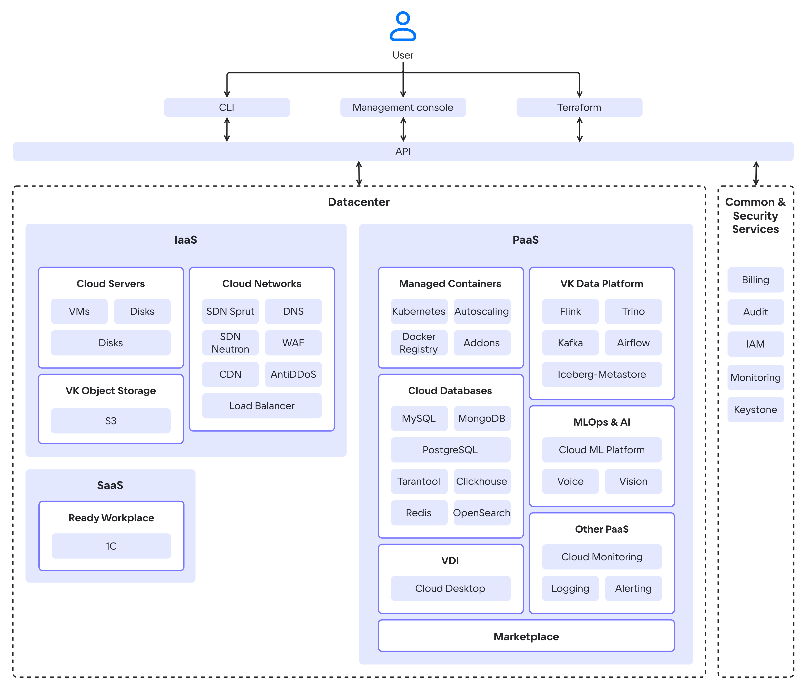

# {heading({var(cloud)} Architecture)[id=architecture]}

{include(/en/_includes/_translated_by_ai_en.md)}

{var(cloud)} is a cloud platform that provides network access to computing resources (virtual machines, databases, storage, and other services) on a "pay as you go" basis: you are charged only for the resources you consume.

You rent virtual resources hosted in VK {linkto(#architecture-az)[text=data centers]}. This eliminates the need to spend money on purchasing and maintaining your own physical servers, and also gives you access to {var(cloud)} technical support.

## {heading(Deployment models)[id=architecture-deployment-models]}

{var(cloud)} offers the following deployment models:

- **Public Cloud** — a cloud deployment model in the form of a multi-tenant platform with shared resources (servers, storage, networks). User data is isolated from each other through virtualization, but can physically reside on the same servers. {var(cloud)} manages the infrastructure, including data center maintenance, hardware procurement, fault tolerance, and network management.

   Advantages: scalability, pay-as-you-go billing, access to new technologies.

- **Private Cloud** — a deployment model in which resources are allocated separately for each client (usually organizations). Employees of one organization can share its infrastructure, but sharing physical and virtual resources between different organizations is excluded. In a private cloud, it is the client (organization) who controls and maintains the underlying infrastructure.

   Advantages: complete data isolation and control, enhanced security. For more information about Private Cloud from VK, see the [Private installations](/en/on-premises) portal.

[cols="1,1,1", options="header"]
|===
| Characteristic
| Public Cloud
| Private Cloud

| Deployment
| Automatic
| Manual configuration for your specific needs

| Infrastructure maintenance
| {var(cloud)}
| You

| Resources
| Scalable
| Limited

| Cost
| Pay as you go
| Subscription fee

| Investment
| Minimal
| High

| Data access
| You and {var(cloud)}
| Only you

| Security
| [Provided](https://cloud.vk.ru/cloud-platform/certificates/) by {var(cloud)}
| You configure the required security level yourself based on certified {var(cloud)} products
|===

## {heading(Cloud service delivery models)[id=architecture-delivery-models]}

{var(cloud)} can host virtualization, monitoring, container, and data storage services. The architecture is based on four groups of services:

- **Infrastructure as a Service (IaaS)**. IaaS services are built on top of [OpenStack](https://www.openstack.org/software) and in-house developed components. They manage dynamic resource allocation, scaling, and fault tolerance. They are hosted in the same cloud data center as PaaS services. IaaS provides basic components: virtual servers, networking, data storage, and access to dedicated hardware.

   {cut(List of IaaS services)}

  - {linkto(../../../computing/iaas#iaas)[text=Cloud Servers]} — provides virtual machines with the ability to use public IP addresses and a 1 Gbit/s communication channel with unlimited traffic (virtual machines with NVIDIA GPU are also available). It is responsible for resource virtualization and integration and uses the KVM hypervisor.
  - {linkto(../../../storage/s3#s3-main)[text=VK Object Storage]} — provides S3-compatible object storage. The storage workload is distributed across all storage nodes. You can deploy storage with a customizable architecture.
  - {linkto(../../../networks/vnet#vnet)[text=Cloud Networks]} — provides network interaction within the selected {linkto(../../../tools-for-using-services/account/concepts/projects#tools-account-concepts-projects)[text=project]} using SDN (Software Defined Network) technology. It runs on OpenStack Neutron and on in-house developed software — Sprut. It includes the following components:

    - {linkto(../../../networks/dns#dns)[text=DNS]} — supports public and private DNS that provides name resolution for {var(cloud)} platform services.
    - {linkto(../../../networks/cdn#cdn)[text=CDN]} — organizes content delivery from your servers to users with minimal latency.
    - {linkto(../../../networks/balancing/concepts/about#balancing-load-balancer)[text=Load Balancer]} — distributes the load on the infrastructure, ensuring fault tolerance and flexible application scaling.
    - {linkto(../../../security/firewall-and-protection-ddos#firewall-and-protection-ddos-antiddos)[text=AntiDDoS]} — filters incoming traffic to {var(cloud)} resources deployed in the project to block DDoS attacks.
    - {linkto(../../../security/firewall-and-protection-ddos#firewall-and-protection-ddos-waf)[text=WAF]} (Web Application Firewall) — configures rules for filtering inbound and outbound traffic to detect and block network attacks.

  {/cut}

- **Platform as a Service (PaaS)**. These include open source solutions (Kubernetes) and solutions from technology partners. Built-in monitoring of {var(cloud)} services and individual entities is supported. The PaaS model is built on top of IaaS. It does not require managing the underlying infrastructure, including hardware and operating systems, and allows you to focus entirely on developing and managing applications.

  {cut(List of PaaS services)}

  - {linkto(../../../kubernetes#kubernetes)[text=Managed Containers]} — allows you to create and manage Kubernetes clusters in which you can run services and applications.
  - {linkto(../../../dbs/dbaas#dbaas-dbaas)[text=Cloud Databases]} — provides scalable DBMSs: MySQL, PostgreSQL, ClickHouse, MongoDB, Redis, Tarantool, OpenSearch, Arenadata DB based on Greenplum.
  - {linkto(../../../ml/spark-to-k8s#mlspark)[text=Cloud Spark]} — offers distributed batch and stream data processing, Machine Learning, and analytics capabilities.
  - {linkto(../../../ml/mlplatform#mlplatform)[text=Cloud ML Platform]} — supports services for the full ML development cycle.
  - {linkto(../../../ml/cloud-voice#cloud_voice)[text=Cloud Voice]} — provides a REST API for speech recognition and synthesis based on machine learning.
  - {linkto(../../../ml/vision#vision)[text=Vision]} — provides a REST API for face and object recognition based on machine learning.
  - {linkto(../../../monitoring-services/alerting#alerting)[text=Cloud Alerting]} — configures notifications about changes in key metrics of {var(cloud)} services.
  - {linkto(../../../monitoring-services/logging#logging)[text=Cloud Logging]} — aggregates and analyzes logs of services in {var(cloud)}.
  - {linkto(../../../monitoring-services/monitoring#monitoring)[text=Cloud Monitoring]} — provides monitoring of metrics specific to PaaS services, for example, analytics on K8s container pods, PostgreSQL DBMS transaction statistics.
  - {linkto(../../../computing/cloud-desktops#cloud-desktops)[text=Cloud Desktop]} — managed virtual workstations accessible from anywhere in the world.
  - {linkto(../../../data-platform/kafka#kafka)[text=Cloud Kafka]} — provides real-time data exchange between different modules of IT systems.
  - {linkto(../../../data-platform/flink#flink)[text=Cloud Flink]} — stream processing and transfer of data from sources to target systems.
  - {linkto(../../../data-platform/trino#trino)[text=Cloud Trino]} — an SQL engine for processing big data from remote sources.
  - [Marketplace](../../../applications-and-services/marketplace) — allows you to quickly deploy web development and administration environments based on virtual machines. It includes applications such as OpenVPN, VK Testers, Redash, Grafana, Milvus, Nexus, Joomla, WordPress, and others.

  {/cut}

- **Software as a Service (SaaS)**. Ready-to-use software available by subscription over the internet. It does not require infrastructure or platform management. An example of a SaaS service in {var(cloud)} is {linkto(../../../applications-and-services/1cgrm#1cgrm)[text=1C:Ready Workplace]}. The service provides resources and software for deploying {linkto(../../../applications-and-services/1cgrm/concepts/about#1cgrm-description)[text=1C services]}.

- **Common&Security services** ensure secure user operation and support the role-based model when using {var(cloud)} resources.

  {cut(List of Common&Security services)}

  - {linkto(../../../intro/billing#billing)[text=Billing]} — tracks resource usage and controls expenses, generates financial reports, and ensures interaction with payment systems when paying for services.
  - {linkto(../../../monitoring-services/event-log#event-log)[text=Cloud Audit]} — creates an audit log of user actions in {var(cloud)}.
  - IAM — manages authentication and authorization of users and services in conjunction with Keystone.
  - Monitoring — provides monitoring of cloud services and user applications.
  - Keystone — provides client authentication via API, service discovery, and distributed multi-tenant authorization.

  {/cut}

The overall diagram of {var(cloud)} components and services is shown below.

{params[noBorder=true]}

## {heading(Ways to manage {var(cloud)} services)[id=architecture-control-methods]}

Cloud services are managed using the API. Users interact with the API through one or more {linkto(../../../tools-for-using-services#tools-for-using-services)[text=tools]}:

  - the {var(cloud)} management console;
  - OpenStack CLI;
  - Terraform with a dedicated provider.

{var(cloud)} provides {linkto(../../support/support-info#support-info)[text=technical support]} for its services. Partner solutions (for example, AntiDDoS, WAF) are supported jointly with the partner.

## {heading(Fault tolerance)[id=architecture-fault-tolerance]}

Physical fault tolerance is achieved by hosting {var(cloud)} in three Tier III data centers in Russia. This placement guarantees data center SLA maintenance above 98% with an overall {linkto(../../support/sla#support-sla)[text=SLA]} of 99.95%.

Network fault tolerance is ensured by connecting data centers via routes with a bandwidth of 200 Gbit/s. Each server is connected to backbone providers through two independent channels, via two routers.

Logical fault tolerance is implemented using availability zones, which are grouped into {linkto(../../../tools-for-using-services/account/concepts/regions#tools-account-concepts-regions)[text=regions]}.

{note:info}

You can check the status of availability zones, services, and {var(cloud)} infrastructure on the [Service status](https://status.msk.cloud.vk.ru) page.

{/note}

### {heading(Availability zones)[id=architecture-az]}

{note:warn}
The `GZ1` availability zone is being decommissioned. Create new resources in other availability zones.
{/note}

Each availability zone contains one or more data centers where cloud infrastructure objects are physically located. In {var(cloud)}, an availability zone corresponds to a separate Tier III data center. {var(cloud)} provides the following availability zones:

[cols="1,1", options="header"]
|===
| Region
| Availability zone

.4+|Moscow
|`GZ1`

|`MS1`

|`ME1`

|`PA2`

.2+|Kazakhstan
|`QAZ`

|`KTP`

|===

Each data center is equipped with independent power supply and cooling systems.

Availability zones within one region are connected via a redundant dedicated high-bandwidth, low-latency fiber-optic network for high-speed data transfer between zones.

## {heading(Security)[id=architecture-security]}

The security of {var(cloud)} is ensured by continuous monitoring of {var(cloud)} services and external audits. The {var(cloud)} information system is [certified](https://cloud.vk.ru/cloud-platform/certificates) in accordance with the requirements of Order No. 21 of the FSTEC of Russia for working with personal data.

The infrastructure of availability zones in all {var(cloud)} regions is {linkto(../../../intro/it-security/compliance-152fz#it-security-compliance-152fz)[text=protected]} in accordance with the Russian Federal Law "On Personal Data" No. 152-FZ.

For more information, see the {linkto(../../../intro/it-security#it-security)[text=Platform security]} section.

## {heading(Migration to {var(cloud)})[id=architecture-migration]}

{var(cloud)} supports migration using {linkto(../../../intro/migration#migration)[text=third-party software]} or {linkto(../../../intro/migration/migrate-hstx-mr#migration-migrate-hstx-mr)[text=platform tools]}. Transferring virtual resources is more cost-effective due to the implementation of services based on OSS solutions (Open Source Solutions).