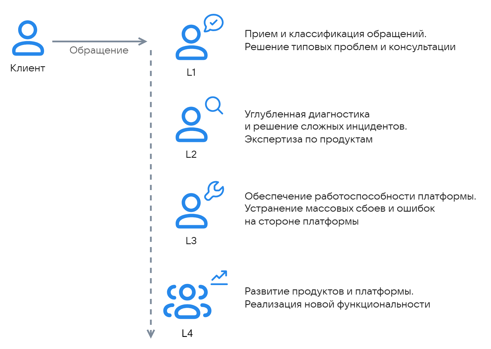

# {heading(Support lines)[id=support-principles]}

{include(/en/_includes/_translated_by_ai_en.md)}

A multi-tier technical support model is used to handle requests on the {var(cloud)} platform:

{params[noBorder=true; width=60%; printWidth=60%]}

The guaranteed response time for requests is defined by the {linkto(../sla#support-sla)[text=Service Level Agreement (SLA)]}.

## {heading(First support line (L1))[id=support-principles-l1]}

L1 engineers perform initial processing of all incoming requests.

L1 scope of responsibility:

- Receiving, registering, and classifying requests.
- Initial diagnostics and gathering of required information.
- Resolving typical technical issues.
- Consulting on service operation and configuration.
- Consulting on payment method setup, balance checks, and charges.
- Restoring access to the management console.
- Changing quotas and VM configuration upon request.
- Responding to technical failures and notifying customers.
- Interacting with vendors on Marketplace products.

## {heading(Second support line (L2))[id=support-principles-l2]}

Complex issues requiring in-depth technical expertise are escalated to the second line. L2 engineers have specialized knowledge of the technical specifics of services and product areas.

L2 scope of responsibility:

- Resolving non-typical and complex issues.
- Performing detailed problem diagnostics.
- Proactive monitoring of service status and responding to alerts.

## {heading(Third support line (L3))[id=support-principles-l3]}

Third-line experts are responsible for the operation and stability of the platform infrastructure.

L3 scope of responsibility:

- Resolving large-scale failures on the provider's side.
- Fixing software bugs and identifying vulnerabilities.
- Interacting with product teams to inform them about service improvement areas.

## {heading(Product team (L4))[id=support-principles-l4]}

The product team is responsible for the development and lifecycle of a specific service or platform.

L4 scope of responsibility:

- Releasing updated software versions that include fixes for widespread issues.
- Improving service performance, fault tolerance, and usability.
- Developing and implementing new functionality.