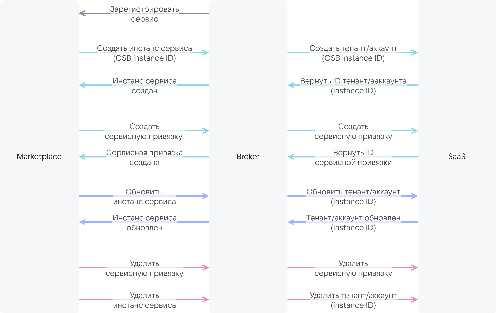

{include(/en/_includes/_translated_by_ai_en.md)}

The Marketplace service and the SaaS application interact with each other via a [SaaS broker](/en/tools-for-using-services/vendor-account/manage-apps/concepts/about#xaas_vendor_index_type_services) using the VK OSB protocol. The protocol is provided by the VK Cloud platform.

Requirements for the SaaS broker:

* The broker must implement methods that describe the lifecycle of service instances. The methods are shown in the diagram.

    {cut(Broker interaction scheme with the marketplace and the SaaS application)}

    {params[noBorder=true]}

    {/cut}

* The broker must have authentication configured over the secure HTTPS protocol with a certificate issued by a trusted certificate authority.

    {note:err}

    The use of self-signed certificates is prohibited.

    {/note}

The SaaS application provider develops the SaaS broker entirely on their own or based on a template provided by the VK Cloud platform. The template already implements the interaction between the marketplace and the broker. It needs to be supplemented with a description of the broker's interaction with a specific SaaS application. The template is written in Python based on the [FastAPI](https://fastapi.tiangolo.com/tutorial/first-steps) framework.

These instructions are intended for the case of developing a SaaS broker based on the template from VK Cloud.

## {heading(Preparatory steps)[id=preparatory_steps]}

1. Send an email to [marketplace@cloud.vk.com](mailto:marketplace@cloud.vk.com). In the email, request:
   * the VK OSB protocol;
   * the template for developing a SaaS broker;
   * the names of the test and public Marketplace namespaces and access to them.

1. Send an email to [marketplace@cloud.vk.com](mailto:marketplace@cloud.vk.com) with an icon attached in SVG format at least 62 × 62 pixels in size. The size of the icon file must not exceed 1 MB.

   The service icon is displayed in the service card:

   * In the marketplace catalog.
   * On the **Service description** tab on the service page.

   A reply email will be sent containing the icon URL, which is specified in the [service configuration JSON file](../../../reference/saas-apps-reference/saas-param).

1. [Register](/en/intro/onboarding/account) with VK Cloud. A VK Cloud account is required to test the application in the marketplace.

## {heading(1. Describe the service configuration (tariff plans, options))[id=service_config]}

1. Create a `catalog_<SERVICE_NAME>.json` file.
1. In the JSON file, describe the service configuration using the following structure:

    {include(/en/_includes/_saas_add_update.md)[tags=service_config]}

## {heading(2. Develop the SaaS broker)[id=saas_broker]}

1. Develop a client for interacting with the API of your service.
1. Develop a service manager that describes the interaction between the broker and the service. To do this, implement the following methods:

   [cols="1,3", options="header"]
   |===
   |Method
   |Input data

   |Creating a tenant or account
   |
   * The OSB ID of the service instance, which is generated by the marketplace when the service is connected. The OSB ID is passed to the SaaS application so that the SaaS application generates the service instance ID. The service instance ID is used in the methods described below in the table.
   * The tariff plan ID.
   * The tariff plan options described in the service configuration JSON file in the [plans.schemas.service_instance.create section](../../../reference/saas-apps-reference/schemas-section).
   * (Optional) Context containing user information: email, [unique project identifier (PID)](/en/tools-for-using-services/account/instructions/project-settings/manage#getting_project_id)

   |Updating a tenant or account
   |
   * The service instance ID.
   * The tariff plan ID.
   * The tariff plan options described in the service configuration JSON file in the [plans.schemas.service_instance.update section](../../../reference/saas-apps-reference/schemas-section)

   |Retrieving and deleting a tenant or account
   |The service instance ID

   |Creating service bindings
   |
   * The service instance ID.
   * The service binding parameters described in the service configuration JSON file in the [plans.schemas.service_binding.create section](../../../reference/saas-apps-reference/schemas-section).
   * (Optional) Context containing user information: email, [unique project identifier (PID)](/en/tools-for-using-services/account/instructions/project-settings/manage#getting_project_id)

   |Retrieving and deleting service bindings
   |
   * The service instance ID.
   * The service binding ID
   |===

1. Integrate the client into the service manager.
1. Configure authentication in the broker.

1. If the SaaS application has postpaid tariff options and metrics for them are collected using the [pull model](/en/tools-for-using-services/vendor-account/manage-apps/concepts/about#billing_pull), perform additional steps:

    1. In the service manager, implement a method for obtaining a report on the actually consumed resources of the SaaS application. In response to the request, the broker must send the report to the marketplace.

        {cut(Example of a report on the actually consumed resources of the SaaS application)}

        ```json
        {
            "batch_id": 35,
            "data": [
                {
                "kind": "vms",
                "type": "cb",
                "unit": "month",
                "price": 600.0,
                "value": 1.0,
                "plan_uuid": "2f070fe3-3e31-4482-bad4-a4d0c36bab31",
                "instance_uuid": "d1dff97c-df6c-45a7-95e1-b539a8d77721"
            },
            {
                "kind": "storage",
                "type": "cb",
                "unit": "GB-month",
                "price": 3.3,
                "value": 2.4474525451660156,
                "plan_uuid": "2f070fe3-3e31-4482-bad4-a4d0c36bab31",
                "instance_uuid": "d1dff97c-df6c-45a7-95e1-b539a8d77721"
            },
            {
                "kind": "vms",
                "type": "cb",
                "unit": "month",
                "price": 600.0,
                "value": 0.0,
                "plan_uuid": "354df2fa-5ec3-45e1-b99b-7d45840cf3df",
                "instance_uuid": "3910e993-63f0-4a90-95d7-5eea35785c29"
            },
            {
                "kind": "storage",
                "type": "cb",
                "unit": "GB-month",
                "price": 3.3,
                "value": 0.0,
                "plan_uuid": "354df2fa-5ec3-45e1-b99b-7d45840cf3df",
                "instance_uuid": "3910e993-63f0-4a90-95d7-5eea35785c29"
            },
            {
                "kind": "storage",
                "type": "cb",
                "unit": "GB-month",
                "price": 7.0,
                "value": 0.0,
                "plan_uuid": "d719f348-3497-4341-8465-a438bfcc2d96",
                "instance_uuid": "f10e67be-dfd7-4dcd-917c-4bfd3cd64ce2"
            }
            ]
        }
        ```
  
        Here:

        * `batch_id` — the report ID generated by the broker.
        * `kind` — the tariff option name. It must match the name used in the service configuration file.
        * `type` — the service name. It must match the `SERVICE_NAME` parameter specified in the name of the service configuration file (`catalog_<SERVICE_NAME>.json`).
        * `unit` — the measurement unit of the option.
        * `price` — the cost of one unit of the option per month. It must match the `plans.billing.options.cost` value of the specific option specified in the service configuration file.
        * `value` — how many units of the option were actually consumed during the month. The value is generated by the SaaS application.
        * `plan_uuid` — the tariff plan ID.
        * `instance_uuid` — the service instance (tenant/account) ID.

        {/cut}

    1. In the service manager, implement a method for notifying the broker that the report has been processed (funds have been charged according to the report or the charge has been scheduled).

## {heading(3. Upload the service configuration to the broker)[id=saas_load_configuration_to_broker]}

1. Navigate to the broker directory.
1. Place the service configuration file `catalog_<SERVICE_NAME>.json` in the `resources` subdirectory.
1. In the `resources/plan_mapping.json` file, specify:

   * `<SERVICE_NAME>` — the service name.
   * `<PLAN_ID>` — the IDs of the tariff plans specified in the `catalog_<SERVICE_NAME>.json` file.
   * `<SAAS_PLAN_ID>` (format: `string`) — the tariff plan IDs on the service side corresponding to the `<PLAN_ID>` tariff plan IDs.

      ```json
      {
        "<SERVICE_NAME>": {
          "<PLAN_ID>": <SAAS_PLAN_ID>,
          "<PLAN_ID>": <SAAS_PLAN_ID>
        }
      }
      ```

   Example of the `plan_mapping.json` file contents:

   ```json
   {
     "VKT": {
       "0dc54b75-XXXX-89d5a47eef71": 1,
       "312b628e-XXXX-080ab4ca3acb": 2,
       "e2ae1588-XXXX-3f5081a799a9": 3,
       "b54e7247-XXXX-7a9dccc22e7b": 4
     }
   }
   ```

1. In the broker directory, rename the `.env.example` file to `.env`.
1. In the `.env` file, specify the service name in `BROKER_MODE`:

   ```json
   BROKER_MODE=<SERVICE_NAME>
   ```

## 4. (Optional) Test the broker locally

1. In the `.env` file in the broker directory, describe the environment variables:

   * `BROKER_PROVIDER_CLIENT_ID` — the broker name for accessing the SaaS application.
   * `BROKER_PROVIDER_SECRET` — the password for the broker to access the SaaS application.
   * `BROKER_PROVIDER_URL` — the URL of the SaaS application.
   * `BROKER_USERNAME` — the marketplace name for interservice interaction with the broker.
   * `BROKER_PASSWORD` — the marketplace password for interservice interaction with the broker.

1. In the `.env` file in the broker directory, specify the variable values for accessing the broker database.
1. Install the Python libraries by running the command:

   {tabs}

   {tab(Linux)}

   ```console
   pip install -r requirements/prod.txt
   ```

   {/tab}

   {/tabs}

1. Start the broker by running the command:

   {tabs}

   {tab(Linux)}

   ```console
   gunicorn app.main:app --log-file - --workers ${UVICORN_WORKERS:-1} --worker-class uvicorn.workers.UvicornWorker --bind 0.0.0.0:${BROKER_PORT:-8000} --timeout ${WORKER_TIMEOUT:-90}
   ```

   {/tab}

   {/tabs}

   Example of the response to the broker start command:

   ```console
   INFO:     Started server process [34934]
   INFO:     Waiting for application startup.
   INFO:     Application startup complete.
   INFO:     Uvicorn running on http://0.0.0.0:8000 (Press CTRL+C to quit)
   ```

1. After installing the broker, open the [http://0.0.0.0:8000/docs](http://0.0.0.0:8000/docs) page in your browser.

   The page contains the broker API description in the Swagger editor.

1. Make API requests using the following parameters:

   * The value of the VK OSB protocol version `x-broker-api-version` (for example, `"0.1"`).
   * The `BROKER_USERNAME` value from the `.env` file.
   * The `BROKER_PASSWORD` value from the `.env` file.

## 5. Deploy the broker image to the environment

To build the image, use the `Dockerfile` file in the broker template directory.

{note:warn}

For the Marketplace to be able to interact with the broker and the SaaS application, the broker must be available around the clock.

{/note}

## 6. Register the broker

Send an email to [marketplace@cloud.vk.com](mailto:marketplace@cloud.vk.com). In the email, specify:

* Company information:

  * the company name,
  * the contact person,
  * the phone number.

* The email address of the user who will receive notifications about errors when creating service instances.
* The broker parameters listed in the table.

[cols="2,5,2,2", options="header"]
|===
|Name
|Description
|Format
|Required

|`name`
|The broker name
|string
| 

|`url`
|The URL to which requests from the marketplace will be sent
|string
| 

|`description`
|The broker description
|string
| 

|`osb_version`
|The VK OSB protocol version
|string
| 

|`username`
|The marketplace name for interservice interaction with the broker.

{note:err}

It must match the value of the `BROKER_USERNAME` environment variable in the `.env` file of the broker directory

{/note}

|string
| 

|`password`
|The marketplace password for interservice interaction with the broker.

{note:err}

It must match the value of the `BROKER_PASSWORD` environment variable in the `.env` file of the broker directory

{/note}
|string
| 
|===

After the broker is registered, the SaaS application will become available in the test namespace of the marketplace. The service will be available in the public namespace of the marketplace only after publication.

## {heading(7. Test the service in the marketplace)[id=saas_test_marketplace]}

To check how the service will function in VK Cloud, test it in the test namespace of the marketplace:

1. Send an email to [marketplace@cloud.vk.com](mailto:marketplace@cloud.vk.com) to receive a grant for testing the service. The funds will be credited to the bonus account of your project in VK Cloud.
1. If you do not have access to the test namespaces specified in the service configuration, send an email to [marketplace@cloud.vk.com](mailto:marketplace@cloud.vk.com). In the email, specify:

   * The names of the test Marketplace namespaces specified in the `metadata` parameter of the [service configuration JSON file](../../../reference/saas-apps-reference/saas-param).
   * The email address of the user who needs access to the test Marketplace namespaces.

{include(/en/_includes/_saas_add_update.md)[tags=test_service]}

1. If necessary, make changes to the service configuration:

   1. Navigate to the `resources` subdirectory of the broker directory.
   1. Edit the `catalog_<SERVICE_NAME>.json` and `plan_mapping.json` files.
   1. Repeat the testing one more time.

1. If you specified test cost values in the service configuration for the duration of testing and debugging, edit the `catalog_<SERVICE_NAME>.json` file specifying the real values in it.

## {heading(8. Publish the service)[id=saas_publish_service]}

Send an email to [marketplace@cloud.vk.com](mailto:marketplace@cloud.vk.com). In the email, specify the service ID and its revision.

The service configuration will be moderated. After that, the service will be published in the marketplace.

The published revision of the service will move from the test namespace of the marketplace to the public namespace specified in the `metadata` parameter of the [service configuration JSON file](../../../reference/saas-apps-reference/saas-param). The service will be available to all users who have access to this public namespace.

{note:warn}

Only the latest published revision of the service is available in public namespaces.

{/note}