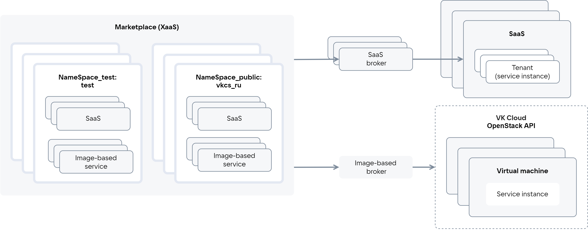
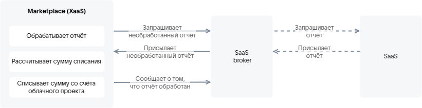
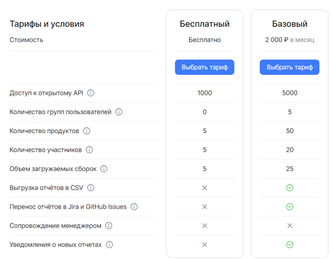
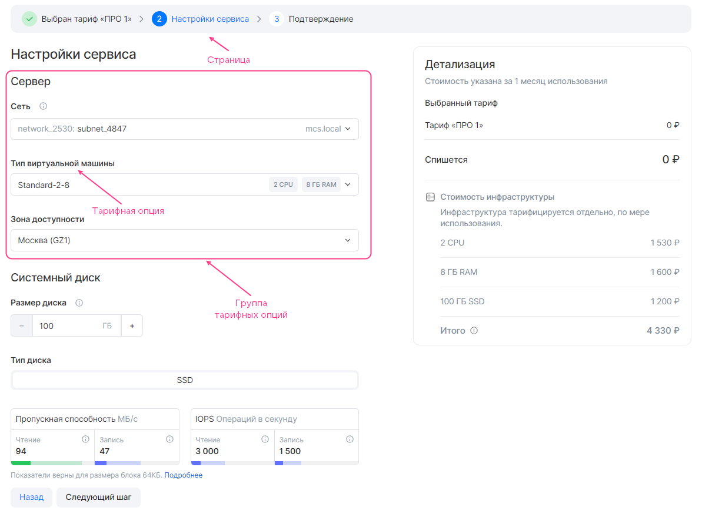

# {heading(General information)[id=index]}

{include(/en/_includes/_translated_by_ai_en.md)}

The full name of the system hosting the services: {var(marketplace)} (XaaS).

Short names of the system: Marketplace, application store, store.

Marketplace is integrated with the {var(cloud)} cloud platform. Marketplace provides cloud platform users with access to the services hosted in it.

{note:info}

Services added to the store are displayed in the **Application Store** section of the cloud platform management console.

{/note}

Roles of users interacting with the store:

* Provider — adds a service to the store. Both test and public store namespaces are available.
* Consumer — uses a service hosted in the store. Only public store namespaces are available.

This document is intended for providers.

This document describes the procedure for adding services to the store.

## {heading(Service types)[id=xaas_vendor_index_type_services]}

The store supports hosting the following service types:

* SaaS application — a centrally installed multitenant product. The infrastructure for the service is provided by the provider. The provider deploys the service either on third-party infrastructure or on the cloud platform infrastructure in their own project. The user is granted access to the service instance via a separate tenant/account.
* Image-based application — a product deployed based on virtual machine images in the user's cloud project. The service may use additional cloud platform infrastructure: virtual networks, load balancers, DBaaS clusters, {var(s3)}, backups. The infrastructure for the service is provided by the cloud platform. Service instances are deployed in the user's project.

   Marketplace allows hosting image-based applications deployed both on a single VM and in a cluster.

The services provided by a service are described using tariff plans and options. A tariff option is a specific plan parameter.

The store interacts with services via the VK OSB protocol using brokers ({linkto(#pic_xaas)[text=figure %number]}). The broker delivers the service configuration to the store: the store periodically polls the broker about the current service configuration.

{caption( Figure {counter(pic)[id=numb_pic_xaas]} — Interaction between the store and services)[align=center;position=under;id=pic_xaas;number={const(numb_pic_xaas)} ]}
{params[noBorder=true]}
{/caption}

A SaaS broker provides the interaction of a specific SaaS application with the store. An image-based broker provides the interaction of image-based applications with the store. An image-based broker internally contains tenants that group image-based applications of a single provider.

{note:warn}

The SaaS application provider develops the SaaS broker.

The image-based application provider develops a service package for the image-based broker.

The broker for image-based applications is developed by VK.

{/note}

The store includes:

* Test namespaces (`NameSpace_test`), where the service configuration is verified before publication. All service revisions are available.
* Public namespaces (`NameSpace_public`), where the service is published. Only the latest published service revision is available.

Access to test namespaces is granted only to providers. If a user has access to several namespaces, they will see in the store catalog all services and their revisions hosted in at least one namespace the user has access to.

Test and public namespaces for an image-based application are specified in the service key and the image-based broker; for a SaaS application — in the SaaS broker when registering the broker in Marketplace.

Entities associated with a service and used when integrating with the store are listed in {linkto(#tab_entities)[text=table %number]}.

{caption( Table {counter(table)[id=numb_tab_entities]} — Entities associated with a service)[align=right;position=above;id=tab_entities;number={const(numb_tab_entities)}]}
[cols="2,5", options="header"]
|===
|Name
|Description

|Service instance
|
An instance of the service deployed for the user

|Service binding
|
An entity created after deploying a service instance based on a request from the cloud platform to the broker and associated with the service instance.

Most often, a service binding is used to pass sensitive information for accessing the service to the user. If the service can send access data without the store's involvement, using a service binding for this task is not required. The tasks for which service bindings are used depend on the specific service
|===
{/caption}

{note:info}

A service instance of a SaaS application is a tenant/account of the SaaS application. For example, a service instance of the VK Testers SaaS application corresponds to one company in VK Testers.

{/note}

## {heading(Tariff option types)[id=xaas_option_types]}

The tariff option types listed in {linkto(#tab_tariff_options_types)[text=table %number]} are supported.

{caption( Table {counter(table)[id=numb_tab_tariff_options_types]} — Tariff option types)[align=right;position=above;id=tab_tariff_options_types;number={const(numb_tab_tariff_options_types)}]}
[cols="4,2,2", options="header"]
|===
|Tariff option type
|SaaS application
|Image-based application

|Numeric (integer, number)
| 
| 

|String (string)
| 
| 

|Boolean (boolean)
| 
| 

|Datasource
| 
| 
|===
{/caption}

The `datasource` option type is used to describe options related to cloud platform entities. This type allows using cloud platform data in real time. Based on this data, the possible option values are generated when connecting a service or updating a tariff plan.

Supported `datasource` types:

* VM types available in the cloud platform user's project.
* Availability zones of the cloud platform.
* Virtual networks available in the cloud platform project.
* Disk type.

## {heading(Billing)[id=xaas_billing]}

Tariff plans can be paid or free.

Tariff plans can have paid tariff options. Paid options of the following types are supported:

* Numeric.
* Boolean.

The cost of tariff plans and options is described in the service configuration.

The description of billing types (payment methods) is provided in {linkto(#tab_tariff_types)[text=table %number]}.

{caption( Table {counter(table)[id=numb_tab_tariff_types]} — Billing types)[align=right;position=above;id=tab_tariff_types;number={const(numb_tab_tariff_types)}]}
[cols="2,5", options="header"]
|===
|Name
|Description

|Free
|
No payment for using the service.

For an image-based application, the cloud platform infrastructure is paid for

|Prepaid (Upfront Commitment)
|
Payment for the service is charged once per billing period on the service connection date or the tariff plan change date. The billing period duration and the charge date are configured in the service configuration (for details, see the sections {linkto(/en/tools-for-using-services/vendor-account/manage-apps/ibservice_add/ibservice_configure/ibplan#ibplan)[text=%text]}, {linkto(/en/tools-for-using-services/vendor-account/manage-apps/saas_add/saas_configure/saas_plan#saas_plan_param)[text=%text]}).

The cost is fixed.

If there are insufficient funds in the project account at the time of charging, the user will be forcibly switched to a free tariff plan.

If the service has no free tariff plan, the service instance will be deactivated and the user will lose access to it

|Postpaid (Usage Based)
|
Payment for the service is calculated based on the actual amount of service resources used during the billing period (for example, the storage space used).

Payment for the used service resources (tariff options) is made upon actual usage based on metrics received by the store. Methods for receiving metrics:

* Pull model.
* Push model.

The tariff options for which the store receives metrics must be described in the service configuration.

The frequency of charges depends on the frequency of receiving metrics. For example, if the store receives metrics once a month, the payment will be charged once a month.

If there are insufficient funds in the project account at the time of charging, a soft period begins:

* The user is sent an email notification about the need to top up the account, otherwise after the soft period ends the service instance will be deactivated (suspended).
* During the soft period, the project account balance is checked daily. If there are sufficient funds, the charge will be made.

If the account has not been topped up by the required amount before the soft period ends, a hard period begins:

* Funds are forcibly charged from the project account, and the project is frozen.
* The service instance is deactivated, and the user loses access to it.
* The user is sent an email notification about the need to top up the account, otherwise after the hard period ends the service instance will be deleted.

{note:err}

If the project account balance is not topped up to a positive value before the hard period ends, the service instance will be deleted.

{/note}

{note:warn}

The postpaid charging method applies only to tariff options in a free tariff plan.

{/note}

|BYOL (Bring Your Own License)
|
Using third-party licenses for services. The service instance is deployed without a license
|===
{/caption}

{note:warn}

In projects where cloud platform services are provided on a postpaid basis, deactivation of service instances is not applied.

{/note}

### {heading(Pull model of postpaid billing)[id=billing_pull]}

{note:warn}

The pull model of postpaid billing is supported only for SaaS applications.

{/note}

The pull model is a method of obtaining metrics on actually used resources based on a report received from the service. The store sends a request to the broker at set intervals asking about unprocessed reports ({linkto(#pic_xaas_saas_broker_resource_usage)[text=figure %number]}):

1. If the broker has unprocessed reports, the broker sends them to the store.
1. If the broker has no unprocessed reports, the following actions are performed:

   1. The broker requests a report from the service.
   1. Upon the broker's request, the service sends it a report on all existing service instances.
   1. The broker assigns the identifier `batch_id` to the report.
   1. The broker, in response to the store's request, sends it the unprocessed report.

1. The store calculates the cost of the used resources based on the received report.
1. After processing the report (the funds have been charged for it or the charge is scheduled), the store notifies the broker of the `batch_id` of this report. Going forward, the broker will not send processed reports to the store.

The frequency at which requests are sent from the store to the broker is configured in the `billing_cycle_step` parameter in the service configuration (for details, see the section {linkto(/en/tools-for-using-services/vendor-account/manage-apps/saas_add/saas_configure/saas_plan#saas_plan_param)[text=%text]}).

{caption( Figure {counter(pic)[id=numb_pic_xaas_saas_broker_resource_usage]} — Report transfer between the store and the broker)[align=center;position=under;id=pic_xaas_saas_broker_resource_usage;number={const(numb_pic_xaas_saas_broker_resource_usage)} ]}
{params[noBorder=true]}
{/caption}

The SaaS broker must implement methods that send the report to the store. The report format is provided in the section {linkto(/en/tools-for-using-services/vendor-account/manage-apps/saas_add/saas_broker#saas_broker)[text=%text]}.

### {heading(Push model of postpaid billing)[id=billing_push]}

The push model is a method of obtaining metrics on actually used resources via an API request sent by the service. The API request parameters are provided in {linkto(#tab_metrics_request)[text=table %number]}.

{caption( Table {counter(table)[id=numb_tab_metrics_request]} — Parameters of the request for sending metrics to the store)[align=right;position=above;id=tab_metrics_request;number={const(numb_tab_metrics_request)}]}
[cols="2,5", options="header"]
|===
|Parameter
|Value

|
Request method
|
`POST`

|
Request path
|
`https://<CLOUD_HOST>/marketplace/api/infra-api/api/v1-public/usages`

Here `<CLOUD_HOST>` is the domain name of the cloud platform `https://cloud.vk.ru`

|
`Content-Type`
|
`application/json`

|
Request body (`--data`)
|
The request body contains metrics for the service instances. Specify the following parameters:

* `base_date` — the date the metrics are sent, in RFC3339 format.

   If the date is not specified, the current date and time of the API request execution will be applied.
* `broker_id` — the broker ID with which it is registered in the store. To obtain the broker ID, send an email to [marketplace@cloud.vk.com](mailto:marketplace@cloud.vk.com) with the following information:

   * Company name.
   * Service name.

   Do not specify this parameter if the company has only one SaaS broker or only one tenant in an image-based broker.
* `usages` — metrics on the used service resources.

   * `usages.instance_uuid` — the service instance ID.
   * `usages.param` — the name of the tariff option. For a SaaS application, the name must match the name specified in the JSON file; for an image-based application — the name of the option's YAML file.
   * `usages.value` — the consumed amount of the tariff option

|
`x-service-token`
|
`<SERVICE_TOKEN_USAGES>` — the service key for sending metrics. To obtain a service key for metrics, send an email to [marketplace@cloud.vk.com](mailto:marketplace@cloud.vk.com) with the following information:

* Company name.
* Email of the user who will be assigned as the owner of the service key for sending metrics.

By default, the service key for metrics is valid for 1 year.

{note:warn}

The service key used when uploading the service package of an image-based application cannot be used to send metrics to the store.

{/note}
|===
{/caption}

{caption( Example of a request for sending metrics to the store)[align=left;position=above]}
```console
$ curl -v -X POST https://cloud.vk.ru/marketplace/api/infra-api/api/v1-public/usages \
-H "Content-Type: application/json" \
-H 'x-service-token: <SERVICE_TOKEN_USAGES>' \
--data '{
      "broker_id": "7",
      "usages: [
        {
        "instance_uuid": "078621f1-ebe3-4f16-b998-503c487e4bfc",
        "param": "storage", // Option name in the JSON file or the YAML file name
        "value": 2.55786
        }
      ]
}'
```
{/caption}

HTTP response codes are provided in {linkto(#tab_http_response_codes)[text=table %number]}.

{caption( Table {counter(table)[id=numb_tab_http_response_codes]} — HTTP response codes)[align=right;position=above;id=tab_http_response_codes;number={const(numb_tab_http_response_codes)}]}
[cols="2,5", options="header"]
|===
|Code
|Description

|200
|Metrics sent

|400, 500
|Request execution error

|401
|Authorization error
|===
{/caption}

## {heading(Tariff plan matrix)[id=xaas_tariff_matrix]}

The tariff plan matrix ({linkto(#pic_preview)[text=figure %number]}) is displayed on the tariff page when viewing service information. Based on the matrix, the user can compare the service tariffs with each other: which options are included in which tariff plan.

{caption( Figure {counter(pic)[id=numb_pic_preview]} — Tariff plan matrix)[align=center;position=under;id=pic_preview;number={const(numb_pic_preview)} ]}

{/caption}

The tariff plan matrix is described in the service configuration. It specifies the service tariff options based on which the user will choose a tariff plan.

## {heading(Tariff plan configuration wizard)[id=xaas_wizard]}

When connecting a service and when updating a tariff plan, the tariff plan configuration wizard is displayed to the user.

The tariff plan configuration wizard allows the user to configure the tariff options for a specific tariff plan.

In the store interface, the tariff plan configuration wizard is split into separate pages ({linkto(#pic_xaas_wizard)[text=figure %number]}). Each page describes a specific stage of tariff plan configuration. The page displays the tariff options configured at that stage. The options are grouped.

{caption( Figure {counter(pic)[id=numb_pic_xaas_wizard]} — Tariff plan configuration wizard)[align=center;position=under;id=pic_xaas_wizard;number={const(numb_pic_xaas_wizard)} ]}

{/caption}

The first and last pages of the tariff plan configuration wizard are added automatically. The remaining pages are described in the service configuration.

The tariff plan configuration wizard displays the cost of the tariff plan and the paid tariff options. For image-based applications, the cost of the cloud platform infrastructure is additionally displayed; it is calculated automatically according to the cloud platform tariffs. The parameters for the calculation are described in the image-based application configuration.