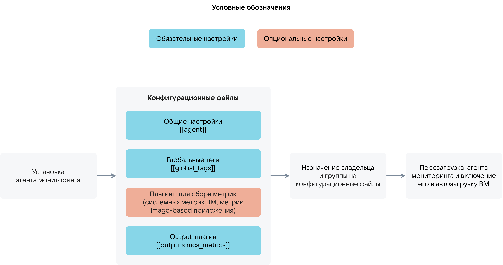

# {heading(Monitoring agent)[id=ib_cloud_monitoring_telegraf]}

{include(/en/_includes/_translated_by_ai_en.md)}

Marketplace is integrated with the [Cloud Monitoring](/en/monitoring-services/monitoring) service of the cloud platform, which allows collecting metrics for image-based applications. Metrics are collected using the monitoring agent (Telegraf). The diagram of using the monitoring agent is shown in {linkto(#pic_use_agent)[text=figure %number]}.

{caption(Figure {counter(pic)[id=numb_pic_use_agent]} — Using the monitoring agent)[align=center;position=under;id=pic_use_agent;number={const(numb_pic_use_agent)} ]}
{params[noBorder=true]}
{/caption}

For more information about using the monitoring agent, see the sections {linkto(../ib_cloud_monitoring_vm#ib_cloud_monitoring_vm)[text=%text]} and {linkto(../ib_cloud_monitoring_app#ib_cloud_monitoring_app)[text=%text]}.