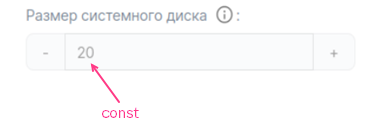
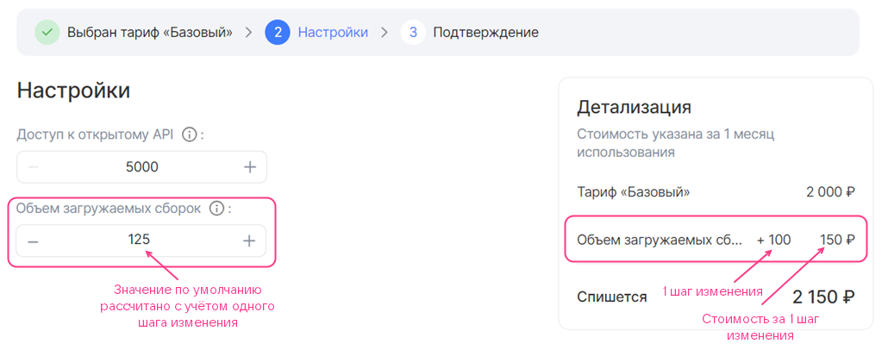
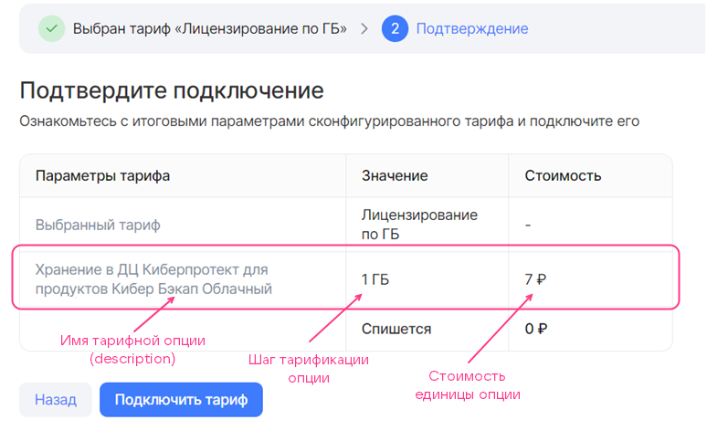
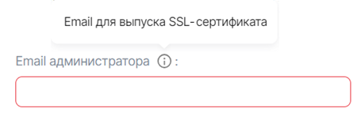
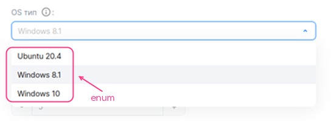
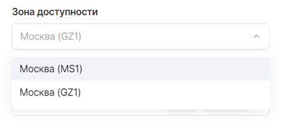

# {heading(Filling in YAML files of tariff options)[id=IB_option_fill_in]}

{include(/en/_includes/_translated_by_ai_en.md)}

In the `parameters/<OPTION_NAME>.yaml` files, describe all tariff options (for details, see the section {linkto(/ru/tools-for-using-services/vendor-account/manage-apps/concepts/about#xaas_option_types)[text=%text]}) that will be used in at least one tariff plan.

Each separate YAML file corresponds to one tariff option. It describes the tariff option settings, and for paid options — the cost.

A detailed description of the parameters used to describe tariff options is provided in the section [YAML file of a tariff option](../iboption).

## {heading(Free constant tariff option of the integer type)[id=option_int_const]}

Fill in the `parameters/<OPTION_NAME>.yaml` file as follows:

1. Specify the `actions` parameter.
1. In the `schema` section, set the following parameters:

   * `description` — the name of the tariff option.
   * `hint` — the description of the tariff option (optional).
   * `type` — the type of the tariff option. Specify `integer`.
   * `const` — the value of the tariff option.

{caption(Example of describing a constant option of the `integer` type, `YAML` format)[align=left;position=above]}
```yaml
actions:
- create
- update

schema:
  description: System disk size
  hint: In GB
  type: integer
  const: 20
```
{/caption}

{linkto(#pic_option_int_const)[text=Figure %number]} shows how the option described above will be displayed in the tariff plan configuration wizard.

{caption(Figure {counter(pic)[id=numb_pic_option_int_const]} — Constant tariff option of the integer type)[align=center;position=under;id=pic_option_int_const;number={const(numb_pic_option_int_const)} ]}
{params[width=40%]}
{/caption}

## {heading(Free tariff option of the integer type with selecting a value from a list)[id=option_int_enum]}

Fill in the `parameters/<OPTION_NAME>.yaml` file as follows:

1. Specify the `actions` parameter.
1. In the `schema` section, set the following parameters:

   * `description` — the name of the tariff option.
   * `hint` — the description of the tariff option (optional).
   * `type` — the type of the tariff option. Specify `integer`.
   * `enum` — the possible values of the tariff option.
   * `default` — the default value.

{caption(Example of describing an option of the `integer` type with selecting a value from a list, `YAML` format)[align=left;position=above]}
```yaml
actions:
- create
- update

schema:
  description: Number of servers in the cluster
  type: integer
  enum: [3, 5, 7]
  default: 5
```
{/caption}

{linkto(#pic_option_int_enum)[text=Figure %number]} shows how the option described above will be displayed in the tariff plan configuration wizard.

{caption(Figure {counter(pic)[id=numb_pic_option_int_enum]} — Tariff option of the integer type with selecting a value from a list)[align=center;position=under;id=pic_option_int_enum;number={const(numb_pic_option_int_enum)} ]}
{params[width=60%]}
{/caption}

## {heading(Free tariff option of the integer type with a change step of 1)[id=option_int_step]}

Fill in the `parameters/<OPTION_NAME>.yaml` file as follows:

1. Specify the `actions` parameter.
1. In the `schema` section, set the following parameters:

   * `description` — the name of the tariff option.
   * `hint` — the description of the tariff option (optional).
   * `type` — the type of the tariff option. Specify `integer`.
   * `default` — the default value (optional).

      If the parameter is not set, the default value will be `0`.
   * `minimum` and `maximum` — the maximum and minimum values of the tariff option (optional).

{caption(Example of describing a free option of the `integer` type with a change step of 1, `YAML` format)[align=left;position=above]}
```yaml
actions:
- create
- update

schema:
  description: Number of participants
  hint: The number of the customer's employees who can use the testing infrastructure and process reports from VK Testers testers.
  type: integer
  default: 20
  minimum: 20
```
{/caption}

Figures 3 and 4 show how the option described above will be displayed in the tariff plan configuration wizard.

{caption(Figure {counter(pic)[id=numb_pic_option_int_step]} — Free tariff option of the integer type with a change step of 1)[align=center;position=under;id=pic_option_int_step;number={const(numb_pic_option_int_step)} ]}

{/caption}

{caption(Figure {counter(pic)[id=numb_pic_option_int_step_plus]} — Free tariff option of the integer type with a change step of 1, the value increased by 1 step)[align=center;position=under;id=pic_option_int_step_plus;number={const(numb_pic_option_int_step_plus)} ]}

{/caption}

## {heading(Free tariff option of the integer type with a custom change step)[id=option_int_with_user_step_free]}

Fill in the `parameters/<OPTION_NAME>.yaml` file as follows:

1. Specify the `actions` parameter.
1. In the `billing` section, set the following parameters:

   * `base` — the standard value.
   * `cost` — the cost of the change step. Specify `0`.
   * `unit.size` — the size of the change step.
   * `unit.measurement` — the units of measurement of the tariff option (optional).

   {caption(Example of filling in the `billing` section)[align=left;position=above]}
   ```yaml
   billing:
     base: 25
     cost: 0
     unit:
        size: 100
   ```
   {/caption}
1. In the `schema` section, set the following parameters:

   * `description` — the name of the tariff option.
   * `hint` — the description of the tariff option (optional).
   * `type` — the type of the tariff option. Specify `integer`.
   * `default` — the default value (optional). It is set relative to the standard value of the option:

      * Do not specify the `default` parameter or specify `0` so that the default value equals the standard value ({linkto(#pic_option_int_with_user_step_free)[text=figure %number]}).

         {caption(Figure {counter(pic)[id=numb_pic_option_int_with_user_step_free]} — Free tariff option of the integer type with a custom change step (billing.base = 25, schema.default = 0, billing.unit.size = 100))[align=center;position=under;id=pic_option_int_with_user_step_free;number={const(numb_pic_option_int_with_user_step_free)} ]}
         
         {/caption}
      * Specify `n` so that the default value is calculated using the formula based on the standard value and the value of `n` ({linkto(#pic_option_int_with_user_step_free1)[text=figure %number]}, {linkto(#pic_option_int_with_user_step_free2)[text=figure %number]}):

         ```txt
         billing.base + n * billing.unit.size
         ```

         {caption(Figure {counter(pic)[id=numb_pic_option_int_with_user_step_free1]} — Free tariff option of the integer type with a custom change step (billing.base = 25, schema.default = 1, billing.unit.size = 100))[align=center;position=under;id=pic_option_int_with_user_step_free1;number={const(numb_pic_option_int_with_user_step_free1)} ]}
         
         {/caption}

         {caption(Figure {counter(pic)[id=numb_pic_option_int_with_user_step_free2]} — Free tariff option of the integer type with a custom change step (billing.base = 25, schema.default = 2, billing.unit.size = 100))[align=center;position=under;id=pic_option_int_with_user_step_free2;number={const(numb_pic_option_int_with_user_step_free2)} ]}
         
         {/caption}

   * `minimum` and `maximum` — the maximum and minimum values of the tariff option (optional). They are set in the same way as the default value.

{caption(Example of describing a free option of the `integer` type with a custom change step, `YAML` format)[align=left;position=above]}
```yaml
actions:
- create
- update

billing:
  base: 25
  cost: 0
  unit:
     size: 100

schema:
  description: Volume of uploaded builds
  hint: Test builds of applications can be uploaded to the platform for distribution to the customer's employees and VK Testers testers. The larger the storage, the more versions of your products can be stored on the testing platform. Supported platforms: iOS, Android, Windows, MacOS, Linux.
  type: integer
  default: 0
```
{/caption}

{note:info}

A detailed description of the parameters of the `billing` and `schema` sections is provided in the sections {linkto(/ru/tools-for-using-services/vendor-account/manage-apps/ibservice_add/ibservice_configure/iboption#iboption_billing)[text=%text]} and {linkto(/ru/tools-for-using-services/vendor-account/manage-apps/ibservice_add/ibservice_configure/iboption#iboption_schema)[text=%text]} respectively.

{/note}

## {heading(Prepaid tariff option of the integer type with a change step)[id=option_int_step_prepayed]}

Fill in the `parameters/<OPTION_NAME>.yaml` file as follows:

1. Specify the `actions` parameter.
1. In the `billing` section, set the following parameters ({linkto(#pic_option_int_step_prepayed)[text=figure %number]}, {linkto(#pic_option_int_step_prepayed1)[text=figure %number]}, {linkto(#pic_option_int_step_prepayed2)[text=figure %number]}):

   * `base` — the standard value. The standard value is included in the cost of the tariff plan.
   * `cost` — the cost of the change step.
   * `unit.size` — the size of the change step.
   * `unit.measurement` — the units of measurement of the tariff option (optional).

      {caption(Example of filling in the `billing` section)[align=left;position=above]}
      ```yaml
      billing:
        base: 25
        cost: 150
        unit:
           size: 100
      ```
      {/caption}

      In the example above, every 100 units of the option in addition to the standard value cost 150 monetary units.

   {caption(Figure {counter(pic)[id=numb_pic_option_int_step_prepayed]} — Paid tariff option of the integer type with a change step (billing.base = 25, billing.cost = 150, billing.unit.size = 100))[align=center;position=under;id=pic_option_int_step_prepayed;number={const(numb_pic_option_int_step_prepayed)} ]}
   
   {/caption}

   {caption(Figure {counter(pic)[id=numb_pic_option_int_step_prepayed1]} — Paid tariff option of the integer type with a change step, the value increased by 1 step (billing.base = 25, billing.cost = 150, billing.unit.size = 100))[align=center;position=under;id=pic_option_int_step_prepayed1;number={const(numb_pic_option_int_step_prepayed1)} ]}
   
   {/caption}

   {caption(Figure {counter(pic)[id=numb_pic_option_int_step_prepayed2]} — Paid tariff option of the integer type with a change step, the value increased by 2 steps (billing.base = 25, billing.cost = 150, billing.unit.size = 100))[align=center;position=under;id=pic_option_int_step_prepayed2;number={const(numb_pic_option_int_step_prepayed2)} ]}
   
   {/caption}
1. Fill in the `schema` section in the same way as for a free tariff option with a custom change step (for details, see the section {linkto(../ibopt_fill_in#option_int_with_user_step_free)[text=%text]}).

   If the default value of a tariff option is not equal to the standard value (`schema.default ≠ 0`), then when the user opens the tariff plan configuration wizard, the cost of such a tariff option will be displayed ({linkto(#pic_option_int_step_prepayed3)[text=figure %number]}). The user can reduce the option value to the standard one, which is included in the cost of the tariff plan.

   {caption(Figure {counter(pic)[id=numb_pic_option_int_step_prepayed3]} — Paid tariff option of the integer type with a change step (billing.base = 25, billing.cost = 150, billing.unit.size = 100, schema.default = 1))[align=center;position=under;id=pic_option_int_step_prepayed3;number={const(numb_pic_option_int_step_prepayed3)} ]}
   
   {/caption}

{note:info}

A detailed description of the parameters of the `billing` and `schema` sections is provided in the sections {linkto(/ru/tools-for-using-services/vendor-account/manage-apps/ibservice_add/ibservice_configure/iboption#iboption_billing)[text=%text]} and {linkto(/ru/tools-for-using-services/vendor-account/manage-apps/ibservice_add/ibservice_configure/iboption#iboption_schema)[text=%text]} respectively.

{/note}

## {heading(Postpaid tariff option of the integer or number type)[id=option_postpayed_ib]}

{note:warn}

The name of the YAML file of a postpaid tariff option must match the `param` value in the API request for submitting metrics (for details, see the section {linkto(/ru/tools-for-using-services/vendor-account/manage-apps/concepts/about#billing_push)[text=%text]}).

{/note}

Fill in the `parameters/<OPTION_NAME>.yaml` file as follows:

1. Set the `actions` parameter value — `resource_usages`.
1. In the `billing` section, set the following parameters:

   * `cost` — the cost of one unit of the tariff option.
   * `unit.size` — the billing step. Specify `1`.
   * `unit.measurement` — the units of measurement of the tariff option (optional).

1. In the `schema` section, set the following parameters:

   * `description` — the name of the tariff option.
   * `hint` — the description of the tariff option (optional).
   * `type` — the type of the tariff option. Specify `integer` or `number`.

{caption(Example of describing a postpaid numeric tariff option)[align=left;position=above]}
```yaml
actions:
- resource_usages

billing:
  cost: 7
  unit:
    size: 1
    measurement: GB

schema:
  description: Storage in the Cyberprotect data center for Cloud Backup products
  type: number
```
{/caption}

{linkto(#pic_option_postpayed_ib)[text=Figure %number]} shows how the option described above will be displayed in the tariff plan configuration wizard. One unit of the tariff option costs 7 monetary units.

{caption(Figure {counter(pic)[id=numb_pic_option_postpayed_ib]} — Postpaid tariff option)[align=center;position=under;id=pic_option_postpayed_ib;number={const(numb_pic_option_postpayed_ib)} ]}
{params[width=75%]}
{/caption}

## {heading(Free constant tariff option of the string type)[id=option_string]}

Fill in the `parameters/<OPTION_NAME>.yaml` file as follows:

1. Specify the `actions` parameter.
1. In the `schema` section, set the following parameters:

   * `description` — the name of the tariff option.
   * `hint` — the description of the tariff option (optional).
   * `type` — the type of the tariff option. Specify `string`.
   * `const` — the value of the tariff option.

{caption(Example of describing a constant option of the `string` type, `YAML` format)[align=left;position=above]}
```yaml
actions:
- create
- update

schema:
  description: Administrator login
  type: string
  const: admin@example.ru
```
{/caption}

{linkto(#pic_option_string)[text=Figure %number]} shows how the option described above will be displayed in the tariff plan configuration wizard.

{caption(Figure {counter(pic)[id=numb_pic_option_string]} — Constant tariff option of the string type)[align=center;position=under;id=pic_option_string;number={const(numb_pic_option_string)} ]}
{params[width=60%]}
{/caption}

## {heading(Free tariff option of the string type with value input)[id=option_string_input]}

Fill in the `parameters/<OPTION_NAME>.yaml` file as follows:

1. Specify the `actions` parameter.
1. In the `schema` section, set the following parameters:

   * `description` — the name of the tariff option.
   * `hint` — the description of the tariff option (optional).
   * `type` — the type of the tariff option. Specify `string`.
   * `default` — the default value.
   * Additional parameters provided in the section {linkto(/ru/tools-for-using-services/vendor-account/manage-apps/ibservice_add/ibservice_configure/iboption#iboption_option_string)[text=%text]} (optional).

{caption(Example of describing an option of the `string` type with value input, `YAML` format)[align=left;position=above]}
```yaml
actions:
- create
- update

schema:
  description: Administrator email
  hint: Email for issuing an SSL certificate
  type: string
```
{/caption}

{linkto(#pic_option_string_input)[text=Figure %number]} shows how the option described above will be displayed in the tariff plan configuration wizard.

{caption(Figure {counter(pic)[id=numb_pic_option_string_input]} — Tariff option of the string type with value input)[align=center;position=under;id=pic_option_string_input;number={const(numb_pic_option_string_input)} ]}
{params[width=40%]}
{/caption}

## {heading(Free tariff option of the string type with selecting a value from a list)[id=option_string_enum]}

Fill in the `parameters/<OPTION_NAME>.yaml` file as follows:

1. Specify the `actions` parameter.
1. In the `schema` section, set the following parameters:

   * `description` — the name of the tariff option.
   * `hint` — the description of the tariff option (optional).
   * `type` — the type of the tariff option. Specify `string`.
   * `enum` — the possible values of the tariff option.
   * `default` — the default value.

{caption(Example of describing an option of the `string` type with selecting a value from a list, `YAML` format)[align=left;position=above]}
```yaml
actions:
- create
- update

schema:
  description: OS type
  hint: Operating system
  type: string
  enum: ["Ubuntu 20.4", "Windows 8.1", "Windows 10"]
  default: Windows 8.1
```
{/caption}

{linkto(#pic_option_string_enum)[text=Figure %number]} shows how the option described above will be displayed in the tariff plan configuration wizard.

{caption(Figure {counter(pic)[id=numb_pic_option_string_enum]} — Tariff option of the string type with selecting a value from a list)[align=center;position=under;id=pic_option_string_enum;number={const(numb_pic_option_string_enum)} ]}
{params[width=55%]}
{/caption}

## {heading(Free constant tariff option of the boolean type)[id=option_bool_const]}

Fill in the `parameters/<OPTION_NAME>.yaml` file as follows:

1. Specify the `actions` parameter.
1. In the `schema` section, set the following parameters:

   * `description` — the name of the tariff option.
   * `hint` — the description of the tariff option (optional).
   * `type` — the type of the tariff option. Specify `boolean`.
   * `const` — the value of the tariff option.

{caption(Example of describing a constant option of the `boolean` type, `YAML` format)[align=left;position=above]}
```yaml
actions:
- create
- update

schema:
  description: Premium support
  hint: 24/7 technical support
  type: boolean
  const: false
```
{/caption}

{linkto(#pic_option_bool_const)[text=Figure %number]} shows how the option described above will be displayed in the tariff plan configuration wizard.

{caption(Figure {counter(pic)[id=numb_pic_option_bool_const]} — Constant tariff option of the boolean type (const = false))[align=center;position=under;id=pic_option_bool_const;number={const(numb_pic_option_bool_const)} ]}
{params[width=40%]}
{/caption}

## {heading(Free boolean toggle tariff option)[id=option_bool]}

Fill in the `parameters/<OPTION_NAME>.yaml` file as follows:

1. Specify the `actions` parameter.
1. In the `schema` section, set the following parameters:

   * `description` — the name of the tariff option.
   * `hint` — the description of the tariff option (optional).
   * `type` — the type of the tariff option. Specify `boolean`.
   * `default` — the default value (optional).

      If the `default` parameter is not set, the default value will be `false`.

{caption(Example description of a free `boolean` toggle option, `YAML` format)[align=left;position=above]}
```yaml
actions:
- create
- update

schema:
  description: Update notifications
  hint: Whether to receive email notifications about new service versions.
  type: boolean
  default: true
```
{/caption}

{linkto(#pic_option_bool)[text=Figure %number]} shows how the option described above will be displayed in the tariff plan configuration wizard.

{caption(Figure {counter(pic)[id=numb_pic_option_bool]} — Boolean toggle tariff option)[align=center;position=under;id=pic_option_bool;number={const(numb_pic_option_bool)} ]}
{params[width=50%]}
{/caption}

## {heading(Prepaid boolean toggle tariff option)[id=option_bool_paid]}

Fill in the `parameters/<OPTION_NAME>.yaml` file as follows:

1. Specify the `actions` parameter.
1. In the `schema` section, set the following parameters:

   * `description` — the name of the tariff option.
   * `hint` — the description of the tariff option (optional).
   * `type` — the type of the tariff option. Specify `boolean`.
   * `default` — the default value (optional).

      If the `default` parameter is not set, the default value will be `false`.

1. In the `billing` section, set the `cost` parameter — the cost of the option when the toggle is in the active position.

{caption(Example description of a paid `boolean` toggle option, `YAML` format)[align=left;position=above]}
```yaml
actions:
- create
- update

schema:
  description: New report notifications
  hint: Whether to receive email notifications about new reports
  type: boolean
  default: true

billing:
  cost: 50
```
{/caption}

{linkto(#pic_option_bool_paid)[text=Figure %number]} shows how the option described above will be displayed in the tariff plan configuration wizard.

{caption(Figure {counter(pic)[id=numb_pic_option_bool_paid]} — Paid boolean toggle tariff option)[align=center;position=under;id=pic_option_bool_paid;number={const(numb_pic_option_bool_paid)} ]}
{params[width=90%]}
{/caption}

## {heading(Datasource tariff option (VM type))[id=option_datasource_flavor]}

Fill in the `parameters/<OPTION_NAME>.yaml` file as follows:

1. Specify the `actions` parameter.
1. In the `schema` section, set the following parameters:

   * `description` — the name of the tariff option.
   * `hint` — the description of the tariff option (optional).
   * `type` — the type of the tariff option. Specify `string`.
   * `datasource.type` — the type of the cloud platform entity. Specify `flavor`.
   * `datasource.filter` — filters (optional). The available filters are described in the section {linkto(/en/tools-for-using-services/vendor-account/manage-apps/ibservice_add/ibservice_configure/iboption#iboption_option_datasource)[text=%text]}.

{caption(Example description of a `datasource` option for the VM type, `YAML` format)[align=left;position=above]}
```yaml
actions:
- create
- update

schema:
  description: Virtual machine type
  type: string
  datasource:
    type: flavor
```
{/caption}

{linkto(#pic_option_datasource_flavor)[text=Figure %number]} shows how the option described above will be displayed in the tariff plan configuration wizard.

{caption(Figure {counter(pic)[id=numb_pic_option_datasource_flavor]} — Datasource tariff option (VM type))[align=center;position=under;id=pic_option_datasource_flavor;number={const(numb_pic_option_datasource_flavor)} ]}
{params[width=45%]}
{/caption}

## {heading(Datasource tariff option (availability zone))[id=option_datasource_az]}

Fill in the `parameters/<OPTION_NAME>.yaml` file as follows:

1. Specify the `actions` parameter.
1. In the `schema` section, set the following parameters:

   * `description` — the name of the tariff option.
   * `hint` — the description of the tariff option (optional).
   * `type` — the type of the tariff option. Specify `string`.
   * `default` — the default value (optional). The available values are described in the section {linkto(/en/tools-for-using-services/vendor-account/manage-apps/ibservice_add/ibservice_configure/iboption#iboption_option_datasource)[text=%text]}.
   * `datasource.type` — the type of the cloud platform entity. Specify `az`.

{caption(Example description of a `datasource` option for the availability zone, `YAML` format)[align=left;position=above]}
```yaml
actions:
- create
- update

schema:
  description: Availability zone
  type: string
  default: gz1
  datasource:
    type: az
```
{/caption}

{linkto(#pic_option_datasource_az)[text=Figure %number]} shows how the option described above will be displayed in the tariff plan configuration wizard.

{caption(Figure {counter(pic)[id=numb_pic_option_datasource_az]} — Datasource tariff option (availability zone))[align=center;position=under;id=pic_option_datasource_az;number={const(numb_pic_option_datasource_az)} ]}
{params[width=45%]}
{/caption}

## {heading(Datasource tariff option (subnet))[id=option_datasource_subnet]}

Fill in the `parameters/<OPTION_NAME>.yaml` file as follows:

1. Specify the `actions` parameter.
1. In the `schema` section, set the following parameters:

   * `description` — the name of the tariff option.
   * `hint` — the description of the tariff option (optional).
   * `type` — the type of the tariff option. Specify `string`.
   * `datasource.type` — the type of the cloud platform entity. Specify `subnet`.

{caption(Example description of a `datasource` option for the subnet, `YAML` format)[align=left;position=above]}
```yaml
actions:
- create
- update

schema:
  description: Network
  type: string
  datasource:
    type: subnet
```
{/caption}

{linkto(#pic_option_datasource_subnet)[text=Figure %number]} shows how the option described above will be displayed in the tariff plan configuration wizard.

{caption(Figure {counter(pic)[id=numb_pic_option_datasource_subnet]} — Datasource tariff option (subnet))[align=center;position=under;id=pic_option_datasource_subnet;number={const(numb_pic_option_datasource_subnet)} ]}
{params[width=40%]}
{/caption}

## {heading(Datasource tariff option (network))[id=option_datasource_net]}

Fill in the `parameters/<OPTION_NAME>.yaml` file as follows:

1. Specify the `actions` parameter.
1. In the `schema` section, set the following parameters:

   * `description` — the name of the tariff option.
   * `hint` — the description of the tariff option (optional).
   * `type` — the type of the tariff option. Specify `string`.
   * `datasource.type` — the type of the cloud platform entity. Specify `network`.
   * `datasource.value_is` — the type of information output. The available values are:
      * `uuid` — display the network UUID.
      * `name` — display the network name.
   * `datasource.filter` — filters (optional). The available filters are described in the section {linkto(/en/tools-for-using-services/vendor-account/manage-apps/ibservice_add/ibservice_configure/iboption#iboption_option_datasource)[text=%text]}.

{caption(Example description of a `datasource` option for the network, `YAML` format)[align=left;position=above]}
```yaml
actions:
- create
- update

schema:
  description: Internal network
  hint: Internal network
  type: string
  datasource:
    type: network
    value_is: name
    filter:
      kind: private
      shared: false
```
{/caption}

{linkto(#pic_option_datasource_net)[text=Figure %number]} shows how the option described above will be displayed in the tariff plan configuration wizard.

{caption(Figure {counter(pic)[id=numb_pic_option_datasource_net]} — Datasource tariff option (network))[align=center;position=under;id=pic_option_datasource_net;number={const(numb_pic_option_datasource_net)} ]}
{params[width=55%]}
{/caption}

## {heading(Describing a disk using tariff option files)[id=IBoption_fill_in_volume]}

A disk is described by two tariff options (two separate YAML files):

* Disk type — using a `datasource` type tariff option.
* Disk size — using an `integer` type tariff option with a change step of 1.

To describe a disk:

1. Describe a `datasource` type tariff option that retrieves data about disk types from the cloud platform, in the `parameters/<OPTION_NAME>.yaml` file:

   1. Specify the `actions` parameter.
   1. In the `schema` section, set the following parameters:

      * `description` — the name of the tariff option.
      * `hint` — the description of the tariff option (optional).
      * `type` — the type of the tariff option. Specify `string`.
      * `default` — the default value (optional). The available values are described in the section {linkto(/en/tools-for-using-services/vendor-account/manage-apps/ibservice_add/ibservice_configure/iboption#iboption_option_datasource)[text=%text]}.
      * `tag` — a tag. The tag links the option describing the disk type with the option describing the disk size.
      * `datasource.type` — the type of the cloud platform entity. Specify `volume_type`.
      * `datasource.filter` — filters (optional). The available filters are described in the section {linkto(/en/tools-for-using-services/vendor-account/manage-apps/ibservice_add/ibservice_configure/iboption#iboption_option_datasource)[text=%text]}.

         If no filters are specified, all disk types supported by the cloud platform will be displayed.

   {caption(Example description of a `datasource` option for the disk type, `YAML` format)[align=left;position=above]}
   ```yaml
   actions:
   - create
   - update

   schema:
     description: Disk type
     type: string
     default: ceph-ssd
     tag: disk1
     datasource:
       type: volume_type
       filter:
         disk_class:
           enum: ["ssd", "hdd"]
   ```
   {/caption}
1. In a separate `parameters/<OPTION_NAME>.yaml` file, describe the disk size using an `integer` type tariff option with a change step of 1:

   1. Specify the `actions` parameter.
   1. In the `schema` section, set the following parameters:

      * `description` — the name of the tariff option.
      * `hint` — the description of the tariff option (optional).
      * `type` — the type of the tariff option. Specify `integer`.
      * `default` — the default value (optional).
      * `maximum` and `minimum` — the maximum and minimum values (optional).
      * `tag` — a tag. The value must be the same as in the file describing the disk type.

      {note:info}

      Disk size is measured in GB.

      {/note}

   {caption(Example description of the disk size using an `integer` type tariff option with a change step of 1, `YAML` format)[align=left;position=above]}
   ```yaml
   actions:
   - create
   - update

   schema:
     description: Disk size
     type: integer
     default: 100
     minimum: 100
     tag: disk1
   ```
   {/caption}

{note:warn}

The cost of the disk is determined by the cloud platform tariffs, so it cannot be set in the tariff option description.

{/note}

{linkto(#pic_option_fill_in_volume)[text=Figure %number]} shows how the options described above (disk type and size) will be displayed in the tariff plan configuration wizard.

{caption(Figure {counter(pic)[id=numb_pic_option_fill_in_volume]} — Integer and datasource type tariff options that allow configuring the disk size and type)[align=center;position=under;id=pic_option_fill_in_volume;number={const(numb_pic_option_fill_in_volume)} ]}
{params[width=40%]}
{/caption}