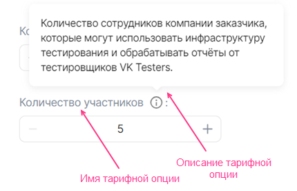
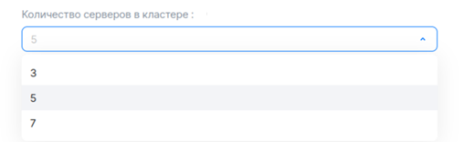
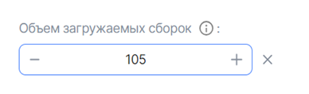
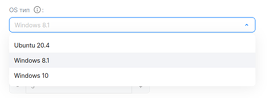

## {heading(Structure)[id=iboption_structure]}

{include(/en/_includes/_translated_by_ai_en.md)}

{note:warn}

The YAML file name of a postpaid tariff option must match the `param` value in the API request for sending metrics (for details, see the section {linkto(/en/tools-for-using-services/vendor-account/manage-apps/concepts/about#billing_push)[text=%text]}).

{/note}

A tariff option is described by the parameters and sections listed in {linkto(#tab_top_level_options)[text=table %number]}.

{caption(Table {counter(table)[id=numb_tab_top_level_options]} — Parameters and sections for describing a tariff option)[align=right;position=above;id=tab_top_level_options;number={const(numb_tab_top_level_options)}]}
[cols="2,5,2", options="header"]
|===
|Name
|Description
|Required

|actions
|
This parameter defines how the option is billed (for details, see the section {linkto(/en/tools-for-using-services/vendor-account/manage-apps/concepts/about#xaas_billing)[text=%text]}). Possible values:

* For free or prepaid billing, specify one or both values:

   * `create` — the option will be active when the service is connected.
   * `update` — the option will be active when the tariff plan is updated.

   If the option is active, the user will be able to change its value.
* For postpaid billing, specify the value `resource_usages`

| 

|schema
|
This section defines:

* The type of the tariff option.
* The name and description of the tariff option ({linkto(#pic_tariff_option)[text=figure %number]}).
* The settings of the tariff option value.

The section parameters are described in the section {linkto(#iboption_schema)[text=%text]}
| 

|billing
|
This section defines:

* The cost of the tariff option.
* The user-defined increment for a tariff option of the `integer` type.

The section parameters are described in the section {linkto(#iboption_billing)[text=%text]}
| 
|===
{/caption}

{caption(Figure {counter(pic)[id=numb_pic_tariff_option]} — Tariff option)[align=center;position=under;id=pic_tariff_option;number={const(numb_pic_tariff_option)} ]}
{params[width=45%]}
{/caption}

Examples of describing different types of tariff options are provided in the section {linkto(../ibopt_fill_in#IB_option_fill_in)[text=%text]}.

## {heading(The billing section)[id=iboption_billing]}

Paid tariff options can be options of the following types:

* Numeric (`integer`, `number`). Both prepaid and postpaid billing are supported.
* Boolean (`boolean`). Prepaid billing is supported.

For more information about billing types, see the section {linkto(/en/tools-for-using-services/vendor-account/manage-apps/concepts/about#xaas_billing)[text=%text]}.

Depending on the billing type and the option type, specify the parameters and child sections listed in {linkto(#tab_billing_integer)[text=table %number]}, {linkto(#tab_billing_boolean)[text=table %number]}, {linkto(#tab_billing_number)[text=table %number]} in the `billing` section.

{caption(Table {counter(table)[id=numb_tab_billing_integer]} — Parameters of the billing section for a prepaid option of the integer type with an increment)[align=right;position=above;id=tab_billing_integer;number={const(numb_tab_billing_integer)}]}
[cols="2,5,2,2", options="header"]
|===
|Name
|Description
|Format
|Required

|base
|Defines the default value of the tariff option included in the cost of the tariff plan.

The default value is the minimum value that the user can set.

If the parameter is not specified, the default value of the tariff option will automatically be `0`
|integer
| 

|cost
|Defines the cost of the increment by which the tariff option value can be changed.

If changing the option is free, specify `0`. The increment parameters are defined in the `unit` section
|float64, >= 0
| 

|unit
|Defines the parameters of the option increment
| 
| 

4+|Parameters of the `unit` section

|unit.size
|Defines the size of the increment by which the tariff option value can be changed.

The value specified in this parameter is billed according to the cost set in the `billig.cost` parameter
|integer, > 0
| 

|unit.measurement
|Defines the units of measurement for the increment specified in the `unit.size` parameter
|string, up to 255 characters
| 
|===
{/caption}

{caption(Table {counter(table)[id=numb_tab_billing_boolean]} — Parameters of the billing section for a prepaid boolean switch option)[align=right;position=above;id=tab_billing_boolean;number={const(numb_tab_billing_boolean)}]}
[cols="2,5,2,2", options="header"]
|===
|Name
|Description
|Format
|Required

|cost
|
Defines the cost of the option
|float64, >= 0
| 
|===
{/caption}

{caption(Table {counter(table)[id=numb_tab_billing_number]} — Parameters of the billing section for a postpaid option of the integer or number type)[align=right;position=above;id=tab_billing_number;number={const(numb_tab_billing_number)}]}
[cols="2,5,2,2", options="header"]
|===
|Name
|Description
|Format
|Required

|cost
|Defines the cost of a unit of the tariff option
|float64, >= 0
| 

|unit
|Defines the units of measurement of the option
| 
| 

4+|Parameters of the `unit` section

|unit.size
|The billing increment of the option. The value must be `1`
|integer
| 

|unit.measurement
|Defines the units of measurement of the option
|string, up to 255 characters
| 
|===
{/caption}

{note:warn}

Postpaid tariff options can only be in a free tariff plan.

{/note}

## {heading(The schema section)[id=iboption_schema]}

### {heading(The schema section for numeric tariff options)[id=iboption_numeric_schemas]}

#### {heading(Free or prepaid tariff option of the integer type)[id=iboption_option_integer]}

Subtypes of the `integer` tariff option:

* Constant ({linkto(#pic_tariff_option_integer)[text=figure %number]}).

   {caption(Figure {counter(pic)[id=numb_pic_tariff_option_integer]} — Constant tariff option of the integer type)[align=center;position=under;id=pic_tariff_option_integer;number={const(numb_pic_tariff_option_integer)} ]}
   {params[width=40%]}
   {/caption}
* With selecting a value from a list ({linkto(#pic_tariff_option_select)[text=figure %number]}).

   {caption(Figure {counter(pic)[id=numb_pic_tariff_option_select]} — Tariff option of the integer type with selecting a value from a list)[align=center;position=under;id=pic_tariff_option_select;number={const(numb_pic_tariff_option_select)} ]}
   {params[width=60%]}
   {/caption}
* With an increment ({linkto(#pic_tariff_option_step)[text=figure %number]}, {linkto(#pic_tariff_option_step_plus)[text=figure %number]}).

   By default, the option increment is 1. You can change the increment size and make it paid in the {linkto(#iboption_billing)[text=%text]} section.

   {caption(Figure {counter(pic)[id=numb_pic_tariff_option_step]} — Tariff option of the integer type with an increment)[align=center;position=under;id=pic_tariff_option_step;number={const(numb_pic_tariff_option_step)} ]}
   {params[width=35%]}
   {/caption}

   {caption(Figure {counter(pic)[id=numb_pic_tariff_option_step_plus]} — Tariff option of the integer type with an increment, the value is increased by the increment)[align=center;position=under;id=pic_tariff_option_step_plus;number={const(numb_pic_tariff_option_step_plus)} ]}
   {params[width=40%]}
   {/caption}

The parameters for a free or prepaid tariff option of the `integer` type are provided in {linkto(#tab_tariff_option_integer)[text=table %number]}. The cost of the option is described in the {linkto(#iboption_billing)[text=%text]} section.

{caption(Table {counter(table)[id=numb_tab_tariff_option_integer]} — The schema section for a tariff option of the integer type)[align=right;position=above;id=tab_tariff_option_integer;number={const(numb_tab_tariff_option_integer)}]}
[cols="2,5,2,2", options="header"]
|===
|Name
|Description
|Format
|Required

4+|**Main parameters of the tariff option, the same for all subtypes**

|description
|The name of the tariff option
|string, up to 255 characters
| 

|hint
|A hint describing the tariff option
|string, up to 255 characters
| 

|type
|Defines the type of the tariff option. Specify the value `integer`
| 
| 

4+|**Parameters for configuring the tariff option subtype**

4+|**Parameter for a constant option**

|const
|Defines the value of the constant tariff option
|integer
| 

4+|**Parameters for an option with selecting a value**

|enum
|Defines the list of values from which the user can select one
|List, within the list — integer
| 

|default
|Defines the default value of the tariff option
|integer
| 

4+|**Parameters for an option with increment 1**

|default
|Defines the default value of the tariff option.

If the parameter is not specified, the default value is `0`
|integer, >= 0 or `minimum`, &#8656; `maximum`
| 

|minimum
|Defines the minimum value of the tariff option
|integer, >= 0 and &#8656; `maximum`
| 

|maximum
|Defines the maximum value of the tariff option
|integer, > 0 and >= `minimum`
| 

|tag
|A tag. Allows linking several options together.

Used to describe a disk (for details, see the section {linkto(../ibopt_fill_in#IBoption_fill_in_volume)[text=%text]})
|string
| 

4+|**Parameters for an option with a user-defined increment. The increment is configured in the {linkto(#iboption_billing)[text=%text]} section**

|default
|Defines the default value of the tariff option, calculated relative to the default value (the default value is set in the `billing.base` parameter):

* If the value `0` is specified, the default value of the tariff option equals the default value (set in the `billing.base` parameter).
* If the value `n > 0` is specified, the default value of the tariff option is the sum of the default value and an increment multiple of `n`:

   ```
   billing.base + n * billing.unit.size
   ```

|integer, >= 0 or `minimum`, &#8656; `maximum`
| 

|minimum
|Defines the minimum value of the tariff option, calculated relative to the default value (the default value is set in the `billing.base` parameter):

* If the value `0` is specified, the minimum value of the tariff option equals the default value.
* If the value `n > 0` is specified, the minimum value of the tariff option is the sum of the default value and an increment multiple of `n`:

   ```
   billing.base + n * billing.unit.size
   ```

|integer, >= 0 and &#8656; `maximum`
| 

|maximum
|Defines the maximum value of the tariff option, calculated relative to the default value (the default value is set in the `billing.base` parameter):

* If the value `0` is specified, the maximum value of the tariff option equals the default value.
* If the value `n > 0` is specified, the maximum value of the tariff option is the sum of the default value and an increment multiple of `n`:

   ```
   billing.base + n * billing.unit.size
   ```

|integer, > 0 and >= `minimum`
| 
|===
{/caption}

#### {heading(Postpaid tariff option of the integer or number type)[id=iboption_option_postpaid]}

The parameters for a postpaid numeric tariff option are provided in {linkto(#tab_tariff_option_postpaid)[text=table %number]}. The cost of the option is described in the {linkto(#iboption_billing)[text=%text]} section.

{caption(Table {counter(table)[id=numb_tab_tariff_option_postpaid]} — The schema section for a postpaid option)[align=right;position=above;id=tab_tariff_option_postpaid;number={const(numb_tab_tariff_option_postpaid)}]}
[cols="2,5,2,2", options="header"]
|===
|Name
|Description
|Format
|Required

|description
|The name of the tariff option
|string, up to 255 characters
| 

|hint
|A hint describing the tariff option
|string, up to 255 characters
| 

|type
|Defines the type of the tariff option. Specify the value `integer` or `number`
| 
| 
|===
{/caption}

### {heading(The schema section for a tariff option of the string type)[id=iboption_option_string]}

Subtypes of the `string` tariff option:

* Constant ({linkto(#pic_option_string_const)[text=figure %number]}).

   {caption(Figure {counter(pic)[id=numb_pic_option_string_const]} — Constant tariff option of the string type)[align=center;position=under;id=pic_option_string_const;number={const(numb_pic_option_string_const)} ]}
   {params[width=60%]}
   {/caption}
* With entering a value ({linkto(#pic_option_string_input)[text=figure %number]}).

   {caption(Figure {counter(pic)[id=numb_pic_option_string_input]} — Tariff option of the string type with entering a value)[align=center;position=under;id=pic_option_string_input;number={const(numb_pic_option_string_input)} ]}
   {params[width=45%]}
   {/caption}
* With selecting a value from a list ({linkto(#pic_option_string_enum)[text=figure %number]}).

   {caption(Figure {counter(pic)[id=numb_pic_option_string_enum]} — Tariff option of the string type with selecting a value from a list)[align=center;position=under;id=pic_option_string_enum;number={const(numb_pic_option_string_enum)} ]}
   {params[width=60%]}
   {/caption}

The parameters for a tariff option of the `string` type are provided in {linkto(#tab_option_string)[text=table %number]}.

{caption(Table {counter(table)[id=numb_tab_option_string]} — The schema section for a tariff option of the string type)[align=right;position=above;id=tab_option_string;number={const(numb_tab_option_string)}]}
[cols="2,5,2,2", options="header"]
|===
|Name
|Description
|Format
|Required

4+|**Main parameters of the tariff option, the same for all subtypes**

|description
|The name of the tariff option
|string, up to 255 characters
| 

|hint
|A hint describing the tariff option
|string, up to 255 characters
| 

|type
|Defines the type of the tariff option. Specify the value `string`
| 
| 

4+|**Parameters for configuring the tariff option subtype**

4+|**Parameter for a constant option**

|const
|Defines the value of the constant tariff option
|string
| 

4+|**Parameters for an option with entering a value**

|default
|Defines the default value
|string
| 

|pattern
|Defines the pattern that the tariff option value must match
|regex
| 

|minLength
|Defines the minimum number of characters for the tariff option value
|integer, > 0 and &#8656; `maxLength`
| 

|maxLength
|Defines the maximum number of characters for the tariff option value
|integer, > 0 and >= `minLength`
| 

4+|**Parameters for an option with selecting a value from a list**

|enum
|Defines the list of values from which the user can select one
|List, within the list — string
| 

|default
|Defines the default value
|string
| 
|===
{/caption}

### {heading(The schema section for a tariff option of the boolean type)[id=iboption_option_boolean]}

Subtypes of the `boolean` tariff option:

* Constant ({linkto(#pic_option_boolean_const)[text=figure %number]}).

   {caption(Figure {counter(pic)[id=numb_pic_option_boolean_const]} — Constant tariff option of the boolean type)[align=center;position=under;id=pic_option_boolean_const;number={const(numb_pic_option_boolean_const)} ]}
   {params[width=35%]}
   {/caption}
* Switch ({linkto(#pic_option_boolean)[text=figure %number]}).

   {caption(Figure {counter(pic)[id=numb_pic_option_boolean]} — Boolean switch)[align=center;position=under;id=pic_option_boolean;number={const(numb_pic_option_boolean)} ]}
   {params[width=50%]}
   {/caption}

The parameters for a tariff option of the `boolean` type are provided in {linkto(#tab_option_boolean)[text=table %number]}.

{caption(Table {counter(table)[id=numb_tab_option_boolean]} — The schema section for a tariff option of the boolean type)[align=right;position=above;id=tab_option_boolean;number={const(numb_tab_option_boolean)}]}
[cols="2,5,2,2", options="header"]
|===
|Name
|Description
|Format
|Required

4+|**Main parameters of the tariff option, the same for all subtypes**

|description
|The name of the tariff option
|string, up to 255 characters
| 

|hint
|A hint describing the tariff option
|string, up to 255 characters
| 

|type
|Defines the type of the tariff option. Specify the value `boolean`
| 
| 

4+|**Parameters for configuring the tariff option subtype**

4+|**Parameter for a constant option**

|const
|Defines the value of the constant tariff option
|boolean
| 

4+|**Parameter for a switch option**

|default
|Defines the default value of the tariff option.

{note:warn}

If the `default` parameter is not specified for a `boolean` switch, the default value will be `false`.

{/note}
|boolean
| 
|===
{/caption}

To make a tariff option of the `boolean` type paid, describe its cost in the {linkto(#iboption_billing)[text=%text]} section.

### {heading(The schema section for a datasource-type tariff option)[id=iboption_option_datasource]}

Parameters for a tariff option of the `datasource` type are provided in {linkto(#pic_option_datasource)[text=table %number]}.

{caption(Table {counter(table)[id=numb_pic_option_datasource]} — The schema section for a datasource-type tariff option)[align=right;position=above;id=pic_option_datasource;number={const(numb_pic_option_datasource)}]}
[cols="2,5,2,2", options="header"]
|===
|Name
|Description
|Format
|Required

|description
|The name of the tariff option
|string, up to 255 characters
| 

|hint
|A hint describing the tariff option
|string, up to 255 characters
| 

|type
|Together with the `datasource` section, defines the tariff option as an option associated with the cloud platform entities.

Set the value to `string`
| 
| 

|default
|Defines the default value.

Can be set only for the `datasource` types:

* `az`.
* `volume_type`.

Possible values for `az` (Moscow region):

* `ms1`.
* `gz1`.

Possible values for `volume_type`:

* `ceph-ssd` — an SSD disk.
* `ceph-hdd` — an HDD disk.
* `high-iops` — a High-IOPS SSD disk (SSD with enhanced performance)

| 
| 

|tag
|A tag. Allows linking multiple options together.

Used to describe a disk (for details, see the section {linkto(../ibopt_fill_in#IBoption_fill_in_volume)[text=%text]})
|string
| 

|datasource
|A section that, together with the `type` parameter, defines the tariff option as an option associated with the cloud platform entities.

The section describes a specific type of cloud platform entity
| 
| 

4+|**Parameters of the `datasource` section**

|datasource.type
|A parameter that defines the type of cloud platform entity.

Possible values:

* `flavor` — VM types available in the user's project of the cloud platform.
* `az` — availability zones of the cloud platform.
* `network` — networks available in the cloud platform project.
* `subnet` — subnets available in the cloud platform project.
* `volume_type` — disk type.

The user will be shown a list of values corresponding to the specified type, taking into account the filters (the filters are set in the `datasource.filter` section). The user will need to select one value from this list
| 
| 

|datasource.filter
|The section can be set only for the `datasource` types:

* `flavor`
* `network`
* `volume_type`

Defines filters for the VM type, network, or disk
| 
| 

4+|**Filters for the VM type `datasource.filter`**

|datasource.filter.vcpus
|Defines filters for the VM CPU
|Provided in the table {linkto(#tab_CPU_RAM)[text=CPU and RAM limits for VMs]}
| 

|datasource.filter.ram
|Defines filters for the VM RAM
|Provided in the table {linkto(#tab_CPU_RAM)[text=CPU and RAM limits for VMs]}
| 

4+|**Filters for the network `datasource.filter`**

|datasource.filter.kind
|Defines filters by network type.

Possible values:

* `external` — external networks only.
* `internal` — internal networks only.
* `all` — all networks
|List
| 

|datasource.filter.shared
|Defines filters by network sharing.

Possible values:

* `true` — the network is available for use by all projects.
* `false` — the network is available only in the user's project.

Default value: `false`
|List
| 

4+|**Filters for the disk type `datasource.filter`**

|datasource.filter.disk_class.enum
|Defines filters by disk type.

Possible values:

* `ssd` — an SSD disk.
* `hdd` — an HDD disk.
* `high_iops_disk` — a High-IOPS SSD disk (SSD with enhanced performance)

|List
| 

|datasource.filter.name.enum
|Defines filters by disk name.

Possible values:

* `ceph-ssd` — an SSD disk.
* `ceph-hdd` — an HDD disk.
* `high-iops` — a High-IOPS SSD disk (SSD with enhanced performance)

|List
| 
|===
{/caption}

CPU and RAM limits for VMs are set using the parameters provided in {linkto(#tab_CPU_RAM)[text=table %number]}.

{caption(Table {counter(table)[id=numb_tab_CPU_RAM]} — CPU and RAM limits for VMs)[align=right;position=above;id=tab_CPU_RAM;number={const(numb_tab_CPU_RAM)}]}
[cols="2,5,2,2", options="header"]
|===
|Name
|Description
|Format
|Required

|minimum
|Defines the minimum value for CPU or RAM — depending on the section in which this parameter is set.

For RAM, the value is specified in MB
|integer, > 0 and &#8656;  `maximum`
| 

|maximum
|Defines the maximum value for CPU or RAM — depending on the section in which this parameter is set
|integer, > 0 and >= `minimum`
| 
|===
{/caption}