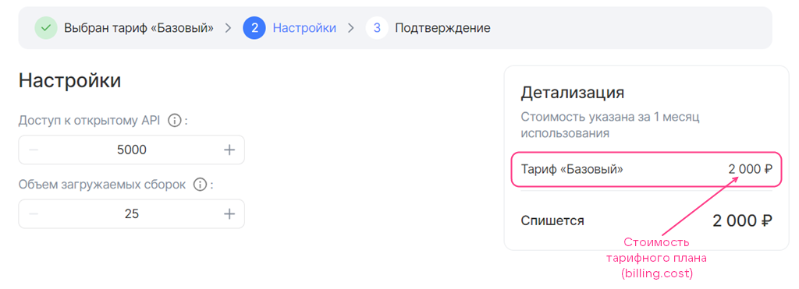

# {heading(plan.yaml file)[id=ibplan]}

{include(/en/_includes/_translated_by_ai_en.md)}

The `plans/<PLAN_NAME>/plan.yaml` file describes the parameters of a specific tariff plan. After the service package is uploaded and the service is published, the tariff plan will become available in the public store namespaces (`namespace_public`) specified in the service key (for more information, see the section [Uploading an image-based application to the store](../../ibservice_upload)).

In the `plans/<PLAN_NAME>/plan.yaml` file, specify the parameters and sections given in {linkto(#tab_plan_param)[text=table %number]}.

{caption(Table {counter(table)[id=numb_tab_plan_param]} — Parameters of the plans/<PLAN_NAME>/plan.yaml file)[align=right;position=above;id=tab_plan_param;number={const(numb_tab_plan_param)}]}
[cols="2,5,2,2", options="header"]
|===
| Name
| Description
| Format
| Required

| id
| UUID4 tariff plan identifier (ID) generated using a UUID4 generator
| string (UUID4)
| 

| revision
| Revision of the tariff plan. The combination of the revision and the tariff plan ID determines its uniqueness within the service. The remaining parameters describe the characteristics of a specific tariff plan revision
| string, up to 255 characters
| 

| name
| Technical name of the tariff plan, which is not displayed in the store interface. It must be specified in Latin letters using an underscore instead of spaces
| string, up to 255 characters
| 

| description
| Name of the tariff plan that is displayed in the store interface
| string, up to 255 characters
| 

| free
| Defines whether this tariff plan is free or not
| boolean
| 

| billing
| Defines the cost of the tariff plan excluding paid tariff options (for more information, see the section {linkto(#plan_billing)[text=%text]})
| 
| 

| parameters_patch
| Allows overriding the parameters of tariff options for a specific plan (for more information, see the section {linkto(#plan_options)[text=%text]})
| 
| 

| resource_usages
| Contains a list of postpaid tariff options
| Array
| Yes — for a plan with postpaid options
|===
{/caption}

{note:err}

The combination of the tariff plan ID and revision must be unique within the service. If a plan with the same identifier and revision already exists in this service, the tariff plan will not be updated.

{/note}

{note:warn}

Within a single tariff plan, only options of one billing type are allowed: a tariff plan with prepaid options or a tariff plan with postpaid options.

{/note}

Examples of `plans/<PLAN_NAME>/plan.yaml` files are provided in the section {linkto(#ibexample_plan)[text=%text]}.

## {heading(billing section of a tariff plan)[id=plan_billing]}

For the tariff plan cost, only the prepaid billing type is supported (for more information, see the section {linkto(/ru/tools-for-using-services/vendor-account/manage-apps/concepts/about#xaas_billing)[text=%text]}).

To describe the cost of a tariff plan ({linkto(#pic_plan_billing)[text=figure %number]}), specify the `billing` section in the `plans/<PLAN_NAME>/plan.yaml` file and set the parameters given in {linkto(#tab_plan_billing)[text=table %number]}.

{caption(Table {counter(table)[id=numb_tab_plan_billing]} — Parameters of the billing section)[align=right;position=above;id=tab_plan_billing;number={const(numb_tab_plan_billing)}]}
[cols="3,5,2,1,2", options="header"]
|===
|Name
|Description
|Format
|Required
|Default value

|cost
|
Defines the cost of the tariff plan for a billing period excluding paid tariff options.

If the plan is free, specify `0`. The cost is set in the currency of the country where the store is deployed
|float
| 
|
—

|refundable
|
Defines whether or not to refund funds for the remaining days of the billing period to the project bonus account if the user changed the tariff plan or deleted the service instance.

This parameter affects the date when the service payment is charged if the user changes the tariff plan (edits tariff options or switches to a new one):

* If the value is `true`, the date does not change.
* If the value is `false`, the date is updated to the date of the tariff plan change

|boolean
| 
|
`true`

|billing_cycle_flat
|
Defines the duration of the billing period for billing.

Format: `<NUMBER_OF_MONTHS> mons <NUMBER_OF_DAYS> days`. For example, `1 mons 15 days`, `30 days`.

{note:info}

The number of days in the month `mons` is calculated based on the calendar value. Therefore, the periods `1 mons 0 days` and `0 mons 31 days` are not equal to each other.

{/note}
|string
| 
|
`1 mons 0 days`
|===
{/caption}

{caption(Example of filling in the `billing` section)[align=left;position=above]}
```yaml
billing:
  cost: 2000
  refundable: true
  billing_cycle_flat: 1 mons 0 days
```
{/caption}

{caption(Figure {counter(pic)[id=numb_pic_plan_billing]} — Tariff plan cost)[align=center;position=under;id=pic_plan_billing;number={const(numb_pic_plan_billing)} ]}

{/caption}

{note:warn}

The cost of using the cloud platform computing resources is not included in the tariff plan cost of the service.

{/note}

Paid tariff options can be added to the plan cost. To do this, describe their cost in YAML files (for more information, see the section {linkto(../ibopt_fill_in#IB_option_fill_in)[text=%text]}).

{note:info}

To make effective use of the bonuses provided for testing and debugging the service in the store (for more information, see the section {linkto(../../ibservice_upload/ibservice_upload_package#ibservice_upload_package)[text=%text]}), specify a test cost for the tariff plan and its options.

{/note}

## {heading(parameters_patch section)[id=plan_options]}

To override the parameters of tariff options for a specific tariff plan or add new ones not specified in the YAML files:

1. In the `plans/<PLAN_NAME>/plan.yaml` file, specify:

   * The `parameters_patch` section.
   * Inside `parameters_patch` — the names of the YAML files of the tariff options.

1. Set the values of the tariff option parameters. Specify the parameter names with the path to the root section. Separate the parameter name and the names of its parent sections with a dot.

   The possible parameters depending on the tariff option type are given in the section [Tariff option YAML file](../iboption).

   {caption(Example of overriding tariff option parameters)[align=left;position=above]}
   ```yaml
   parameters_patch:
     users:
       schema.const: 5000
     volume_data_size:
       schema.default: 550
       schema.minimum: 550
   ```
   {/caption}

   The parameter values specified in the tariff option YAML file will not be applied in the tariff plan.

To override a tariff option section completely:

1. In the `plans/<PLAN_NAME>/plan.yaml` file, specify:

   * The `parameters_patch` section.
   * Inside `parameters_patch` — a tariff option section. For example, `billing`.

1. Set the section parameters (for more information, see the section [Tariff option YAML file](../iboption)).

   {caption(Example of overriding the `billing` section of a tariff option)[align=left;position=above]}
   ```yaml
   parameters_patch:
     assemblies_size:
       billing:
         base: 25
         cost: 0
         unit:
           size: 100
   ```
   {/caption}

   The parameters specified for this section in the tariff option YAML file will not be applied in the tariff plan.

{note:warn}

Simultaneously overriding a section completely and an individual parameter from that section is prohibited.

{/note}

{note:info}

If the tariff plans use options that differ significantly from each other, it is recommended to describe each option in a separate YAML file in the `parameters` directory. It is not recommended to describe one option and override most of its parameters within tariff plans.

{/note}

## {heading(Examples of plan.yaml files)[id=ibexample_plan]}

{caption(Example of a tariff plan with overriding tariff option parameters)[align=left;position=above]}
```yaml
id: b2b42648-XXXX-b4cddbf010b2
revision: v. 1.0
name: basic
description: Basic
free: false

billing:
  cost: 2000
  refundable: true
  billing_cycle_flat: 1 mons

parameters_patch:
  users:
    schema.const: 5000
  volume_data_size:
    schema.default: 550
    schema.minimum: 550
```
{/caption}

{caption(Example of a tariff plan with a postpaid tariff option)[align=left;position=above]}
```yaml
id: 3aa541d8-XXXX-6dbf542b3f90
revision: v. 1.1
name: postpaid
description: Postpaid
free: true

billing:
  cost: 0

resource_usages:
  - storage
```
{/caption}