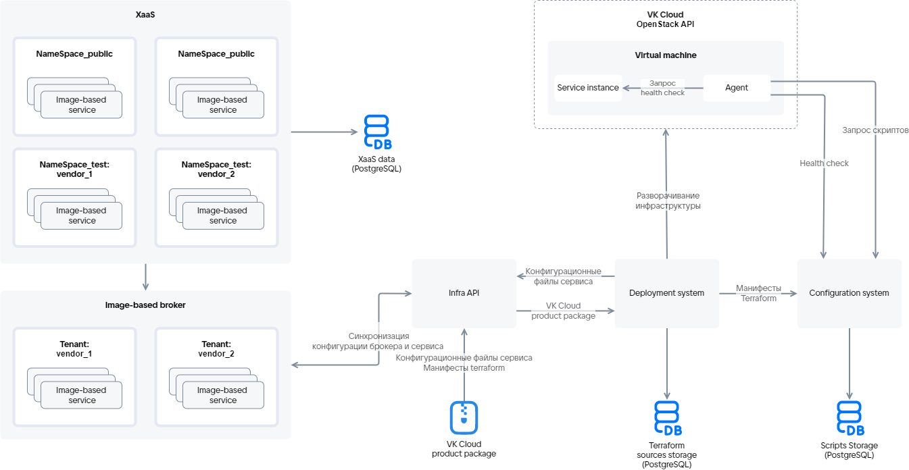

# {heading(Uploading a service package to the store)[id=ibservice_upload_package]}

{include(/en/_includes/_translated_by_ai_en.md)}

## {heading(Upload scheme)[id=upload_scheme]}

The service package is uploaded to the store using the deployment system via the Infra API service. The upload scheme is shown in {linkto(#pic_ib_upload)[text=figure %number]}.

{caption(Figure {counter(pic)[id=numb_pic_ib_upload]} — Service package upload scheme)[align=center;position=under;id=pic_ib_upload;number={const(numb_pic_ib_upload)} ]}
{params[noBorder=true]}
{/caption}

The description of the main scheme elements is provided in {linkto(#tab_scheme_elements)[text=table %number]}.

{caption(Table {counter(table)[id=numb_tab_scheme_elements]} — Description of the main scheme elements)[align=right;position=above;id=tab_scheme_elements;number={const(numb_tab_scheme_elements)}]}
[cols="2,5", options="header"]
|===
|Name
|Description

|
Infra API
|
Serves as the integration point between the store and the cloud platform for deploying image-based applications. Infra API verifies the data of the user uploading a service package or deploying a service instance. After successful verification, Infra API gets access to inter-service communication to create the resources described in the Terraform manifest. Infra API interacts with the deployment system and the configuration management service

|
Deployment system
|
Provides deployment of an image-based application on VMs in the cloud platform. Manages the service infrastructure and software

|
Image-based broker
|
Manages the life cycle of a service instance and includes tenants. Tenants combine image-based applications of a single vendor (`vendor`)

|
Configuration management service (Configuration system)
|
A server that stores:

* The configuration described in Terraform manifests.
* The results of script execution.
* The current configuration of the service instance.

Provides access to the current version of the agent installed on a VM

|
Marketplace agent (Agent)
|
Software installed on a VM during service deployment (for more information, see the section [Marketplace agent](/ru/tools-for-using-services/vendor-account/manage-apps/concepts/vendor-preconditions/ib_image_agent))

|
Service package ({var(cloud)} product package)
|
A structured set of YAML files and Terraform manifests
|===
{/caption}

The test (`NameSpace_test`) and public (`NameSpace_public`) namespaces of the store for each service are specified in the service key.

## {heading(Procedure for uploading a service package to the store)[id=upload_actions]}

1. Perform the steps described in {linkto(../ibservice_upload_prepare#ibservice_upload_prepare)[text=%text]}.
1. Test the Terraform manifests locally (for more information, see the section {linkto(../ibservice_upload_localtest#ibservice_upload_localtest)[text=%text]}).
1. Test the Terraform manifests with the deployment system (for more information, see the section {linkto(../ibservice_upload_deploysystemtest#ibservice_upload_deploysystemtest)[text=%text]}).
1. Make sure the service package files are filled in and their structure matches the version of the JSON file generator in use (for more information, see the section {linkto(../../ib_structure#ib_structure)[text=%text]}).
1. Make sure the combination of ID and revision of each tariff plan is unique within the service package.
1. Pack the service package (the `<SERVICE_NAME>` directory with the service configuration files and Terraform manifests) into a zip archive. The archive size must not exceed 30 MB.
1. Upload the archive to the store in one of the following ways:

   {tabs}
   
   {tab(Vendor dashboard)}
      
   1. [Go to](https://msk.cloud.vk.ru/app/) the {var(cloud)} personal dashboard.
   1. In the **Application store** section, click the **Go to vendor dashboard** button.
   1. On the **Service management** tab, click the **Add service** button.
   1. Select the zip archive on your device to upload it to the system.
   1. Click the **Add** button.

   After that, the added service appears in the list of services with the `Hidden` status. The uploaded archive file is sent for validation.

   {/tab}
   
   {tab(Infra API)}
   
   Send a request to the Infra API service with the following parameters:

   * Request method: `POST`.
   * Request path: `https://<CLOUD_HOST>/marketplace/api/infra-api/api/v1-public/product`

      Here `<CLOUD_HOST>` is the domain name of the cloud platform `https://cloud.vk.ru`.
   
   * Request body: zip archive.
   * `x-service-token`: `<SERVICE_TOKEN>` — the service key.

      {caption(Example of a request to upload a service package to the store)[align=left;position=above]}
      {tabs}
      
      {tab(Linux (bash))}
            
      ```console
      curl -v -X POST https://cloud.vk.ru/marketplace/api/infra-api/api/v1-public/product \
      -H 'x-service-token: <SERVICE_TOKEN>' \
      -F "upload=@/home/VKservice.zip"
      ```

      {/tab}
      
      {tab(Windows (cmd))}
      
      ```console
      curl -v -X POST https://cloud.vk.ru/marketplace/api/infra-api/api/v1-public/product ^
      -H "x-service-token: <SERVICE_TOKEN>" ^
      -F "upload=@/home/VKservice.zip"
      ```

      {/tab}
      
      {/tabs}
      {/caption}

      HTTP response codes:

       * 204 — the service package has been uploaded.
       * 400, 404, 500 — request execution error.
       * 401 — authorization error.

      The configuration files describing the service tariff plans and options are passed to the image-based broker, and the Terraform manifests are passed to the deployment system.

   {/tab}
   
   {/tabs}

   A service package uploaded to the store first goes to the test namespace and, after publication, to the public one.

1. After the service upload is complete, log in to the cloud platform dashboard and make sure the service is displayed in the store. The uploaded service will be available only to users of the store test namespaces specified in the service key.

   {note:info}

   If the service is not displayed in the store after upload, log out of the dashboard and log in again.

   {/note}

## {heading(Testing the uploaded service before publication)[id=upload_test]}

To check how the service will operate in the cloud platform, after uploading the service package, test the service in the test namespace of the store:

{note:info}

Bonuses are granted for service testing. To receive bonuses, send an email to [marketplace@cloud.vk.com](mailto:marketplace@cloud.vk.com). The bonus funds will be credited to the bonus account of the cloud platform project.

{/note}

1. [Go to](https://msk.cloud.vk.ru/app/) the VK Cloud personal dashboard.
1. Make sure the configuration wizard of each tariff plan is displayed correctly.
1. Connect the service. Make sure the service instance has been deployed successfully.

   If a resource described in the manifest fails to be created during service instance deployment, the deployment system will restart the service deployment process. Retry attempts may take up to 1.5 hours and can be disabled in the `settings.yaml` file (for more information, see the section {linkto(../../tf_manifest/tf_manifest_settings#tf_manifest_settings)[text=%text]}).

   {note:warn}

   On each new attempt to deploy the service, all existing resources are deleted and created anew.

   {/note}

   {note:info}

   If an error occurs when connecting the service, check the logs (for more information, see the section {linkto(#ibservice_upload_package_log)[text=%text]}).

   {/note}
1. Update the service instance:

   1. Change the values of the tariff options of the current tariff plan.
   1. Switch to a new tariff plan.

      Changing the parameters of resources described in the manifest triggers the service instance reinstallation process, during which only the changed resources are updated. If the deployment system fails to update the resources, it will retry updating them. The process of updating the service instance configuration, including retries, may take up to 1.5 hours. Retry attempts can be disabled in the `settings.yaml` file (for more information, see the section {linkto(../../tf_manifest/tf_manifest_settings#tf_manifest_settings)[text=%text]}).

   {note:warn}

   When updating the service instance configuration, the deployment system updates only the changed resources.

   {/note}
1. Check the main user scenarios of the service.
1. Delete the service instance.
1. If necessary, make changes to the service configuration (for more information, see the section {linkto(../../../../instructions/manage-ib-apps/update-ib-app#ibservice_update)[text=%text]}).

   {note:warn}

   If test values were set for the service cost in the service configuration for the duration of testing and debugging, edit them.

   {/note}
1. If changes were made to the service package during testing, make sure the service revision has been updated.

## {heading(Viewing the logs of a service instance)[id=ibservice_upload_package_log]}

1. [Go to](https://msk.cloud.vk.ru/app/) the VK Cloud personal dashboard.
1. Go to the **Application store** section.
1. Open the console and obtain the store authorization JWT token:

   {tabs}
   
   {tab(Linux (bash))}
      
   ```console
   curl -X POST https://cloud.vk.ru/marketplace/api/um/v1/tokens/sid \
   --cookie 'sid=<SID>'
   ```

   {/tab}
   
   {tab(Windows (cmd))}
   
   ```console
   curl -X POST https://cloud.vk.ru/marketplace/api/um/v1/tokens/sid ^
   --cookie "sid=<SID>"
   ```

   {/tab}

   {/tabs}

   Here `<SID>` is the value of the `sid` cookie file in the web browser.

   The command response will display the JWT token.
1. Get the log of the service instance:

   {tabs}
   
   {tab(Linux (bash))}
      
   ```console
   curl -v https://cloud.vk.ru/marketplace/api/notifications/api/v1/instance?uuid=<UUID> \
   -H 'Authorization: Bearer <JWT_TOKEN>'
   ```

   {/tab}
   
   {tab(Windows (cmd))}
   
   ```console
   curl -v https://cloud.vk.ru/marketplace/api/notifications/api/v1/instance?uuid=<UUID> ^
   -H "Authorization: Bearer <JWT_TOKEN>"
   ```

   {/tab}
   
   {/tabs}

   Here:

   * `<UUID>` — the identifier of the service instance. The value is displayed in the cloud platform dashboard on the service instance page — the **ID** parameter.
   * `<JWT_TOKEN>` — the authorization JWT token obtained in the previous step.