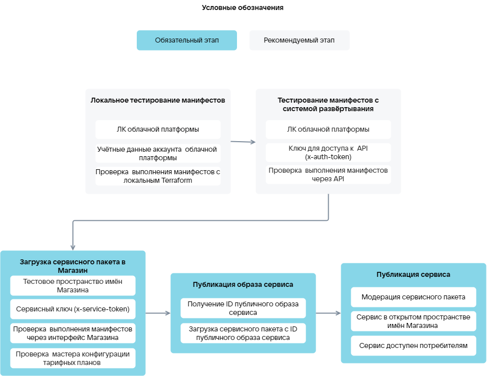

# {heading(Service upload phases)[id=ibservice_upload_phases]}

{include(/en/_includes/_translated_by_ai_en.md)}

The upload phases of an image-based application ({linkto(#pic_upload_phases)[text=figure %number]}):

1. {linkto(../ibservice_upload_localtest#ibservice_upload_localtest)[text=%text]}.
1. {linkto(../ibservice_upload_deploysystemtest#ibservice_upload_deploysystemtest)[text=%text]}.
1. {linkto(../ibservice_upload_package#ibservice_upload_package)[text=%text]}.
1. {linkto(../ibservice_upload_publish_image#ibservice_upload_publish_image)[text=%text]}.
1. {linkto(../ibservice_upload_publish#ibservice_upload_publish)[text=%text]}.

{caption(Figure {counter(pic)[id=numb_pic_upload_phases]} — Phases of uploading an image-based application to the marketplace)[align=center;position=under;id=pic_upload_phases;number={const(numb_pic_upload_phases)} ]}
{params[noBorder=true]}
{/caption}

Before testing the Terraform manifests, verify that the parameters of existing cloud platform resources (for example, the VM type or the service image) are correctly specified in the manifests. Use the [VK CS provider data sources](https://github.com/vk-cs/terraform-provider-vkcs/tree/master/docs/data-sources). Terraform installation and configuration is described in the section {linkto(../ibservice_upload_localtest#ibservice_upload_localtest)[text=%text]}.

{caption(Example of verifying that the specified VM type exists in the cloud platform)[align=left;position=above]}
```hcl
data "vkcs_compute_flavor" "compute" {
flavor_id = "4e115a9b-XXXX-95cf130d63c7"
}
```
{/caption}

{note:info}

Verifying the parameters of existing cloud platform resources will reduce the manifest testing time and prevent attempts to create resources with an incorrect configuration.

{/note}