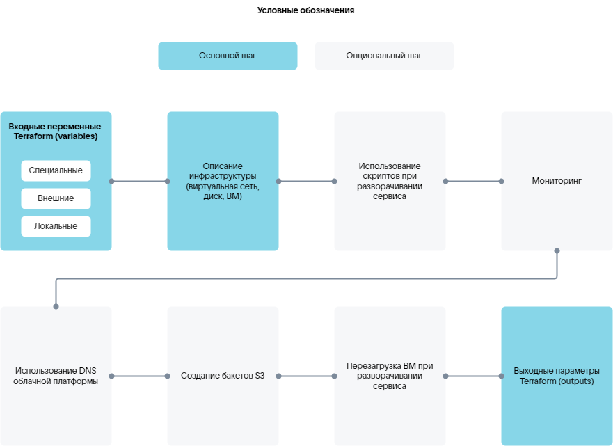

# {heading(Terraform manifest)[id=tf_manifest_steps]}

{include(/en/_includes/_translated_by_ai_en.md)}

The infrastructure configuration of an image-based application is described using a Terraform manifest `plans/<PLAN_NAME>/deployment/deploy.tf` written in `HashiCorp Configuration Language (HCL)` (for syntax, see the [official website](https://developer.hashicorp.com/terraform/language/syntax/configuration)).

In the `plans/<PLAN_NAME>/deployment/deploy.tf` manifest, describe the infrastructure for deploying a service instance. Use the resources and data sources of the providers from {linkto(#tab_providers)[text=table %number]}.

{caption(Table {counter(table)[id=numb_tab_providers]} — Terraform providers)[align=right;position=above;id=tab_providers;number={const(numb_tab_providers)}]}
[cols="2,5,2", options="header"]
|===
|Name
|Description
|Designation in the manifest

|VK CS
|
Contains resources and data sources for describing the service infrastructure.

Resources and data sources are provided in the [official provider documentation](https://github.com/vk-cs/terraform-provider-vkcs/tree/master/docs).

Examples of manifest content describing resource creation are provided in the scenarios in the [How-To Guides](/en/tools-for-using-services/terraform/how-to-guides) section on using Terraform
|
`vkcs`

|VK CS Infra (iVK CS)
|
Contains resources and data sources that extend the capabilities of the VK CS provider. For example, they make it possible to monitor the state of a service instance, run scripts, and use their results during deployment. Bash and Python are supported for scripts.

Resources and data sources are provided in the [VK CS Infra (iVK CS) provider reference](../../../ivkcs) section
|
`ivkcs`

|Null
|
The provider resources are used to run external processes or actions not directly related to infrastructure resources
|
`null`

|Random
|
The provider resources (for details, see the [official provider documentation](https://github.com/hashicorp/terraform-provider-random/tree/main/docs)) are used to generate passwords for accessing a service instance
|
`random`

|Time
|
The provider resources are used to configure time-based interaction between other resources. For example, creating a pause or a timestamp
|
`time`
|===
{/caption}

## {heading(Terraform elements)[id=tf_elements]}

Use the main Terraform elements in the manifest:

* `variables` — input variables for resource configuration.
* `resources` — resources that allow managing infrastructure objects. For example, creating a VM. When describing resources, you can specify dependencies using the `depends on` block. A resource will not be created if at least one dependency is not met.
* `data-sources` — data sources that allow obtaining specific information from the provider. For example, retrieving available VM types or getting script execution results.
* `outputs` — output parameters, the results of the manifest execution.

## {heading(Steps for the Terraform manifest)[id=tf_manifest_steps]}

The main and optional steps described in the Terraform manifest are shown in {linkto(#pic_tf_steps)[text=figure %number]}.

{caption(Figure {counter(pic)[id=numb_pic_tf_steps]} — Steps for the Terraform manifest)[align=center;position=under;id=pic_tf_steps;number={const(numb_pic_tf_steps)} ]}
{params[noBorder=true]}
{/caption}

{note:err}

The specific steps for describing a service deployment depend on the required infrastructure and its settings for a particular service.

{/note}

The main steps for deploying a service on a VM in the cloud platform:

1. {linkto(../tf_manifest_variable#tf_manifest_variable)[text=Describing input variables for resource configuration]}.
1. {linkto(../tf_manifest_image#tf_manifest_image)[text=Describing the infrastructure]}.
1. {linkto(../tf_manifest_output#tf_manifest_output)[text=Describing output parameters]}.

Additional capabilities:

* {linkto(../tf_manifest_script#tf_manifest_script)[text=Using scripts]}:

   * Executing scripts during service deployment or reinstallation.
   * Using script execution results by other manifest resources.
   * Retrieving script execution results.

* {linkto(../tf_manifest_monitoring#tf_manifest_monitoring)[text=%text]}.
* Using the cloud platform DNS (for details, see the [VK CS Infra (iVK CS) provider reference](../../../ivkcs) section).

   {note:warn}

   Managing the created resource DNS records (for example, deleting them) will not be available in the cloud platform management console.

   {/note}
* Creating {var(s3)} buckets (for details, see the [VK CS Infra (iVK CS) provider reference](../../../ivkcs) section). The created buckets will be displayed in the cloud platform management console.
* Rebooting the VM during service deployment (for details, see the [VK CS Infra (iVK CS) provider reference](../../../ivkcs) section).

Additional capabilities are provided by the resources of the iVK CS provider.

{note:info}

Obtain the service deployment identifier for the resources of the iVK CS provider using the special variable `instance_uuid` (for details, see the section {linkto(../tf_manifest_variable#tf_manifest_variable)[text=%text]}).

{/note}

VM monitoring and script usage are provided by special services (for details, see the section {linkto(../../ibservice_upload/ibservice_upload_package#ibservice_upload_package)[text=%text]}) that the iVK CS provider interacts with:

* Configuration management service.
* Agent.

The prepared manifest is uploaded to the deployment system as part of a service package (for details, see the section [Uploading an image-based application to the store](../../ibservice_upload)).

## {heading(Example of a Terraform manifest)[id=tf_manifest_example]}

Below is a manifest for deploying a Grafana service on a single VM using:

* External IP addresses.
* Cloud platform DNS.
* Address availability monitoring.

{caption(Example manifest for the Grafana service)[align=left;position=above]}
```hcl

# --------------------variables--------------------

# Special variables

# Service deployment identifier
variable "instance_uuid" {
  type    = string
  default = "4a57a965-3c83-436c-80e2-428e421538cc"
}

variable "email" {
  type    = string
  default = "user@example.com"
}

# External variables

# Placement with an external or internal IP address
variable "grafana_placement" {
  type    = string
  default = "internal"
}

# Backup
variable "backup_style" {
  type    = string
  default = "s3"
}

# Availability zone
variable "ds-az" {
  type    = string
  default = "ME1"
}

# VM type
variable "ds-flavor" {
  type    = string
  default = "a493b27d-170d-48eb-a24b-99e9b325f988"
}

# Subnet identifier
variable "ds-subnet" {
  type    = string
  default = "cd4224ac-0527-4291-a8e0-afae0cee02ed"
}

# Root disk type
variable "root_type" {
  type    = string
  default = "ceph-ssd"
}

# Root disk size, GB
variable "root_size" {
  type    = number
  default = 10
}

# Data storage disk type
variable "data_type" {
  type    = string
  default = "ceph-ssd"
}

# Data storage disk size, GB
variable "data_size" {
  type    = number
  default = 1
}

# Service image identifier
variable "image_uuid" {
  type        = string
  default     = "8c7a6443-bb79-4f04-884a-14231f0ba6cb"
  description = "grafana image"
}

# Access ports for the security group
variable "ports" {
  type    = list(number)
  default = [
    22, 80, 443
  ]
  description = "ports for secgroup rule. grafana [80, 443]"
}

locals {

  # Shortened version of instance_uuid
  short_name = substr(var.instance_uuid, 0, 8)

  # Hostname generation
  hosts_name = "${local.short_name}-grafana"
}

# ---------------------data------------------------

# Retrieving virtual network data
data "vkcs_networking_subnet" subnet {
  id = var.ds-subnet
}

# --------------------backup-----------------------

# Creating VK Object Storage buckets
resource "ivkcs_s3" "s3_backup" {
  count = var.backup_style == "s3" ? 1 : 0
  name  = "${local.hosts_name}-backup"
}

# --------------------security group---------------

# Creating a security group
resource "vkcs_networking_secgroup" "secgroup" {
  name = "${local.short_name}-grafana"
  sdn  = data.vkcs_networking_subnet.subnet.sdn
}

# Security group rules
resource "vkcs_networking_secgroup_rule" "rules" {
  count             = length(var.ports)

  # Determining the direction of rule application — for incoming (ingress) or outgoing (egress) connections
  direction         = "ingress"

  # List of access ports
  port_range_max    = element(var.ports, count.index)
  port_range_min    = element(var.ports, count.index)

  # Access protocol
  protocol          = "tcp"

  # Remote network prefix
  remote_ip_prefix  = "0.0.0.0/0"

  # Identifier of the security group for which the rules are created
  security_group_id = vkcs_networking_secgroup.secgroup.id
  description       = "rule_tcp_${element(var.ports, count.index)}"
}

# --------------------network----------------------

# Binding an IP address to a port
resource "vkcs_networking_port" "ports" {
  name               = "${local.short_name}-grafana"
  admin_state_up     = "true"
  network_id         = data.vkcs_networking_subnet.subnet.network_id
  sdn                = data.vkcs_networking_subnet.subnet.sdn
  security_group_ids = [
    vkcs_networking_secgroup.secgroup.id
  ]
  fixed_ip {
    subnet_id = var.ds-subnet
  }
}

# --------------------keypair----------------------

# Creating a key pair
resource "ivkcs_ssh_keypair" "keypair" {}

# --------------------------vm---------------------

# Creating a cloud-config configuration. Retrieving data for initializing the agent on the host
resource "ivkcs_user_data" "user_data" {

  # Service deployment identifier
  uuid      = var.instance_uuid
  hosts     = [local.hosts_name]
  target_os = "almalinux9"

  # SSH access keys
  ssh_authorized_keys = [
    ivkcs_ssh_keypair.keypair.public_key,
  ]
}

# Creating a VM
resource "vkcs_compute_instance" "grafana" {
  name              = local.hosts_name
  flavor_id         = var.ds-flavor
  security_groups   = [vkcs_networking_secgroup.secgroup.name]
  availability_zone = var.ds-az
  metadata          = { "sid" : "xaas", "product" : "grafana" }

  # Root disk
  block_device {
    source_type      = "volume"
    destination_type = "volume"
    boot_index       = 0
    uuid             = vkcs_blockstorage_volume.boot.id
  }

  # Applying the cloud-config configuration to configure the VM. Installing the agent
  user_data = ivkcs_user_data.user_data.user_data[0]

  # Attaching an IP address to the VM
  network {
    port = vkcs_networking_port.ports.id
  }

  # Attempting to stop the VM before deletion
  stop_before_destroy = true

  # VM creation timeout
  timeouts {
    create = "10m"
  }
}

# --------------------volume-----------------------

# Creating a root disk
resource "vkcs_blockstorage_volume" "boot" {
  name              = "${local.short_name}-grafana-boot"

  # Metadata
  metadata          = { "sid" : "xaas", "product" : "grafana" }

  # Service image identifier
  image_id          = var.image_uuid
  volume_type       = var.root_type
  size              = var.root_size
  availability_zone = var.ds-az
}

# Creating a data disk
resource "vkcs_blockstorage_volume" "grafana_data" {
  name              = "${local.short_name}-grafana-data"

  # Metadata
  metadata          = { "sid" : "xaas", "product" : "grafana" }
  size              = var.data_size
  availability_zone = var.ds-az
  volume_type       = var.data_type
}

# Attaching the data disk to the VM
resource "vkcs_compute_volume_attach" "attached" {
  instance_id = vkcs_compute_instance.grafana.id
  volume_id   = vkcs_blockstorage_volume.grafana_data.id
}

# -----------------------external------------------

# Retrieving the pool of external IP addresses
resource "vkcs_networking_floatingip" "fips" {
  count = var.grafana_placement == "external" ? 1 : 0
  pool  = data.vkcs_networking_subnet.subnet.sdn == "neutron" ? "ext-net" : "internet"
}

# Assigning an external IP address to the VM
resource "vkcs_compute_floatingip_associate" "fip" {
  count       = length(vkcs_networking_floatingip.fips)
  floating_ip = vkcs_networking_floatingip.fips[count.index].address
  instance_id = vkcs_compute_instance.grafana.id
}

# Creating an A record in the cloud platform DNS
resource "ivkcs_dns" "grafana" {
  count  = length(vkcs_networking_floatingip.fips)
  name   = "grafana-${local.short_name}"
  domain = "xaas.msk.vkcs.cloud"
  ip     = vkcs_networking_floatingip.fips[count.index].address
}

# --------------------agent-run--------------------
locals {
  grafana_domain   = var.grafana_placement == "external" ? "${ivkcs_dns.grafana[0].name}.${ivkcs_dns.grafana[0].domain}" : vkcs_compute_instance.grafana.access_ip_v4
  grafana_root_url = var.grafana_placement == "external" ? "https://${local.grafana_domain}" : "http://${local.grafana_domain}"

  # Startup script for the ivkcs_agent_exec.start resource
  start = <<-EOT
#!/bin/bash
ansible-playbook start.yml \
  --extra-vars "lego_enabled=${var.grafana_placement == "external" ? "true" : "false"}" \
  --extra-vars "lego_email=${var.email}" \
  --extra-vars "backup_enabled=${var.backup_style == "s3" ? "true" : "false"}" \
  --extra-vars "backup_access_token=${try(ivkcs_s3.s3_backup[0].access, "n/a")}" \
  --extra-vars "backup_secret_token=${try(ivkcs_s3.s3_backup[0].secret, "n/a")}" \
  --extra-vars "backup_bucket_name=${try(ivkcs_s3.s3_backup[0].name, "n/a")}_bucket" \
  --extra-vars "grafana_domain=${local.grafana_domain}" \
  --extra-vars "grafana_root_url=${local.grafana_root_url}"
EOT
}

resource "ivkcs_agent_exec" "start" {
  hosts = [local.hosts_name]
  name  = "start_grafana"
  uuid  = var.instance_uuid
  step {
    index   = 1
    type    = "bash"
    content = local.start
    options {
      timeout  = "20m"
      cwd      = "/opt/playbooks"
      attempts = 1
    }
  }

  depends_on = [
    vkcs_compute_instance.grafana,
    vkcs_compute_volume_attach.attached,
  ]
}

# --------------------health check-----------------

# VM monitoring
resource "ivkcs_agent_check" "health" {
  hosts = [local.hosts_name]
  uuid  = var.instance_uuid

  # Address-based monitoring
  http_health {
    method     = "GET"
    protocol   = var.grafana_placement == "internal" ? "http" : "https"
    host       = local.grafana_domain
    path       = "/api/health"
    http_codes = [200]
    period     = "30s"
  }

  timeouts {
    create = "5m"
  }

  depends_on = [
    ivkcs_agent_exec.start,
  ]
}

# --------------------outputs----------------------

# Outputting the private SSH key for accessing the VM
output "keypair" {
  value     = ivkcs_ssh_keypair.keypair.private_key

  # The output parameter contains sensitive data
  sensitive = true
}

# Outputting the Grafana URL
output "grafana_url" {
  value = local.grafana_root_url
}

# Outputting the VK Object Storage bucket identifier
output "s3_backup" {
  value = try(ivkcs_s3.s3_backup[0].id, "n/a")
}
```
{/caption}