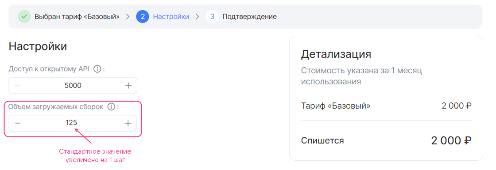
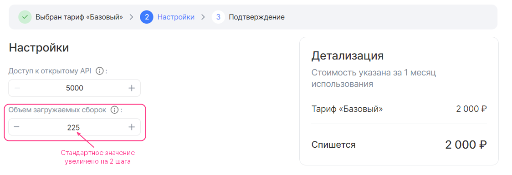
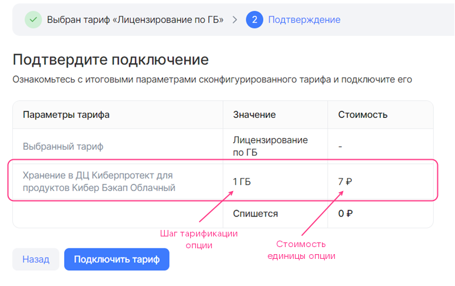

## {heading(Structure)[id=saas_plan_structure]}

{include(/en/_includes/_translated_by_ai_en.md)}

In the `plans` section, describe the service's tariff plans using the following structure:

```json
      "plans": [
        {
          <PLAN_PARAMETERS>,
          "display": {
          },
          "billing": {
          },
          "schemas": {
          }
        },
        ...
      ]
```

Here:

* `<PLAN_PARAMETERS>` — plan parameters (for details, see the section {linkto(#saas_plan_param)[text=%text]}).
* The `display` section — describes the configuration wizard of a specific tariff plan (for details, see the section {linkto(#saas_plan_display)[text=%text]}).
* The `billing` section — describes the cost of the plan and its options (for details, see the section {linkto(#saas_plan_billing)[text=%text]}).
* The `schemas` section — describes the plan's tariff options (for details, see the section {linkto(#saas_plan_schema)[text=%text]}).

## {heading(Tariff plan parameters)[id=saas_plan_param]}

For a tariff plan, specify the parameters listed in {linkto(#tab_plan_params)[text=table %number]}.

{caption(Table {counter(table)[id=numb_tab_plan_params]} — Tariff plan parameters)[align=right;position=above;id=tab_plan_params;number={const(numb_tab_plan_params)}]}
[cols="2,4,2,1,2", options="header"]
|===
|Name
|Description
|Format
|Required
|Default value

|id
|
Tariff plan identifier UUID4 (ID) generated using the UUID4 generator
|string (UUID4)
| 
| 

|revision
|
Tariff plan revision. The combination of the revision and the tariff plan ID determines its uniqueness within the service. The remaining parameters describe the characteristics of a specific tariff plan revision
|string, up to 255 characters
| 
| 

|name
|
Technical name of the tariff plan that is not displayed in the store interface. It must consist of Latin letters with an underscore used instead of spaces
|string, up to 255 characters
| 
| 

|description
|
Name of the tariff plan that is displayed in the store interface
|string, up to 255 characters
| 
| 

|free
|
Defines whether the tariff plan is free or not
|boolean
| 
| 

|plan_updateable
|Defines whether the user can switch from one tariff plan to another without deleting the service.

Overrides the value set in the identically named service parameter
|boolean
| 
| 

|metadata
|Defines the test and public store namespaces in which the tariff plan will be available.

Test namespaces are specified in the `test_ns` key.

Public namespaces are specified in the `prod_ns` key.

To obtain the namespace names, send an email to [marketplace@cloud.vk.com](mailto:marketplace@cloud.vk.com).

If the namespaces are not specified, the values set in the identically named service parameter will be used (for details, see the section {linkto(../saas_param#saas_param)[text=%text]})
|map, keys — string
| 
| 
|===
{/caption}

{note:err}

The combination of the tariff plan ID and revision must be unique within the service. If a plan with the same identifier and revision already exists in this service, the tariff plan will not be updated.

{/note}

## {heading(The display section)[id=saas_plan_display]}

In the `display` section, describe the configuration wizard of the tariff plan (for details, see the section {linkto(/en/tools-for-using-services/vendor-account/manage-apps/concepts/about#xaas_wizard)[text=%text]}) using the following structure:

```json
"display": {
  "pages": [
    {
      <PAGE_PARAMETERS>,
      "groups": [
        {
          <GROUP_PARAMETERS>,
          "parameters": [
            {
              <OPTION_PARAMETERS>
            },
            ...
          ]
        }
        ...
      ]
    },
  ...
  ]
}
```

Here:

* The `pages` section — describes the pages of the tariff plan configuration wizard. It can be empty.
* `<PAGE_PARAMETERS>` — parameters of a single page.
* The `groups` section — describes groups of tariff options within a single page.
* `<GROUP_PARAMETERS>` — parameters of a group of tariff options.
* The `parameters` section — defines tariff options within a single group.

   {note:warn}

   The same tariff option can be specified in only one group.

   {/note}
* `<OPTION_PARAMETERS>` — parameters of tariff options.

The `display` section describes all pages of the tariff plan configuration wizard except the first and the last ones. The maximum number of pages is 5.

The parameters of pages, groups, and tariff options in groups are identical and are listed in {linkto(#tab_plan_params)[text=table %number]}.

{caption(Table {counter(table)[id=numb_tab_plan_params]} — Parameters of pages, groups, and tariff options for the tariff plan configuration wizard)[align=right;position=above;id=tab_plan_params;number={const(numb_tab_plan_params)}]}
[cols="2,5,4,2", options="header"]
|===
|Name
|Description
|Format
|Required

|name
|
Name of the page, group, or tariff option in the JSON file.

{note:warn}

In the store interface, tariff options will be displayed with the names specified in the `description` parameter of these options (the `plans.schemas` section).

{/note}
|
string.

Page name — up to 32 characters.

Group name — up to 255 characters
| 

|index
|
Sequential number of the page, the group on the page, or the tariff option in the group
|
integer
| 
|===
{/caption}

The tariff plan configuration wizard shown in {linkto(#pic_wizard_saas)[text=figure %number]} corresponds to the following content of the `display` section:

```json
"display": {
  "pages": [
    {
      "name": "Настройки", // Имя страницы
      "index": 0,
      "groups": [
        {
          "name": "", // Имя группы
          "index": 0,
          "parameters": [
            {
              "name": "api_requests_daily_limit", // Имя тарифной опции в JSON-файле
              "index": 0,
            },
            {
              "name": "groups",
              "index": 1,
            },
            {
              "name": "products",
              "index": 2,
            },
            {
              "name": "reports",
              "index": 3
            }
          ]
        }
      ]
    }
  ]
}
```

{caption(Figure {counter(pic)[id=numb_pic_wizard_saas]} — Tariff plan configuration wizard)[align=center;position=under;id=pic_wizard_saas;number={const(numb_pic_wizard_saas)} ]}

{/caption}

By default, all tariff option groups `groups` are displayed and can be configured in the tariff plan configuration wizard. To make a group appear only under certain conditions, use the `when` construct. The construct is described in the section {linkto(/en/tools-for-using-services/vendor-account/manage-apps/ibservice_add/ibservice_configure/ib_display#IBdisplay_when)[text=%text]}.

{note:warn}

The broker must support creating a service instance taking into account the conditions specified in the `when` constructs.

{/note}

{caption(The `when` structure in JSON format)[align=left;position=above]}
```json
{
  "when": {
    "in": { // Или "not_in"
      "key": {
        "param": "<OPTION>" // Или "const": "<VALUE>"
      },
      "values": [
        {
          "const": "<VALUE>"
        },
        {
          "param": "<OPTION>"
        },
      ...
      ]
    }
  },
  "parameters": [
  ...
  ]
}
```
{/caption}

Here:

* `<OPTION>` — name of the tariff option in the JSON file.
* `<VALUE>` — value of the constant.

The `when` construct in the `pages` section is used in the same way as in image-based applications (for details, see the section {linkto(/en/tools-for-using-services/vendor-account/manage-apps/ibservice_add/ibservice_configure/ib_display#IBdisplay_when_in_pages)[text=%text]}).

{caption(Example of using the when construct in the `pages` section)[align=left;position=above]}
```json
{
  "pages": [
    {
      "name": "Настройки бекапа", // Имя страницы
      "groups": [
        {
          "name": "High-frequency бекап", // Имя группы тарифных опций
          "parameters": [
            {
              "name": "frequency_per_day" // Имя тарифной опции в JSON-файле
            }
          ],
          "when": {
            "in": {
              "key": {
                "param": "backup_method" // Имя тарифной опции в JSON-файле
              },
              "values": [
                {
                  "const": "high-frequency"
                }
              ]
            }
          }
        }
      ]
    }
  ]
}
```
{/caption}

In the example above, the backup creation frequency is configured for the high-frequency method: if the value of the `backup_method` tariff option is `high-frequency`, the tariff plan configuration wizard displays the `High-frequency бекап` group with the `frequency_per_day` tariff option.

The `backup_method` tariff option:

* Can be used in the `when` construct in other groups.
* Must be specified in `parameters` in another group.

The `frequency_per_day` tariff option cannot be used in other groups:

* In the `when` construct, because only one level of dependency hierarchy is supported.
* In `parameters`, because a single tariff option can be specified in only one group.

## {heading(The billing section)[id=saas_plan_billing]}

The `billing` section specifies:

* The cost of a specific tariff plan.
* The duration of the reporting period for billing.
* The frequency with which Marketplace requests usage reports from the broker.
* The procedure for handling unused bonuses.
* The custom change step for tariff options of the `integer` type.
* The cost of the plan's tariff options. Paid tariff options can be of the following types:

  * Numeric (`integer`, `number`). Both prepaid and postpaid billing are supported.
  * Boolean (`boolean`). Prepaid billing is supported.

For more information about billing types, see the section {linkto(/en/tools-for-using-services/vendor-account/manage-apps/concepts/about#xaas_billing)[text=%text]}.

{note:warn}

Within a single tariff plan, only options of one billing type are allowed: a tariff plan with prepaid options or a tariff plan with postpaid options.

{/note}

The applied billing method is determined by the location where the tariff options are described in the `plans.schemas` section (for details, see the section {linkto(#saas_plan_schema)[text=%text]}):

* If the options are described in the `service_instance.create` and `service_instance.update` sections, prepaid billing is applied.
* If the options are described in the `service_instance.resource_usages` section, postpaid billing is applied.

Describe the `billing` section using the following structure:

```json
"billing": {
            "cost": <COST>,
            "billing_cycle_flat": <PERIOD>,
            "billing_cycle_step": <STEP>,
            "refundable": <IS_REFUNDABLE>,
            "options": {
              "<OPTION>": {
                <OPTION_BILLING>
                },
              ...
              }
            }
```

Here:

* The `cost` parameter — defines the cost of the plan for the reporting period `<COST>` excluding paid tariff options. It is set in the currency of the country where the store is deployed. If the plan is free, `0` is specified. Only prepaid billing is supported.
* (Optional) The `billing_cycle_flat` parameter — defines the duration of the reporting period for billing. It can be specified only for a prepaid tariff plan. The default value is `1 mons 0 days`.

  It is set in the format: `<NUMBER_OF_MONTHS> mons <NUMBER_OF_DAYS> days`, for example: `1 mons 15 days`, `30 days`. The number of days in a month `mons` is calculated based on the calendar value, so the periods `1 mons 0 days` and `0 mons 31 days` are not equal to each other.

* (Optional) The `billing_cycle_step` parameter — defines the duration of the period with which the store polls the broker for unprocessed reports (for details, see the section [Billing](../../../concepts/about#xaas_billing)). It can be specified only for a tariff plan with postpaid tariff options. The default value is `1 mons 0 days`.

  It is set in the format: `<NUMBER_OF_MONTHS> mons <NUMBER_OF_DAYS> days`, for example: `1 mons 15 days`, `30 days`. The number of days in a month `mons` is calculated based on the calendar value, so the periods `1 mons 0 days` and `0 mons 31 days` are not equal to each other.

* (Optional) The `refundable` parameter — defines whether to refund the funds for the remaining days of the billing period to the project's bonus account if the user changed the tariff plan or deleted the service instance. It can be specified only for a prepaid tariff plan. The default value is `true`.

  This parameter affects the date of charging the service payment when the user changes the tariff plan (edits the tariff options or switches to a new one):

  * If the value is `true`, the date does not change.
  * If the value is `false`, the date is updated to the date of the tariff plan change.

* (Optional) The `options` section — describes the cost of paid tariff options.

  * `<OPTION>` — name of the tariff option in the JSON file.
  * `<OPTION_BILLING>` — cost of the tariff option and the change step parameters for an option of the `integer` type. The tariff option itself (type, value settings) is described in the section {linkto(#saas_plan_schema)[text=%text]}.

{note:info}

To make effective use of the bonuses provided for testing and debugging the service in the store (for details, see the section {linkto(../../saas_upload/saas_upload_testmarketplace#saas_upload_testmarketplace)[text=%text]}), specify a test cost for the tariff plan and its options.

{/note}

### {heading(The billing section with a free integer tariff option with a custom change step)[id=option_int_step_free]}

The change step of an `integer` tariff option in `<OPTION_BILLING>` is described by the same parameters as for an image-based application (for details, see the section {linkto(/en/tools-for-using-services/vendor-account/manage-apps/ibservice_add/ibservice_configure/iboption#iboption_billing)[text=%text]}).

To make the option free, specify `0` in the `billing.options.<OPTION>.cost` parameter.

{caption(Example of describing the `billing` section for a plan with a free `integer` tariff option with a change step)[align=left;position=above]}
```json
"billing": {
  "cost": 2000,  // Стоимость тарифного плана
  "options": {
    "quantity": { // Имя опции в JSON-файле
      "base": 25, // Стандартное значение опции
      "cost": 0, // Стоимость шага изменения опции
      "unit": {
        "size": 100 // Шаг изменения опции
      }
    }
  }
}
```
{/caption}

Figures 1, 2, 3 show how the cost of the tariff plan and the option described above will be displayed in the tariff plan configuration wizard.

{caption(Figure {counter(pic)[id=numb_pic_option_int_step_prepayed]} — Tariff plan with a free integer option with a change step (base = 25, size = 100))[align=center;position=under;id=pic_option_int_step_prepayed;number={const(numb_pic_option_int_step_prepayed)} ]}
{params[width=90%]}
{/caption}

{caption(Figure {counter(pic)[id=numb_pic_option_int_step_free]} — Tariff plan with a free integer option with a change step, the option value increased by 1 step (base = 25, size = 100))[align=center;position=under;id=pic_option_int_step_free;number={const(numb_pic_option_int_step_free)} ]}
{params[width=90%]}
{/caption}

{caption(Figure {counter(pic)[id=numb_pic_option_int_step_free1]} — Tariff plan with a free integer option with a change step, the option value increased by 2 steps (base = 25, size = 100))[align=center;position=under;id=pic_option_int_step_free1;number={const(numb_pic_option_int_step_free1)} ]}
{params[width=90%]}
{/caption}

### {heading(The billing section with a prepaid integer tariff option with a change step)[id=option_int_step_prepaid]}

The cost and change step of a prepaid `integer` tariff option in `<OPTION_BILLING>` are described by the same parameters as for an image-based application (for details, see the section {linkto(/en/tools-for-using-services/vendor-account/manage-apps/ibservice_add/ibservice_configure/iboption#iboption_billing)[text=%text]}).

To make the option prepaid, specify the cost per 1 change step in the `billing.options.<OPTION>.cost` parameter.

{caption(Example of describing the `billing` section for a plan with a prepaid `integer` tariff option with a change step)[align=left;position=above]}
```json
"billing": {
  "cost": 2000, // Стоимость тарифного плана
  "options": {
    "quantity": { // Имя опции в JSON-файле
      "base": 25, // Стандартное значение опции
      "cost": 150, // Стоимость шага изменения опции
      "unit": {
        "size": 100 // Шаг изменения опции
      }
    }
  }
}
```
{/caption}

Figures 4, 5, 6 show how the cost of the tariff plan and the option described above will be displayed in the tariff plan configuration wizard.

{caption(Figure {counter(pic)[id=numb_pic_option_int_step_prepayed4]} — Tariff plan with a prepaid integer option with a change step (base = 25, size = 100))[align=center;position=under;id=pic_option_int_step_prepayed4;number={const(numb_pic_option_int_step_prepayed4)} ]}
{params[width=90%]}
{/caption}

{caption(Figure {counter(pic)[id=numb_pic_option_int_step_prepayed1]} — Tariff plan with a prepaid integer option with a change step, the option value increased by 1 step (base = 25, size = 100))[align=center;position=under;id=pic_option_int_step_prepayed1;number={const(numb_pic_option_int_step_prepayed1)} ]}
{params[width=90%]}
{/caption}

{caption(Figure {counter(pic)[id=numb_pic_option_int_step_prepayed2]} — Tariff plan with a prepaid integer option with a change step, the option value increased by 2 steps (base = 25, size = 100))[align=center;position=under;id=pic_option_int_step_prepayed2;number={const(numb_pic_option_int_step_prepayed2)} ]}
{params[width=90%]}
{/caption}

### {heading(billing section with a prepaid boolean toggle option)[id=option_boolean]}

For the `boolean` toggle option to be prepaid, specify the cost in the `billing.options.<OPTION>.cost` parameter.

{caption(Example of the `billing` section description for a plan with a prepaid `boolean` toggle option)[align=left;position=above]}
```json
"billing": {
  "cost": 2000, // Tariff plan cost
  "options": {
    "notifications": { // Option name in the JSON file
      "cost": 50 // Option cost
    }
  }
}
```
{/caption}

{linkto(#pic_option_bool)[text=Figure %number]} shows how the tariff plan cost and the option described above will be displayed in the tariff plan configuration wizard.

{caption(Figure {counter(pic)[id=numb_pic_option_bool]} — Tariff plan with a prepaid boolean toggle option)[align=center;position=under;id=pic_option_bool;number={const(numb_pic_option_bool)} ]}
{params[width=90%]}
{/caption}

### {heading(billing section with a postpaid numeric tariff option)[id=option_number]}

The cost of a postpaid option of the `integer` or `number` type in `<OPTION_BILLING>` is described by the parameters given in {linkto(#tab_option_number)[text=table %number]}.

{caption(Table {counter(table)[id=numb_tab_option_number]} — Parameters of a numeric postpaid tariff option)[align=right;position=above;id=tab_option_number;number={const(numb_tab_option_number)}]}
[cols="2,5,2,2", options="header"]
|===
|Name
|Description
|Format
|Mandatory

|cost
|
Defines the cost of a unit of the tariff option.

{note:warn}

If metrics are collected using the pull model, the cost must match the `price` value specified in the broker method for delivering the report to the store (for more details, see the section {linkto(../../saas_broker#saas_broker)[text=%text]}).

{/note}
|float64, >= 0
| 

|unit
|
Defines the measurement units of the option
| 
| 

4+|Parameters of the `unit` section

|unit.size
|
Tariffication step of the option. The value must be `1`
|integer
| 

|unit.measurement
|
Defines the measurement units of the option
|string, up to 255 characters
| 
|===
{/caption}

{note:warn}

Postpaid tariff options can only exist in a free tariff plan.

{/note}

{caption(Example of the `billing` section description for a plan with a postpaid `storage` tariff option)[align=left;position=above]}
```json
"billing": {
  "cost": 0, // Tariff plan cost
  "options": {
    "storage": { // Option name in the JSON file
      "cost": 7,
      "unit": {
      "size": 1,
      "measurement": "GB"
      }
    }
  }
}
```
{/caption}

In the example above, the tariff plan is free, and one unit of the `storage` tariff option costs 7 monetary units ({linkto(#pic_option_postpaid)[text=figure %number]}).

{caption(Figure {counter(pic)[id=numb_pic_option_postpaid]} — Tariff plan with a postpaid option (billing.cost = 7, billing.unit.size = 1))[align=center;position=under;id=pic_option_postpaid;number={const(numb_pic_option_postpaid)} ]}
{params[width=70%]}
{/caption}

## {heading(schemas section)[id=saas_plan_schema]}

In the `schemas` section, describe the tariff options of a specific plan (for more details, see the section {linkto(/en/tools-for-using-services/vendor-account/manage-apps/concepts/about#xaas_option_types)[text=%text]}) using the following structure:

```json
"schemas": {
            "service_instance": {
              "create": {
                "parameters": {
                  "$schema": "http://json-schema.org/draft-04/schema#",
                  "type": "object",
                  "properties": {
                  }
                }
              },
              "update": {
                "parameters": {
                  "$schema": "http://json-schema.org/draft-04/schema#",
                  "type": "object",
                  "properties": {
                  }
                }
              },
              "resource_usages": {
                "parameters": {
                  "$schema": "http://json-schema.org/draft-04/schema#",
                  "type": "object",
                  "properties": {
                  }
                }
              }
            },
            "service_binding": {
              "create": {
                "parameters": {
                  "type": "object",
                  "properties": {
                  }
                }
              }
            }
          }
```

Here:

* The `service_instance` section — describes the tariff options of the plan and defines the way funds are charged for paid options.

   * The `service_instance.create` section — describes free and prepaid tariff options that will be active in the tariff plan configuration wizard when the service is connected.
   * The `service_instance.update` section — describes free and prepaid tariff options that will be active in the tariff plan configuration wizard when the service tariff plan is updated.
   * The `service_instance.resource_usages` section — describes postpaid tariff options.

   {note:warn}

   All postpaid tariff options must be described in the broker (for more details, see the section {linkto(../../saas_broker#saas_broker)[text=%text]}).

   {/note}
* The `service_binding` section — describes the creation of service bindings.

{note:warn}

Within a single tariff plan, only options with a single tariffication type can exist. The following can be described:

* Only the `service_instance.create` and `service_instance.update` sections (both or only one).
* Or only the `service_instance.resource_usages` section.

{/note}

All sections inside `schemas` are mandatory to declare in the JSON file. The sections can be empty.

The parameters of tariff options are described by JSON schemas. The cost of paid options, as well as the increment step for an option of the `integer` type, is described in the `plans.billing.options` section (for more details, see the section {linkto(#saas_plan_billing)[text=%text]}).

For a SaaS application, all types of tariff options are supported except `datasource` (for more details, see the section {linkto(/en/tools-for-using-services/vendor-account/manage-apps/concepts/about#xaas_option_types)[text=%text]}). Tariff options are described by the same parameters as for an image-based application (for more details, see the section {linkto(/en/tools-for-using-services/vendor-account/manage-apps/ibservice_add/ibservice_configure/iboption#iboption_schema)[text=%text]}). The cost of an option is described in the section {linkto(#saas_plan_billing)[text=%text]}.

Filling in the `schema` section with examples of how different types of options are displayed in the store interface is described in the section {linkto(/en/tools-for-using-services/vendor-account/manage-apps/ibservice_add/ibservice_configure/ibopt_fill_in#IB_option_fill_in)[text=%text]}.

Examples of describing different types of options in `JSON` format are given below.

{caption(Example of the `schemas` section description for free and prepaid tariff options)[align=left;position=above]}
```json
"schemas": {
            "service_instance": {
              "create": {
                "parameters": {
                  "$schema": "http://json-schema.org/draft-04/schema#",
                  "type": "object",
                  "properties": {
                    "int_const": {  // Constant tariff option of the integer type
                      "type": "integer",
                      "description": "System disk size",
                      "hint": "In GB",
                      "const": 20
                    },
                    "int_enum": {  // Tariff option of the integer type with value selection from a list
                      "type": "integer",
                      "description": "Number of servers in the cluster",
                      "enum": [3, 5, 7],
                      "default": 5
                    },
                    "int_step_1": {  // Tariff option of the integer type with an increment step of 1
                      "type": "integer",
                      "description": "Number of participants",
                      "hint": "Number of the customer's employees who can use the testing infrastructure and process reports from VK Testers testers.",
                      "default": 20,
                      "minimum": 20
                    },
                    "int_step_user": {  // Tariff option of the integer type with a custom increment step. Step parameters are described in the billing section
                      "type": "integer",
                      "description": "Volume of uploaded builds",
                      "hint": "Test builds of applications can be uploaded to the platform for distribution to the customer's employees and VK Testers testers. The larger the storage, the more versions of your products can be stored on the testing platform. Supported platforms: iOS, Android, Windows, MacOS, Linux.",
                      "default": 0
                    },
                    "string_const": {  // Constant tariff option of the string type
                      "type": "string",
                      "description": "Administrator login",
                      "const": "admin@example.ru"
                    },
                    "string_input": {  // Tariff option of the string type with value input
                      "type": "string",
                      "description": "Administrator email",
                      "hint": "Email for issuing an SSL certificate"
                    },
                    "string_enum": {  // Tariff option of the string type with value selection from a list
                      "type": "string",
                      "description": "OS type",
                      "hint": "Operating system",
                      "enum": ["Ubuntu 20.4", "Windows 8.1", "Windows 10"],
                      "default": "Windows 8.1"
                    },
                    "boolean_const": {  // Constant tariff option of the boolean type
                      "type": "boolean",
                      "description": "Premium support",
                      "hint": "24/7 technical support",
                      "const": false
                    },
                    "boolean": {  // Toggle tariff option of the boolean type
                      "type": "boolean",
                      "description": "Update notifications",
                      "hint": "Whether to receive email notifications about new service versions.",
                      "default": true
                    }
                  }
                }
              },
              "update": {
                "parameters": {
                  "$schema": "http://json-schema.org/draft-04/schema#",
                  "type": "object",
                  "properties": {
                  }
                }
              },
              "resource_usages": {
                "parameters": {
                  "$schema": "http://json-schema.org/draft-04/schema#",
                  "type": "object",
                  "properties": {
                  }
                }
              }
            },
            "service_binding": {
              "create": {
                "parameters": {
                  "type": "object",
                  "properties": {
                  }
                }
              }
            }
}
```
{/caption}

{caption(Example of the `schemas` section description for postpaid tariff options)[align=left;position=above]}
```json
"schemas": {
            "service_instance": {
              "create": {
                "parameters": {
                  "$schema": "http://json-schema.org/draft-04/schema#",
                  "type": "object",
                  "properties": {
                  }
                }
              },
              "update": {
                "parameters": {
                  "$schema": "http://json-schema.org/draft-04/schema#",
                  "type": "object",
                  "properties": {
                  }
                }
              },
              "resource_usages": {
                "parameters": {
                  "$schema": "http://json-schema.org/draft-04/schema#",
                  "type": "object",
                  "properties": {
                    "storage": {
                      "description": "Storage at the Cyberprotect data center for Cloud Backup products",
                      "type": "number"
                    }
                  }
                }
              }
            },
            "service_binding": {
              "create": {
                "parameters": {
                  "type": "object",
                  "properties": {
                  }
                }
              }
            }
          }
```
{/caption}

{note:warn}

If metrics are collected using the pull model, the option name in the JSON file must match the `kind` value specified in the broker method for delivering the report to the store (for more details, see the section {linkto(../../saas_broker#saas_broker)[text=%text]}).

If metrics are collected using the push model, the option name in the JSON file must match the `param` value in the API request for delivering metrics (for more details, see the section {linkto(/en/tools-for-using-services/vendor-account/manage-apps/concepts/about#billing_push)[text=%text]}).

{/note}