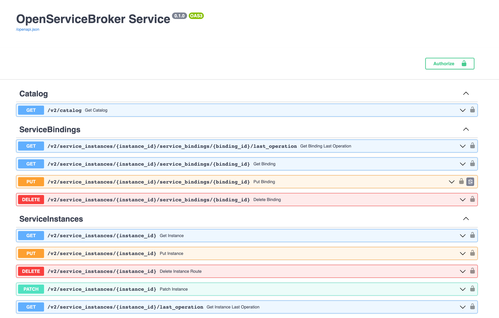
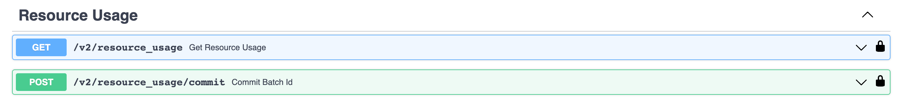

# {heading(Local testing of the broker)[id=saas_upload_localtest]}

{include(/en/_includes/_translated_by_ai_en.md)}

Test the broker locally.

To test the broker developed from the template locally, follow these steps:

1. In the `.env` file in the broker directory, describe the environment variables:

   * `BROKER_PROVIDER_CLIENT_ID` — the broker name used to access the SaaS application.
   * `BROKER_PROVIDER_SECRET` — the password used by the broker to access the SaaS application.
   * `BROKER_PROVIDER_URL` — the URL of the SaaS application.
   * `BROKER_USERNAME` — the store name used for service-to-service interaction with the broker.
   * `BROKER_PASSWORD` — the store password used for service-to-service interaction with the broker.

   {note:err}

   The value of the `BROKER_USERNAME` variable must match the `username` value, and the `BROKER_PASSWORD` value must match the `password` specified in the broker registration request.

   {/note}
1. In the `.env` file in the broker directory, specify the values of the variables for accessing the broker's database.
1. To install the Python libraries, run the command:

   ```console
   $ pip install -r requirements/prod.txt
   ```

1. To start the broker, run the command:

   ```console
   $ gunicorn app.main:app --log-file - --workers ${UVICORN_WORKERS:-1} --worker-class uvicorn.workers.UvicornWorker --bind 0.0.0.0:${BROKER_PORT:-8000} --timeout ${WORKER_TIMEOUT:-90}
   ```

   {caption(Example of the response to the broker startup command)[align=left;position=above]}
   ```console
   INFO:     Started server process [34934]
   INFO:     Waiting for application startup.
   INFO:     Application startup complete.
   INFO:     Uvicorn running on http://0.0.0.0:8000 (Press CTRL+C to quit)
   ```
   {/caption}

   After the broker is installed, the API will be available in the swagger UI editor at `http://0.0.0.0:8000/docs` ({linkto(#pic_saas_swagger_broker)[text=figure %number]}, {linkto(#pic_saas_swagger_resourceusage)[text=figure %number]}).

   {caption(Figure {counter(pic)[id=numb_pic_saas_swagger_broker]} — Example of the swagger UI API)[align=center;position=under;id=pic_saas_swagger_broker;number={const(numb_pic_saas_swagger_broker)} ]}
   
   {/caption}

   {caption(Figure {counter(pic)[id=numb_pic_saas_swagger_resourceusage]} — Example of the swagger UI API containing requests for postpaid billing options)[align=center;position=under;id=pic_saas_swagger_resourceusage;number={const(numb_pic_saas_swagger_resourceusage)} ]}
   
   {/caption}
1. Execute the requests described in the swagger UI API.

   In the requests, use:

   * The value of the VK OSB protocol version `x-broker-api-version` (for example, `"0.1"`).
   * The `BROKER_USERNAME` value from the `.env` file.
   * The `BROKER_PASSWORD` value from the `.env` file.