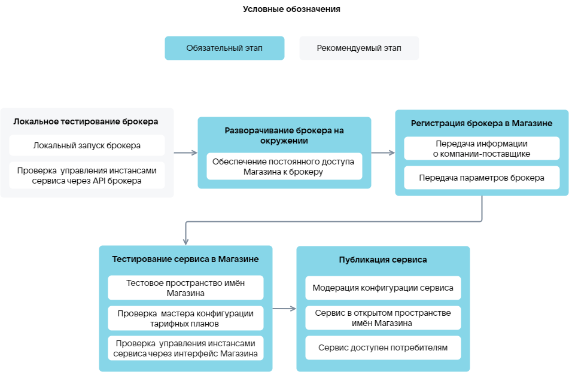

# {heading(Service upload stages)[id=saas_upload_phases]}

{include(/en/_includes/_translated_by_ai_en.md)}

The user uploading a service to the store must have an account (personal dashboard) in the cloud platform. Registration instructions are provided in the section [Registration in {var(cloud)}](/en/intro/onboarding/account).

Stages of uploading a SaaS application to the store ({linkto(#pic_saas_upload)[text=figure %number]}):

1. {linkto(../saas_upload_localtest#saas_upload_localtest)[text=%text]}.
1. {linkto(../saas_upload_env#saas_upload_env)[text=%text]}.
1. {linkto(../saas_upload_registration#saas_upload_registration)[text=%text]}.
1. {linkto(../saas_upload_testmarketplace#saas_upload_testmarketplace)[text=%text]}.
1. {linkto(../saas_upload_publish#saas_upload_publish)[text=%text]}.

{caption(Figure {counter(pic)[id=numb_pic_saas_upload]} — Uploading a SaaS application)[align=center;position=under;id=pic_saas_upload;number={const(numb_pic_saas_upload)} ]}
{params[noBorder=true]}
{/caption}