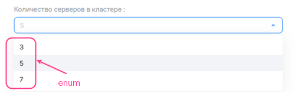
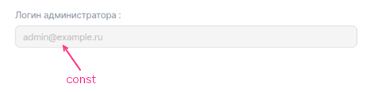
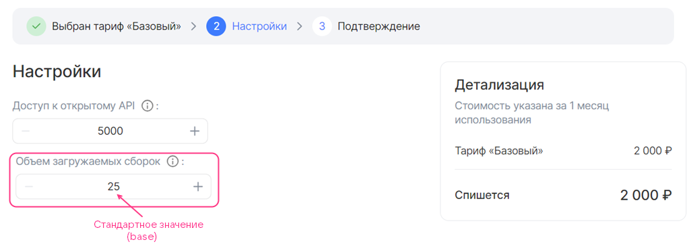
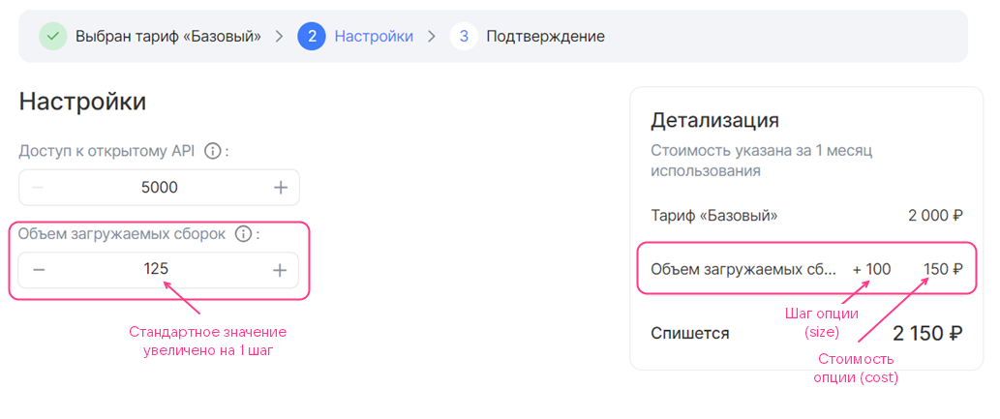
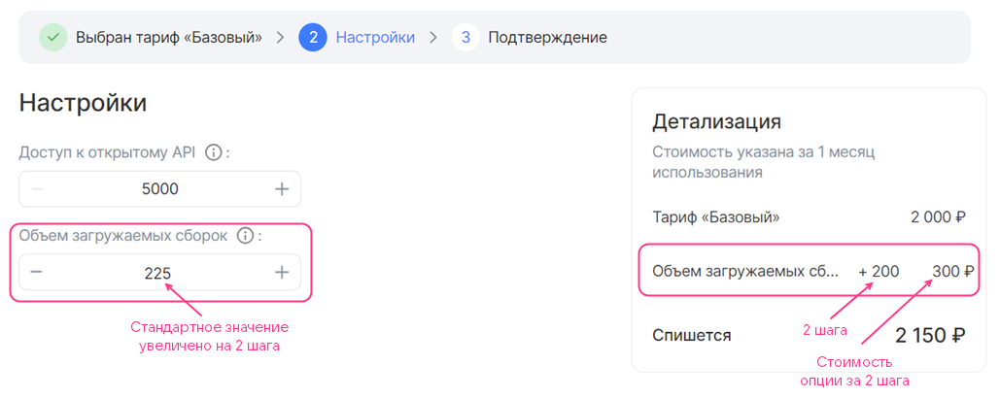
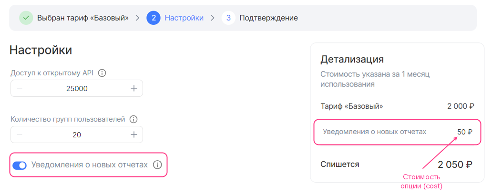
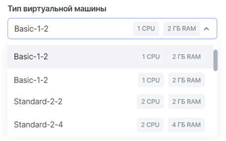
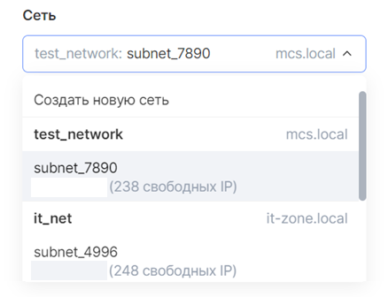
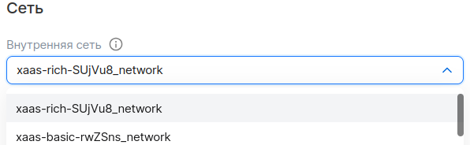
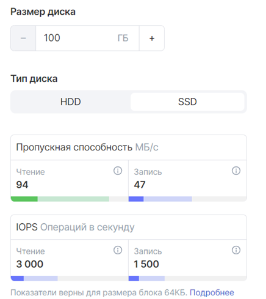

# {heading(Tariff option examples)[id=tariff-examples]}

{include(/en/_includes/_translated_by_ai_en.md)}

## {heading(Free)[id=free-options]}

### {heading(Immutable option of the integer type)[id=integer_const]}

{params[width=40%]}

```yaml
actions:
- create
- update

schema:
  description: System disk size
  hint: In GB
  type: integer
  const: 20
```

Here:

- `actions` — an array of two values, `create` and `update`. It allows the user to select the tariff option both when connecting the service and when updating the tariff plan.
- `schema` — a sequence of values:

    - `description` — the name of the tariff option.
    - `hint` — the description of the tariff option (optional).
    - `type` — the type of the tariff option. Specify `integer`.
    - `const` — the value of the tariff option.

### {heading(Option of the integer type with value selection from a list)[id=integer_list]}

{params[width=60%]}

```yaml
actions:
- create
- update

schema:
  description: Number of servers in the cluster
  type: integer
  enum: [3, 5, 7]
  default: 5
```

Here:

- `actions` — an array of two values, `create` and `update`. It allows the user to select the tariff option both when connecting the service and when updating the tariff plan.
- `schema` — a sequence of values:

    - `description` — the name of the tariff option.
    - `hint` — the description of the tariff option (optional).
    - `type` — the type of the tariff option. Specify `integer`.
    - `enum` — the possible values of the tariff option.
    - `default` — the default value.

### {heading(Option of the integer type with an increment step of 1)[id=integer_step_1]}

Before changing the value:


After increasing the value by 1 point:


```yaml
actions:
- create
- update

schema:
  description: Number of participants
  hint: The number of the customer's company employees who can use the testing infrastructure and process reports from VK Testers testers.
  type: integer
  default: 20
  minimum: 20
```

Here:

- `actions` — an array of two values, `create` and `update`. It allows the user to select the tariff option both when connecting the service and when updating the tariff plan.
- `schema` — a sequence of values:

    - `description` — the name of the tariff option.
    - `hint` — the description of the tariff option (optional).
    - `type` — the type of the tariff option. Specify `integer`.
    - `default` — the default value (optional).

    If the parameter is not set, the default value will be `0`.
    - `minimum` and `maximum` — the maximum and minimum values of the tariff option (optional).

### {heading(Option of the integer type with a custom increment step)[id=integer_users_step]}

```yaml
actions:
- create
- update

billing:
  base: 25
  cost: 0
  unit:
    size: 100

schema:
  description: Volume of uploaded builds
  hint: Test builds of applications can be uploaded to the platform to distribute them to the customer's employees and VK Testers testers. The larger the storage, the more versions of your products can be saved on the testing platform. Supported platforms: iOS, Android, Windows, MacOS, Linux.
  type: integer
  default: 0
```

Here:

- `actions` — an array of two values, `create` and `update`. It allows the user to select the tariff option both when connecting the service and when updating the tariff plan.
- `billing` — a sequence of values:

    - `base` — the standard value.
    - `cost` — the cost of the increment step. Specify `0`.
    - `unit.size` — the size of the increment step.
    - `unit.measurement` — the units of measurement of the tariff option (optional).

- `schema` — a sequence of values:

    - `description` — the name of the tariff option.
    - `hint` — the description of the tariff option (optional).
    - `type` — the type of the tariff option. Specify `integer`.
    - `default` — the default value (optional). It is set relative to the standard value of the option:

      - Do not specify the `default` parameter or specify `0` so that the default value equals the standard value.
      - Specify an integer value `n` so that the default value is calculated using the formula based on the standard value and the entered value `n`:

         ```txt
         billing.base + n * billing.unit.size
         ```

    - `minimum` and `maximum` — the maximum and minimum values of the tariff option (optional). They are set in the same way as it was done for the default value.

Below is shown how the choice of the `default` parameter affects the display of the option in the tariff plan configuration wizard.

Free tariff option of the integer type with a custom increment step (billing.base = 25, schema.default = 0, billing.unit.size = 100):


Free tariff option of the integer type with a custom increment step (billing.base = 25, schema.default = 1, billing.unit.size = 100):


Free tariff option of the integer type with a custom increment step (billing.base = 25, schema.default = 2, billing.unit.size = 100):


### {heading(Free constant tariff option of the string type)[id=string_const]}

{params[width=60%]}

```yaml
actions:
- create
- update

schema:
  description: Administrator login
  type: string
  const: admin@example.ru
```

Here:

- `actions` — an array of two values, `create` and `update`. It allows the user to select the tariff option both when connecting the service and when updating the tariff plan.
- `schema` — a sequence of values:

    - `description` — the name of the tariff option.
    - `hint` — the description of the tariff option (optional).
    - `type` — the type of the tariff option. Specify `string`.
    - `const` — the value of the tariff option.

### {heading(Free tariff option of the string type with value input)[id=string_input]}

{params[width=40%]}

```yaml
actions:
- create
- update

schema:
  description: Administrator email
  hint: Email for issuing an SSL certificate
  type: string
```

Here:

- `actions` — an array of two values, `create` and `update`. It allows the user to select the tariff option both when connecting the service and when updating the tariff plan.
- `schema` — a sequence of values:

    - `description` — the name of the tariff option.
    - `hint` — the description of the tariff option (optional).
    - `type` — the type of the tariff option. Specify `string`.
    - `default` — the default value.
    - Additional parameters given in the [reference](../../../manage-apps/ibservice_add/ibservice_configure/iboption#iboption_option_string) (optional).

### {heading(Free tariff option of the string type with value selection from a list)[id=string_list]}

{params[width=55%]}

```yaml
actions:
- create
- update

schema:
  description: OS type
  hint: Operating system
  type: string
  enum: ["Ubuntu 20.4", "Windows 8.1", "Windows 10"]
  default: Windows 8.1
```

Here:

- `actions` — an array of two values, `create` and `update`. It allows the user to select the tariff option both when connecting the service and when updating the tariff plan.
- `schema` — a sequence of values:

    - `description` — the name of the tariff option.
    - `hint` — the description of the tariff option (optional).
    - `type` — the type of the tariff option. Specify `string`.
    - `enum` — the possible values of the tariff option.
    - `default` — the default value.

Below is shown how the option from this example will be displayed in the tariff plan configuration wizard.

### {heading(Free constant tariff option of the boolean type)[id=boolean_const]}

{params[width=40%]}

```yaml
actions:
- create
- update

schema:
  description: Premium support
  hint: 24/7 technical support
  type: boolean
  const: false
```

Here:

- `actions` — an array of two values, `create` and `update`. It allows the user to select the tariff option both when connecting the service and when updating the tariff plan.
- `schema` — a sequence of values:

    - `description` — the name of the tariff option.
    - `hint` — the description of the tariff option (optional).
    - `type` — the type of the tariff option. Specify `boolean`.
    - `const` — the value of the tariff option.

### {heading(Free boolean switch tariff option)[id=boolean_switch]}

{params[width=50%]}

```yaml
actions:
- create
- update

schema:
  description: Update notifications
  hint: Whether to receive email notifications about new versions of the service.
  type: boolean
  default: true
```

Here:

- `actions` — an array of two values, `create` and `update`. It allows the user to select the tariff option both when connecting the service and when updating the tariff plan.
- `schema` — a sequence of values:

    - `description` — the name of the tariff option.
    - `hint` — the description of the tariff option (optional).
    - `type` — the type of the tariff option. Specify `boolean`.
    - `default` — the default value (optional).

    If the `default` parameter is not set, the default value will be `false`.

Below is shown how the option from this example will be displayed in the tariff plan configuration wizard.

## {heading(Prepaid tariff options)[id=prepaid]}

### {heading(Prepaid tariff option of the integer type with an increment step)[id=prepaid-int]}

Here:

- `actions` — an array of two values, `create` and `update`. It allows the user to select the tariff option both when connecting the service and when updating the tariff plan.
- `billing` — a sequence of values:

    - `base` — the standard value. The standard value is included in the cost of the tariff plan.
    - `cost` — the cost of the increment step.
    - `unit.size` — the size of the increment step.
    - `unit.measurement` — the units of measurement of the tariff option (optional).

    Example of filling in the `billing` section:

    ```yaml
    billing:
      base: 25
      cost: 150
      unit:
        size: 100
    ```

    In this example, every 100 units of the option, in addition to the standard value, cost 150 monetary units. Below is shown how this option will be displayed in the tariff plan configuration wizard as the user increases the value.

    Paid tariff option of the integer type with an increment step (billing.base = 25, billing.cost = 150, billing.unit.size = 100):

    

    Paid tariff option of the integer type with an increment step, the value increased by 1 step (billing.base = 25, billing.cost = 150, billing.unit.size = 100):

    

    Paid tariff option of the integer type with an increment step, the value increased by 2 steps (billing.base = 25, billing.cost = 150, billing.unit.size = 100):

    

1. Fill in the `schema` section in the same way as for a free tariff option with a custom increment step.

    If the default value of the tariff option is not equal to the standard value (`schema.default ≠ 0`), then when the user opens the tariff plan configuration wizard, its cost will be displayed for such a tariff option (see the figure below). The user can reduce the value of the option to the standard one, which is included in the cost of the tariff plan.

    Paid tariff option of the integer type with an increment step (billing.base = 25, billing.cost = 150, billing.unit.size = 100, schema.default = 1):

    

### {heading(Prepaid boolean switch tariff option)[id=prepaid_boolean]}

{params[width=90%]}

```yaml
actions:
- create
- update

schema:
  description: Notifications about new reports
  hint: Whether to receive email notifications about new reports
  type: boolean
  default: true

billing:
  cost: 50
```

Here:

- `actions` — an array of two values, `create` and `update`. It allows the user to select the tariff option both when connecting the service and when updating the tariff plan.
- `schema` — a sequence of values:

    - `description` — the name of the tariff option.
    - `hint` — the description of the tariff option (optional).
    - `type` — the type of the tariff option. Specify `boolean`.
    - `default` — the default value (optional).

    If the `default` parameter is not set, the default value will be `false`.

- `billing` — a sequence of one value of the integer type, `cost` — the cost of the option when the switch is in the active position.

## {heading(Tariff option of the integer or number type)[id=postpaid_integer_or_number]}

{note:warn}

For a [postpaid tariff option](/en/tools-for-using-services/vendor-account/manage-apps/concepts/about#billing_push), the name of the YAML file must match the value of `param` in the API request for transmitting metrics on the actually used resources that your service will send to Marketplace.

{/note}

{params[width=75%]}

```yaml
actions:
- resource_usages

billing:
  cost: 7
  unit:
    size: 1
    measurement: GB

schema:
  description: Storage in the Cyberprotect data center for Cloud Backup products
  type: number
```

Here:

- `actions` — an array of one value, `resource_usages`.
- `billing` — a sequence of values:

    - `cost` — the cost of a unit of the tariff option.
    - `unit.size` — the billing step. Specify `1`.
    - `unit.measurement` — the units of measurement of the tariff option (optional).

- `schema` — a sequence of values:

    - `description` — the name of the tariff option.
    - `hint` — the description of the tariff option (optional).
    - `type` — the type of the tariff option. Specify `integer` or `number`.

## {heading(Tariff options of the datasource type)[id=datasource]}

### {heading(VM type)[id=datasource_vm]}

{params[width=45%]}

```yaml
actions:
- create
- update

schema:
  description: Virtual machine type
  type: string
  datasource:
    type: flavor
```

Here:

- `actions` — an array of two values, `create` and `update`. It allows the user to select the tariff option both when connecting the service and when updating the tariff plan.
- `schema` — a sequence of values:

    - `description` — the name of the tariff option.
    - `hint` — the description of the tariff option (optional).
    - `type` — the type of the tariff option. Specify `string`.
    - `datasource.type` — the type of the cloud platform entity. Specify `flavor`.
    - `datasource.filter` — filters (optional). The possible filters are given in the [reference](../tariff-options#iboption_datasource).

Below is shown how the option from this example will be displayed in the tariff plan configuration wizard.

### {heading(Availability zone)[id=datasource_az]}

{params[width=45%]}

```yaml
actions:
- create
- update

schema:
  description: Availability zone
  type: string
  default: gz1
  datasource:
    type: az
```

Here:

- `actions` — an array of two values, `create` and `update`. It allows the user to select the tariff option both when connecting the service and when updating the tariff plan.
- `schema` — a sequence of values:

    - `description` — the name of the tariff option.
    - `hint` — the description of the tariff option (optional).
    - `type` — the type of the tariff option. Specify `string`.
    - `default` — the default value (optional). The possible values are given in the [reference](../tariff-options#iboption_datasource).
    - `datasource.type` — the type of the cloud platform entity. Specify `az`.

Below is shown how the option from this example will be displayed in the tariff plan configuration wizard.

### {heading(Subnet)[id=datasource_subnet]}

```yaml
actions:
- create
- update

schema:
  description: Network
  type: string
  datasource:
    type: subnet
```

Here:

- `actions` — an array of two values, `create` and `update`. It allows the user to select the tariff option both when connecting the service and when updating the tariff plan.
- `schema` — a sequence of values:

    - `description` — the name of the tariff option.
    - `hint` — the description of the tariff option (optional).
    - `type` — the type of the tariff option. Specify `string`.
    - `datasource.type` — the type of the cloud platform entity. Specify `subnet`.

Below is shown how the option from this example will be displayed in the tariff plan configuration wizard.

{params[width=40%]}

### {heading(Network)[id=datasource_net]}

{params[width=55%]}

```yaml
actions:
- create
- update

schema:
  description: Private network
  hint: Private network
  type: string
  datasource:
    type: network
    value_is: name
    filter:
      kind: private
      shared: false
```

Here:

- `actions` — an array of two values, `create` and `update`. It allows the user to select the tariff option both when connecting the service and when updating the tariff plan.
- `schema` — a sequence of values:

    - `description` — the name of the tariff option.
    - `hint` — the description of the tariff option (optional).
    - `type` — the type of the tariff option. Specify `string`.
    - `datasource.type` — the type of the cloud platform entity. Specify `network`.
    - `datasource.value_is` — the type of information output. The available values are:
    - `uuid` — display the network UUID.
    - `name` — display the network name.
    - `datasource.filter` — filters (optional). The possible filters are given in the [reference](../tariff-options#iboption_datasource).

Below is shown how the option from this example will be displayed in the tariff plan configuration wizard.

### {heading(Disk)[id=disk]}

{params[width=40%]}

A disk is described by two tariff options (two separate YAML files):

- Disk type — using a tariff option of the `datasource` type.
- Disk size — using a tariff option of the `integer` type with a change step of 1.

To describe a disk:

1. Describe a tariff option of the `datasource` type that receives data about disk types from the cloud platform, in the file `parameters/<OPTION_NAME>.yaml`:

    1. Specify the `actions` parameter.
    1. In the `schema` section, set the following parameters:

    - `description` — the name of the tariff option.
    - `hint` — the description of the tariff option (optional).
    - `type` — the type of the tariff option. Specify `string`.
    - `default` — the default value (optional). Possible values are given in the [reference](../tariff-options#iboption_datasource).
    - `tag` — a tag. The tag links the option describing the disk type with the option describing the disk size.
    - `datasource.type` — the type of the cloud platform entity. Specify `volume_type`.
    - `datasource.filter` — filters (optional). Possible filters are given in the [reference](../tariff-options#iboption_datasource).

        If no filters are specified, all disk types supported by the cloud platform will be displayed.

    Example of a `datasource` option description for a disk type, `YAML` format:

    ```yaml
    actions:
    - create
    - update

    schema:
      description: Disk type
      type: string
      default: ceph-ssd
      tag: disk1
      datasource:
        type: volume_type
        filter:
          disk_class:
          enum: ["ssd", "hdd"]
    ```

1. In a separate file `parameters/<OPTION_NAME>.yaml`, describe the disk size using a tariff option of the `integer` type with a change step of 1:

    1. Specify the `actions` parameter.
    1. In the `schema` section, set the following parameters:

    - `description` — the name of the tariff option.
    - `hint` — the description of the tariff option (optional).
    - `type` — the type of the tariff option. Specify `integer`.
    - `default` — the default value (optional).
    - `maximum` and `minimum` — the maximum and minimum values (optional).
    - `tag` — a tag. The value must be the same as in the file describing the disk type.

    {note:info}

    Disk size is measured in GB.

    {/note}

    Example of a disk size description via a tariff option of the `integer` type with a change step of 1, `YAML` format:

    ```yaml
    actions:
    - create
    - update

    schema:
      description: Disk size
      type: integer
      default: 100
      minimum: 100
      tag: disk1
    ```

{note:warn}

The cost of a disk is determined by the cloud platform tariffs, so it cannot be specified in the tariff option description.

{/note}