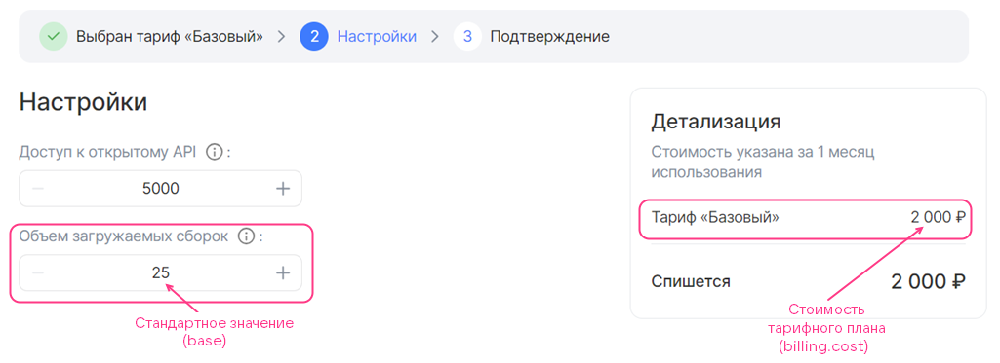

{include(/en/_includes/_translated_by_ai_en.md)}

The `billing` section in the [service configuration JSON file](../../../instructions/manage-saas-apps/saas-add#service_config) contains the following information:

* The cost of the tariff plan.
* The duration of the billing period.
* The frequency at which Marketplace requests usage reports from the broker.
* The procedure for handling unused bonuses.
* The step increment for tariff options of the `integer` type.
* The cost of the plan's tariff options. The following types of paid tariff options are supported:

  * Numeric (`integer`, `number`). Both prepaid and postpaid billing are supported.
  * Boolean (`boolean`). Prepaid billing is supported.

For more information about billing types, see the [Billing](/en/tools-for-using-services/vendor-account/manage-apps/concepts/about#xaas_billing) section.

{note:warn}

A tariff plan cannot use both prepaid and postpaid options at the same time. Postpaid tariff options can only be used in a free tariff plan.

{/note}

The billing type applied depends on where the tariff options are described in the [schemas section](../schemas-section):

* If the options are described in the `service_instance.create` and `service_instance.update` sections, prepaid billing is applied.
* If the options are described in the `service_instance.resource_usages` section, postpaid billing is applied.

The `billing` section has the following structure:

```json
"billing": {
            "cost": <COST>,
            "billing_cycle_flat": <BILLING_PERIOD>,
            "billing_cycle_step": <CHECK_FREQUENCY>,
            "refundable": <REFUNDABLE>,
            "options": {
              "<OPTION_NAME>": {
                <BILLING_OPTIONS>
                },
              ...
              }
            }
```

Here:

* `<COST>` — the cost of the plan for the billing period, excluding paid tariff options. It is set in the currency of the country where Marketplace is deployed. If the plan is free, the value `0` is specified. Only prepaid billing is supported.

* (Optional) `<BILLING_PERIOD>` — the duration of the billing period. It can be set only for a prepaid tariff plan.

  It is set in the format: `<NUMBER_OF_MONTHS> mons <NUMBER_OF_DAYS> days`. For example, `1 mons 15 days` or `30 days`. The number of days in a month `mons` is calculated according to the calendar, so the periods `1 mons 0 days` and `0 mons 31 days` are not equal to each other.

* (Optional) `<CHECK_FREQUENCY>` — the duration of the period at which Marketplace checks whether the broker has unprocessed reports. For more information, see the [Billing](/en/tools-for-using-services/vendor-account/manage-apps/concepts/about#xaas_billing) section. It can be set only for a tariff plan with postpaid tariff options.

  It is set in the format: `<NUMBER_OF_MONTHS> mons <NUMBER_OF_DAYS> days`. For example, `1 mons 15 days` or `30 days`. The number of days in a month `mons` is calculated according to the calendar, so the periods `1 mons 0 days` and `0 mons 31 days` are not equal to each other.

* (Optional) `<REFUNDABLE>` — whether or not to refund the project's bonus account with the funds for the remaining days of the billing period if the user changed the tariff plan or deleted the service instance. It can be specified only for a prepaid tariff plan. The default value is `true`.

  This parameter affects the date of charging for the service when the user changes the tariff plan (edits tariff options or switches to a new one):

  * `true` — the date does not change.
  * `false` — the date is updated to the date of the tariff plan change.

* (Optional) The `options` section describes the cost of paid tariff options.
  * `<OPTION_NAME>` — the name of the tariff option in the service configuration JSON file.
  * `<BILLING_OPTIONS>` — the cost of the tariff option and the step increment parameters for an option of the `integer` type. The tariff option itself (type, value settings) is described in the [schemas section](../schemas-section).

The parameters of the `<BILLING_OPTIONS>` section depend on the option type:

[cols="2,5,2,2", options="header"]
|===
|Name
|Description
|Format
|Required

4+^|**Prepaid option of the `integer` type with a step increment**

|`base`
|Defines the default value of the tariff option included in the cost of the tariff plan.

The default value is the minimum value that a user can set.

If the parameter is not set, the default value is `0`
|integer
| 

|`cost`
|Defines the cost of the step by which the value of the tariff option can be changed. If `0` is specified, the option change is free of charge

|float64, >= 0
| 

|`unit`
|Defines the parameters of the option step increment
| 
| 

4+|Parameters of the `unit` section

|`unit.size`
|Defines the size of the step by which the value of the tariff option can be changed
|integer, > 0
| 

|`unit.measurement`
|Defines the units of measurement for the step specified in the `unit.size` parameter
|string, up to 255 characters
| 

4+^|**Prepaid `boolean` toggle option**

|`cost`
|
Defines the cost of the option
|float64, >= 0
| 

4+^|**Postpaid option of the `integer` or `number` type**

|`cost`
|Defines the cost of one unit of the tariff option.

{note:warn}

If metrics are collected using the [pull model](../../../manage-apps/concepts/about#billing_pull), the cost must match the `price` value [specified in the broker method](../../../instructions/manage-saas-apps/saas-add) for submitting a report to Marketplace.

{/note}
|float64, >= 0
| 

|`unit`
|Defines the parameters of the option step increment
| 
| 

4+|Parameters of the `unit` section

|`unit.size`
|Defines the size of the option step increment. The value must be equal to `1`
|integer
| 

|`unit.measurement`
|Defines the units of measurement of the option
|string, up to 255 characters
| 
|===

{note:info}

To effectively use the [bonuses](../../../instructions/manage-saas-apps/saas-add#saas_test_marketplace) provided for testing and debugging a service in Marketplace, specify the test cost of the tariff plan and its options before publishing the service.

{/note}

### Examples of the billing section description

{cut(Example of the billing section with a free tariff option of the integer type with a step increment)}

```json
"billing": {
  "cost": 2000,  // Cost of the tariff plan
  "options": {
    "quantity": { // Option name in the JSON file
      "base": 25, // Default value of the option
      "cost": 0, // Cost of the option step increment
      "unit": {
        "size": 100 // Option step increment
      }
    }
  }
}
```

Below is an example of how the tariff plan cost and the option from this example are displayed in the tariff plan configuration wizard. The option name displayed in the wizard is set by the `<OPTION_NAME>.description` parameter in the `schemas` section. In this example, `quantity.description` is set to `Объем загружаемых сборок` (Volume of downloaded builds).

* In the tariff plan settings, the default value is selected for the option:

  {params[width=90%]}

* In the tariff plan settings, the option value is increased by 2 steps compared to the default value:

  {params[width=90%]}

  The plan cost has not changed since the option is free of charge.

{/cut}

{cut(Example of the billing section with a prepaid tariff option of the integer type with a step increment)}

```json
"billing": {
  "cost": 2000, // Cost of the tariff plan
  "options": {
    "quantity": { // Option name in the JSON file
      "base": 25, // Default value of the option
      "cost": 150, // Cost of the option step increment
      "unit": {
        "size": 100 // Option step increment
      }
    }
  }
}
```

Below is an example of how the tariff plan cost and the option from this example are displayed in the tariff plan configuration wizard. The option name displayed in the wizard is set by the `<OPTION_NAME>.description` parameter in the `schemas` section. In this example, `quantity.description` is set to `Объем загружаемых сборок` (Volume of downloaded builds).

* In the tariff plan settings, the default value is selected for the option:

  {params[width=90%]}

* In the tariff plan settings, the value of the prepaid option is increased by 1 step compared to the default value:

  {params[width=90%]}

  The plan cost has increased by the price of the prepaid option step.

{/cut}

{cut(Example of the billing section with a prepaid boolean toggle tariff option)}

```json
"billing": {
  "cost": 2000, // Cost of the tariff plan
  "options": {
    "notifications": { // Option name in the JSON file
      "cost": 50 // Cost of the option
    }
  }
}
```

Below is an example of how the tariff plan cost and the option from this example are displayed in the tariff plan configuration wizard. The option name displayed in the wizard is set by the `<OPTION_NAME>.description` parameter in the `schemas` section. In this example, `notifications.description` is set to `Уведомления о новых отчетах` (Notifications about new reports).

{params[width=90%]}

{/cut}

{cut(Example of the billing section with a postpaid numeric tariff option)}

```json
"billing": {
  "cost": 0, // Cost of the tariff plan
  "options": {
    "storage": { // Option name in the JSON file
      "cost": 7,
      "unit": {
      "size": 1,
      "measurement": "GB"
      }
    }
  }
}
```

In this example, the tariff plan is free, one unit of the postpaid tariff option `storage` equals 1 GB and costs 7 currency units.

The figure below shows the tariff plan configuration wizard. The option name displayed in the wizard is set by the `<OPTION_NAME>.description` parameter in the `schemas` section. In this example, `storage.description` is set to `Хранение в ДЦ Киберпротект для продуктов Кибер Бэкап Облачный` (Storage in the Cyberprotect data center for Cyber Backup Cloud products).

{params[width=70%]}

{/cut}