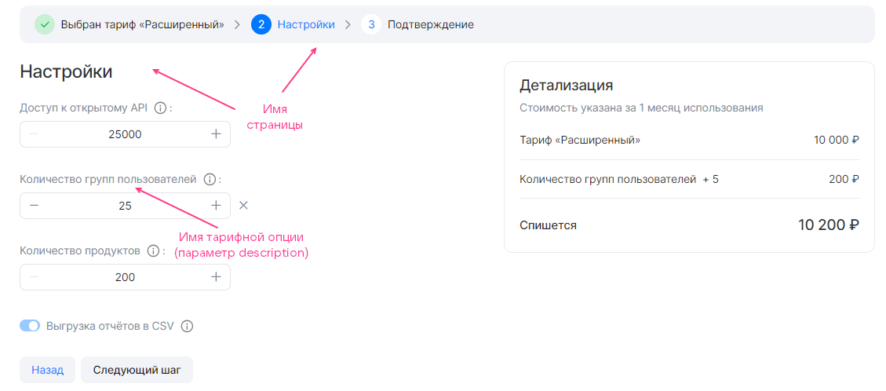

{include(/en/_includes/_translated_by_ai_en.md)}

The `display` section in the [service configuration JSON file](../../../instructions/manage-saas-apps/saas-add#service_config) describes the [tariff plan configuration wizard](/en/tools-for-using-services/vendor-account/manage-apps/concepts/about#xaas_wizard). The section has the following structure:

```json
"display": {
  "pages": [
    {
      <PAGE_PARAMETERS>,
      "groups": [
        {
          <GROUP_PARAMETERS>,
          "parameters": [
            {
              <OPTION_PARAMETERS>
            },
            ...
          ]
        }
        ...
      ]
    },
  ...
  ]
}
```

Here:

* `pages` — a section describing the pages of the tariff plan configuration wizard. It can be empty.
* `<PAGE_PARAMETERS>` — parameters of a single page.
* `groups` — a section describing groups of tariff options within a single page.
* `<GROUP_PARAMETERS>` — parameters of a group of tariff options.
* `parameters` — a section describing tariff options within a single group.

   {note:warn}

   The same tariff option can be specified in only one group.

   {/note}
* `<OPTION_PARAMETERS>` — parameters of tariff options.

The `display` section describes all pages of the tariff plan configuration wizard except the first and the last ones. The maximum number of pages is 5.

The parameters of pages, groups, and tariff options within groups are identical and are given in the table.

[cols="2,5,4,2", options="header"]
|===
|Name
|Description
|Format
|Required

|`name`
|
The name of a page, group, or tariff option in the JSON file.

{note:warn}

In the store interface, tariff options will be displayed with the names specified in the `description` parameter of these options in the [schemas section](../schemas-section).

{/note}
|
string.

Page name — up to 32 characters.

Group name — up to 255 characters
| 

|`index`
|
The sequential number of a page, a group on the page, or a tariff option in the group
|
integer
| 
|===

{cut(Example of the display section)}

```json
"display": {
  "pages": [
    {
      "name": "Settings", // Page name
      "index": 0,
      "groups": [
        {
          "name": "", // Group name
          "index": 0,
          "parameters": [
            {
              "name": "api_requests_daily_limit", // Name of the tariff option in the JSON file
              "index": 0,
            },
            {
              "name": "groups",
              "index": 1,
            },
            {
              "name": "products",
              "index": 2,
            },
            {
              "name": "reports",
              "index": 3
            }
          ]
        }
      ]
    }
  ]
}
```

The tariff plan configuration wizard corresponding to this content of the `display` section is shown in the figure:



{/cut}

By default, all groups of tariff options `groups` are displayed and configured in the tariff plan configuration wizard. To make a group display only under certain conditions, use the [when construct](/en/tools-for-using-services/vendor-account/manage-apps/ibservice_add/ibservice_configure/ib_display#IBdisplay_when).

{note:warn}

The broker must support creating a service instance taking into account the conditions specified in the `when` constructs.

{/note}

The structure of `when` in JSON format:

```json
{
  "when": {
    "in": { // Or "not_in"
      "key": {
        "param": "<OPTION_NAME>" // Or "const": "<VALUE>"
      },
      "values": [
        {
          "const": "<VALUE>"
        },
        {
          "param": "<OPTION_NAME>"
        },
      ...
      ]
    }
  },
  "parameters": [
  ...
  ]
}
```

Here:

* `<OPTION_NAME>` — the name of the tariff option in the service configuration JSON file.
* `<VALUE>` — the value of the constant.

The [when construct in the pages section](/en/tools-for-using-services/vendor-account/manage-apps/ibservice_add/ibservice_configure/ib_display#IBdisplay_when_in_pages) is used in the same way as in image-based applications.

{cut(Example of using the when construct in the pages section)}

```json
{
  "pages": [
    {
      "name": "Backup settings", // Page name
      "groups": [
        {
          "name": "High-frequency backup", // Name of the tariff option group
          "parameters": [
            {
              "name": "frequency_per_day" // Name of the tariff option in the JSON file
            }
          ],
          "when": {
            "in": {
              "key": {
                "param": "backup_method" // Name of the tariff option in the JSON file
              },
              "values": [
                {
                  "const": "high-frequency"
                }
              ]
            }
          }
        }
      ]
    }
  ]
}
```

In this example, the backup creation frequency is configured. If the value of the `backup_method` tariff option is `high-frequency`, the tariff plan configuration wizard will display the `High-frequency backup` group with the `frequency_per_day` tariff option.

The `backup_method` tariff option:

* Can be used in the `when` construct in other groups.
* Must be specified in `parameters` in another group.

The `frequency_per_day` tariff option cannot be used in other groups:

* In the `when` construct — because only one level of dependency hierarchy is supported.
* In `parameters` — because one tariff option can be specified in only one group.

{/cut}