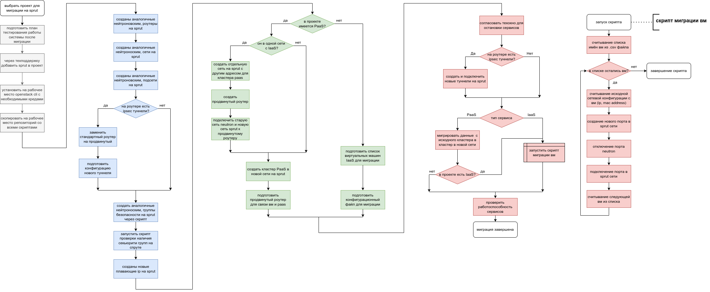

{include(/kz/_includes/_translated_by_ai_kz.md)}

## Миграция не берілген

Бұлттық желілік инфрақұрылымның сенімділігі мен қолжетімділігін арттыру үшін жобаларды [Sprut](/kz/networks/vnet/concepts/sdn#vnet-sdn-sprut) — VK Cloud-дың меншікті әзірлемесі болып табылатын SDN-ға көшіру ұсынылады, ол үлкен масштабтарда желілердің және осы желілер үстіндегі желілік функциялардың тұрақты жұмысын қамтамасыз етеді.

SDN Sprut бұрын пайдаланылған [SDN Neutron](/kz/networks/vnet/concepts/sdn#vnet-sdn-neutron) мүмкіндіктерін кеңейту мақсатында әзірленді. SDN Neutron шағын желілермен жұмыс істеу кезінде тиімді, бірақ ірі желілермен (мыңдаған және он мыңдаған порттар) жұмыс істеу кезінде шектеулерге ие. SDN барлық виртуалды желілер мен сервистердің негізі болғандықтан, бұл шектеулер пайдаланушы жобаларына да, бүкіл платформаға да тұрақтылыққа, масштабталуға және дамуына айтарлықтай әсер етті.

SDN Sprut Openstack Neutron API-мен толық үйлесімді және SDN Neutron-мен салыстырғанда бірқатар артықшылықтары бар:

- оңай масштабталады және кез келген өлшемдегі желілерге жарамды;
- VK Cloud сервистерімен және үшінші тарап сервистерімен еркін интеграциялануға мүмкіндік береді;
- өнімділігі жоғары;
- SDN Neutron-да қолжетімсіз сервистері бар;
- OpenStack-тан тәуелсіз.

Қазіргі уақытта Sprut — барлық жаңа жобалар үшін негізгі SDN, ал ескі жобалар SDN Neutron-ды пайдаланады. Өз жобаларыңызды SDN Sprut-қа өз бетінше көшіре аласыз. Жеке кабинетте [жобаңыз қай SDN-ға қосылғанын](/kz/tools-for-using-services/account/instructions/project-settings/manage#project-sdn-view) білуге болады.

{note:warn}
SDN Neutron қолдауы 2025 жылдың соңында тоқтатылады. Осыдан кейін SDN Neutron пайдаланушылары қауіпсіздік мәселелеріне және жаңартулардың болмауына тап болуы мүмкін.
{/note}

Өз жобаларыңызды SDN Sprut-қа өз бетінше көшіре аласыз.

Миграцияның функционалдық артықшылықтары:

- BGP протоколы бойынша динамикалық маршрутизацияны қолдайтын және ақауға төзімді маршрутизация схемаларын құруға арналған [Жетілдірілген маршрутизатор](/kz/networks/vnet/concepts/router#vnet-router-advanced).
- [Cloud Direct Connect](https://cloud.vk.ru/direct-connect) — компанияның жергілікті желісі мен VK Cloud арасындағы арналған қосылымдар.
- Бір өңірдегі жобаларды біріктіруге арналған [Ортақ желілер](/kz/networks/vnet/concepts/net-types#vnet-net-types-shared-net).
- Ақауға төзімділікті арттыру үшін орталықтандырылмаған DHCP-сервис.
- PaaS-сервистер аясында әртүрлі жобалар арасындағы оқшауланған трафик.
- Бұлт ішіндегі орталықтандырылмаған және ақауға төзімді [жеке DNS-сервис](/kz/networks/dns/instructions/private-dns).

Миграцияның функционалдық емес артықшылықтары:
- Платформа сервистерімен немесе үшінші тарап сервистерімен интеграцияланудың REST API және басқа механизмдері.
- SDN Neutron-мен салыстырғанда өнімділіктің 34%-ға дейін артуы.
- API және UI жауап беру уақытының қысқаруы.
- SDN-компоненттерінің горизонтальді масштабталуына дайындық.
- Желілік нысандардың жұмысқа қабілеттілігін автоматты қалпына келтіру.
- Жүйенің нақты уақыт режиміндегі оқиғаларға реакциясы есебінен ақауға төзімділіктің жақсаруы.
- Желілік инфрақұрылымды автоматты конфигурациялау және мониторингтеу мүмкіндігі.

## {heading(Миграция реттілігі)[id=migration_sequence]}

Схемада SDN Sprut-қа көшу кезіндегі әрекеттер реттілігі көрсетілген:

{params[noBorder=true]}

Барлық әрекеттер төрт кезеңге бөлінген:

1. Ағымдағы инфрақұрылымды дайындау және талдау.
2. [Желілік инфрақұрылымды көшіру](../iaas) (IaaS).
3. [Платформалық сервистерді көшіру](../paas) (PaaS).
4. Көшіруден кейінгі тестілеу және оңтайландыру.

## {heading(Қандай сервистерді көшіруге болады)[id=services_to_migrate]}

[cols="1,2,1", options="header"]
|===
|Сервис
|Көшіру мүмкіндігі
|Сипаттама

|Желі
| 
.6+|[Желілік инфрақұрылымды көшіру](../iaas)

|Маршрутизатор
| 

|Floating IP-мекенжай
|Floating IP-мекенжайды көшіру мүмкін емес, SDN Sprut-та жаңасын жасап, оны ВМ-ге байланыстыру қажет

|Виртуалды машина
| 

|Қауіпсіздік тобы
| 

|VPN (IPsec)
| 

|Жүктеме теңгергіші
| 
.4+|Платформалық сервистерді көшіру

|Файлдық қойма (NFS)
|Әзірленуде

|Дерекқор
|Әзірленуде

|Kubernetes
|Әзірленуде
|===

## {heading(Көшіру құралдары)[id=migration_instruments]}

Жобаңызды SDN Sprut-қа мына құралдардың көмегімен өз бетіңізше көшіре аласыз:

- Terraform: көшірудің ең қарапайым тәсілі, бірақ үлкенірек техникалық терезені (сервис жұмыс істемейтін уақытты) талап етеді.
- Жеке кабинет және Openstack CLI: көшіруді дайындауға көбірек уақыт қажет етеді, бірақ техникалық терезе қысқарақ болады.

Жобаларды көшіру кезінде мына скрипттер пайдаланылады:

[cols="1,3", options="header"]
|===
|Скрипт
|Сипаттама

|[copy-router-and-networks.sh](https://github.com/vk-cs/neutron-2-sprut/blob/guide_v3/copy-router-and-networks.sh)
|Скрипт SDN Neutron-дағы маршрутизаторлар мен оларға қосылған желілер мен ішкі желілердің конфигурацияларын көшіріп, SDN Sprut-та соған ұқсас конфигурациялар жасайды

|[copy-ipsec.sh](https://github.com/vk-cs/neutron-2-sprut/blob/guide_v3/copy-ipsec.sh)
|Скрипт SDN Neutron-дағы IPsec-туннельдер конфигурацияларын көшіріп, SDN Sprut-та соған ұқсас конфигурациялар жасайды

|[copy-loadbalancer.sh](https://github.com/vk-cs/neutron-2-sprut/blob/guide_v3/copy-loadbalancer.sh)
|Скрипт SDN Neutron-дағы теңгергіштер конфигурацияларын көшіріп, SDN Sprut-та соған ұқсас конфигурациялар жасайды

|[copy-security-group.sh](https://github.com/vk-cs/neutron-2-sprut/blob/guide_v3/copy-security-group.sh)
|Скрипт SDN Neutron-дағы қауіпсіздік топтарын көшіріп, SDN Sprut-та соған ұқсас топтар жасайды, олардың атауына `-sprut` қосады

|[check-if-all-sprut-sg-present.sh](https://github.com/vk-cs/neutron-2-sprut/blob/guide_v3/check-if-all-sprut-sg-present.sh)
|Скрипт SDN Neutron-да көшірілетін әрбір ВМ-ге қандай қауіпсіздік топтары тағайындалғанын тексереді, содан кейін сол атаумен және `-sprut` жұрнағымен топтардың бар-жоғын тексереді. `default`, `all`, `ssh+www` топтары екі SDN үшін де базалық болғандықтан еленбейді

|[migrator.sh](https://github.com/vk-cs/neutron-2-sprut/blob/guide_v3/migrator.sh)
|Скрипт ВМ желілік интерфейсін SDN Neutron-нан SDN Sprut-қа ауыстырады. Порттың MAC немесе IP-мекенжайын сақтап немесе сақтамай ауыстыру мүмкін. Скрипт іске қосылғанға дейін ВМ белсенді болуы тиіс

|[migrator-multiple.sh](https://github.com/vk-cs/neutron-2-sprut/blob/guide_v3/migrator-multiple.sh)
|Скрипт бірнеше ВМ-нің желілік интерфейстерін SDN Neutron-нан SDN Sprut-қа ауыстырады. ВМ-дер белсенді болуы және тек бір желілік интерфейсі болуы тиіс

|[modify-terraform-state.sh](https://github.com/vk-cs/neutron-2-sprut/blob/guide_v3/modify-terraform-state.sh)
|Скрипт Terraform арқылы көшіру кезінде `terraform.tfstate` файлындағы әрбір ВМ-нің күйін өзгертеді
|===

