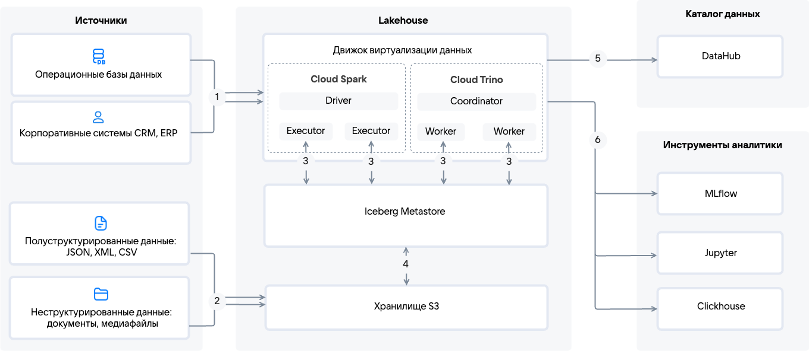

# {heading(Сервис архитектурасы)[id=dlh_architecture]}

{include(/kz/_includes/_translated_by_ai_kz.md)}

{ifdef(public)}
{include(/kz/_includes/_dp-unavailable.md)}
{/ifdef}

{linkto(../about#dlh_info)[text=Data Lakehouse (DLH)]} әртүрлі дереккөздерден құрылымдық және құрылымсыз деректерді жинайды, оларды {linkto(../components/spark#dlh_spark)[text=Cloud Spark]} ([ETL](https://ru.wikipedia.org/wiki/ETL) немесе ELT) немесе {linkto(../components/trino#dlh_trino)[text=Cloud Trino]} (SQL-сұраулары) арқылы өңдейді, {linkto(../components/s3#dlh_s3)[text=S3-қоймасында]} {linkto(../components/iceberg#dlh_iceberg)[text=Cloud Iceberg Metastore]} каталогтауымен сақтайды, метадеректерді DataHub-та басқарады және деректерді Cloud Trino, Cloud Spark немесе {linkto(../components/clickhouse#dlh_clickhouse)[text=Cloud ClickHouse]} арқылы аналитика, BI және ML үшін ұсынады.

{params[noBorder=true]}

1. Жедел ([OLTP](https://ru.wikipedia.org/wiki/OLTP)) және корпоративтік (CRM, ERP) жүйелерден түсетін құрылымдық деректер Cloud Trino-ға тікелей немесе күрделі ETL- және ELT-процессдерін орындау үшін Cloud Spark арқылы түседі.

1. Жартылай құрылымдық (JSON, XML, CSV) және құрылымсыз (медиафайлдар, құжаттар) деректер S3 қоймасына ағындар түрінде немесе блоктармен беріледі.

1. {linkto(../components/trino#dlh_trino)[text=Cloud Trino]} және {linkto(../components/spark#dlh_spark)[text=Cloud Spark]} S3 қоймасымен деректер алмасу үшін Iceberg Metastore API-ін пайдаланады.

    Cloud Trino-да сұрауларды өңдеу процесі координатордың (Coordinator) SQL-сұрауларын қабылдауын ([PULL-моделі](#dlh_data_processing_models)) және оңтайландыруын қамтиды, содан кейін ол оларды жұмыс тораптарына (Workers) бөледі, бұл дәстүрлі СУБД-ға ұқсас функционалдылықты қамтамасыз етеді.

    Cloud Spark күрделі ETL- және ELT-процессдерін орындау үшін қолданылады. Бұл сервис деректердің топтық та, ағындық та өңдеуін қолдайды:

    - [Ағынды өңдеу](https://en.wikipedia.org/wiki/Stream_processing) кезінде (Streaming Processing) деректер үздіксіз, микропартиялармен (mini-batches) немесе оқиға бойынша (event-by-event) нақты уақыт режимінде өңделеді. Ағынды өңдеу [PUSH-моделі](#dlh_data_processing_models) бойынша жүзеге асырылады.

    - [Топтық өңдеу](https://en.wikipedia.org/wiki/Batch_processing) кезінде (Batch Processing) деректер партиялармен (файлдар, кестелер) жинақталып, бір мезгілде өңделеді. Шығарып алу процесі кесте бойынша немесе қолмен іске қосылады ([PULL-моделі](#dlh_data_processing_models)).

1. Cloud Iceberg Metastore {linkto(../components/s3#dlh_s3)[text=S3 қоймасының]} нысандарын каталогтайды және оған қолжетімділік үшін API ұсынады.

    Деректерді сақтау {linkto(../components/iceberg#dlh_iceberg)[text=Cloud Iceberg Metastore]} сервисі арқылы [ACID](https://ru.wikipedia.org/wiki/ACID)-транзакцияларды қолдаумен ұйымдастырылған, ол S3 қоймасының нысандарын ДҚ кестелері ретінде көрсетуге мүмкіндік береді. S3 қоймасын пайдалану сақтау шығындарын айтарлықтай азайтады.

1. Нысандардың және оларды өңдеу ережелерінің жалпы тізімі қолжетімділікті басқару және деректердің тарихын бақылау үшін DataHub негізіндегі деректер каталогінде жарияланады (Data Discovery, Data Quality, Metadata Management, Data Governance, Data Lineage функционалын қолдаумен).
1. Cloud Trino және Cloud Spark-тан өңделген деректерді әртүрлі сыртқы аналитикалық жүйелерде пайдалануға болады: MLflow, Jupyter, ClickHouse. Бұл жүйелер деректерді терең талдауға, егжей-тегжейлі визуализациялар жасауға және машиналық оқыту модельдерінің өмірлік циклін басқаруға мүмкіндік береді.

## {heading(Деректерді өңдеу модельдері)[id=dlh_data_processing_models]}

Міндетке байланысты деректер келесі тәсілдермен өңделуі мүмкін:

- _PULL-моделі_ — бұл деректер көзден кесте бойынша batch-процестерді орындау арқылы шығарылатын тәсіл, оларды Cloud Airflow-да ыңғайлы басқаруға болады. Бұл тәсіл қарапайым ETL және ELT процестері, S3 қоймасындағы аналитика, BI-интеграция, дерекқорларға SQL-сұраулар үшін және дереккөзге түсетін жүктемені бақылау қажет болғанда қолданылады.

- _PUSH-моделі_ — бұл деректер көзден автоматты түрде Cloud Spark немесе Cloud Trino-ға жіберілетін тәсіл. Бұл тәсіл деректердің үлкен көлемдерін үздіксіз жеткізу және өңдеу аса маңызды болатын міндеттерде қолданылады: күрделі ETL және ELT процестері, аналитикаға арналған деректерді дайындау, үлкен деректердегі машиналық оқыту.

Data Lakehouse архитектурасын жобалау кезінде қандай деректер түрлері және қандай тәсілмен өңделетінін анықтау маңызды:

[cols="<,<,<",options="header"]
|===
| Критерий
| PULL-моделі
| PUSH-моделі

| Сервис
| {linkto(../components/airflow#dlh_airflow)[text=Cloud Airflow]}, {linkto(../components/trino#dlh_trino)[text=Cloud Trino]}, {linkto(../components/spark#dlh_spark)[text=Cloud Spark]} (пакеттік өңдеу)
| {linkto(../components/spark#dlh_spark)[text=Cloud Spark]} (ағындық өңдеу, микробатчтар)

| Дереккөздерді қолдау
| API, ДҚ, файлдар
| Әрбір дереккөз үшін деректерді Producer API арқылы жіберетін компонентті әзірлеу қажет

| Жаңарту жиілігі
| Кесте бойынша
| Нақты уақыт режимінде

| Деректер кідірісі  
| 5–60 минут
| < 1 секунд

| Дереккөзге түсетін жүктеме
| Жоғары (сағатына 50–500 қосылым)
| Төмен (1–5 тұрақты қосылым)

| Масштабталу
| Шектеулі (секундына 100 параллель операцияға дейін)
| Жоғары (секундына 10 000 параллель операцияға дейін)

| Интеграция күрделілігі
| Төмен (конфигурацияға 1–2 күн)
| Жоғары (Producer әзірлеу қажет)
|===