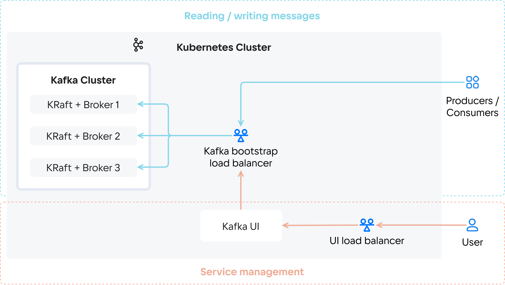

# {heading(Сервистің архитектурасы)[id=kafka_architecture]}

{include(/kz/_includes/_translated_by_ai_kz.md)}

{ifdef(public)}
{include(/kz/_includes/_dp-unavailable.md)}
{/ifdef}

<!---->

Cloud Kafka кластері біріктірілген KRaft түйіндерінен және [брокерден](https://kafka.apache.org/documentation/#intro_concepts_and_terms) (Kafka Broker) тұрады. Мұндай түйіндердің саны таңдалған ақауға төзімділік режиміне байланысты. Кластердің өнімділігін арттыру үшін түйіндер санын қолмен ұлғайтуға болады.

Сервис «жариялау/жазылу» (публикация/подписка) қағидаты бойынша жұмыс істейді: жеткізушілер (producers) хабарламаларды топиктерде жариялайды, ал тұтынушылар (consumers) жаңа хабарламаларды алу үшін сервисті сұрайды. Жеткізушілер мен тұтынушылардың жұмыс істеуі үшін {ifdef(public)} [жүктеме теңгеріші](/kz/networks/balancing/concepts/about) арқылы {/ifdef} {ifndef(public)}жүктеме теңгеріші арқылы{/ifndef} bootstrap қосылуы бапталуы керек (Kafka bootstrap load balancer). Теңгеріш жеткізушілер мен тұтынушылардың ақауға төзімді қосылуын қамтамасыз етеді.