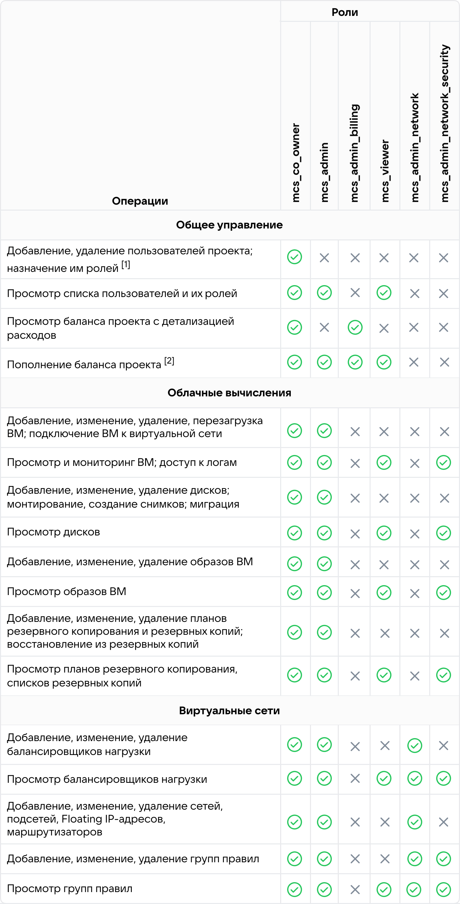

# {heading(Кіріспе)[id=intro-about]}

{include(/kz/_includes/_translated_by_ai_kz.md)}

## {heading(Жалпы ақпарат)[id=intro-about-general]}

Жүйенің толық атауы: {var(cloud)}.

{var(cloud)} — сенімді және қауіпсіз бұлттық инфрақұрылым құрудың ыңғайлы құралы. Ол сапалы бұлттық қызметтерге қолжетімділікті қамтамасыз етеді, онда сіз өз бизнесіңізді құра аласыз, қосымшалар мен қызметтерді іске қоса аласыз және әзірлеуді жеделдете аласыз. {var(cloud)} жүйесінде жұмыс істеу қаржылық және уақыт ресурстарын үнемдеуге көмектеседі.

{ifndef(private-cert)}
{var(cloud)} екі редакцияда шығарылады:

* Light Cloud — {var(cloud)} жүйесінің қысқартылған компоненттер жиынтығы мен жабдыққа қойылатын талаптары аз редакциясы.
* Enterprise Cloud — {var(cloud)} жүйесінің толық компоненттер жиынтығы бар, барлық пайдалану сценарийлеріне сай редакциясы.

Әр редакцияда әртүрлі компоненттік құрамы бар конфигурациялар қолжетімді.

Құжатта {var(cloud)} жүйесінің максималды толық құрамы сипатталған. Нақты бір инсталляцияның құрамы таңдалған конфигурацияға байланысты және құжатта сипатталған барлық компоненттер мен функцияларды қамти бермейді.
{/ifndef}

{var(cloud)} жүйесінің негізгі графикалық интерфейсі — жеке кабинет. Оны {var(cloud)} жүйесінің негізгі қызметтерін басқару үшін пайдалана аласыз.

Жеке кабинетке кіру веб-браузер арқылы мына мекенжай бойынша жүзеге асырылады:

{ifndef(private-cert)}
```console
lk.<ДОМЕННОЕ_ИМЯ>
```
{/ifndef}

{ifdef(private-cert)}
```console
LK<ДОМЕННОЕ_ИМЯ>
```
{/ifdef}

Мұнда `<ДОМЕННОЕ_ИМЯ>` — {var(cloud)} орналастырылған сіздің компанияңыздың домендік атауы.

{ifndef(private-cert)}

## {heading({var(cloud)} артықшылықтары)[id=intro-about-advantages]}

{var(cloud)} жүйесінің негізгі артықшылықтары:

- Жеке инсталляциядағы инновациялық технологиялар.

  {var(cloud)} бизнеске арналған VK Cloud Solutions публичтік бұлтымен бірге дамиды. Осылайша, {var(cloud)} басқа да мүмкіндіктермен қатар, публичтік бұлттың мыңдаған клиенттерінің жобаларында сенімділігі дәлелденген жаңартулар мен қызметтерді алады.

- Интеграцияланған PaaS.

  {var(cloud)} — интеграцияланған PaaS-шешімдерімен және корпоративтік IT-қосымшалар каталогымен жеке бұлт құруға арналған толыққанды технологиялық платформа.

- Тексерілген пайдалану құралдары.

  {var(cloud)} жүйесіндегі серверлік жабдықты басқару, мониторинг, логтарды өңдеу құралдары VK инфрақұрылымын 20 жыл пайдалану және жергілікті жеке бұлтты құру мен пайдаланудың 5 жылы ішінде тексерілген.

- Кастомизация және қолдау.

  {var(cloud)} әрбір тапсырыс берушінің мақсаттары мен міндеттеріне сай бейімделеді. Жеке сарапшылар командасы бұлтты енгізуге, процестерді сауатты құруға және оңтайлы пайдалануды қамтамасыз етуге көмектеседі.

- TCO төмендету.

  {var(cloud)} халықаралық вендорлардың көпшілігінің жеке бұлттарымен салыстырғанда шығындарды оңтайландыруды және иелену құнын төмендетуді қамтамасыз етеді.
{/ifndef}

{ifdef(private-cert)}

## {heading(Жұмыс режимдері)[id=intro-about-work-mode]}

{var(cloud)} келесі режимдердің бірінде жұмыс істей алады:

- Штаттық.
- Шектеулі.
- Авариялық.
- Сервистік.

Толығырақ — **{var(cloud)} әкімшісінің нұсқаулығы** құжатының **Жұмыс істеу режимдері** бөлімінде.

## {heading(Пайдаланушылардың құқықтары мен есептік жазбалары)[id=intro-about-rbac]}

Әрбір пайдаланушыға жеке персонифицирленген есептік жазба сәйкес келеді.

Жеке кабинеттің пайдаланушылары үшін жеке жоба аясында тағайындалатын рөлдер жиынтығы қолдау көрсетіледі. Пайдаланушыға {linkto(#tab_roles_mcs)[text=%number-кестедегі]} бір немесе бірнеше рөлді тағайындауға болады.

{caption({counter(table)[id=numb_tab_roles_mcs]}-кесте — Жеке кабинет пайдаланушыларының рөлдері)[align=right;position=above;id=tab_roles_mcs;number={const(numb_tab_roles_mcs)}]}
[cols="2,2,3", options="header"]
|===
|Рөл ID-сы
|Рөл атауы
|Сипаттамасы

|`mcs_viewer`
|Бақылаушы
|Жобаның көпшілік ақпаратын көруге мүмкіндік береді, бірақ өңдеу құқығынсыз

|`mcs_co_owner`
|Жобаның серіктес иесі
|Жобаның барлық ресурстарына қолжетімділікті қамтамасыз етеді. Қолмен тағайындалуы мүмкін

|`mcs_admin_network`
|Желі әкімшісі
|Желілік жүйенің барлық объектілеріне қолжетімділікті қамтамасыз етеді

|`mcs_admin_billing`
|Жобаның биллинг әкімшісі
|Тек **Баланс** тармағына және биллинг функцияларына қолжетімділікті қамтамасыз етеді

|`mcs_admin`
|Жоба әкімшісі
|Пайдаланушылар топтары мен баланстан басқа жобаның барлық ресурстарына қолжетімділікті қамтамасыз етеді

|`mcs_admin_network_security`
|Желілік қауіпсіздік әкімшісі
|Желілік баптауларды бақылауды жүзеге асырады
|===
{/caption}

Әрбір рөлге {linkto(#tab_rbac_mcs)[text=%number-кестеде]} келтірілген белгілі бір құқықтар жиынтығы сәйкес келеді.

[1] Көрсетілген функционалдық {var(cloud)} жеке кабинетінде өшірілген. Пайдаланушылармен және рөлдермен өзара іс-қимыл Әкімші порталында жүзеге асырылады.

[2] {var(cloud)} жүйесінде жазу операцияларының барлығы Әкімші порталында жүзеге асырылады. Мысал: баланс немесе бағаларды өзгерту.

{caption({counter(table)[id=numb_tab_rbac_mcs]}-кесте — Жеке кабинет пайдаланушыларының құқықтары)[align=center;position=under;id=tab_rbac_mcs;number={const(numb_tab_rbac_mcs)}]}
{params[width=100%;noBorder=true]}
{/caption}

## {heading(Құпиясөздер қауіпсіздігі)[id=intro-about-security-pass]}

Құпиясөздер қауіпсіздігін {var(cloud)} қамтамасыз етеді.

Құпиясөздерді жасағанда мына ережелерді сақтаңыз:

- Ұзындығы мен күрделілігі.

  Құпиясөздер кемінде 8 таңбадан тұруы тиіс. Оларға бас және кіші регистрдегі әріптер мен сандар енгізілуі тиіс. Сөздіктерде кездесетін сөздерден аулақ болыңыз. Оңай болжанатын жеке ақпаратты пайдаланбауға тырысыңыз.

- Бірегейлік.

  Бірегей құпиясөздер жасаңыз. Бірдей құпиясөзді пайдалану сіздің барлық деректеріңіздің компрометациялау қаупін арттырады.

- Тұрақты жаңарту.

  Құпиясөздеріңізді тұрақты жаңартып отырыңыз. Құпиясөздерді әр 3-6 ай сайын өзгерту ұсынылады.

- Жалпы қателіктерден аулақ болу.

  Құпиясөздерді жазбаларға немесе карточкаларға жазбаңыз. Сондай-ақ `12345678` немесе `qwerty12` сияқты қарапайым құпиясөздерді пайдаланудан аулақ болыңыз.

## {heading(Қауіпсіздік оқиғаларының журналы)[id=intro-about-security-log]}

{var(cloud)} жүйесінің қауіпсіздік оқиғаларының журналына тек {var(cloud)} әкімшісі ғана қол жеткізе алады.

Толығырақ — **{var(cloud)} әкімшісінің нұсқаулығы** құжатының **Қауіпсіздік оқиғаларының журналы** бөлімінде.

## {heading(Қауіпсіздік параметрлері)[id=intro-about-security-param]}

Жеке кабинеттегі қолжетімді қауіпсіздік параметрлері туралы толығырақ:

- {linkto(../../tools-for-using-services/account/instructions/account-manage-private/keypairs-private#private-account-manage-keypairs)[text=%text]}.
- {linkto(../../storage/backups/instructions/create-backup-plan/create-backup-plan.md#backup-plan-create-vm)[text=%text]}.

{/ifdef}