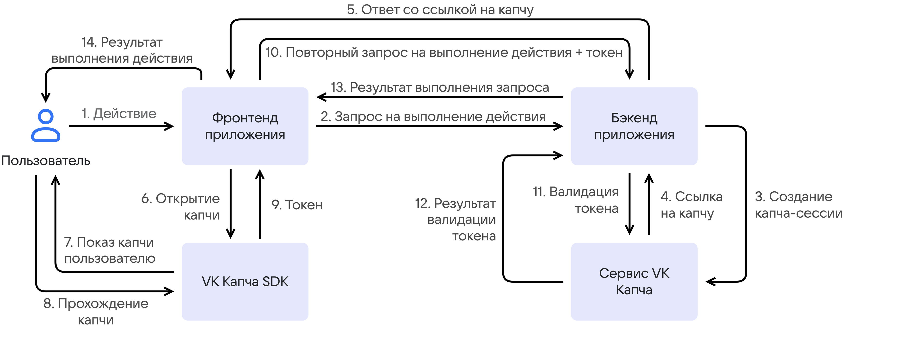
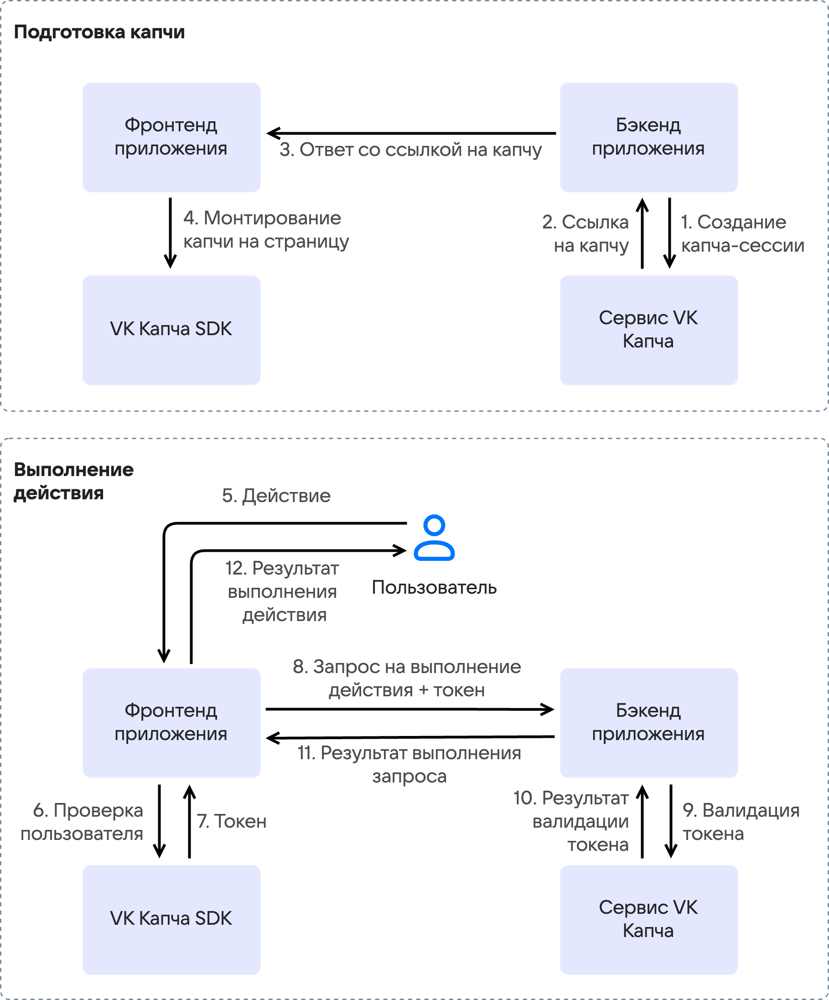

# {heading(Сервис туре)[id=captcha-concepts-about]}

{include(/kz/_includes/_translated_by_ai_kz.md)}

VK Капча — қосымшаның пайдаланушысы адам ба, жоқ па, соны нақты уақыт режимінде анықтайтын сервис. Сервис пайдаланушылармен өзара әрекеттесудің негізгі нүктелерін — авторизацияны, тіркелуді, API-эндпоинттерді — автоматтандырылған шабуылдардан қорғайды. Мұндай шабуылдарға мыналар жатады:

- жалған аккаунттарды жаппай тіркеу;
- құпиясөздерді толық іріктеу (brute force);
- веб-формалар арқылы хабарламаларды автоматты жіберу;
- контент жинау (scraping);
- қолданбалы деңгейдегі DDoS-шабуылдары.

Сервис боттарды сүзгіден өткізіп, легитимді пайдаланушыларды олардың тарапынан ең аз қатысумен верификациялайды. Сервис инфрақұрылымына веб-қосымшалар, iOS және Android үшін SDK, сондай-ақ бэкенд үшін API кіреді. Тексеруді де бэкенд, де қосымшаның фронтенді бастауы мүмкін.

## {heading(Сервис жұмыс істеу принципі)[id=captcha-about-how-it-works]}

Сервис қосу сценарийлерінің екеуін қолдайды: {linkto(#captcha-about-backend-first)[text=бэкенд сұранысы бойынша тексеру]} және {linkto(#captcha-about-frontend-first)[text=фронтенд сұранысы бойынша тексеру]}.

### {heading(Бэкенд сұранысы бойынша капча)[id=captcha-about-backend-first]}

Тексеру шешімін бэкенд қабылдайтын сервистерге арналған сценарий: пайдаланушы әрекетті орындайды, бэкенд капча қажет екенін жауап береді, ал фронтенд осы жауапты өңдеушісінде тексеруді іске қосады. Тексеру сәтті өткеннен кейін әрекетке арналған сұраныс бэкендке қайтадан жіберіледі, бірақ капчаны сәтті өткен токенімен бірге.

{params[align=center; noBorder=true]}

1. Пайдаланушы қосымшада әрекет орындайды.

1. Қосымшаның фронтенді бұл әрекетті орындауға бэкендке сұраныс жібереді.

1. Қосымшаның бэкенді осы сұранысқа капча көрсету қажет пе екенін тексереді. Егер қажет болса, бэкенд капча-сессияны жасау үшін {linkto(../../../../tools-for-using-services/api/api-spec/captcha-api#api-spec-captcha)[text=VK Капча API]-не} өтінеді.

1. VK Капча сервисі қосымшаның фронтендінде капча виджетін іске қосуға арналған сілтемені қайтарады.

1. Қосымшаның бэкенді алынған сілтемені фронтендке жібереді.

1. Қосымшаның фронтенді сілтемені пайдаланушыға капча виджетін көрсету үшін {linkto(../reference-sdk#captcha-concepts-reference-sdk)[text=VK Капча SDK]-ге} береді.

1. {linkto(../reference-sdk#captcha-concepts-reference-sdk)[text=VK Капча SDK]} пайдаланушыға капча виджетін көрсетеді.

1. Пайдаланушы тексеруден өтеді. Капчадан өту кезінде сервис оның мінез-құлқын талдап, {linkto(#captcha-about-trust-score)[text=пайдаланушыға деген сенім деңгейін]} (trust score) бағалайды.

1. Капчаны сәтті өткеннен кейін {linkto(../reference-sdk#captcha-concepts-reference-sdk)[text=VK Капча SDK]} фронтендке `success-token` — пайдаланушының тексеруден өткенін растайтын криптографиялық тұрғыдан қорғалған токенді қайтарады. Егер пайдаланушы капчадан өтпесе, токеннің орнына қате қайтарады.

1. Қосымшаның фронтенді бэкендке `success-token` қамтитын пайдаланушының әрекетін орындауға қайталанған сұраныс жібереді.

1. Қосымшаның бэкенді верификациялау үшін `success-token`-ді {linkto(../../../../tools-for-using-services/api/api-spec/captcha-api#api-spec-captcha)[text=VK Капча API]-не} жібереді.

1. VK Капча сервисі токеннің жарамдылығын растайды.

1. Қосымшаның бэкенді пайдаланушының бастапқы әрекетін өңдеп, нәтижені фронтендке жібереді.

1. Пайдаланушыға әрекетті орындау нәтижесі көрсетіледі.

### {heading(Фронтенд сұранысы бойынша капча)[id=captcha-about-frontend-first]}

Тексеруді фронтенд іске қосатын сервистерге арналған сценарий: капча виджетін іске қосуға арналған сілтеме алдын ала, пайдаланушының мақсатты әрекетіне дейін алынады. Тексеру әрекетті орындау сұранысын жібергенге дейін жүзеге асырылады, сондықтан токен осы сұраныспен бірден жіберіледі — қайталанған сұраныс қажет емес. Бұл сценарий тек веб-қосымша үшін қолжетімді және {linkto(#captcha-about-types)[text=көрінбейтін капчаны]} қолдайды.

{params[align=center; width=70%; noBorder=true]}

1. Қосымшаның бэкенді капча-сессияны жасау үшін {linkto(../../../../tools-for-using-services/api/api-spec/captcha-api#api-spec-captcha)[text=VK Капча API]-не} өтінеді.

1. VK Капча сервисі бэкендке капча виджетін іске қосуға арналған сілтемені қайтарады.

1. Қосымшаның бэкенді алынған сілтемені фронтендке жібереді.

1. Қосымшаның фронтенді сілтемені капча виджетін бетке орнататын {linkto(../reference-sdk#captcha-concepts-reference-sdk)[text=VK Капча SDK]-ге} береді. Көрінбейтін капча үшін тексеру фондық режимде іске қосылады.

1. Пайдаланушы мақсатты әрекетті орындайды.

1. Пайдаланушы тексеруден өтеді. Капчадан өту кезінде сервис оның мінез-құлқын талдап, {linkto(#captcha-about-trust-score)[text=пайдаланушыға деген сенім деңгейін]} (trust score) бағалайды.

1. Капчаны сәтті өткеннен кейін {linkto(../reference-sdk#captcha-concepts-reference-sdk)[text=VK Капча SDK]} фронтендке `success-token` — пайдаланушының тексеруден өткенін растайтын криптографиялық тұрғыдан қорғалған токенді қайтарады. Егер пайдаланушы капчадан өтпесе, токеннің орнына қате қайтарады.

1. Қосымшаның фронтенді бэкендке `success-token` қамтитын пайдаланушының әрекетін орындауға сұраныс жібереді.

1. Қосымшаның бэкенді верификациялау үшін `success-token`-ді {linkto(../../../../tools-for-using-services/api/api-spec/captcha-api#api-spec-captcha)[text=VK Капча API]-не} жібереді.

1. VK Капча сервисі токеннің жарамдылығын растайды.

1. Қосымшаның бэкенді пайдаланушының әрекетін өңдеп, нәтижені фронтендке жібереді.

1. Пайдаланушыға әрекетті орындау нәтижесі көрсетіледі.

## {heading(Капча түрлері)[id=captcha-about-types]}

VK Капча сервисінде көрінетін және көрінбейтін (invisible) капчалар қолжетімді.

Көрінбейтін капча тек веб-қосымшада қолжетімді және {linkto(#captcha-about-frontend-first)[text=фронтенд сұранысы бойынша капча]} сценарийінде жұмыс істейді. Бұл жағдайда тексеру фондық режимде өтеді. Егер сервис пайдаланушыны күдікті деп бағаласа, көрінбейтін капча автоматты түрде көрінетін капчамен ауыстырылады.

Көрінетін капча да {linkto(#captcha-about-frontend-first)[text=фронтенд сұранысы бойынша капча]} сценарийінде, да {linkto(#captcha-about-backend-first)[text=бэкенд сұранысы бойынша капча]} сценарийінде жұмыс істейді. Көрінетін капчаның үш түрі қолжетімді:

- Құсбелгі (checkbox) — бір басумен растау. Ең аз өзара әрекеттесу, көптеген сценарийлерге жарамды.
- Сырғытпалы (slider) — суреттер торындағы адам қабылдауы мен логикасын қажет ететін визуалды тапсырма.
- Аудио (sound) — аудиотапсырма: дыбыс жолын тыңдап, танылған сөзді енгізу.

Көрінетін капчаның түрін капча-сессияны жасау кезінде орнатуға болады немесе ол пайдаланушыға деген сенім деңгейін бағалау негізінде автоматты таңдалуы мүмкін. Капчаны автоматты таңдау кезінде, егер сервис пайдаланушыны сенімді деп бағаласа, құсбелгілі капча ұсынылады. Әйтпесе сервис күрделілікті арттырып, сырғытпалы капчаны немесе аудиокапчаны ұсынады.

## {heading(Пайдаланушыға деген сенім деңгейі)[id=captcha-about-trust-score]}

VK Капча сервисі бірнеше сигналдар тобын біріктіре отырып, пайдаланушыға деген сенім деңгейін нақты уақыт режимінде анықтайды:

- Мінез-құлық сигналы.

  ML-модельдер пайдаланушының мінез-құлқын талдайды: курсор траекториясын, басу үлгілерін, реакция жылдамдығын, әрекеттердің хронологиясы мен реттілігін. Осы деректер негізінде сессиялар арасында сақталатын пайдаланушының цифрлық профилі (fingerprint) қалыптастырылады. Адамды имитациялайтын боттар ML-модель танитын тән атрибуттарды қалдырады.

- Интенсивтік және орта сигналы.

  Сервис пайдаланушылық сұраныстарды жіберу қарқындылығын және пайдаланушы тарапындағы орындау ортасын зерттейді: құрылғы сипаттамаларын, браузер конфигурациясын, қолжетімді API-лер. Алынған деректерді талдап, сервис автоматтандырылған ортаны анықтайды: headless-браузерлер, эмуляторлар, виртуалды машиналар фермалары.

Сенім деңгейінің қорытынды бағасы пайдаланушы өтуі тиіс {linkto(#captcha-about-types)[text=капча түрін]} анықтайды.

## {heading(Жүйе талаптары)[id=captcha-about-requirements]}

{include(../../../../_includes/_captcha-requirements.md)[tags=captcha-req-browser]}

iOS:

{include(../../../../_includes/_captcha-requirements.md)[tags=captcha-req-ios]}

Android:

{include(../../../../_includes/_captcha-requirements.md)[tags=captcha-req-android]}

## {heading(Кері байланыс)[id=captcha-about-feedback]}

Сервис жұмысы туралы сұрақтарыңыз болса немесе оны дамыту бойынша ұсыныстарыңыз болса, [captcha@corp.vk.com](mailto:captcha@corp.vk.com) поштасына жазыңыз.