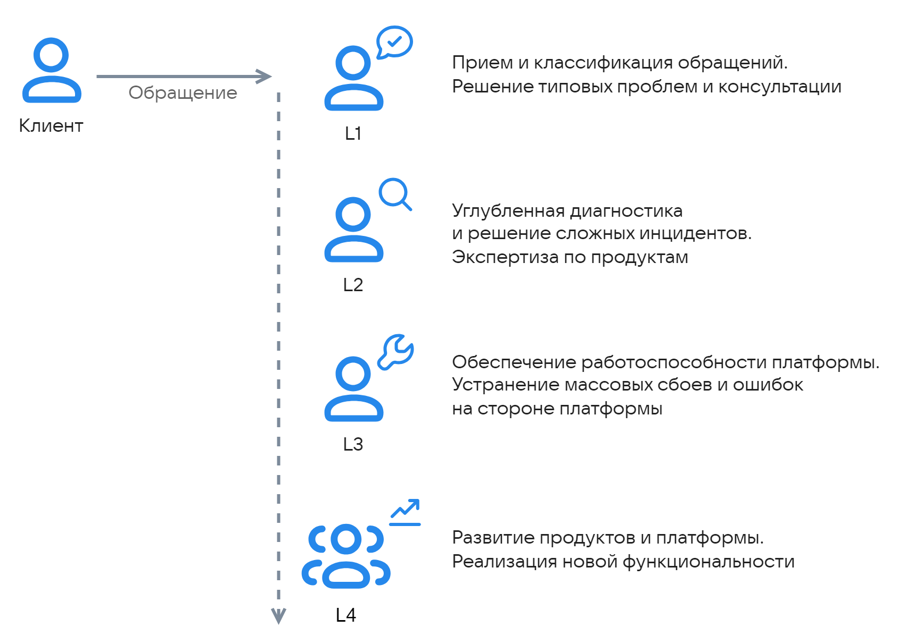

# {heading(Қолдау желілері)[id=support-principles]}

{include(/kz/_includes/_translated_by_ai_kz.md)}

Платформадағы {var(cloud)} өтініштерді шешу үшін техникалық қолдаудың көпдеңгейлі моделі қолданылады:

{params[noBorder=true; width=60%; printWidth=60%]}

Өтініштерге жауап берудің кепілдікті уақыты {linkto(../sla#support-sla)[text=қызмет көрсету деңгейі туралы келісіммен (SLA)]} анықталады.

## {heading(Бірінші қолдау желісі (L1))[id=support-principles-l1]}

L1 инженерлері келіп түскен барлық өтініштерді бастапқы өңдеуді орындайды.

L1 жауапкершілік аймағы:

- Өтініштерді қабылдау, тіркеу және жіктеу.
- Бастапқы диагностика, қажетті ақпаратты жинау.
- Типтік техникалық мәселелерді шешу.
- Сервистердің жұмысы мен баптауы бойынша кеңес беру.
- Төлем тәсілдерін баптау, балансты тексеру және алып салу сұрақтары бойынша кеңес беру.
- Жеке кабинетке кіру мүмкіндігін қалпына келтіру.
- Сұрау бойынша квоталар мен ВМ конфигурациясын өзгерту.
- Техникалық істен шығуларға реакция жасау және клиенттерді хабарландыру.
- Marketplace-тегі өнімдер бойынша вендорлармен өзара іс-қимыл.

## {heading(Екінші қолдау желісі (L2))[id=support-principles-l2]}

Екінші желіге тереңдетілген техникалық сараптаманы қажет ететін күрделі сұрақтар беріледі. L2 инженерлері сервистер мен өнім бағыттарының техникалық ерекшеліктері бойынша арнайы білімге ие.

L2 жауапкершілік аймағы:

- Типтік емес және күрделі сұрақтарды шешу.
- Мәселелерді егжей-тегжейлі диагностикалау.
- Сервистердің күйін белсенді мониторингтеу және хабарландыруларға реакция жасау.

## {heading(Үшінші қолдау желісі (L3))[id=support-principles-l3]}

Үшінші желі сарапшылары платформа инфрақұрылымының пайдаланылуы мен тұрақтылығына жауап береді.

L3 жауапкершілік аймағы:

- Провайдер тарапынан болатын жаппай істен шығуларды шешу.
- Бағдарламалық қателерді жою, осалдықтарды анықтау.
- Сервистердің даму нүктелері туралы хабардар ету үшін өнім командаларымен өзара іс-қимыл.

## {heading(Өнім командасы (L4))[id=support-principles-l4]}

Өнім командасы нақты сервис немесе платформаның дамуы мен өмірлік цикліне жауап береді.

L4 жауапкершілік аймағы:

- Жаппай мәселелерді түзетуді қамтитын ПО-ның жаңартылған нұсқаларын шығару.
- Сервистердің өнімділігін, істен шығуға төзімділігін және пайдалану ыңғайлылығын арттыру.
- Жаңа функционалдылықты әзірлеу және енгізу.