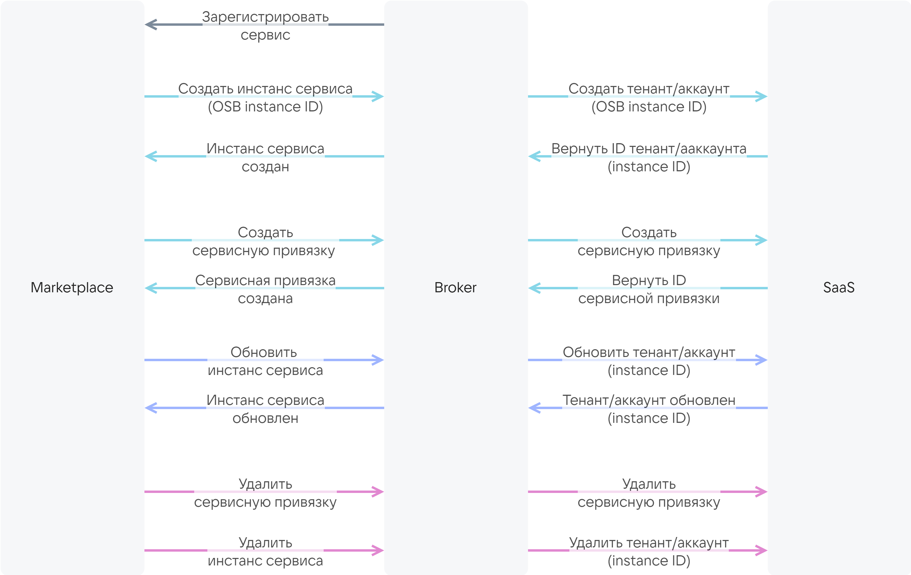

{include(/kz/_includes/_translated_by_ai_kz.md)}

Marketplace сервисі мен SaaS-қосымшасы бір-бірімен [SaaS-брокер](/kz/tools-for-using-services/vendor-account/manage-apps/concepts/about#xaas_vendor_index_type_services) арқылы VK OSB хаттамасы бойынша өзара әрекеттеседі. Хаттаманы VK Cloud платформасы ұсынады.

SaaS-брокерге қойылатын талаптар:

* Брокер сервис инстанстарының өмірлік циклін сипаттайтын әдістерді іске асыруы керек. Әдістер схемада көрсетілген.

    {cut(Брокердің дүкенмен және SaaS-қосымшасымен өзара әрекеттесу схемасы)}

    {params[noBorder=true]}

    {/cut}

* Брокерде сенімді сертификаттау орталығы берген сертификатпен қауіпсіз HTTPS хаттамасы бойынша аутентификация теңшелген болуы керек.

    {note:err}

    Өзін-өзі қол қойған сертификаттарды пайдалануға тыйым салынады.

    {/note}

SaaS-қосымшасының жеткізушісі SaaS-брокерді толығымен өз бетінше немесе VK Cloud платформасы ұсынатын үлгі негізінде әзірлейді. Үлгіде дүкен мен брокер арасындағы өзара әрекеттесу бұрыннан іске асырылған. Оны нақты SaaS-қосымшасымен брокердің өзара әрекеттесуін сипаттаумен толықтыру қажет. Үлгі [FastAPI](https://fastapi.tiangolo.com/tutorial/first-steps) фреймворкі негізінде Python тілінде әзірленген.

Бұл нұсқаулық VK Cloud үлгісі негізінде SaaS-брокерді әзірлеу жағдайына арналған.

## {heading(Дайындық қадамдар)[id=preparatory_steps]}

1. [marketplace@cloud.vk.com](mailto:marketplace@cloud.vk.com) мекенжайына хат жіберіңіз. Хатта сұраңыз:
   * VK OSB хаттамасын;
   * SaaS-брокерді әзірлеуге арналған үлгіні;
   * Marketplace тесттік және ашық кеңістіктерінің атауларын және оларға кіру мүмкіндігін.

1. [marketplace@cloud.vk.com](mailto:marketplace@cloud.vk.com) мекенжайына кемінде 62 × 62 пиксель өлшеміндегі SVG форматындағы иконка салынған хат жіберіңіз. Иконкасы бар файлдың өлшемі 1 МБ-тан аспауы керек.

   Сервис иконкасы сервис карточкасында көрсетіледі:

   * Дүкен каталогында.
   * Сервис бетіндегі **Сервис сипаттамасы** қойындысында.

   Жауап хатта [JSON сервис конфигурация файлында](../../../reference/saas-apps-reference/saas-param) көрсетілетін иконканың URL мекенжайы жіберіледі.

1. VK Cloud-те [тіркеліңіз](/kz/intro/onboarding/account). Дүкенде қосымшаны тестілеу үшін VK Cloud тіркелгісі қажет.

## {heading(1. Сервис конфигурациясын сипаттаңыз (тарифтік жоспарлар, опциялар))[id=service_config]}

1. `catalog_<СЕРВИС_АТАУЫ>.json` файлын жасаңыз.
1. JSON-файлда келесі құрылымды пайдалана отырып, сервис конфигурациясын сипаттаңыз:

    {include(/kz/_includes/_saas_add_update.md)[tags=service_config]}

## {heading(2. SaaS-брокерді әзірлеңіз)[id=saas_broker]}

1. Сервисіңіздің API-мен өзара әрекеттесуге арналған клиентті әзірлеңіз.
1. Брокер мен сервис арасындағы өзара әрекеттесуді сипаттайтын сервис-менеджерді әзірлеңіз. Ол үшін келесі әдістерді іске асырыңыз:

   [cols="1,3", options="header"]
   |===
   |Әдіс
   |Кіріс деректер

   |Тенанттың немесе аккаунттың жасалуы
   |
   * Сервиске қосылу кезінде дүкен жасайтын сервис инстансының OSB ID-сі. SaaS-қосымшасы сервис инстансының ID-сін құруы үшін OSB ID SaaS-қосымшасына беріледі. Сервис инстансының ID-сі кестеде төменде сипатталған әдістерде пайдаланылады.
   * Тарифтік жоспардың ID-сі.
   * Сервис конфигурациясының JSON-файлында [plans.schemas.service_instance.create](../../../reference/saas-apps-reference/schemas-section) бөлімінде сипатталған жоспардың тарифтік опциялары.
   * (Қалау бойынша) Пайдаланушы туралы ақпаратты қамтитын контекст: электрондық пошта, [жобаның бірегей идентификаторы (PID)](/kz/tools-for-using-services/account/instructions/project-settings/manage#project-pid-view)

   |Тенанттың немесе аккаунттың жаңартылуы
   |
   * Сервис инстансының ID-сі.
   * Тарифтік жоспардың ID-сі.
   * Сервис конфигурациясының JSON-файлында [plans.schemas.service_instance.update](../../../reference/saas-apps-reference/schemas-section) бөлімінде сипатталған жоспардың тарифтік опциялары

   |Тенанттың немесе аккаунттың алынуы және жойылуы
   |Сервис инстансының ID-сі

   |Сервис привязкаларын (bindings) жасау
   |
   * Сервис инстансының ID-сі.
   * Сервис конфигурациясының JSON-файлында [plans.schemas.service_binding.create](../../../reference/saas-apps-reference/schemas-section) бөлімінде сипатталған сервис привязкаларының параметрлері.
   * (Қалау бойынша) Пайдаланушы туралы ақпаратты қамтитын контекст: электрондық пошта, [жобаның бірегей идентификаторы (PID)](/kz/tools-for-using-services/account/instructions/project-settings/manage#project-pid-view)

   |Сервис привязкаларын алу және жою
   |
   * Сервис инстансының ID-сі.
   * Сервис привязкасының ID-сі
   |===

1. Клиентті сервис-менеджерге интеграциялаңыз.
1. Брокерде аутентификацияны теңшеңіз.

1. SaaS-қосымшасында постапайттық тарифтік опциялар бар болса және олар бойынша метрикалар [pull-модель](/kz/tools-for-using-services/vendor-account/manage-apps/concepts/about#billing_pull) бойынша жиналса, қосымша әрекеттерді орындаңыз:

    1. Сервис-менеджерде SaaS-қосымшасының іс жүзінде пайдаланылған ресурстары бойынша есеп алудың әдісін іске асырыңыз. Сұрауға жауап ретінде брокер дүкенге есепті беруі керек.

        {cut(SaaS-қосымшасының іс жүзінде пайдаланылған ресурстары бойынша есеп мысалы)}

        ```json
        {
            "batch_id": 35,
            "data": [
                {
                "kind": "vms",
                "type": "cb",
                "unit": "month",
                "price": 600.0,
                "value": 1.0,
                "plan_uuid": "2f070fe3-3e31-4482-bad4-a4d0c36bab31",
                "instance_uuid": "d1dff97c-df6c-45a7-95e1-b539a8d77721"
            },
            {
                "kind": "storage",
                "type": "cb",
                "unit": "GB-month",
                "price": 3.3,
                "value": 2.4474525451660156,
                "plan_uuid": "2f070fe3-3e31-4482-bad4-a4d0c36bab31",
                "instance_uuid": "d1dff97c-df6c-45a7-95e1-b539a8d77721"
            },
            {
                "kind": "vms",
                "type": "cb",
                "unit": "month",
                "price": 600.0,
                "value": 0.0,
                "plan_uuid": "354df2fa-5ec3-45e1-b99b-7d45840cf3df",
                "instance_uuid": "3910e993-63f0-4a90-95d7-5eea35785c29"
            },
            {
                "kind": "storage",
                "type": "cb",
                "unit": "GB-month",
                "price": 3.3,
                "value": 0.0,
                "plan_uuid": "354df2fa-5ec3-45e1-b99b-7d45840cf3df",
                "instance_uuid": "3910e993-63f0-4a90-95d7-5eea35785c29"
            },
            {
                "kind": "storage",
                "type": "cb",
                "unit": "GB-month",
                "price": 7.0,
                "value": 0.0,
                "plan_uuid": "d719f348-3497-4341-8465-a438bfcc2d96",
                "instance_uuid": "f10e67be-dfd7-4dcd-917c-4bfd3cd64ce2"
            }
            ]
        }
        ```

        Мұнда:

        * `batch_id` — брокер жасаған есептің ID-сі.
        * `kind` — тарифтік опцияның атауы. Сервис конфигурациясы файлында пайдаланылатын атауға сәйкес болуы керек.
        * `type` — сервис атауы. Сервис конфигурациясы файлының атауында (`catalog_<СЕРВИС_АТАУЫ>.json`) көрсетілген `СЕРВИС_АТАУЫ` параметріне сәйкес болуы керек.
        * `unit` — опцияның өлшем бірлігі.
        * `price` — опция бірлігінің айлық құны. Сервис конфигурациясы файлында көрсетілген нақты опцияның `plans.billing.options.cost` мәніне сәйкес болуы керек.
        * `value` — айында іс жүзінде қанша опция бірлігі пайдаланылғаны. Мәнді SaaS-қосымшасы құрады.
        * `plan_uuid` — тарифтік жоспардың ID-сі.
        * `instance_uuid` — сервис инстансының (тенанттың/аккаунттың) ID-сі.

        {/cut}

    1. Сервис-менеджерде брокерге есеп өңделгені туралы (есеп бойынша ақша алынды немесе жоспарланды) хабарлайтын әдісті іске асырыңыз.

## {heading(3. Сервис конфигурациясын брокерге жүктеңіз)[id=saas_load_configuration_to_broker]}

1. Брокер орналасқан директорияға өтіңіз.
1. Сервис конфигурациясы бар `catalog_<СЕРВИС_АТАУЫ>.json` файлын `resources` ішкі директориясына қойыңыз.
1. `resources/plan_mapping.json` файлында көрсетіңіз:

   * `<СЕРВИС_АТАУЫ>` — сервис атауы.
   * `<ЖОСПАР_ID>` — `catalog_<СЕРВИС_АТАУЫ>.json` файлында көрсетілген тарифтік жоспарлардың ID-сі.
   * `<SAAS_ЖОСПАР_ID>` (формат `string`) — `<ЖОСПАР_ID>` тарифтік жоспарларының ID-сіне сәйкес келетін сервис жағындағы тарифтік жоспарлардың ID-сі.

      ```json
      {
        "<СЕРВИС_АТАУЫ>": {
          "<ЖОСПАР_ID>": <SAAS_ЖОСПАР_ID>,
          "<ЖОСПАР_ID>": <SAAS_ЖОСПАР_ID>
        }
      }
      ```

   `plan_mapping.json` файлының мазмұны мысалы:

   ```json
   {
     "VKT": {
       "0dc54b75-XXXX-89d5a47eef71": 1,
       "312b628e-XXXX-080ab4ca3acb": 2,
       "e2ae1588-XXXX-3f5081a799a9": 3,
       "b54e7247-XXXX-7a9dccc22e7b": 4
     }
   }
   ```

1. Брокер орналасқан директорияда `.env.example` файлының атауын `.env` етіп өзгертіңіз.
1. `.env` файлында сервис атауын `BROKER_MODE` ішінде көрсетіңіз:

   ```json
   BROKER_MODE=<СЕРВИС_АТАУЫ>
   ```

## 4. (Қалау бойынша) Брокерді жергілікті тестілеңіз

1. Брокер орналасқан директориядағы `.env` файлында орта айнымалыларын сипаттаңыз:

   * `BROKER_PROVIDER_CLIENT_ID` — SaaS-қосымшасына кіру үшін брокердің атауы.
   * `BROKER_PROVIDER_SECRET` — брокердің SaaS-қосымшасына кіру паролі.
   * `BROKER_PROVIDER_URL` — SaaS-қосымшасының URL мекенжайы.
   * `BROKER_USERNAME` — брокермен сервисаралық өзара әрекеттесу үшін дүкеннің атауы.
   * `BROKER_PASSWORD` — брокермен сервисаралық өзара әрекеттесу үшін дүкеннің паролі.

1. Брокер орналасқан директориядағы `.env` файлында брокердің БД-на кіру үшін айнымалылардың мәндерін көрсетіңіз.
1. Python-кітапханаларын орнатыңыз, команданы орындай отырып:

   {tabs}

   {tab(Linux)}

   ```console
   pip install -r requirements/prod.txt
   ```

   {/tab}

   {/tabs}

1. Брокерді іске қосыңыз, команданы орындай отырып:

   {tabs}

   {tab(Linux)}

   ```console
   gunicorn app.main:app --log-file - --workers ${UVICORN_WORKERS:-1} --worker-class uvicorn.workers.UvicornWorker --bind 0.0.0.0:${BROKER_PORT:-8000} --timeout ${WORKER_TIMEOUT:-90}
   ```

   {/tab}

   {/tabs}

   Брокерді іске қосу командасына жауап мысалы:

   ```console
   INFO:     Started server process [34934]
   INFO:     Waiting for application startup.
   INFO:     Application startup complete.
   INFO:     Uvicorn running on http://0.0.0.0:8000 (Press CTRL+C to quit)
   ```

1. Брокерді орнатқаннан кейін браузерде [http://0.0.0.0:8000/docs](http://0.0.0.0:8000/docs) бетін ашыңыз.

   Бетте Swagger редакторындағы брокердің API сипаттамасы бар.

1. Келесі параметрлерді пайдалана отырып, API сұрауларын орындаңыз:

   * VK OSB хаттамасының нұсқасы мәні `x-broker-api-version` (мысалы, `"0.1"`).
   * `.env` файлындағы `BROKER_USERNAME` мәні.
   * `.env` файлындағы `BROKER_PASSWORD` мәні.

## 5. Брокер бар образды ортаға орналастырыңыз

Образды жинау үшін брокер үлгісінің директориясындағы `Dockerfile` файлын пайдаланыңыз.

{note:warn}

Marketplace брокермен және SaaS-қосымшасымен өзара әрекеттесе алуы үшін брокер тәулік бойы қолжетімді болуы керек.

{/note}

## 6. Брокерді тіркеп қойыңыз

[marketplace@cloud.vk.com](mailto:marketplace@cloud.vk.com) мекенжайына хат жіберіңіз. Хатта көрсетіңіз:

* Компания туралы ақпарат:

  * компания атауы,
  * контактілі тұлға,
  * телефон.

* Сервис инстанстарын жасау кезінде қателіктер туралы хабарламалар келетін пайдаланушының электрондық поштасы.
* Кестеде келтірілген брокер параметрлері.

[cols="2,5,2,2", options="header"]
|===
|Атауы
|Сипаттамасы
|Форматы
|Міндетті

|`name`
|Брокердің атауы
|string
| 

|`url`
|Дүкеннен сұраулар жіберілетін URL мекенжайы
|string
| 

|`description`
|Брокердің сипаттамасы
|string
| 

|`osb_version`
|VK OSB хаттамасының нұсқасы
|string
| 

|`username`
|Брокермен сервисаралық өзара әрекеттесу үшін дүкеннің атауы.

{note:err}

Брокер директориясындағы `.env` файлындағы `BROKER_USERNAME` орта айнымалысының мәніне сәйкес болуы керек

{/note}

|string
| 

|`password`
|Брокермен сервисаралық өзара әрекеттесу үшін дүкеннің паролі.

{note:err}

Брокер директориясындағы `.env` файлындағы `BROKER_PASSWORD` орта айнымалысының мәніне сәйкес болуы керек

{/note}
|string
| 
|===

Брокер тіркелгеннен кейін SaaS-қосымшасы дүкеннің тесттік кеңістігінде қолжетімді болады. Дүкеннің ашық кеңістігінде сервис жарияланғаннан кейін ғана қолжетімді болады.

## {heading(7. Сервисді дүкенде тестілеңіз)[id=saas_test_marketplace]}

Сервисдің VK Cloud-те қалай жұмыс істейтінін тексеру үшін оны дүкеннің тесттік кеңістігінде тестілеңіз:

1. Сервисді тестілеуге грант алу үшін [marketplace@cloud.vk.com](mailto:marketplace@cloud.vk.com) мекенжайына хат жіберіңіз. Қаражат VK Cloud-тегі жобаның бонусдық шотына есептеледі.
1. Сервис конфигурациясында көрсетілген тесттік кеңістіктерге кіру мүмкіндігіңіз болмаса, [marketplace@cloud.vk.com](mailto:marketplace@cloud.vk.com) мекенжайына хат жіберіңіз. Хатта көрсетіңіз:

   * [JSON сервис конфигурация файлында](../../../reference/saas-apps-reference/saas-param) `metadata` параметрінде көрсетілген Marketplace тесттік кеңістіктерінің атаулары.
   * Marketplace тесттік кеңістіктеріне кіру қажет болатын пайдаланушының электрондық поштасы.

{include(/kz/_includes/_saas_add_update.md)[tags=test_service]}

1. Қажет болса, сервис конфигурациясына өзгерістер енгізіңіз:

   1. Брокер орналасқан директорияның `resources` ішкі директориясына өтіңіз.
   1. `catalog_<СЕРВИС_АТАУЫ>.json` және `plan_mapping.json` файлдарын өңдеңіз.
   1. Тестілеуді тағы бір рет қайталаңыз.

1. Егер тестілеу және отладка кезеңіне сервис конфигурациясында құнның тесттік мәндерін көрсеткен болсаңыз, `catalog_<СЕРВИС_АТАУЫ>.json` файлын өңдеп, оған нақты мәндерді көрсетіңіз.

## {heading(8. Сервисді жариялаңыз)[id=saas_publish_service]}

[marketplace@cloud.vk.com](mailto:marketplace@cloud.vk.com) мекенжайына хат жіберіңіз. Хатта сервис ID-сін және оның ревизиясын көрсетіңіз.

Сервис конфигурациясының модерациясы өткізіледі. Осыдан кейін сервис дүкенде жарияланады.

Жарияланатын сервис ревизиясы дүкеннің тесттік кеңістігінен [JSON сервис конфигурация файлында](../../../reference/saas-apps-reference/saas-param) `metadata` параметрінде көрсетілген ашық кеңістікке ауысады. Сервис осы ашық кеңістікке кіру мүмкіндігі бар барлық пайдаланушыларға қолжетімді болады.

{note:warn}

Ашық кеңістіктерде сервисдің соңғы жарияланған ревизиясы ғана қолжетімді.

{/note}