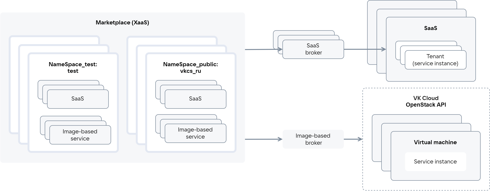
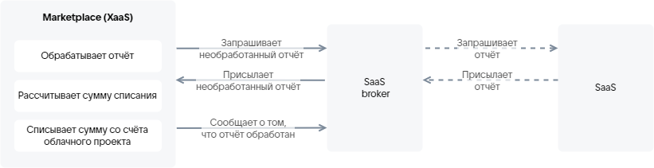
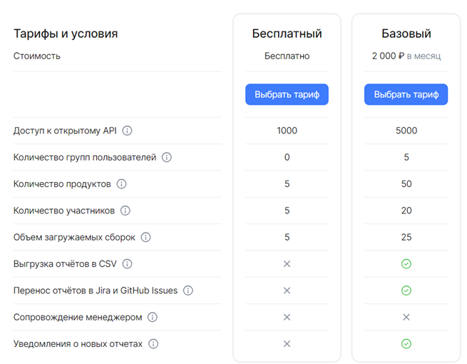
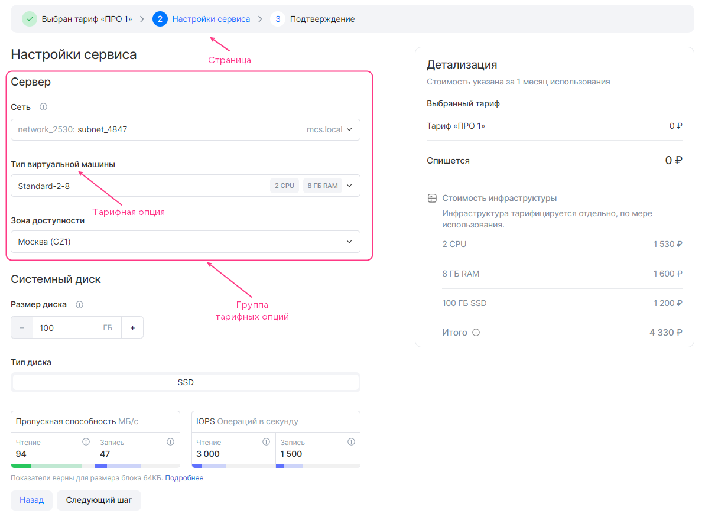

# {heading(Жалпы ақпарат)[id=index]}

{include(/kz/_includes/_translated_by_ai_kz.md)}

Сервислер орналастырылатын жүйенің толық атауы: {var(marketplace)} (XaaS).

Жүйенің қысқа атаулары: Marketplace, қосымшалар дүкені, дүкен.

Marketplace {var(cloud)} бұлтты платформасымен интеграцияланған. Marketplace бұлтты платформасының пайдаланушыларына онда орналастырылған сервислерге қол жеткізуді қамтамасыз етеді.

{note:info}

Дүкенге қосылған сервислер бұлтты платформасының ЖК-дегі **Қосымшалар дүкені** бөлімінде көрсетіледі.

{/note}

Дүкенмен өзара әрекеттесетін пайдаланушы рөлдері:

* Жеткізуші — сервисті дүкенге қосады. Дүкеннің тесттік және ашық кеңістіктері (namespace) қолжетімді.
* Тұтынушы — дүкенде орналастырылған сервисді пайдаланады. Тек дүкеннің ашық кеңістіктері (namespace) қолжетімді.

Осы құжат жеткізушілерге арналған.

Осы құжат сервистерді дүкенге қосу рәсімін сипаттайды.

## {heading(Сервис түрлері)[id=xaas_vendor_index_type_services]}

Дүкен келесі сервис түрлерін орналастыруға мүмкіндік береді:

* SaaS-қосымша — орталықтандырылған түрде орнатылған мультитенанттық өнім. Сервис жұмысына арналған инфрақұрылымды жеткізуші ұсынады. Жеткізуші сервисті үшінші тарап инфрақұрылымында да, бұлтты платформаның инфрақұрылымындағы өз жобасында да орналастырады. Пайдаланушыға сервис инстансына жеке тенант/аккаунт арқылы қол жеткізу беріледі.
* Image-based қосымша — пайдаланушының бұлтты жобасындағы виртуалды машиналардың бейнелері (образ) негізінде орналастырылатын өнім. Сервис жұмысы үшін бұлтты платформаның қосымша инфрақұрылымы пайдаланылуы мүмкін: виртуалды желілер, жүктемені теңгерушілер, DBaaS кластерлері, {var(s3)}, резервтік көшірмелеу. Сервис жұмысына арналған инфрақұрылымды бұлтты платформа ұсынады. Сервис инстанстары пайдаланушының жобасында орналастырылады.

   Marketplace бір ВМ-де де, кластерде де орналастырылатын image-based қосымшаларды орналастыруға мүмкіндік береді.

Сервис ұсынатын қызметтер тарифтік жоспарлар мен опциялар арқылы сипатталады. Тарифтік опция — жоспардың нақты бір параметрі.

Дүкеннің сервистермен өзара әрекеттесуі VK OSB протоколы бойынша брокерлер арқылы жүзеге асырылады ({linkto(#pic_xaas)[text=сурет %number]}). Брокер сервис конфигурациясын дүкенге жеткізуді қамтамасыз етеді: дүкен брокерді сервисдің ағымдағы конфигурациясы туралы мерзімді түрде сұрайды.

{caption(Сурет {counter(pic)[id=numb_pic_xaas]} — Дүкеннің сервистермен өзара әрекеттесуі)[align=center;position=under;id=pic_xaas;number={const(numb_pic_xaas)} ]}
{params[noBorder=true]}
{/caption}

SaaS-брокер нақты бір SaaS-қосымшаның дүкенмен өзара әрекеттесуін қамтамасыз етеді. Image-based брокер image-based қосымшалардың дүкенмен өзара әрекеттесуін қамтамасыз етеді. Image-based брокердің ішінде бір жеткізушінің image-based қосымшаларын біріктіретін тенанттар бар.

{note:warn}

SaaS-қосымшаның жеткізушісі SaaS-брокерді әзірлейді.

Image-based қосымшаның жеткізушісі image-based брокер үшін сервистік пакетті әзірлейді.

Image-based қосымшаларға арналған брокерді VK әзірлеген.

{/note}

Дүкеннің құрамына кіреді:

* Сервис жариялануына дейінгі конфигурациясы тексерілетін тесттік кеңістіктер (`NameSpace_test`). Сервисдің барлық ревизиялары қолжетімді.
* Сервис жарияланатын ашық кеңістіктер (`NameSpace_public`). Тек сервисдің соңғы жарияланған ревизиясы қолжетімді.

Тесттік кеңістіктерге (namespace) қол жеткізу тек жеткізушілерге беріледі. Пайдаланушының бірнеше кеңістікке (namespace) қол жеткізуі болса, дүкеннің каталогында оған қол жеткізуі бар кеңістіктердің кемінде бірінде орналастырылған барлық сервистер мен олардың ревизиялары көрінеді.

Image-based қосымша үшін тесттік және ашық кеңістіктер (namespace) сервистік кілтте және image-based брокерде, ал SaaS-қосымша үшін — брокерді Marketplace-те тіркеу кезінде SaaS-брокерде белгіленеді.

Сервисмен байланысты және дүкенмен интеграция кезінде пайдаланылатын сущностілер {linkto(#tab_entities)[text=кестеде %number]} келтірілген.

{caption(Кесте {counter(table)[id=numb_tab_entities]} — Сервисмен байланысты сущностілер)[align=right;position=above;id=tab_entities;number={const(numb_tab_entities)}]}
[cols="2,5", options="header"]
|===
|Атауы
|Сипаттамасы

|Сервис инстансы (Service instance)
|
Пайдаланушыда орналастырылған сервис данасы

|Сервистік байланыстыру (Service binding)
|
Брокерге бұлтты платформаның сұрауы негізінде сервис инстансы орналастырылғаннан кейін жасалатын және сервис инстансымен байланысатын сущность.

Сервистік байланыстыру көбіне пайдаланушыға сервиске қол жеткізуге арналған құпия ақпаратты беруге қолданылады. Егер сервис дүкеннің қатысуынсыз қол жеткізу деректерін жібере алатын болса, бұл міндетке сервистік байланыстыруды қолданудың қажеті жоқ. Сервистік байланыстырулар қолданылатын міндеттер нақты бір сервиске байланысты
|===
{/caption}

{note:info}

SaaS-қосымшаның сервис инстансы — SaaS-қосымшаның тенанты/аккаунты. Мысалы, VK Testers SaaS-қосымшасының инстансы VK Testers-тегі бір компанияға сәйкес келеді.

{/note}

## {heading(Тарифтік опциялардың түрлері)[id=xaas_option_types]}

{linkto(#tab_tariff_options_types)[text=кестеде %number]} келтірілген тарифтік опция түрлері қолдау көрсетіледі.

{caption(Кесте {counter(table)[id=numb_tab_tariff_options_types]} — Тарифтік опциялардың түрлері)[align=right;position=above;id=tab_tariff_options_types;number={const(numb_tab_tariff_options_types)}]}
[cols="4,2,2", options="header"]
|===
|Тарифтік опция түрі
|SaaS-қосымша
|Image-based қосымша

|Сандық (integer, number)
| 
| 

|Жолдық (string)
| 
| 

|Логикалық (boolean)
| 
| 

|Datasource
| 
| 
|===
{/caption}

`datasource` опция түрі бұлтты платформаның сущностілерімен байланысты опцияларды сипаттау үшін қолданылады. Мұндай түр бұлтты платформаның деректерін нақты уақыт режимінде пайдалануға мүмкіндік береді. Сервисді қосу немесе тарифтік жоспарды жаңарту кезінде опцияның мүмкін мәндері осы деректер негізінде қалыптастырылады.

`datasource` қолдайтын түрлері:

* Бұлтты платформаның пайдаланушы жобасында қолжетімді ВМ түрлері.
* Бұлтты платформаның қолжетімділік аймақтары.
* Бұлтты платформаның жобасында қолжетімді виртуалды желілер.
* Диск түрі.

## {heading(Тарификация)[id=xaas_billing]}

Тарифтік жоспарлар ақылы немесе тегін болуы мүмкін.

Тарифтік жоспарларда ақылы тарифтік опциялар болуы мүмкін. Келесі түрдегі ақылы опциялар қолдау көрсетіледі:

* Сандық.
* Логикалық.

Тарифтік жоспарлар мен опциялардың құны сервис конфигурациясында сипатталады.

Тарификация түрлерінің (төлем тәсілдерінің) сипаттамасы {linkto(#tab_tariff_types)[text=кестеде %number]} келтірілген.

{caption(Кесте {counter(table)[id=numb_tab_tariff_types]} — Тарификация түрлері)[align=right;position=above;id=tab_tariff_types;number={const(numb_tab_tariff_types)}]}
[cols="2,5", options="header"]
|===
|Атауы
|Сипаттамасы

|Тегін (Free)
|
Сервисді пайдаланғаны үшін төлем жоқ.

Image-based қосымша үшін бұлтты платформаның инфрақұрылымы төленеді

|Алдын ала төлемді (Upfront Commitment)
|
Сервис үшін төлем есепті кезеңде бір рет, сервис қосылған күні немесе тарифтік жоспар өзгерген күні алынады. Есепті кезеңнің ұзақтығы мен алу күні сервис конфигурациясында бапталады (толығырақ — {linkto(/kz/tools-for-using-services/vendor-account/manage-apps/ibservice_add/ibservice_configure/ibplan#ibplan)[text=%text]}, {linkto(/kz/tools-for-using-services/vendor-account/manage-apps/saas_add/saas_configure/saas_plan#saas_plan_param)[text=%text]} бөлімдерінде).

Құны тұрақты.

Егер алу сәтінде жобаның шотында қаражат жеткіліксіз болса, пайдаланушы мәжбүрлі түрде тегін тарифтік жоспарға ауыстырылады.

Егер сервистің тегін тарифтік жоспары болмаса, сервис инстансы деактивацияланады және пайдаланушы оған қол жеткізуден айырылады

|Кейін төлемді (Usage Based)
|
Сервис үшін төлем есепті кезеңде сервис ресурстарының іс жүзінде пайдаланылған көлеміне байланысты есептеледі (мысалы, пайдаланылған қойма көлемі).

Сервис ресурстарының (тарифтік опциялардың) пайдаланылуы үшін төлем дүкен алған метрикалар негізінде пайдалану фактісі бойынша жүргізіледі. Метрикаларды алу тәсілдері:

* Pull-модель.
* Push-модель.

Дүкен метрикалар алатын тарифтік опциялар сервис конфигурациясында сипатталуы тиіс.

Аулардың жиілігі метрикаларды алу жиілігіне байланысты. Мысалы, дүкен метрикаларды айына бір рет алса, төлем айына бір рет алынады.

Егер алу сәтінде жобаның шотында қаражат жеткіліксіз болса, soft-кезең басталады:

* Пайдаланушыға шотты толтыру қажеттілігі туралы email-хабарлама жіберіледі, әйтпесе soft-кезең аяқталғаннан кейін сервис инстансы деактивацияланады (тоқтатылады).
* Soft-кезең ішінде жобаның шот балансы күн сайын тексеріледі. Қаражат жеткілікті болса, алу жүргізіледі.

Егер soft-кезең аяқталмай тұрып шот қажетті сомаға толтырылмаса, hard-кезең басталады:

* Жобаның шотынан қаражат мәжбүрлі түрде алынады, жоба мұздатылады.
* Сервис инстансы деактивацияланады, пайдаланушы оған қол жеткізуден айырылады.
* Пайдаланушыға шотты толтыру қажеттілігі туралы email-хабарлама жіберіледі, әйтпесе hard-кезең аяқталғаннан кейін сервис инстансы өшіріледі.

{note:err}

Егер hard-кезең аяқталмай тұрып жобаның шот балансы оң мәнге дейін толтырылмаса, сервис инстансы өшіріледі.

{/note}

{note:warn}

Кейін төлемді алу тәсілі тек тегін тарифтік жоспардағы тарифтік опцияларға қолданылады.

{/note}

|BYOL (Bring Your Own License)
|
Сервистер үшін үшінші тарап лицензияларын пайдалану. Сервис инстансы лицензиясыз орналастырылады
|===
{/caption}

{note:warn}

Бұлтты платформаның сервистері кейін төлем шарттарымен ұсынылатын жобаларда сервис инстанстарының деактивациясы қолданылмайды.

{/note}

### {heading(Кейін төлемді тарификацияның Pull-моделі)[id=billing_pull]}

{note:warn}

Кейін төлемді тарификацияның Pull-моделі тек SaaS-қосымшалар үшін қолдау көрсетіледі.

{/note}

Pull-модель — сервисден алынған есеп негізінде іс жүзінде пайдаланылған ресурстар бойынша метрикаларды алу тәсілі. Дүкен тарапынан белгіленген жиілікпен брокерге өңделмеген есептердің бар-жоғы туралы сұрау жіберіледі ({linkto(#pic_xaas_saas_broker_resource_usage)[text=сурет %number]}):

1. Егер брокерде өңделмеген есептер болса, брокер оларды дүкенге жібереді.
1. Егер брокерде өңделмеген есептер болмаса, келесі әрекеттер орындалады:

   1. Брокер сервисден есеп сұрайды.
   1. Брокердің сұрауы бойынша сервис оған барлық бар сервис инстанстары бойынша есеп жібереді.
   1. Брокер есепке `batch_id` идентификаторын тағайындайды.
   1. Брокер дүкеннің сұрауына жауап ретінде оған өңделмеген есепті жібереді.

1. Дүкен алынған есеп негізінде пайдаланылған ресурстардың құнын есептейді.
1. Есеп өңделгеннен кейін (бұл есеп бойынша қаражат алынды немесе жоспарланды) дүкен брокерге осы есептің `batch_id`-ін хабарлайды. Әрі қарай брокер өңделген есептерді дүкенге жібермейді.

Дүкеннен брокерге сұраулардың жіберілу жиілігі сервис конфигурациясындағы `billing_cycle_step` параметрінде бапталады (толығырақ — {linkto(/kz/tools-for-using-services/vendor-account/manage-apps/saas_add/saas_configure/saas_plan#saas_plan_param)[text=%text]} бөлімінде).

{caption(Сурет {counter(pic)[id=numb_pic_xaas_saas_broker_resource_usage]} — Дүкен мен брокер арасындағы есеп берудің алмасуы)[align=center;position=under;id=pic_xaas_saas_broker_resource_usage;number={const(numb_pic_xaas_saas_broker_resource_usage)} ]}
{params[noBorder=true]}
{/caption}

SaaS-брокерде дүкенге есеп жіберетін әдістер іске асырылуы тиіс. Есептің пішімі {linkto(/kz/tools-for-using-services/vendor-account/manage-apps/saas_add/saas_broker#saas_broker)[text=%text]} бөлімінде келтірілген.

### {heading(Кейін төлемді тарификацияның Push-моделі)[id=billing_push]}

Push-модель — сервис жіберетін API-сұрау арқылы іс жүзінде пайдаланылған ресурстар бойынша метрикаларды алу тәсілі. API-сұраудың параметрлері {linkto(#tab_metrics_request)[text=кестеде %number]} келтірілген.

{caption(Кесте {counter(table)[id=numb_tab_metrics_request]} — Дүкенге метрикалар жіберу сұрауының параметрлері)[align=right;position=above;id=tab_metrics_request;number={const(numb_tab_metrics_request)}]}
[cols="2,5", options="header"]
|===
|Параметр
|Мәні

|
Сұрау әдісі
|
`POST`

|
Сұрау жолы
|
`https://<CLOUD_HOST>/marketplace/api/infra-api/api/v1-public/usages`

Мұнда `<CLOUD_HOST>` — `https://cloud.vk.ru` бұлтты платформасының домендік атауы

|
`Content-Type`
|
`application/json`

|
Сұрау денесі (`--data`)
|
Сұрау денесінде сервис инстанстары бойынша метрикалар беріледі. Келесі параметрлерді көрсету қажет:

* `base_date` — метрикаларды жіберу күні, RFC3339 пішімінде.

   Егер күн көрсетілмесе, API-сұраудың орындалуының ағымдағы күні мен уақыты қолданылады.
* `broker_id` — брокердің дүкенде тіркелген ID-сі. Брокердің ID-сін алу үшін [marketplace@cloud.vk.com](mailto:marketplace@cloud.vk.com) мекенжайына келесі ақпаратпен хат жіберіңіз:

   * Компания атауы.
   * Сервис атауы.

   Компанияда тек бір SaaS-брокер немесе image-based брокерде тек бір тенант болса, бұл параметрді көрсетпеңіз.
* `usages` — сервисдің пайдаланылған ресурстары бойынша метрикалар.

   * `usages.instance_uuid` — сервис инстансының ID-сі.
   * `usages.param` — тарифтік опцияның атауы. SaaS-қосымша үшін атау JSON-файлда көрсетілген атауға, ал image-based қосымша үшін опцияның YAML-файлының атауына сәйкес болуы тиіс.
   * `usages.value` — тұтынылған тарифтік опция мөлшері

|
`x-service-token`
|
`<SERVICE_TOKEN_USAGES>` — метрикаларды жіберу үшін арналған сервистік кілт. Метрикаларға арналған сервистік кілтті алу үшін [marketplace@cloud.vk.com](mailto:marketplace@cloud.vk.com) мекенжайына келесі ақпаратпен хат жіберіңіз:

* Компания атауы.
* Метрикаларды жібергендегі сервистік кілттің иесі болып тағайындалатын пайдаланушының email мекенжайы.

Әдепкі бойынша метрикаларға арналған сервистік кілттің қолданылу мерзімі — 1 жыл.

{note:warn}

Image-based қосымшаның сервистік пакетін жүктеу кезінде қолданылатын сервистік кілт арқылы дүкенге метрикалар жіберу мүмкін емес.

{/note}
|===
{/caption}

{caption(Дүкенге метрикалар жіберу сұрауының мысалы)[align=left;position=above]}
```console
$ curl -v -X POST https://cloud.vk.ru/marketplace/api/infra-api/api/v1-public/usages \
-H "Content-Type: application/json" \
-H 'x-service-token: <SERVICE_TOKEN_USAGES>' \
--data '{
      "broker_id": "7",
      "usages: [
        {
        "instance_uuid": "078621f1-ebe3-4f16-b998-503c487e4bfc",
        "param": "storage", // JSON-файлдағы опцияның атауы немесе YAML-файлдың атауы
        "value": 2.55786
        }
      ]
}'
```

{/caption}

HTTP жауап кодтары {linkto(#tab_http_response_codes)[text=кестеде %number]} келтірілген.

{caption(Кесте {counter(table)[id=numb_tab_http_response_codes]} — HTTP жауап кодтары)[align=right;position=above;id=tab_http_response_codes;number={const(numb_tab_http_response_codes)}]}
[cols="2,5", options="header"]
|===
|Код
|Сипаттамасы

|200
|Метрикалар жіберілді

|400, 500
|Сұрауды орындау қатесі

|401
|Авторизация қатесі
|===
{/caption}

## {heading(Тарифтік жоспарлар матрицасы)[id=xaas_tariff_matrix]}

Тарифтік жоспарлар матрицасы ({linkto(#pic_preview)[text=сурет %number]}) сервис туралы ақпаратты қараған кезде тарифтер бетінде көрсетіледі. Матрица негізінде пайдаланушы сервисдің тарифтерін бір-бірімен салыстыра алады: қандай опциялар қандай тарифтік жоспарға кіреді.

{caption(Сурет {counter(pic)[id=numb_pic_preview]} — Тарифтік жоспарлар матрицасы)[align=center;position=under;id=pic_preview;number={const(numb_pic_preview)} ]}

{/caption}

Тарифтік жоспарлар матрицасы сервис конфигурациясында сипатталады. Онда пайдаланушы тарифтік жоспарды таңдайтын сервисдің тарифтік опциялары көрсетіледі.

## {heading(Тарифтік жоспар конфигурациясының шебері)[id=xaas_wizard]}

Сервисді қосу кезінде және тарифтік жоспарды жаңарту кезінде пайдаланушыға тарифтік жоспар конфигурациясының шебері көрсетіледі.

Тарифтік жоспар конфигурациясының шебері пайдаланушыға нақты бір тарифтік жоспар үшін тарифтік опцияларды баптауға мүмкіндік береді.

Дүкеннің интерфейсінде тарифтік жоспар конфигурациясының шебері жеке беттерге бөлінген ({linkto(#pic_xaas_wizard)[text=сурет %number]}). Әр бет тарифтік жоспарды баптаудың нақты бір кезеңін сипаттайды. Бетте осы кезеңде бапталатын тарифтік опциялар көрсетіледі. Опциялар топтарға біріктірілген.

{caption(Сурет {counter(pic)[id=numb_pic_xaas_wizard]} — Тарифтік жоспар конфигурациясының шебері)[align=center;position=under;id=pic_xaas_wizard;number={const(numb_pic_xaas_wizard)} ]}

{/caption}

Тарифтік жоспар конфигурациясы шеберінің бірінші және соңғы беттері автоматты түрде қосылады. Қалған беттер сервис конфигурациясында сипатталады.

Тарифтік жоспар конфигурациясының шеберінде тарифтік жоспардың және ақылы тарифтік опциялардың құны көрсетіледі. Image-based қосымшалар үшін қосымша түрде бұлтты платформаның инфрақұрылымының құны көрсетіледі, ол бұлтты платформаның тарифтеріне сәйкес автоматты түрде есептеледі. Есептеуге арналған параметрлер image-based қосымшаның конфигурациясында сипатталады.