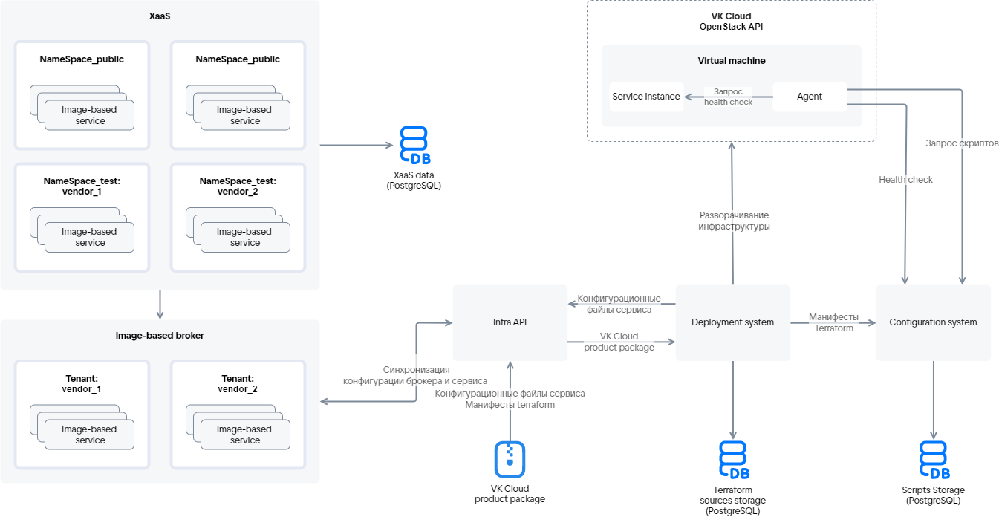

{include(/kz/_includes/_translated_by_ai_kz.md)}

Marketplace-тегі image-based қосымшасының сервистік пакетін жүктеу Infra API сервисі арқылы орналастыру жүйесімен жүзеге асырылады. Процесске VK Cloud платформасының келесі компоненттері қатысады:

[cols="2,5", options="header"]
|===
|Атауы
|Сипаттамасы

|Infra API
|Image-based қосымшаларын орналастыру үшін marketplace пен VK Cloud платформасының интеграция нүктесі болып табылады. Infra API сервистік пакетті жүктеп жатқан немесе сервис инстансын орналастырып жатқан пайдаланушы деректерін тексереді. Сәтті тексеруден кейін Infra API Terraform манифестінде сипатталған ресурстарды жасау үшін сервистер аралық өзара әрекеттесуге қол жеткізеді. Infra API орналастыру жүйесімен және конфигурацияларды басқару сервисімен өзара әрекеттеседі

|Орналастыру жүйесі (Deployment system)
|VK Cloud-та ВМ-де image-based қосымшасын орналастыруды қамтамасыз етеді. Сервисдің инфрақұрылымы мен ПО-сын басқарады

|Image-based брокер
|Сервис инстансының өмірлік циклін басқарады, тенанттарды қамтиды. Тенанттар бір поставщиктің (`vendor`) image-based қосымшаларын біріктіреді

|Конфигурацияларды басқару сервисі (Configuration system)
|Келесілер сақталатын сервер:

* Terraform манифесттерінде сипатталған конфигурация.
* Скрипттердің орындалу нәтижелері.
* Сервис инстансының ағымдағы конфигурациясы.

ВМ-ге орнатылатын агенттің өзекті нұсқасына қол жеткізуді қамтамасыз етеді

|Marketplace агенті (Agent)
|Сервисді орналастыру процесінде ВМ-ге орнатылатын бағдарламалық қамтамасыз ету. Толығырақ — [Marketplace агенті](/kz/tools-for-using-services/vendor-account/manage-apps/concepts/vendor-preconditions/ib_image_agent) бөлімінде

|Сервистік пакет (VK Cloud product package)
|YAML-файлдары мен Terraform манифесттерінің құрылымдалған жиынтығы
|===

Төменде image-based қосымшасын жүктеу процесінде аталған компоненттердің өзара әрекеттесу схемасы келтірілген.

{params[noBorder=true]}

Схемада `NameSpace_test` және `NameSpace_public` — Marketplace-тің тесттік және ашық атау кеңістіктері. Әрбір сервис үшін олар поставщик Marketplace-тен жүктеуге дайындалу кезінде алатын сервистік кілтте беріледі