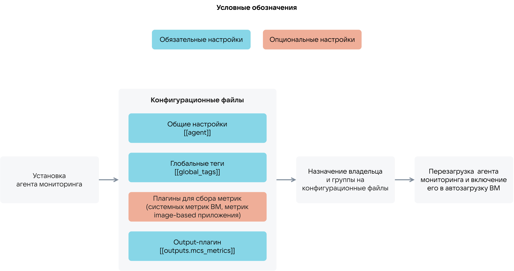

# {heading(Мониторинг агенті)[id=ib_cloud_monitoring_telegraf]}

{include(/kz/_includes/_translated_by_ai_kz.md)}

Marketplace [Cloud Monitoring](/kz/monitoring-services/monitoring) бұлттық платформасының сервисімен интеграцияланған, ол image-based қосымшалар үшін метрикаларды жинауға мүмкіндік береді. Метрикаларды жинау мониторинг агенті (Telegraf) көмегімен орындалады. Мониторинг агентін пайдалану схемасы {linkto(#pic_use_agent)[text=%number-суретте]} көрсетілген.

{caption(Рисунок {counter(pic)[id=numb_pic_use_agent]} — Мониторинг агентін пайдалану)[align=center;position=under;id=pic_use_agent;number={const(numb_pic_use_agent)} ]}
{params[noBorder=true]}
{/caption}

Мониторинг агентін пайдалану туралы толығырақ — {linkto(../ib_cloud_monitoring_vm#ib_cloud_monitoring_vm)[text=%text]} және {linkto(../ib_cloud_monitoring_app#ib_cloud_monitoring_app)[text=%text]} бөлімдерінде.