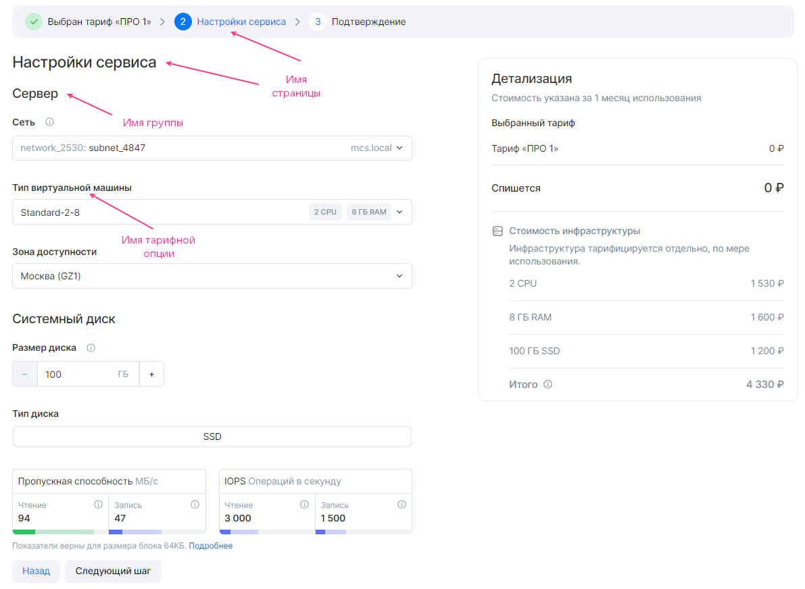
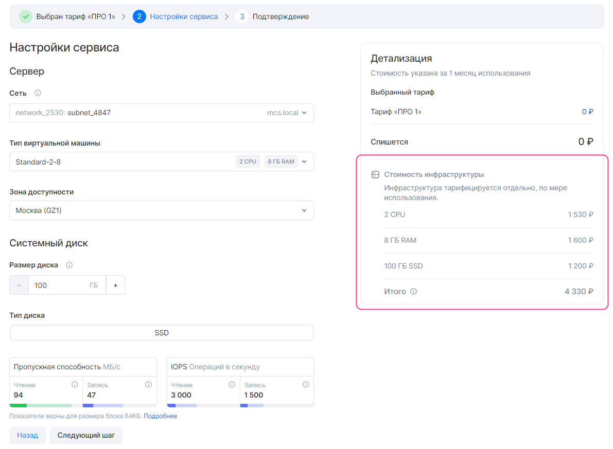
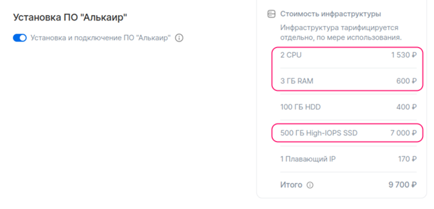

# {heading(display.yaml файлы)[id=ib_display]}

{include(/kz/_includes/_translated_by_ai_kz.md)}

{linkto(/kz/tools-for-using-services/vendor-account/manage-apps/concepts/about#xaas_wizard)[text=%text]} сипаттау үшін `plans/<PLAN_NAME>/display.yaml` файлында {linkto(#tab_plans)[text=%number кестеде]} келтірілген параметрлерді көрсетіңіз.

{caption(Кесте {counter(table)[id=numb_tab_plans]} — plans/<PLAN_NAME>/display.yaml файлының параметрлері)[align=right;position=above;id=tab_plans;number={const(numb_tab_plans)}]}
[cols="2,5,2,2", options="header"]
|===
|Аты
|Сипаттамасы
|Пішімі
|Міндетті

|pages
|
Тарифтік жоспарды баптау шеберінің бірінші және соңғы беттерден басқа барлық беттерін сипаттайды.

Параметр көрсетілмесе, баптау шебері тек автоматты түрде қалыптастырылатын беттерден тұрады
|Массив (толығырақ — {linkto(../ib_display#IBdisplay_pages)[text=%text]} бөлімінде)
|
Жоқ

|entities
|
Бұлттық платформаның инфрақұрылым элементтерін сипаттайды, чтобы тарифтік жоспарды баптау шеберінде олардың құнының есебі көрсетілді:

* ВМ.
* Жүктеме балансирлеушілері.
* Сыртқы IP-адрестер.

Құн бұлттық платформаның тарифтеріне сәйкес автоматты түрде есептеледі
|Массив (толығырақ — {linkto(../ib_display#IBdisplay_entities)[text=%text]} бөлімінде)
|
Иә
|===
{/caption}

## {heading(pages массиві)[id=IBdisplay_pages]}

Әдепкі бойынша тарифтік жоспарды баптау шеберінде `groups` тарифтік опциялар топтарының барлығы көрсетіледі және бапталады. Топтардың көрсетілуін шарттарға байланысты баптау үшін `when` құрылымын пайдаланыңыз (толығырақ — {linkto(../ib_display#IBdisplay_when)[text=%text]} бөлімінде).

Тарифтік жоспарды баптау шеберінің беттерін сипаттау үшін ({linkto(#pic_wizard_ib_page)[text=%number сурет]}):

1. `plans/<PLAN_NAME>/display.yaml` файлында `pages` массивін көрсетіңіз.
1. `pages` ішінде көрсетіңіз:

   * `name` параметрі — бет атауы. 32 таңбадан аспауы тиіс.
   * `groups` массиві.

1. `groups` ішінде тарифтік жоспарды баптау шеберінің нақты беті үшін тарифтік опциялар топтарын сипаттаңыз. Әр топ үшін көрсетіңіз:

   * `name` параметрі — тарифтік опциялар тобының атауы. 255 таңбадан аспауы тиіс.
   * `parameters` массиві — топқа кіретін тарифтік опциялар.

1. `parameters` ішінде әр тарифтік опция үшін `name` параметрін көрсетіңіз — оның YAML-файлының атауы.

   Дүкен интерфейсінде тарифтік опциялар олардың YAML-файлдарындағы `schema` бөлімінде берілген атаулармен көрсетіледі.

   {note:warn}

   Бір тарифтік опция тек бір топта ғана көрсетілуі мүмкін.

   {/note}
1. Тарифтік жоспарды баптау шеберінің келесі беттерін де осылай сипаттаңыз. Беттердің максималды саны — 5.

{caption(Сурет {counter(pic)[id=numb_pic_wizard_ib_page]} — Тарифтік жоспарды баптау шебері)[align=center;position=under;id=pic_wizard_ib_page;number={const(numb_pic_wizard_ib_page)} ]}

{/caption}

{caption(Тарифтік жоспарды баптау шеберінің **Сервисті баптау** бетін сипаттау мысалы)[align=left;position=above]}
```yaml
pages:
- name: Настройки сервиса # Имя страницы
  groups:
  - name: Сервер # Имя группы тарифных опций
    parameters:
    - name: network # Имя YAML-файла тарифной опции
    - name: vm
    - name: az

  - name: Системный диск
    parameters:
    - name: volume_size
    - name: volume_type
```
{/caption}

{note:warn}

Жоспардың барлық тарифтік опциялары `plans/<PLAN_NAME>/display.yaml` файлында көрсетілуі тиіс.

{/note}

## {heading(entities массиві)[id=IBdisplay_entities]}

Әдепкі бойынша тарифтік жоспарды баптау шеберінде `entities` массивінде сипатталған инфрақұрылым элементтерінің бәрінің құны есептеледі. Инфрақұрылым құнының көрсетілуін шарттарға байланысты баптау үшін `when` құрылымын пайдаланыңыз (толығырақ — {linkto(../ib_display#IBdisplay_when)[text=%text]} бөлімінде).

Инфрақұрылым элементінің түрі `entities.entity` параметрінде анықталады:

* `vm` — ВМ.
* `load_balancing` — жүктеме балансирлеуші.
* `floating_ip` — сыртқы IP-адрес.

{note:warn}

Terraform манифесттері `entities` құрамындағы инфрақұрылым элементтерінің сипаттамасын қамтуы тиіс.

{/note}

### {heading(ВМ)[id=IBdisplay_vm]}

Тарифтік жоспарды баптау шеберінде ВМ құны есептелуі үшін ({linkto(#pic_wizard_ib_price)[text=%number сурет]}):

1. `plans/<PLAN_NAME>/display.yaml` файлында `entities` массивін көрсетіңіз.
1. `entities` ішінде келесі параметрлерді көрсетіңіз:

   * `entity` — инфрақұрылым элементінің түрі. `vm` көрсетіңіз.
   * `description` — ВМ сипаттамасы (міндетті емес).
   * `count.const` немесе `count.param` — ВМ саны.

      Константаны берсу үшін `count.const` параметрін және оның мәнін көрсетіңіз.

      ВМ саны тарифтік опцияның мәнімен анықталса, `count.param` параметрін және сәйкес YAML-файлдың атауын көрсетіңіз.
   * `flavor.const` немесе `flavor.param` — ВМ түрі.

      Константаны берсу үшін `flavor.const` параметрін және ВМ түрінің ID-сын көрсетіңіз.

      ВМ түрі тарифтік опцияның мәнімен анықталса, ВМ түрін сипаттайтын YAML-файлдың атауын (`datasource.type` = `flavor`) және `flavor.param` параметрін көрсетіңіз.

1. ВМ дисктерін `disks` массиві арқылы сипаттаңыз (инфрақұрылым баптауында `datasource.type` = `volume_type` түріндегі тарифтік опция болмаса, міндетті емес).

   1. Әр диск үшін келесі параметрлерді көрсетіңіз:

      * `type.const` немесе `type.param` — диск түрі.

         Диск түрі тарифтік опцияның мәнімен анықталса, диск түрін сипаттайтын тарифтік опцияның YAML-файлының атауын (`datasource.type` = `volume_type`) және `type.param` параметрін көрсетіңіз.

         Константаны берсу үшін `type.const` параметрін және мына мәндердің бірін көрсетіңіз:

         * `ceph-ssd` — SSD түріндегі диск.
         * `ceph-hdd` — HDD түріндегі диск.
         * `high-iops` — High-IOPS SSD түріндегі диск (жоғары өнімді SSD).

      * `size.const` немесе `size.param` — диск өлшемі.

         Константаны берсу үшін `size.const` параметрін және оның мәнін көрсетіңіз.

         Диск өлшемі тарифтік опцияның мәнімен анықталса, `size.param` параметрін және сәйкес тарифтік опция YAML-файлының атауын көрсетіңіз.

{caption(Сурет {counter(pic)[id=numb_pic_wizard_ib_price]} — Тарифтік жоспарды баптау шебері. Инфрақұрылым құны туралы ақпарат)[align=center;position=under;id=pic_wizard_ib_price;number={const(numb_pic_wizard_ib_price)} ]}

{/caption}

{caption(Тарифтік жоспарды баптау шебері үшін ВМ сипаттамасының мысалы)[align=left;position=above]}
```yaml
entities:
  - entity: vm
    description: Виртуальная машина
    count:
      const: 1
    flavor:
      param: ds-flavor # Имя YAML-файла тарифной опции
    disks:
      - type:
          param: root_type
        size:
          param: root_size
      - type:
          param: data_type
        size:
          param: data_size
```
{/caption}

{note:warn}

Егер сервис инфрақұрылымының баптауында диск түрін сипаттайтын `datasource` түріндегі тарифтік опция қолданылса, онда ВМ сипаттау кезінде `disks` массиві міндетті түрде толтырылуы тиіс.

{/note}

### {heading(Жүктеме балансирлеуші)[id=IBdisplay_lb]}

Тарифтік жоспарды баптау шеберінде жүктеме балансирлеушінің құны есептелуі үшін:

1. `plans/<PLAN_NAME>/display.yaml` файлында `entities` массивін көрсетіңіз.
1. `entities` ішінде келесі параметрлерді көрсетіңіз:

   * `entity` — инфрақұрылым элементінің түрі. `load_balancing` көрсетіңіз.
   * `count.const` немесе `count.param` — жүктеме балансирлеушілерінің саны.

      Константаны берсу үшін `count.const` параметрін және оның мәнін көрсетіңіз.

      Жүктеме балансирлеушілерінің саны тарифтік опцияның мәнімен анықталса, `count.param` параметрін және сәйкес YAML-файлдың атауын көрсетіңіз.

{caption(Тарифтік жоспарды баптау шебері үшін жүктеме балансирлеушісінің сипаттамасының мысалы)[align=left;position=above]}
```yaml
entities:
  - entity: load_balancing
    count:
      param: number_balancing # Имя YAML-файла тарифной опции
```
{/caption}

### {heading(Сыртқы IP-адрес)[id=IBdisplay_floating_ip]}

Тарифтік жоспарды баптау шеберінде сыртқы IP-адрестің құны есептелуі үшін:

1. `plans/<PLAN_NAME>/display.yaml` файлында `entities` массивін көрсетіңіз.
1. `entities` ішінде келесі параметрлерді көрсетіңіз:

   * `entity` — инфрақұрылым элементінің түрі. `floating_ip` көрсетіңіз.
   * `count.const` немесе `count.param` — сыртқы IP-адрестердің саны.

      Константаны берсу үшін `count.const` параметрін және оның мәнін көрсетіңіз.

      Сыртқы IP-адрестердің саны тарифтік опцияның мәнімен анықталса, `count.param` параметрін және сәйкес YAML-файлдың атауын көрсетіңіз.

{caption(Тарифтік жоспарды баптау шебері үшін сыртқы IP-адрестің сипаттамасының мысалы)[align=left;position=above]}
```yaml
entities:
  - entity: floating_ip
    count:
      const: 1
```
{/caption}

## {heading(when құрылымы)[id=IBdisplay_when]}

`when` құрылымы шартты тармақталуды басқарады. Оған кіреді:

* Шарттың түрі:

   * `when.in` — `key` және `values` параметрлерінде берілген мәндердің теңдігін тексеру. `key` ішіндегі мән `values` ішіндегі мәндердің кем дегенде біріне тең болса, шарт орындалады.
   * `when.not_in` — `key` және `values` параметрлерінде берілген мәндердің тең еместігін тексеру. `key` ішіндегі мән `values` ішіндегі мәндердің барлығына тең болмаса, шарт орындалады.

* Өлшемшарттар. `key` және `values` параметрлерінде мына тәсілдердің бірімен беріледі:

   * `param` параметрі арқылы — нақты тарифтік опцияның мәнін пайдалану үшін.
   * `const` параметрі арқылы — константаны пайдалану үшін.

   `key` ішінде бір мән, `values` ішінде бір немесе бірнеше мән беруге болады.

{caption(YAML пішіміндегі `when` құрылымы)[align=left;position=above]}
```yaml
when:
  in: # Или not_in
    key:
      param: <OPTION> # Или const: <VALUE>
    values:
      - const: <VALUE>
      - param: <OPTION>
      ...
```
{/caption}

Мұнда:

* `<OPTION>` — тарифтік опция YAML-файлының атауы.
* `<VALUE>` — константаның мәні.

{note:warn}

Terraform манифесттеріндегі ресурстар `when` құрылымдарында берілген шарттарды ескере отырып сипатталуы тиіс.

{/note}

### {heading(pages массивінде)[id=IBdisplay_when_in_pages]}

`pages` массивінде `when` құрылымында тарифтік опциялар тобын көрсетуге болатынын анықтайтын шарт беріледі.

{note:warn}

Топтар арасындағы тәуелділіктерде иерархияның тек бірінші деңгейі қолдау көрсетіледі. Егер топта `when` құрылымы көрсетілсе, бұл топтың тарифтік опцияларын (`parameters` ішінде көрсетілген) басқа топтардағы `when` құрылымында пайдалануға болмайды.

{/note}

`when` құрылымын пайдаланған кезде тарифтік опциялары бар бет келесі шарттар орындалғанда жасырылады:

* Бір бет шеңберінде барлық топтарда `when` құрылымы бар.
* Тарифтік жоспарды баптау шеберінде осы бетте барлық топтардағы шарттар орындалмайтындай тарифтік опциялардың мәндері берілген.

Бір тарифтік опция әр түрлі топтардағы `when` құрылымдарында пайдаланылуы мүмкін. Тарифтік опцияның мәніне байланысты сол немесе басқа топтар көрсетіледі.

{caption(`pages` массивінде `when` құрылымын пайдалану мысалы)[align=left;position=above]}
```yaml
pages:
- name: Настройки бекапа # Имя страницы
  groups:
  - name: High-frequency бекап # Имя группы тарифных опций
    parameters:
    - name: frequency_per_day # Имя YAML-файла тарифной опции
    when:
      in:
        key:
          param: backup_method # Имя YAML-файла тарифной опции
        values:
          - const: high-frequency
```
{/caption}

Жоғарыдағы мысалда high-frequency әдісі үшін бекап жасау жиілігі бапталады: егер `backup_method` тарифтік опциясының мәні `high-frequency` болса, тарифтік жоспарды баптау шеберінде `frequency_per_day` тарифтік опциясы бар `High-frequency бекап` тобын көрсетеді.

`backup_method` тарифтік опциясы:

* Басқа топтардағы `when` құрылымында пайдаланылуы мүмкін.
* Басқа топтағы `parameters` ішінде берілгені тиіс.

`frequency_per_day` тарифтік опциясы басқа топтарда пайдаланылуы мүмкін емес:

* `when` құрылымында, себебі тәуелділіктер иерархиясының бір деңгейі қолдау көрсетіледі.
* `parameters` ішінде, себебі бір тарифтік опция тек бір топта көрсетілуі мүмкін.

### {heading(entities массивінде)[id=IBdisplay_when_in_entities]}

`entities` массивінде `when` құрылымында `entities` ішінде сипатталған элементтің құнын сервис инстансының инфрақұрылымының құнына қосу керектігін анықтайтын шарт беріледі. Құн тарифтік жоспарды баптау шеберінде көрсетіледі.

{caption(`entities` массивінде `when` құрылымын пайдалану мысалы)[align=left;position=above]}
```yaml
entities:
  - entity: vm
    description: alkair_software
    when:
      in:
        key:
          param: need_install_alkair_software # Имя YAML-файла тарифной опции
        values:
          - const: true
    flavor:
      const: 6a7a0690-943a-4921-936e-2849970ccfba # Тип ВМ (CPU, RAM). В данном примере тип ВМ с 2 CPU и 3 ГБ RAM
    count:
      const: 1
    disks:
      - type:
          const: high-iops # Тип диска
        size:
          const: 500 # Размер диска
```
{/caption}

Жоғарыдағы мысалда Алькаир БӘЖ үшін ВМ құнының көрсетілуі бапталған: егер `need_install_alkair_software` тарифтік опциясының мәні `true` болса, тарифтік жоспарды баптау шеберінде `entities.entity` ішінде сипатталған ВМ құны көрсетіледі ({linkto(#pic_alkair_included)[text=%number сурет]}).

{caption(Сурет {counter(pic)[id=numb_pic_alkair_included]} — Тарифтік опция қосылған, Алькаир БӘЖ үшін ВМ құны инфрақұрылым құнына ескеріледі)[align=center;position=under;id=pic_alkair_included;number={const(numb_pic_alkair_included)} ]}

{/caption}