# {heading(Tariftiқ опциялардың YAML-файлдарын толтыру)[id=IB_option_fill_in]}

{include(/kz/_includes/_translated_by_ai_kz.md)}

`parameters/<OPTION_NAME>.yaml` файлдарында кем дегенде бір тарифтік жоспарда қолданылатын барлық тарифтік опцияларды сипаттаңыз (қосымша мәліметтер — {linkto(/kz/tools-for-using-services/vendor-account/manage-apps/concepts/about#xaas_option_types)[text=%text]} бөлімінде).

Әрбір жеке YAML-файл бір тарифтік опцияға сәйкес келеді. Онда тарифтік опцияның баптаулары, ал ақылы опциялар үшін — құны сипатталады.

Тарифтік опцияларды сипаттау үшін қолданылатын параметрлердің егжей-тегжейлі сипаттамасы [YAML-файл тарифной опции](../iboption) бөлімінде келтірілген.

## {heading(integer түріндегі тегін тарифтік константа-опциясы)[id=option_int_const]}

`parameters/<OPTION_NAME>.yaml` файлын мынадай түрде толтырыңыз:

1. `actions` параметрін көрсетіңіз.
1. `schema` секциясында мынадай параметрлерді орнатыңыз:

   * `description` — тарифтік опцияның атауы.
   * `hint` — тарифтік опцияның сипаттамасы (міндетті емес).
   * `type` — тарифтік опцияның түрі. `integer` мәнін көрсетіңіз.
   * `const` — тарифтік опцияның мәні.

{caption(`integer` түріндегі константа-опциясын сипаттау мысалы, `YAML` форматы)[align=left;position=above]}
```yaml
actions:
- create
- update

schema:
  description: Размер системного диска
  hint: В ГБ
  type: integer
  const: 20
```
{/caption}

{linkto(#pic_option_int_const)[text=%number суретте]} жоғарыда сипатталған опцияның тарифтік жоспарды баптау шеберінде қалай көрсетілетіні келтірілген.

{caption(Сурет {counter(pic)[id=numb_pic_option_int_const]} — integer түріндегі тарифтік константа-опциясы)[align=center;position=under;id=pic_option_int_const;number={const(numb_pic_option_int_const)} ]}
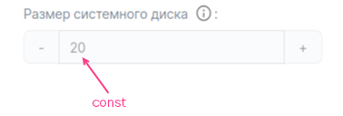{params[width=40%]}
{/caption}

## {heading(Тізімнен мән таңдау мүмкіндігі бар integer түріндегі тегін тарифтік опциясы)[id=option_int_enum]}

`parameters/<OPTION_NAME>.yaml` файлын мынадай түрде толтырыңыз:

1. `actions` параметрін көрсетіңіз.
1. `schema` секциясында мынадай параметрлерді орнатыңыз:

   * `description` — тарифтік опцияның атауы.
   * `hint` — тарифтік опцияның сипаттамасы (міндетті емес).
   * `type` — тарифтік опцияның түрі. `integer` мәнін көрсетіңіз.
   * `enum` — тарифтік опцияның мүмкін мәндері.
   * `default` — әдепкі мән.

{caption(Тізімнен мән таңдау мүмкіндігі бар `integer` түріндегі опцияны сипаттау мысалы, `YAML` форматы)[align=left;position=above]}
```yaml
actions:
- create
- update

schema:
  description: Количество серверов в кластере
  type: integer
  enum: [3, 5, 7]
  default: 5
```
{/caption}

{linkto(#pic_option_int_enum)[text=%number суретте]} жоғарыда сипатталған опцияның тарифтік жоспарды баптау шеберінде қалай көрсетілетіні келтірілген.

{caption(Сурет {counter(pic)[id=numb_pic_option_int_enum]} — Тізімнен мән таңдау мүмкіндігі бар integer түріндегі тарифтік опциясы)[align=center;position=under;id=pic_option_int_enum;number={const(numb_pic_option_int_enum)} ]}
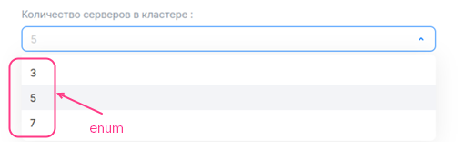{params[width=60%]}
{/caption}

## {heading(1 өзгеру қадамы бар integer түріндегі тегін тарифтік опциясы)[id=option_int_step]}

`parameters/<OPTION_NAME>.yaml` файлын мынадай түрде толтырыңыз:

1. `actions` параметрін көрсетіңіз.
1. `schema` секциясында мынадай параметрлерді орнатыңыз:

   * `description` — тарифтік опцияның атауы.
   * `hint` — тарифтік опцияның сипаттамасы (міндетті емес).
   * `type` — тарифтік опцияның түрі. `integer` мәнін көрсетіңіз.
   * `default` — әдепкі мән (міндетті емес).

      Егер параметр орнатылмаса, әдепкі мән `0` тең болады.
   * `minimum` және `maximum` — тарифтік опцияның ең үлкен және ең кіші мәндері (міндетті емес).

{caption(1 өзгеру қадамы бар `integer` түріндегі тегін опцияны сипаттау мысалы, `YAML` форматы)[align=left;position=above]}
```yaml
actions:
- create
- update

schema:
  description: Количество участников
  hint: Количество сотрудников компании заказчика, которые могут использовать инфраструктуру тестирования и обрабатывать отчеты от тестировщиков VK Testers.
  type: integer
  default: 20
  minimum: 20
```
{/caption}

3, 4 суреттерде жоғарыда сипатталған опцияның тарифтік жоспарды баптау шеберінде қалай көрсетілетіні келтірілген.

{caption(Сурет {counter(pic)[id=numb_pic_option_int_step]} — 1 өзгеру қадамы бар integer түріндегі тегін тарифтік опциясы)[align=center;position=under;id=pic_option_int_step;number={const(numb_pic_option_int_step)} ]}

{/caption}

{caption(Сурет {counter(pic)[id=numb_pic_option_int_step_plus]} — 1 өзгеру қадамы бар integer түріндегі тегін тарифтік опциясы, мән 1 қадамға ұлғайтылған)[align=center;position=under;id=pic_option_int_step_plus;number={const(numb_pic_option_int_step_plus)} ]}

{/caption}

## {heading(Пайдаланушылық өзгеру қадамы бар integer түріндегі тегін тарифтік опциясы)[id=option_int_with_user_step_free]}

`parameters/<OPTION_NAME>.yaml` файлын мынадай түрде толтырыңыз:

1. `actions` параметрін көрсетіңіз.
1. `billing` секциясында мынадай параметрлерді орнатыңыз:

   * `base` — стандартты мән.
   * `cost` — өзгеру қадамының құны. `0` мәнін көрсетіңіз.
   * `unit.size` — өзгеру қадамының өлшемі.
   * `unit.measurement` — тарифтік опцияның өлшем бірліктері (міндетті емес).

   {caption(`billing` секциясын толтыру мысалы)[align=left;position=above]}
   ```yaml
   billing:
     base: 25
     cost: 0
     unit:
        size: 100
   ```
   {/caption}
1. `schema` секциясында мынадай параметрлерді орнатыңыз:

   * `description` — тарифтік опцияның атауы.
   * `hint` — тарифтік опцияның сипаттамасы (міндетті емес).
   * `type` — тарифтік опцияның түрі. `integer` мәнін көрсетіңіз.
   * `default` — әдепкі мән (міндетті емес). Опцияның стандартты мәніне қатысты орнатылады:

      * Әдепкі мән стандартты мәнге тең болуы үшін `default` параметрін көрсетпеңіз немесе `0` мәнін көрсетіңіз ({linkto(#pic_option_int_with_user_step_free)[text=%number сурет]}).

         {caption(Сурет {counter(pic)[id=numb_pic_option_int_with_user_step_free]} — Пайдаланушылық өзгеру қадамы бар integer түріндегі тегін тарифтік опциясы (billing.base = 25, schema.default = 0, billing.unit.size = 100))[align=center;position=under;id=pic_option_int_with_user_step_free;number={const(numb_pic_option_int_with_user_step_free)} ]}
         
         {/caption}
      * Әдепкі мән стандартты мән және `n` мәні негізінде формула бойынша есептелуі үшін `n` мәнін көрсетіңіз ({linkto(#pic_option_int_with_user_step_free1)[text=%number сурет]}, {linkto(#pic_option_int_with_user_step_free2)[text=%number сурет]}):

         ```txt
         billing.base + n * billing.unit.size
         ```

         {caption(Сурет {counter(pic)[id=numb_pic_option_int_with_user_step_free1]} — Пайдаланушылық өзгеру қадамы бар integer түріндегі тегін тарифтік опциясы (billing.base = 25, schema.default = 1, billing.unit.size = 100))[align=center;position=under;id=pic_option_int_with_user_step_free1;number={const(numb_pic_option_int_with_user_step_free1)} ]}
         
         {/caption}

         {caption(Сурет {counter(pic)[id=numb_pic_option_int_with_user_step_free2]} — Пайдаланушылық өзгеру қадамы бар integer түріндегі тегін тарифтік опциясы (billing.base = 25, schema.default = 2, billing.unit.size = 100))[align=center;position=under;id=pic_option_int_with_user_step_free2;number={const(numb_pic_option_int_with_user_step_free2)} ]}
         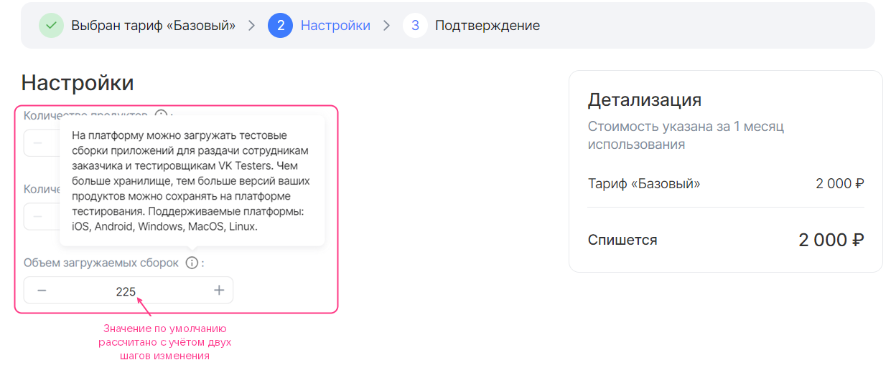
         {/caption}

   * `minimum` және `maximum` — тарифтік опцияның ең үлкен және ең кіші мәндері (міндетті емес). Әдепкі мән үшін жасалғандай орнатылады.

{caption(Пайдаланушылық өзгеру қадамы бар `integer` түріндегі тегін опцияны сипаттау мысалы, `YAML` форматы)[align=left;position=above]}
```yaml
actions:
- create
- update

billing:
  base: 25
  cost: 0
  unit:
     size: 100

schema:
  description: Объем загружаемых сборок
  hint: На платформу можно загружать тестовые сборки приложений для раздачи сотрудникам заказчика и тестировщикам VK Testers. Чем больше хранилище, тем больше версий ваших продуктов можно сохранять на платформе тестирования. Поддерживаемые платформы: iOS, Android, Windows, MacOS, Linux.
  type: integer
  default: 0
```
{/caption}

{note:info}

`billing` және `schema` секцияларының параметрлерінің егжей-тегжейлі сипаттамасы {linkto(/kz/tools-for-using-services/vendor-account/manage-apps/ibservice_add/ibservice_configure/iboption#iboption_billing)[text=%text]} және {linkto(/kz/tools-for-using-services/vendor-account/manage-apps/ibservice_add/ibservice_configure/iboption#iboption_schema)[text=%text]} бөлімдерінде келтірілген.

{/note}

## {heading(Өзгеру қадамы бар integer түріндегі алдын ала төлемді тарифтік опциясы)[id=option_int_step_prepayed]}

`parameters/<OPTION_NAME>.yaml` файлын мынадай түрде толтырыңыз:

1. `actions` параметрін көрсетіңіз.
1. `billing` секциясында мынадай параметрлерді орнатыңыз ({linkto(#pic_option_int_step_prepayed)[text=%number сурет]}, {linkto(#pic_option_int_step_prepayed1)[text=%number сурет]}, {linkto(#pic_option_int_step_prepayed2)[text=%number сурет]}):

   * `base` — стандартты мән. Стандартты мән тарифтік жоспардың құнына кіреді.
   * `cost` — өзгеру қадамының құны.
   * `unit.size` — өзгеру қадамының өлшемі.
   * `unit.measurement` — тарифтік опцияның өлшем бірліктері (міндетті емес).

      {caption(`billing` секциясын толтыру мысалы)[align=left;position=above]}
      ```yaml
      billing:
        base: 25
        cost: 150
        unit:
           size: 100
      ```
      {/caption}

      Жоғарыдағы мысалда стандартты мәннен тыс әрбір 100 опция бірлігінің құны 150 ақша бірлігі.

   {caption(Сурет {counter(pic)[id=numb_pic_option_int_step_prepayed]} — Өзгеру қадамы бар integer түріндегі ақылы тарифтік опциясы (billing.base = 25, billing.cost = 150, billing.unit.size = 100))[align=center;position=under;id=pic_option_int_step_prepayed;number={const(numb_pic_option_int_step_prepayed)} ]}
   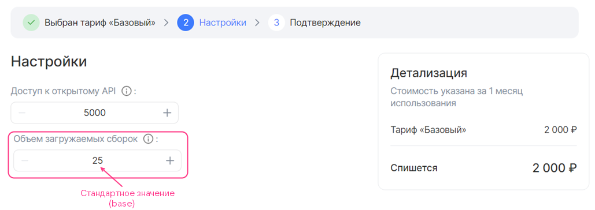
   {/caption}

   {caption(Сурет {counter(pic)[id=numb_pic_option_int_step_prepayed1]} — Өзгеру қадамы бар integer түріндегі ақылы тарифтік опциясы, мән 1 қадамға ұлғайтылған (billing.base = 25, billing.cost = 150, billing.unit.size = 100))[align=center;position=under;id=pic_option_int_step_prepayed1;number={const(numb_pic_option_int_step_prepayed1)} ]}
   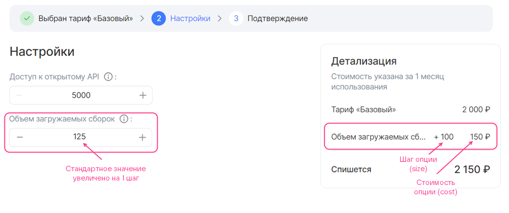
   {/caption}

   {caption(Сурет {counter(pic)[id=numb_pic_option_int_step_prepayed2]} — Өзгеру қадамы бар integer түріндегі ақылы тарифтік опциясы, мән 2 қадамға ұлғайтылған (billing.base = 25, billing.cost = 150, billing.unit.size = 100))[align=center;position=under;id=pic_option_int_step_prepayed2;number={const(numb_pic_option_int_step_prepayed2)} ]}
   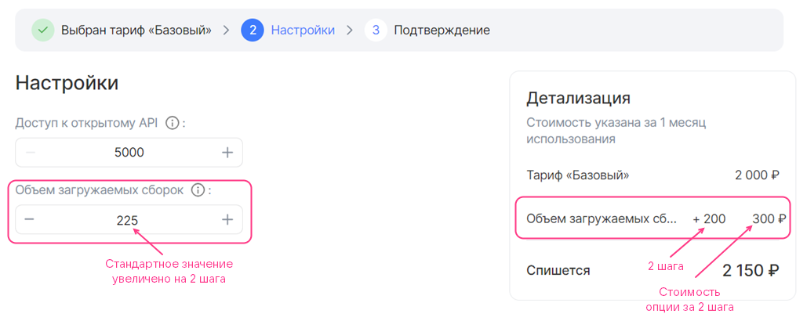
   {/caption}
1. `schema` секциясын пайдаланушылық өзгеру қадамы бар тегін тарифтік опция үшін жасалғандай толтырыңыз (қосымша мәліметтер — {linkto(../ibopt_fill_in#option_int_with_user_step_free)[text=%text]} бөлімінде).

   Егер тарифтік опцияның әдепкі мәні стандартты мәнге тең болмаса (`schema.default ≠ 0`), пайдаланушы тарифтік жоспарды баптау шеберіне өткенде мұндай тарифтік опция үшін оның құны көрсетіледі ({linkto(#pic_option_int_step_prepayed3)[text=%number сурет]}). Пайдаланушы опцияның мәнін тарифтік жоспардың құнына кіретін стандартты мәнге дейін азайта алады.

   {caption(Сурет {counter(pic)[id=numb_pic_option_int_step_prepayed3]} — Өзгеру қадамы бар integer түріндегі ақылы тарифтік опциясы (billing.base = 25, billing.cost = 150, billing.unit.size = 100, schema.default = 1))[align=center;position=under;id=pic_option_int_step_prepayed3;number={const(numb_pic_option_int_step_prepayed3)} ]}
   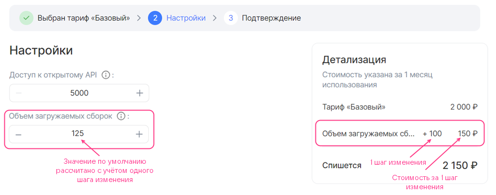
   {/caption}

{note:info}

`billing` және `schema` секцияларының параметрлерінің егжей-тегжейлі сипаттамасы {linkto(/kz/tools-for-using-services/vendor-account/manage-apps/ibservice_add/ibservice_configure/iboption#iboption_billing)[text=%text]} және {linkto(/kz/tools-for-using-services/vendor-account/manage-apps/ibservice_add/ibservice_configure/iboption#iboption_schema)[text=%text]} бөлімдерінде келтірілген.

{/note}

## {heading(integer немесе number түріндегі кейін төлемді тарифтік опциясы)[id=option_postpayed_ib]}

{note:warn}

Кейін төлемді тарифтік опциясының YAML-файлының атауы метрикаларды беру жөніндегі API-сұранымдағы `param` мәніне сәйкес болуы тиіс (қосымша мәліметтер — {linkto(/kz/tools-for-using-services/vendor-account/manage-apps/concepts/about#billing_push)[text=%text]} бөлімінде).

{/note}

`parameters/<OPTION_NAME>.yaml` файлын мынадай түрде толтырыңыз:

1. `actions` параметрінің мәнін — `resource_usages` деп орнатыңыз.
1. `billing` секциясында мынадай параметрлерді орнатыңыз:

   * `cost` — тарифтік опция бірлігінің құны.
   * `unit.size` — тарифтік қадам. `1` мәнін көрсетіңіз.
   * `unit.measurement` — тарифтік опцияның өлшем бірліктері (міндетті емес).

1. `schema` секциясында мынадай параметрлерді орнатыңыз:

   * `description` — тарифтік опцияның атауы.
   * `hint` — тарифтік опцияның сипаттамасы (міндетті емес).
   * `type` — тарифтік опцияның түрі. `integer` немесе `number` мәнін көрсетіңіз.

{caption(Кейін төлемді сандық тарифтік опциясын сипаттау мысалы)[align=left;position=above]}
```yaml
actions:
- resource_usages

billing:
  cost: 7
  unit:
    size: 1
    measurement: ГБ

schema:
  description: Хранение в ДЦ Киберпротект для продуктов Бэкап Облачный
  type: number
```
{/caption}

{linkto(#pic_option_postpayed_ib)[text=%number суретте]} жоғарыда сипатталған опцияның тарифтік жоспарды баптау шеберінде қалай көрсетілетіні келтірілген. Тарифтік опция бірлігінің құны 7 ақша бірлігі.

{caption(Сурет {counter(pic)[id=numb_pic_option_postpayed_ib]} — Кейін төлемді тарифтік опциясы)[align=center;position=under;id=pic_option_postpayed_ib;number={const(numb_pic_option_postpayed_ib)} ]}
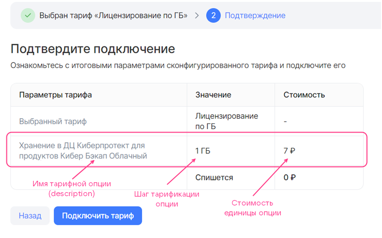{params[width=75%]}
{/caption}

## {heading(string түріндегі тегін тарифтік константа-опциясы)[id=option_string]}

`parameters/<OPTION_NAME>.yaml` файлын мынадай түрде толтырыңыз:

1. `actions` параметрін көрсетіңіз.
1. `schema` секциясында мынадай параметрлерді орнатыңыз:

   * `description` — тарифтік опцияның атауы.
   * `hint` — тарифтік опцияның сипаттамасы (міндетті емес).
   * `type` — тарифтік опцияның түрі. `string` мәнін көрсетіңіз.
   * `const` — тарифтік опцияның мәні.

{caption(`string` түріндегі константа-опциясын сипаттау мысалы, `YAML` форматы)[align=left;position=above]}
```yaml
actions:
- create
- update

schema:
  description: Логин администратора
  type: string
  const: admin@example.ru
```
{/caption}

{linkto(#pic_option_string)[text=%number суретте]} жоғарыда сипатталған опцияның тарифтік жоспарды баптау шеберінде қалай көрсетілетіні келтірілген.

{caption(Сурет {counter(pic)[id=numb_pic_option_string]} — string түріндегі тарифтік константа-опциясы)[align=center;position=under;id=pic_option_string;number={const(numb_pic_option_string)} ]}
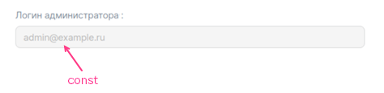{params[width=60%]}
{/caption}

## {heading(Мән енгізу мүмкіндігі бар string түріндегі тегін тарифтік опциясы)[id=option_string_input]}

`parameters/<OPTION_NAME>.yaml` файлын мынадай түрде толтырыңыз:

1. `actions` параметрін көрсетіңіз.
1. `schema` секциясында мынадай параметрлерді орнатыңыз:

   * `description` — тарифтік опцияның атауы.
   * `hint` — тарифтік опцияның сипаттамасы (міндетті емес).
   * `type` — тарифтік опцияның түрі. `string` мәнін көрсетіңіз.
   * `default` — әдепкі мән.
   * {linkto(/kz/tools-for-using-services/vendor-account/manage-apps/ibservice_add/ibservice_configure/iboption#iboption_option_string)[text=%text]} бөлімінде келтірілген қосымша параметрлер (міндетті емес).

{caption(Мән енгізу мүмкіндігі бар `string` түріндегі опцияны сипаттау мысалы, `YAML` форматы)[align=left;position=above]}
```yaml
actions:
- create
- update

schema:
  description: Email администратора
  hint: Email для выпуска SSL-сертификата
  type: string
```
{/caption}

{linkto(#pic_option_string_input)[text=%number суретте]} жоғарыда сипатталған опцияның тарифтік жоспарды баптау шеберінде қалай көрсетілетіні келтірілген.

{caption(Сурет {counter(pic)[id=numb_pic_option_string_input]} — Мән енгізу мүмкіндігі бар string түріндегі тарифтік опциясы)[align=center;position=under;id=pic_option_string_input;number={const(numb_pic_option_string_input)} ]}
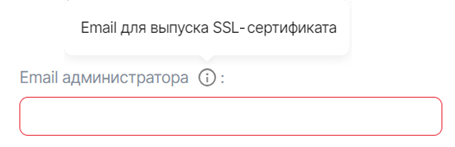{params[width=40%]}
{/caption}

## {heading(Тізімнен мән таңдау мүмкіндігі бар string түріндегі тегін тарифтік опциясы)[id=option_string_enum]}

`parameters/<OPTION_NAME>.yaml` файлын мынадай түрде толтырыңыз:

1. `actions` параметрін көрсетіңіз.
1. `schema` секциясында мынадай параметрлерді орнатыңыз:

   * `description` — тарифтік опцияның атауы.
   * `hint` — тарифтік опцияның сипаттамасы (міндетті емес).
   * `type` — тарифтік опцияның түрі. `string` мәнін көрсетіңіз.
   * `enum` — тарифтік опцияның мүмкін мәндері.
   * `default` — әдепкі мән.

{caption(Тізімнен мән таңдау мүмкіндігі бар `string` түріндегі опцияны сипаттау мысалы, `YAML` форматы)[align=left;position=above]}
```yaml
actions:
- create
- update

schema:
  description: OS тип
  hint: Операционная система
  type: string
  enum: ["Ubuntu 20.4", "Windows 8.1", "Windows 10"]
  default: Windows 8.1
```
{/caption}

{linkto(#pic_option_string_enum)[text=%number суретте]} жоғарыда сипатталған опцияның тарифтік жоспарды баптау шеберінде қалай көрсетілетіні келтірілген.

{caption(Сурет {counter(pic)[id=numb_pic_option_string_enum]} — Тізімнен мән таңдау мүмкіндігі бар string түріндегі тарифтік опциясы)[align=center;position=under;id=pic_option_string_enum;number={const(numb_pic_option_string_enum)} ]}
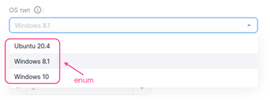{params[width=55%]}
{/caption}

## {heading(boolean түріндегі тегін тарифтік константа-опциясы)[id=option_bool_const]}

`parameters/<OPTION_NAME>.yaml` файлын мынадай түрде толтырыңыз:

1. `actions` параметрін көрсетіңіз.
1. `schema` секциясында мынадай параметрлерді орнатыңыз:

   * `description` — тарифтік опцияның атауы.
   * `hint` — тарифтік опцияның сипаттамасы (міндетті емес).
   * `type` — тарифтік опцияның түрі. `boolean` мәнін көрсетіңіз.
   * `const` — тарифтік опцияның мәні.

{caption(`boolean` түріндегі константа-опциясын сипаттау мысалы, `YAML` форматы)[align=left;position=above]}
```yaml
actions:
- create
- update

schema:
  description: Premium поддержка
  hint: Техническая поддержка 24/7
  type: boolean
  const: false
```
{/caption}

{linkto(#pic_option_bool_const)[text=%number суретте]} жоғарыда сипатталған опцияның тарифтік жоспарды баптау шеберінде қалай көрсетілетіні келтірілген.

{caption(Сурет {counter(pic)[id=numb_pic_option_bool_const]} — boolean түріндегі тарифтік константа-опциясы (const = false))[align=center;position=under;id=pic_option_bool_const;number={const(numb_pic_option_bool_const)} ]}
{params[width=40%]}
{/caption}

## {heading(Boolean қосқышы бар тегін тегін опциясы)[id=option_bool]}

`parameters/<OPTION_NAME>.yaml` файлын келесі түрде толтырыңыз:

1. `actions` параметрін көрсетіңіз.
1. `schema` бөлімінде келесі параметрлерді орнатыңыз:

   * `description` — тарифтік опцияның атауы.
   * `hint` — тарифтік опцияның сипаттамасы (міндетті емес).
   * `type` — тарифтік опцияның түрі. `boolean` мәнін көрсетіңіз.
   * `default` — әдепкі мән (міндетті емес).

      Егер `default` параметрі орнатылмаса, әдепкі мән `false` болады.

{caption(Тегін `boolean` қосқышы бар опцияның сипаттамасының мысалы, `YAML` форматы)[align=left;position=above]}
```yaml
actions:
- create
- update

schema:
  description: Жаңартулар туралы хабарландырулар
  hint: Жаңа нұсқалар туралы хабарландыруларды поштаға алу керек пе.
  type: boolean
  default: true
```
{/caption}

{linkto(#pic_option_bool)[text=%number суретте]} жоғарыда сипатталған опцияның тарифтік жоспарды конфигурациялау шеберінде қалай көрсетілетіні берілген.

{caption({counter(pic)[id=numb_pic_option_bool]} сурет — Boolean қосқышы бар тарифтік опция)[align=center;position=under;id=pic_option_bool;number={const(numb_pic_option_bool)} ]}
{params[width=50%]}
{/caption}

## {heading(Алдын ала төлеммен boolean қосқышы бар тарифтік опция)[id=option_bool_paid]}

`parameters/<OPTION_NAME>.yaml` файлын келесі түрде толтырыңыз:

1. `actions` параметрін көрсетіңіз.
1. `schema` бөлімінде келесі параметрлерді орнатыңыз:

   * `description` — тарифтік опцияның атауы.
   * `hint` — тарифтік опцияның сипаттамасы (міндетті емес).
   * `type` — тарифтік опцияның түрі. `boolean` мәнін көрсетіңіз.
   * `default` — әдепкі мән (міндетті емес).

      Егер `default` параметрі орнатылмаса, әдепкі мән `false` болады.

1. `billing` бөлімінде қосқыш белсенді күйде тұрғандағы опция құны болып табылатын `cost` параметрін орнатыңыз.

{caption(Ақылы `boolean` қосқышы бар опцияның сипаттамасының мысалы, `YAML` форматы)[align=left;position=above]}
```yaml
actions:
- create
- update

schema:
  description: Жаңа есептер туралы хабарландырулар
  hint: Жаңа есептер туралы хабарландыруларды поштаға алу керек пе.
  type: boolean
  default: true

billing:
  cost: 50
```
{/caption}

{linkto(#pic_option_bool_paid)[text=%number суретте]} жоғарыда сипатталған опцияның тарифтік жоспарды конфигурациялау шеберінде қалай көрсетілетіні берілген.

{caption({counter(pic)[id=numb_pic_option_bool_paid]} сурет — Ақылы boolean қосқышы бар тарифтік опция)[align=center;position=under;id=pic_option_bool_paid;number={const(numb_pic_option_bool_paid)} ]}
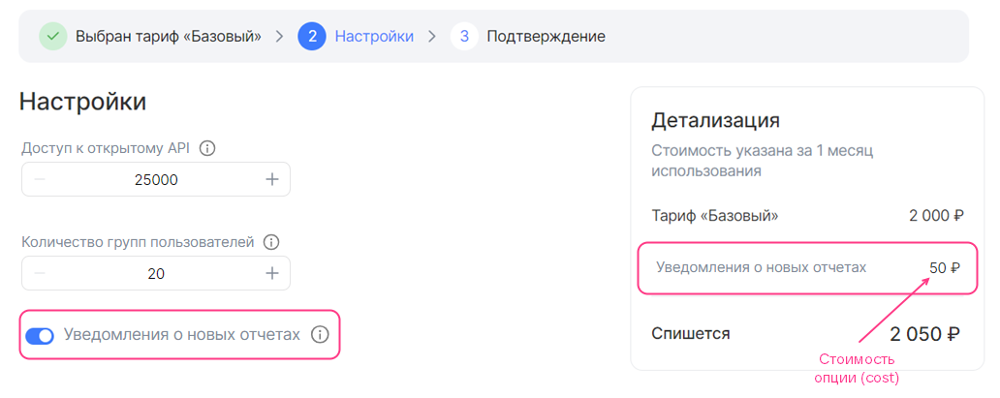{params[width=90%]}
{/caption}

## {heading(datasource типті тарифтік опция (ВМ түрі))[id=option_datasource_flavor]}

`parameters/<OPTION_NAME>.yaml` файлын келесі түрде толтырыңыз:

1. `actions` параметрін көрсетіңіз.
1. `schema` бөлімінде келесі параметрлерді орнатыңыз:

   * `description` — тарифтік опцияның атауы.
   * `hint` — тарифтік опцияның сипаттамасы (міндетті емес).
   * `type` — тарифтік опцияның түрі. `string` мәнін көрсетіңіз.
   * `datasource.type` — бұлттық платформа нысанының түрі. `flavor` мәнін көрсетіңіз.
   * `datasource.filter` — фильтрлер (міндетті емес). Мүмкін фильтрлер {linkto(/kz/tools-for-using-services/vendor-account/manage-apps/ibservice_add/ibservice_configure/iboption#iboption_option_datasource)[text=%text]} бөлімінде берілген.

{caption(ВМ түрі үшін `datasource` опциясының сипаттамасының мысалы, `YAML` форматы)[align=left;position=above]}
```yaml
actions:
- create
- update

schema:
  description: Виртуалды машинаның түрі
  type: string
  datasource:
    type: flavor
```
{/caption}

{linkto(#pic_option_datasource_flavor)[text=%number суретте]} жоғарыда сипатталған опцияның тарифтік жоспарды конфигурациялау шеберінде қалай көрсетілетіні берілген.

{caption({counter(pic)[id=numb_pic_option_datasource_flavor]} сурет — datasource типті тарифтік опция (ВМ түрі))[align=center;position=under;id=pic_option_datasource_flavor;number={const(numb_pic_option_datasource_flavor)} ]}
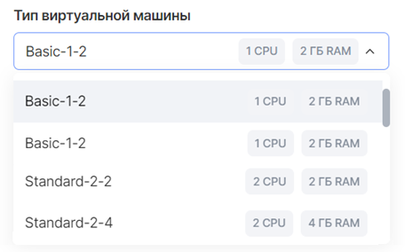{params[width=45%]}
{/caption}

## {heading(datasource типті тарифтік опция (қолжетімділік аймағы))[id=option_datasource_az]}

`parameters/<OPTION_NAME>.yaml` файлын келесі түрде толтырыңыз:

1. `actions` параметрін көрсетіңіз.
1. `schema` бөлімінде келесі параметрлерді орнатыңыз:

   * `description` — тарифтік опцияның атауы.
   * `hint` — тарифтік опцияның сипаттамасы (міндетті емес).
   * `type` — тарифтік опцияның түрі. `string` мәнін көрсетіңіз.
   * `default` — әдепкі мән (міндетті емес). Мүмкін мәндер {linkto(/kz/tools-for-using-services/vendor-account/manage-apps/ibservice_add/ibservice_configure/iboption#iboption_option_datasource)[text=%text]} бөлімінде берілген.
   * `datasource.type` — бұлттық платформа нысанының түрі. `az` мәнін көрсетіңіз.

{caption(Қолжетімділік аймағы үшін `datasource` опциясының сипаттамасының мысалы, `YAML` форматы)[align=left;position=above]}
```yaml
actions:
- create
- update

schema:
  description: Қолжетімділік аймағы
  type: string
  default: gz1
  datasource:
    type: az
```
{/caption}

{linkto(#pic_option_datasource_az)[text=%number суретте]} жоғарыда сипатталған опцияның тарифтік жоспарды конфигурациялау шеберінде қалай көрсетілетіні берілген.

{caption({counter(pic)[id=numb_pic_option_datasource_az]} сурет — datasource типті тарифтік опция (қолжетімділік аймағы))[align=center;position=under;id=pic_option_datasource_az;number={const(numb_pic_option_datasource_az)} ]}
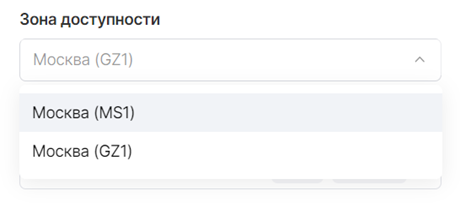{params[width=45%]}
{/caption}

## {heading(datasource типті тарифтік опция (желі ішкі желісі))[id=option_datasource_subnet]}

`parameters/<OPTION_NAME>.yaml` файлын келесі түрде толтырыңыз:

1. `actions` параметрін көрсетіңіз.
1. `schema` бөлімінде келесі параметрлерді орнатыңыз:

   * `description` — тарифтік опцияның атауы.
   * `hint` — тарифтік опцияның сипаттамасы (міндетті емес).
   * `type` — тарифтік опцияның түрі. `string` мәнін көрсетіңіз.
   * `datasource.type` — бұлттық платформа нысанының түрі. `subnet` мәнін көрсетіңіз.

{caption(Желі ішкі желісі үшін `datasource` опциясының сипаттамасының мысалы, `YAML` форматы)[align=left;position=above]}
```yaml
actions:
- create
- update

schema:
  description: Желі
  type: string
  datasource:
    type: subnet
```
{/caption}

{linkto(#pic_option_datasource_subnet)[text=%number суретте]} жоғарыда сипатталған опцияның тарифтік жоспарды конфигурациялау шеберінде қалай көрсетілетіні берілген.

{caption({counter(pic)[id=numb_pic_option_datasource_subnet]} сурет — datasource типті тарифтік опция (желі ішкі желісі))[align=center;position=under;id=pic_option_datasource_subnet;number={const(numb_pic_option_datasource_subnet)} ]}
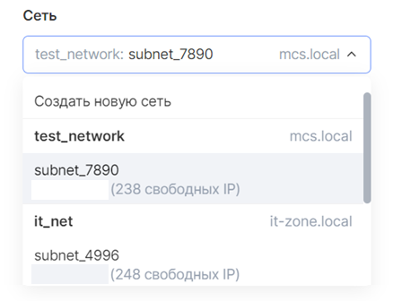{params[width=40%]}
{/caption}

## {heading(datasource типті тарифтік опция (желі))[id=option_datasource_net]}

`parameters/<OPTION_NAME>.yaml` файлын келесі түрде толтырыңыз:

1. `actions` параметрін көрсетіңіз.
1. `schema` бөлімінде келесі параметрлерді орнатыңыз:

   * `description` — тарифтік опцияның атауы.
   * `hint` — тарифтік опцияның сипаттамасы (міндетті емес).
   * `type` — тарифтік опцияның түрі. `string` мәнін көрсетіңіз.
   * `datasource.type` — бұлттық платформа нысанының түрі. `network` мәнін көрсетіңіз.
   * `datasource.value_is` — ақпарат шығару түрі. Мәндер қолжетімді:
      * `uuid` — желінің UUID-ін көрсету.
      * `name` — желінің атауын көрсету.
   * `datasource.filter` — фильтрлер (міндетті емес). Мүмкін фильтрлер {linkto(/kz/tools-for-using-services/vendor-account/manage-apps/ibservice_add/ibservice_configure/iboption#iboption_option_datasource)[text=%text]} бөлімінде берілген.

{caption(Желі үшін `datasource` опциясының сипаттамасының мысалы, `YAML` форматы)[align=left;position=above]}
```yaml
actions:
- create
- update

schema:
  description: Ішкі желі
  hint: Ішкі желі
  type: string
  datasource:
    type: network
    value_is: name
    filter:
      kind: private
      shared: false
```
{/caption}

{linkto(#pic_option_datasource_net)[text=%number суретте]} жоғарыда сипатталған опцияның тарифтік жоспарды конфигурациялау шеберінде қалай көрсетілетіні берілген.

{caption({counter(pic)[id=numb_pic_option_datasource_net]} сурет — datasource типті тарифтік опция (желі))[align=center;position=under;id=pic_option_datasource_net;number={const(numb_pic_option_datasource_net)} ]}
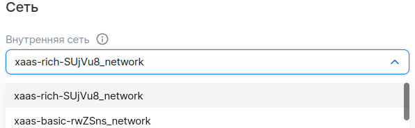{params[width=55%]}
{/caption}

## {heading(Дискті тарифтік опциялар файлдары арқылы сипаттау)[id=IBoption_fill_in_volume]}

Диск екі тарифтік опциямен (екі бөлек YAML-файлмен) сипатталады:

* Диск түрі — `datasource` типті тарифтік опция арқылы.
* Диск өлшемі — өзгеру қадамы 1 болатын `integer` типті тарифтік опция арқылы.

Дискті сипаттау үшін:

1. Бұлттық платформаның диск түрлері туралы деректерін алатын `datasource` типті тарифтік опцияны `parameters/<OPTION_NAME>.yaml` файлында сипаттаңыз:

   1. `actions` параметрін көрсетіңіз.
   1. `schema` бөлімінде келесі параметрлерді орнатыңыз:

      * `description` — тарифтік опцияның атауы.
      * `hint` — тарифтік опцияның сипаттамасы (міндетті емес).
      * `type` — тарифтік опцияның түрі. `string` мәнін көрсетіңіз.
      * `default` — әдепкі мән (міндетті емес). Мүмкін мәндер {linkto(/kz/tools-for-using-services/vendor-account/manage-apps/ibservice_add/ibservice_configure/iboption#iboption_option_datasource)[text=%text]} бөлімінде берілген.
      * `tag` — тег. Тег диск түрін сипаттайтын опцияны диск өлшемін сипаттайтын опциямен байланыстырады.
      * `datasource.type` — бұлттық платформа нысанының түрі. `volume_type` мәнін көрсетіңіз.
      * `datasource.filter` — фильтрлер (міндетті емес). Мүмкін фильтрлер {linkto(/kz/tools-for-using-services/vendor-account/manage-apps/ibservice_add/ibservice_configure/iboption#iboption_option_datasource)[text=%text]} бөлімінде берілген.

         Егер фильтрлер көрсетілмесе, бұлттық платформа қолдайтын барлық диск түрлері көрсетіледі.

   {caption(Диск түрі үшін `datasource` опциясының сипаттамасының мысалы, `YAML` форматы)[align=left;position=above]}
   ```yaml
   actions:
   - create
   - update

   schema:
     description: Диск түрі
     type: string
     default: ceph-ssd
     tag: disk1
     datasource:
       type: volume_type
       filter:
         disk_class:
           enum: ["ssd", "hdd"]
   ```
   {/caption}
1. Бөлек `parameters/<OPTION_NAME>.yaml` файлында диск өлшемін өзгеру қадамы 1 болатын `integer` типті тарифтік опция арқылы сипаттаңыз:

   1. `actions` параметрін көрсетіңіз.
   1. `schema` бөлімінде келесі параметрлерді орнатыңыз:

      * `description` — тарифтік опцияның атауы.
      * `hint` — тарифтік опцияның сипаттамасы (міндетті емес).
      * `type` — тарифтік опцияның түрі. `integer` мәнін көрсетіңіз.
      * `default` — әдепкі мән (міндетті емес).
      * `maximum` және `minimum` — максималды және минималды мәндер (міндетті емес).
      * `tag` — тег. Мән диск түрін сипаттайтын файлдағыдай болуы керек.

      {note:info}

      Диск өлшемі ГБ-пен өлшенеді.

      {/note}

   {caption(Өзгеру қадамы 1 болатын `integer` типті тарифтік опция арқылы диск өлшемін сипаттау мысалы, `YAML` форматы)[align=left;position=above]}
   ```yaml
   actions:
   - create
   - update

   schema:
     description: Диск өлшемі
     type: integer
     default: 100
     minimum: 100
     tag: disk1
   ```
   {/caption}

{note:warn}

Диск құны бұлттық платформаның тарифтерімен анықталады, сондықтан оны тарифтік опцияның сипаттамасында орнату мүмкін емес.

{/note}

{linkto(#pic_option_fill_in_volume)[text=%number суретте]} жоғарыда сипатталған опциялардың (диск түрі мен өлшемі) тарифтік жоспарды конфигурациялау шеберінде қалай көрсетілетіні берілген.

{caption({counter(pic)[id=numb_pic_option_fill_in_volume]} сурет — Диск өлшемі мен түрін теңшеуге мүмкіндік беретін integer және datasource типті тарифтік опциялар)[align=center;position=under;id=pic_option_fill_in_volume;number={const(numb_pic_option_fill_in_volume)} ]}
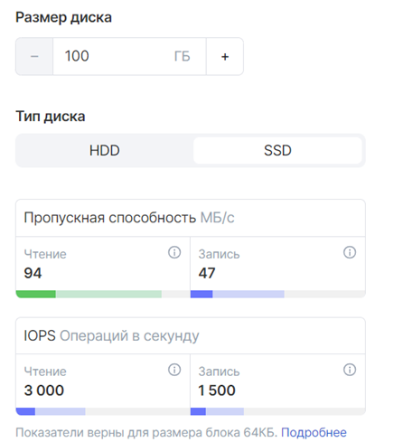{params[width=40%]}
{/caption}