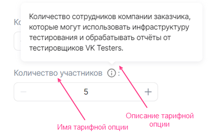
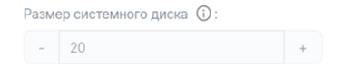
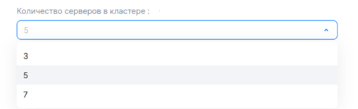
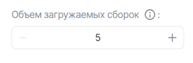
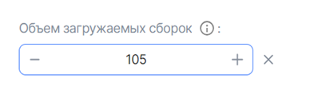
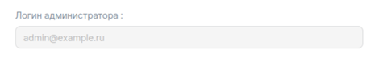
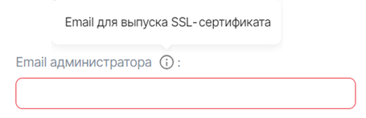
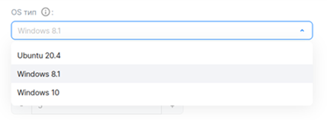
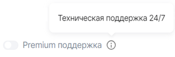

## {heading(Құрылымы)[id=iboption_structure]}

{include(/kz/_includes/_translated_by_ai_kz.md)}

{note:warn}

Постоплаталық тарифтік опцияның YAML-файлының атауы метриктерді жеткізуге арналған API-сұраудағы `param` мәніне сәйкес болуы тиіс (толығырақ — {linkto(/kz/tools-for-using-services/vendor-account/manage-apps/concepts/about#billing_push)[text=%text]} бөлімінде).

{/note}

Тарифтік опция {linkto(#tab_top_level_options)[text=%number кестеде]} келтірілген параметрлер және секциялар арқылы сипатталады.

{caption(Кесте {counter(table)[id=numb_tab_top_level_options]} — Тарифтік опцияны сипаттауға арналған параметрлер және секциялар)[align=right;position=above;id=tab_top_level_options;number={const(numb_tab_top_level_options)}]}
[cols="2,5,2", options="header"]
|===
|Атауы
|Сипаттамасы
|Міндетті

|actions
|
Параметр опцияны тарифтендіру тәсілін анықтайды (толығырақ — {linkto(/kz/tools-for-using-services/vendor-account/manage-apps/concepts/about#xaas_billing)[text=%text]} бөлімінде). Мүмкін мәндері:

* Тегін немесе алдын ала төлемді тарифтендіру үшін бір немесе екі мәнді де көрсетиңіз:

   * `create` — опция сервисті қосқанда белсенді болады.
   * `update` — опция тарифтік жоспарды жаңартқанда белсенді болады.

   Егер опция белсенді болса, пайдаланушы оның мәнін өзгерте алады.
* Постоплаталық тарифтендіру үшін `resource_usages` мәнін көрсетиңіз

| 

|schema
|
Секция анықтайды:

* Тарифтік опцияның түрін.
* Тарифтік опцияның атауы мен сипаттамасын ({linkto(#pic_tariff_option)[text=%number сурет]}).
* Тарифтік опцияның мәніне арналған баптауларды.

Секцияның параметрлері {linkto(#iboption_schema)[text=%text]} бөлімінде келтірілген
| 

|billing
|
Секция анықтайды:

* Тарифтік опцияның құнын.
* `integer` түріндегі тарифтік опцияға арналған өзгертудің пайдаланушылық қадамын.

Секцияның параметрлері {linkto(#iboption_billing)[text=%text]} бөлімінде келтірілген
| 
|===
{/caption}

{caption(Сурет {counter(pic)[id=numb_pic_tariff_option]} — Тарифтік опция)[align=center;position=under;id=pic_tariff_option;number={const(numb_pic_tariff_option)} ]}
{params[width=45%]}
{/caption}

Түрлі типтегі тарифтік опцияларды сипаттау мысалдары {linkto(../ibopt_fill_in#IB_option_fill_in)[text=%text]} бөлімінде келтірілген.

## {heading(billing секциясы)[id=iboption_billing]}

Ақылы тарифтік опциялар мына түрдегі опциялар болуы мүмкін:

* Сандық (`integer`, `number`). Алдын ала төлемді және постоплаталық тарифтендіруге қолдау көрсетіледі.
* Логикалық (`boolean`). Алдын ала төлемді тарифтендіруге қолдау көрсетіледі.

Тарифтендіру түрлері туралы толығырақ — {linkto(/kz/tools-for-using-services/vendor-account/manage-apps/concepts/about#xaas_billing)[text=%text]} бөлімінде.

Тарифтендіру түріне және опция түріне байланысты `billing` секциясында {linkto(#tab_billing_integer)[text=%number кестеде]}, {linkto(#tab_billing_boolean)[text=%number кестеде]}, {linkto(#tab_billing_number)[text=%number кестеде]} келтірілген параметрлер мен еншілес секцияларды көрсетиңіз.

{caption(Кесте {counter(table)[id=numb_tab_billing_integer]} — Қадаммен өзгертілетін integer түріндегі алдын ала төлемді опцияға арналған billing секциясының параметрлері)[align=right;position=above;id=tab_billing_integer;number={const(numb_tab_billing_integer)}]}
[cols="2,5,2,2", options="header"]
|===
|Атауы
|Сипаттамасы
|Форматы
|Міндетті

|base
|Тарифтік жоспардың құнына кіретін тарифтік опцияның стандартты мәнін анықтайды.

Стандартты мән — бұл пайдаланушы орната алатын минималды мән.

Егер параметр орнатылмаса, тарифтік опцияның стандартты мәні автоматты түрде `0`-ге тең болады
|integer
| 

|cost
|Тарифтік опцияның мәнін өзгертуге болатын қадамның құнын анықтайды.

Егер опцияны өзгерту тегін болса, `0` көрсетиңіз. Қадамның параметрлері `unit` секциясында анықталады
|float64, >= 0
| 

|unit
|Опцияны өзгерту қадамының параметрлерін анықтайды
| 
| 

4+|`unit` секциясының параметрлері

|unit.size
|Тарифтік опцияның мәнін өзгертуге болатын қадамның өлшемін анықтайды.

Осы параметрде көрсетілген мән `billig.cost` параметріне орнатылған құнға сәйкес тарифтеленеді
|integer, > 0
| 

|unit.measurement
|`unit.size` параметрінде берілген қадамның өлшем бірліктерін анықтайды
|string, 255 таңбаға дейін
| 
|===
{/caption}

{caption(Кесте {counter(table)[id=numb_tab_billing_boolean]} — boolean түріндегі ауыстырғыш-алдын ала төлемді опцияға арналған billing секциясының параметрлері)[align=right;position=above;id=tab_billing_boolean;number={const(numb_tab_billing_boolean)}]}
[cols="2,5,2,2", options="header"]
|===
|Атауы
|Сипаттамасы
|Форматы
|Міндетті

|cost
|
Опцияның құнын анықтайды
|float64, >= 0
| 
|===
{/caption}

{caption(Кесте {counter(table)[id=numb_tab_billing_number]} — integer немесе number түріндегі постоплаталық опцияға арналған billing секциясының параметрлері)[align=right;position=above;id=tab_billing_number;number={const(numb_tab_billing_number)}]}
[cols="2,5,2,2", options="header"]
|===
|Атауы
|Сипаттамасы
|Форматы
|Міндетті

|cost
|Тарифтік опцияның бірлігінің құнын анықтайды
|float64, >= 0
| 

|unit
|Опцияның өлшем бірліктерін анықтайды
| 
| 

4+|`unit` секциясының параметрлері

|unit.size
|Опцияны тарифтендіру қадамы. Мән `1` болуы тиіс
|integer
| 

|unit.measurement
|Опцияның өлшем бірліктерін анықтайды
|string, 255 таңбаға дейін
| 
|===
{/caption}

{note:warn}

Постоплаталық тарифтік опциялар тек тегін тарифтік жоспарда болуы мүмкін.

{/note}

## {heading(schema секциясы)[id=iboption_schema]}

### {heading(Сандық тарифтік опцияларға арналған schema секциясы)[id=iboption_numeric_schemas]}

#### {heading(integer түріндегі тегін немесе алдын ала төлемді тарифтік опция)[id=iboption_option_integer]}

`integer` тарифтік опциясының ішкі түрлері:

* Константа ({linkto(#pic_tariff_option_integer)[text=%number сурет]}).

   {caption(Сурет {counter(pic)[id=numb_pic_tariff_option_integer]} — integer түріндегі константа-тарифтік опция)[align=center;position=under;id=pic_tariff_option_integer;number={const(numb_pic_tariff_option_integer)} ]}
   {params[width=40%]}
   {/caption}
* Тізімнен мән таңдаумен ({linkto(#pic_tariff_option_select)[text=%number сурет]}).

   {caption(Сурет {counter(pic)[id=numb_pic_tariff_option_select]} — Тізімнен мән таңдаумен integer түріндегі тарифтік опция)[align=center;position=under;id=pic_tariff_option_select;number={const(numb_pic_tariff_option_select)} ]}
   {params[width=60%]}
   {/caption}
* Өзгеру қадамымен ({linkto(#pic_tariff_option_step)[text=%number сурет]}, {linkto(#pic_tariff_option_step_plus)[text=%number сурет]}).

   Әдепкі бойынша опцияны өзгерту қадамы 1-ге тең. Қадамның өлшемін өзгертуді, сондай-ақ оны ақылы етуді {linkto(#iboption_billing)[text=%text]} секциясында жасауға болады.

   {caption(Сурет {counter(pic)[id=numb_pic_tariff_option_step]} — Өзгеру қадамымен integer түріндегі тарифтік опция)[align=center;position=under;id=pic_tariff_option_step;number={const(numb_pic_tariff_option_step)} ]}
   {params[width=35%]}
   {/caption}

   {caption(Сурет {counter(pic)[id=numb_pic_tariff_option_step_plus]} — Өзгеру қадамымен integer түріндегі тарифтік опция, мәні өзгеру қадамына ұлғайтылған)[align=center;position=under;id=pic_tariff_option_step_plus;number={const(numb_pic_tariff_option_step_plus)} ]}
   {params[width=40%]}
   {/caption}

`integer` түріндегі тегін немесе алдын ала төлемді тарифтік опцияға арналған параметрлер {linkto(#tab_tariff_option_integer)[text=%number кестеде]} келтірілген. Опцияның құны {linkto(#iboption_billing)[text=%text]} секциясында сипатталады.

{caption(Кесте {counter(table)[id=numb_tab_tariff_option_integer]} — integer түріндегі тарифтік опцияға арналған schema секциясы)[align=right;position=above;id=tab_tariff_option_integer;number={const(numb_tab_tariff_option_integer)}]}
[cols="2,5,2,2", options="header"]
|===
|Атауы
|Сипаттамасы
|Форматы
|Міндетті

4+|**Тарифтік опцияның барлық ішкі түрлері үшін бірдей негізгі параметрлері**

|description
|Тарифтік опцияның атауы
|string, 255 таңбаға дейін
| 

|hint
|Тарифтік опцияның сипаттамасы бар кеңес
|string, 255 таңбаға дейін
| 

|type
|Тарифтік опцияның түрін анықтайды. `integer` мәнін көрсетиңіз
| 
| 

4+|**Тарифтік опцияның ішкі түрін баптауға арналған параметрлер**

4+|**Константа-опцияға арналған параметр**

|const
|Константа-тарифтік опцияның мәнін анықтайды
|integer
| 

4+|**Мән таңдаумен опцияға арналған параметрлер**

|enum
|Пайдаланушы біреуін таңдай алатын мәндер тізімін анықтайды
|Тізім, тізімнің ішінде — integer
| 

|default
|Тарифтік опцияның әдепкі мәнін анықтайды
|integer
| 

4+|**1 өзгеру қадамы бар опцияға арналған параметрлер**

|default
|Тарифтік опцияның әдепкі мәнін анықтайды.

Егер параметр орнатылмаса, әдепкі мән `0`-ге тең болады
|integer, >= 0 немесе `minimum`, &#8656; `maximum`
| 

|minimum
|Тарифтік опцияның минималды мәнін анықтайды
|integer, >= 0 және &#8656; `maximum`
| 

|maximum
|Тарифтік опцияның максималды мәнін анықтайды
|integer, > 0 және >= `minimum`
| 

|tag
|Тег. Бірнеше опцияны бір-бірімен байланыстыруға мүмкіндік береді.

Дискті сипаттау үшін қолданылады (толығырақ — {linkto(../ibopt_fill_in#IBoption_fill_in_volume)[text=%text]} бөлімінде)
|string
| 

4+|**Пайдаланушылық өзгеру қадамы бар опцияға арналған параметрлер. Өзгеру қадамы {linkto(#iboption_billing)[text=%text]} секциясында бапталады**

|default
|Стандартты мәнге қатысты есептелген тарифтік опцияның әдепкі мәнін анықтайды (стандартты мән `billing.base` параметріне орнатылады):

* Егер `0` мәні берілсе, тарифтік опцияның әдепкі мәні стандартты мәнге тең (`billing.base` параметріне орнатылған).
* Егер `n > 0` мәні берілсе, тарифтік опцияның әдепкі мәні стандартты мәннен және `n`-ге еселік өзгеру қадамынан құралады:

   ```
   billing.base + n * billing.unit.size
   ```

|integer, >= 0 немесе `minimum`, &#8656; `maximum`
| 

|minimum
|Стандартты мәнге қатысты есептелген тарифтік опцияның минималды мәнін анықтайды (стандартты мән `billing.base` параметріне орнатылады):

* Егер `0` мәні берілсе, тарифтік опцияның минималды мәні стандартты мәнге тең.
* Егер `n > 0` мәні берілсе, тарифтік опцияның минималды мәні стандартты мәннен және `n`-ге еселік өзгеру қадамынан құралады:

   ```
   billing.base + n * billing.unit.size
   ```

|integer, >= 0 және &#8656; `maximum`
| 

|maximum
|Стандартты мәнге қатысты есептелген тарифтік опцияның максималды мәнін анықтайды (стандартты мән `billing.base` параметріне орнатылады):

* Егер `0` мәні берілсе, тарифтік опцияның максималды мәні стандартты мәнге тең.
* Егер `n > 0` мәні берілсе, тарифтік опцияның максималды мәні стандартты мәннен және `n`-ге еселік өзгеру қадамынан құралады:

   ```
   billing.base + n * billing.unit.size
   ```

|integer, > 0 және >= `minimum`
| 
|===
{/caption}

#### {heading(integer немесе number түріндегі постоплаталық тарифтік опция)[id=iboption_option_postpaid]}

Постоплаталық сандық тарифтік опцияға арналған параметрлер {linkto(#tab_tariff_option_postpaid)[text=%number кестеде]} келтірілген. Опцияның құны {linkto(#iboption_billing)[text=%text]} секциясында сипатталады.

{caption(Кесте {counter(table)[id=numb_tab_tariff_option_postpaid]} — Постоплаталық опцияға арналған schema секциясы)[align=right;position=above;id=tab_tariff_option_postpaid;number={const(numb_tab_tariff_option_postpaid)}]}
[cols="2,5,2,2", options="header"]
|===
|Атауы
|Сипаттамасы
|Форматы
|Міндетті

|description
|Тарифтік опцияның атауы
|string, 255 таңбаға дейін
| 

|hint
|Тарифтік опцияның сипаттамасы бар кеңес
|string, 255 таңбаға дейін
| 

|type
|Тарифтік опцияның түрін анықтайды. `integer` немесе `number` мәнін көрсетиңіз
| 
| 
|===
{/caption}

### {heading(string түріндегі тарифтік опцияға арналған schema секциясы)[id=iboption_option_string]}

`string` тарифтік опциясының ішкі түрлері:

* Константа ({linkto(#pic_option_string_const)[text=%number сурет]}).

   {caption(Сурет {counter(pic)[id=numb_pic_option_string_const]} — string түріндегі константа-тарифтік опция)[align=center;position=under;id=pic_option_string_const;number={const(numb_pic_option_string_const)} ]}
   {params[width=60%]}
   {/caption}
* Мән енгізумен ({linkto(#pic_option_string_input)[text=%number сурет]}).

   {caption(Сурет {counter(pic)[id=numb_pic_option_string_input]} — Мән енгізумен string түріндегі тарифтік опция)[align=center;position=under;id=pic_option_string_input;number={const(numb_pic_option_string_input)} ]}
   {params[width=45%]}
   {/caption}
* Тізімнен мән таңдаумен ({linkto(#pic_option_string_enum)[text=%number сурет]}).

   {caption(Сурет {counter(pic)[id=numb_pic_option_string_enum]} — Тізімнен мән таңдаумен string түріндегі тарифтік опция)[align=center;position=under;id=pic_option_string_enum;number={const(numb_pic_option_string_enum)} ]}
   {params[width=60%]}
   {/caption}

`string` түріндегі тарифтік опцияға арналған параметрлер {linkto(#tab_option_string)[text=%number кестеде]} келтірілген.

{caption(Кесте {counter(table)[id=numb_tab_option_string]} — string түріндегі тарифтік опцияға арналған schema секциясы)[align=right;position=above;id=tab_option_string;number={const(numb_tab_option_string)}]}
[cols="2,5,2,2", options="header"]
|===
|Атауы
|Сипаттамасы
|Форматы
|Міндетті

4+|**Тарифтік опцияның барлық ішкі түрлері үшін бірдей негізгі параметрлері**

|description
|Тарифтік опцияның атауы
|string, 255 таңбаға дейін
| 

|hint
|Тарифтік опцияның сипаттамасы бар кеңес
|string, 255 таңбаға дейін
| 

|type
|Тарифтік опцияның түрін анықтайды. `string` мәнін көрсетиңіз
| 
| 

4+|**Тарифтік опцияның ішкі түрін баптауға арналған параметрлер**

4+|**Константа-опцияға арналған параметр**

|const
|Константа-тарифтік опцияның мәнін анықтайды
|string
| 

4+|**Мән енгізумен опцияға арналған параметрлер**

|default
|Әдепкі мәнді анықтайды
|string
| 

|pattern
|Тарифтік опцияның мәні сәйкес болуы тиіс шаблонды анықтайды
|regex
| 

|minLength
|Тарифтік опцияның мәніне арналған таңбалардың минималды санын анықтайды
|integer, > 0 және &#8656; `maxLength`
| 

|maxLength
|Тарифтік опцияның мәніне арналған таңбалардың максималды санын анықтайды
|integer, > 0 және >= `minLength`
| 

4+|**Тізімнен мән таңдаумен опцияға арналған параметрлер**

|enum
|Пайдаланушы біреуін таңдай алатын мәндер тізімін анықтайды
|Тізім, тізімнің ішінде — string
| 

|default
|Әдепкі мәнді анықтайды
|string
| 
|===
{/caption}

### {heading(boolean түріндегі тарифтік опцияға арналған schema секциясы)[id=iboption_option_boolean]}

`boolean` тарифтік опциясының ішкі түрлері:

* Константа ({linkto(#pic_option_boolean_const)[text=%number сурет]}).

   {caption(Сурет {counter(pic)[id=numb_pic_option_boolean_const]} — boolean түріндегі константа-тарифтік опция)[align=center;position=under;id=pic_option_boolean_const;number={const(numb_pic_option_boolean_const)} ]}
   {params[width=35%]}
   {/caption}
* Ауыстырғыш ({linkto(#pic_option_boolean)[text=%number сурет]}).

   {caption(Сурет {counter(pic)[id=numb_pic_option_boolean]} — boolean ауыстырғышы)[align=center;position=under;id=pic_option_boolean;number={const(numb_pic_option_boolean)} ]}
   {params[width=50%]}
   {/caption}

`boolean` түріндегі тарифтік опцияға арналған параметрлер {linkto(#tab_option_boolean)[text=%number кестеде]} келтірілген.

{caption(Кесте {counter(table)[id=numb_tab_option_boolean]} — boolean түріндегі тарифтік опцияға арналған schema секциясы)[align=right;position=above;id=tab_option_boolean;number={const(numb_tab_option_boolean)}]}
[cols="2,5,2,2", options="header"]
|===
|Атауы
|Сипаттамасы
|Форматы
|Міндетті

4+|**Тарифтік опцияның барлық ішкі түрлері үшін бірдей негізгі параметрлері**

|description
|Тарифтік опцияның атауы
|string, 255 таңбаға дейін
| 

|hint
|Тарифтік опцияның сипаттамасы бар кеңес
|string, 255 таңбаға дейін
| 

|type
|Тарифтік опцияның түрін анықтайды. `boolean` мәнін көрсетиңіз
| 
| 

4+|**Тарифтік опцияның ішкі түрін баптауға арналған параметрлер**

4+|**Константа-опцияға арналған параметр**

|const
|Константа-тарифтік опцияның мәнін анықтайды
|boolean
| 

4+|**Ауыстырғыш-опцияға арналған параметр**

|default
|Тарифтік опцияның әдепкі мәнін анықтайды.

{note:warn}

Егер `boolean` ауыстырғышы үшін `default` параметрі орнатылмаса, әдепкі мән `false` болады.

{/note}
|boolean
| 
|===
{/caption}

`boolean` түріндегі тарифтік опцияны ақылы ету үшін оның құнын {linkto(#iboption_billing)[text=%text]} секциясында сипаттаңыз.

### {heading(Деректер көзі түріндегі тарифтік опцияға арналған schema секциясы)[id=iboption_option_datasource]}

`datasource` түріндегі тарифтік опцияның параметрлері {linkto(#pic_option_datasource)[text=%number кестесінде]} келтірілген.

{caption({counter(table)[id=numb_pic_option_datasource]} кесте — Деректер көзі түріндегі тарифтік опцияға арналған schema секциясы)[align=right;position=above;id=pic_option_datasource;number={const(numb_pic_option_datasource)}]}
[cols="2,5,2,2", options="header"]
|===
|Аты
|Сипаттамасы
|Пішімі
|Міндетті

|description
|Тарифтік опцияның аты
|string, 255 таңбаға дейін
| 

|hint
|Тарифтік опцияны сипаттайтын кеңес
|string, 255 таңбаға дейін
| 

|type
|`datasource` секциясымен бірге тарифтік опцияны бұлт платформасының нысандарымен байланысты опция ретінде анықтайды.

`string` мәнін көрсету керек
| 
| 

|default
|Әдепкі мәнді анықтайды.

Тек `datasource` түрлері үшін орнатуға болады:

* `az`.
* `volume_type`.

`az` үшін мүмкін мәндер (Мәскеу өңірі):

* `ms1`.
* `gz1`.

`volume_type` үшін мүмкін мәндер:

* `ceph-ssd` — SSD типті диск.
* `ceph-hdd` — HDD типті диск.
* `high-iops` — High-IOPS SSD типті диск (жоғары өнімділікті SSD)

| 
| 

|tag
|Тег. Бірнеше опцияны бір-бірімен байланыстыруға мүмкіндік береді.

Дискті сипаттау үшін қолданылады (толығырақ — {linkto(../ibopt_fill_in#IBoption_fill_in_volume)[text=%text]} бөлімінде)
|string
| 

|datasource
|`type` параметрімен бірге тарифтік опцияны бұлт платформасының нысандарымен байланысты опция ретінде анықтайтын секция.

Секция бұлт платформасының нақты нысан түрін сипаттайды
| 
| 

4+|**`datasource` секциясының параметрлері**

|datasource.type
|Бұлт платформасының нысан түрін анықтайтын параметр.

Мүмкін мәндер:

* `flavor` — бұлт платформасының пайдаланушы жобасында қолжетімді ВМ типтері.
* `az` — бұлт платформасының қолжетімділік аймақтары.
* `network` — бұлт платформасының жобасында қолжетімді желілер.
* `subnet` — бұлт платформасының жобасында қолжетімді ішкі желілер.
* `volume_type` — диск типі.

Пайдаланушыға көрсетілген типке сәйкес келетін мәндер тізімі фильтрлер ескеріле отырып көрсетіледі (фильтрлер `datasource.filter` секциясында орнатылады). Осы мәндердің ішінен пайдаланушы біреуін таңдауы қажет
| 
| 

|datasource.filter
|Секцияны тек `datasource` түрлері үшін орнатуға болады:

* `flavor`
* `network`
* `volume_type`

ВМ, желі немесе диск типі үшін фильтрлерді анықтайды
| 
| 

4+|**ВМ типі `datasource.filter` үшін фильтрлер**

|datasource.filter.vcpus
|ВМ процессоры (CPU) үшін фильтрлерді анықтайды
|{linkto(#tab_CPU_RAM)[text=ВМ арналған CPU және RAM шектеулері]} кестесінде келтірілген
| 

|datasource.filter.ram
|ВМ жадысы (RAM) үшін фильтрлерді анықтайды
|{linkto(#tab_CPU_RAM)[text=ВМ арналған CPU және RAM шектеулері]} кестесінде келтірілген
| 

4+|**Желі типі `datasource.filter` үшін фильтрлер**

|datasource.filter.kind
|Желі типі бойынша фильтрлерді анықтайды.

Мүмкін мәндер:

* `external` — тек сыртқы желілер.
* `internal` — тек ішкі желілер.
* `all` — барлық желілер
|Тізім
| 

|datasource.filter.shared
|Желіні бірлесіп пайдалану бойынша фильтрлерді анықтайды.

Мүмкін мәндер:

* `true` — желі барлық жобалар пайдалануына қолжетімді.
* `false` — желі тек пайдаланушы жобасында қолжетімді.

Әдепкі мәні: `false`
|Тізім
| 

4+|**Диск типі `datasource.filter` үшін фильтрлер**

|datasource.filter.disk_class.enum
|Диск типі бойынша фильтрлерді анықтайды.

Мүмкін мәндер:

* `ssd` — SSD типті диск.
* `hdd` — HDD типті диск.
* `high_iops_disk` — High-IOPS SSD типті диск (жоғары өнімділікті SSD)

|Тізім
| 

|datasource.filter.name.enum
|Диск аты бойынша фильтрлерді анықтайды.

Мүмкін мәндер:

* `ceph-ssd` — SSD типті диск.
* `ceph-hdd` — HDD типті диск.
* `high-iops` — High-IOPS SSD типті диск (жоғары өнімділікті SSD)

|Тізім
| 
|===
{/caption}

ВМ арналған CPU және RAM шектеулері {linkto(#tab_CPU_RAM)[text=%number кестесінде]} келтірілген параметрлер көмегімен орнатылады.

{caption({counter(table)[id=numb_tab_CPU_RAM]} кесте — ВМ арналған CPU және RAM шектеулері)[align=right;position=above;id=tab_CPU_RAM;number={const(numb_tab_CPU_RAM)}]}
[cols="2,5,2,2", options="header"]
|===
|Аты
|Сипаттамасы
|Пішімі
|Міндетті

|minimum
|Осы параметр қай секцияда орнатылғанына қарай CPU немесе RAM үшін ең аз мәнді анықтайды.

RAM үшін мән МБ бірлігінде көрсетіледі
|integer, > 0 және &#8656;  `maximum`
| 

|maximum
|Осы параметр қай секцияда орнатылғанына қарай CPU немесе RAM үшін ең үлкен мәнді анықтайды
|integer, > 0 және >= `minimum`
| 
|===
{/caption}