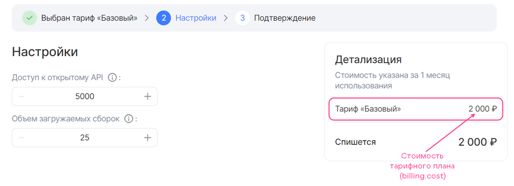

# {heading(plan.yaml файлы)[id=ibplan]}

{include(/kz/_includes/_translated_by_ai_kz.md)}

`plans/<PLAN_NAME>/plan.yaml` файлында нақты тарифтік жоспардың параметрлері сипатталады. Сервисный пакетті жүктеп, сервисті жариялағаннан кейін тарифтік жоспар сервисный кілтте көрсетілген дүкеннің ашық кеңістіктерінде (`namespace_public`) қолжетімді болады (көбірек ақпарат — [Image-based қосымшаны дүкенге жүктеу](../../ibservice_upload) бөлімінде).

`plans/<PLAN_NAME>/plan.yaml` файлында {linkto(#tab_plan_param)[text=%number кестеде]} келтірілген параметрлер мен секцияларды көрсетіңіз.

{caption({counter(table)[id=numb_tab_plan_param]} кесте — plans/<PLAN_NAME>/plan.yaml файлының параметрлері)[align=right;position=above;id=tab_plan_param;number={const(numb_tab_plan_param)}]}
[cols="2,5,2,2", options="header"]
|===
| Атауы
| Сипаттамасы
| Форматы
| Міндетті

| id
| UUID4 генераторының көмегімен жасалған тарифтік жоспардың идентификаторы (ID) UUID4
| string (UUID4)
| 

| revision
| Тарифтік жоспардың ревизиясы. Ревизия мен тарифтік жоспар ID-сының тіркесімі оның сервис ішіндегі бірегейлігін анықтайды. Қалған параметрлер тарифтік жоспардың нақты ревизиясының сипаттамаларын білдіреді
| string, 255 таңбаға дейін
| 

| name
| Дүкен интерфейсінде көрсетілмейтін тарифтік жоспардың техникалық атауы. Бос орындар орнына астынғы сызық белгісін қолданып, латын әріптерімен көрсетілуі тиіс
| string, 255 таңбаға дейін
| 

| description
| Дүкен интерфейсінде көрсетілетін тарифтік жоспардың атауы
| string, 255 таңбаға дейін
| 

| free
| Бұл тарифтік жоспардың тегін екенін немесе емес екенін анықтайды
| boolean
| 

| billing
| Ақылы тарифтік опцияларды есепке алмай, тарифтік жоспардың құнын анықтайды (көбірек ақпарат — {linkto(#plan_billing)[text=%text]} бөлімінде)
| 
| 

| parameters_patch
| Нақты жоспар үшін тарифтік опциялардың параметрлерін қайта анықтауға мүмкіндік береді (көбірек ақпарат — {linkto(#plan_options)[text=%text]} бөлімінде)
| 
| 

| resource_usages
| Кейін төленетін тарифтік опциялардың тізімін қамтиды
| Массив
| Иә — кейін төленетін опциялары бар жоспар үшін
|===
{/caption}

{note:err}

Тарифтік жоспардың ID мен ревизиясының тіркесімі сервис аясында бірегей болуы тиіс. Егер осы сервисте осындай идентификатормен және ревизиясымен жоспар бұрыннан бар болса, тарифтік жоспар жаңартылмайды.

{/note}

{note:warn}

Бір тарифтік жоспар аясында бір ғана тарификация түрінің опцияларына рұқсат етіледі: алдын ала төленетін опциялары бар тарифтік жоспар немесе кейін төленетін опциялары бар тарифтік жоспар.

{/note}

`plans/<PLAN_NAME>/plan.yaml` файлдарының мысалдары {linkto(#ibexample_plan)[text=%text]} бөлімінде келтірілген.

## {heading(Тарифтік жоспардың billing секциясы)[id=plan_billing]}

Тарифтік жоспардың құны үшін тек алдын ала төленетін тарификация түріне қолдау көрсетіледі (көбірек ақпарат — {linkto(/kz/tools-for-using-services/vendor-account/manage-apps/concepts/about#xaas_billing)[text=%text]} бөлімінде).

Тарифтік жоспардың құнын сипаттау үшін ({linkto(#pic_plan_billing)[text=%number сурет]}) `plans/<PLAN_NAME>/plan.yaml` файлында `billing` секциясын көрсетіп, {linkto(#tab_plan_billing)[text=%number кестеде]} келтірілген параметрлерді қойыңыз.

{caption({counter(table)[id=numb_tab_plan_billing]} кесте — billing секциясының параметрлері)[align=right;position=above;id=tab_plan_billing;number={const(numb_tab_plan_billing)}]}
[cols="3,5,2,1,2", options="header"]
|===
|Атауы
|Сипаттамасы
|Форматы
|Міндетті
|Әдепкі мәні

|cost
|
Ақылы тарифтік опцияларды есепке алмай, есептік кезең үшін тарифтік жоспардың құнын анықтайды.

Егер жоспар тегін болса, `0` мәнін көрсетіңіз. Құн дүкен орналастырылған елдің валютасында белгіленеді
|float
| 
|
—

|refundable
|
Пайдаланушы тарифтік жоспарды өзгерткенде немесе сервис инстансын өшіргенде, есептік кезеңнің қалған күндері үшін ақшаны жобаның бонусдық шотына қайтару керектігін анықтайды.

Параметр пайдаланушы тарифтік жоспарды өзгерткенде (тарифтік опцияларды өңдегенде немесе жаңасына ауысқанда) сервис үшін төлем алу күніне әсер етеді:

* Егер мәні `true` болса, күн өзгермейді.
* Егер мәні `false` болса, күн тарифтік жоспар өзгерген күнге дейін жаңартылады

|boolean
| 
|
`true`

|billing_cycle_flat
|
Тарификация үшін есептік кезеңнің ұзақтығын анықтайды.

Жазу форматы: `<АЙ_САНЫ> mons <КҮН_САНЫ> days`. Мысалы, `1 mons 15 days`, `30 days`.

{note:info}

`mons` айындағы күндер саны күнтізбелік мән негізінде есептеледі. Сондықтан `1 mons 0 days` және `0 mons 31 days` кезеңдері бір-біріне тең емес.

{/note}
|string
| 
|
`1 mons 0 days`
|===
{/caption}

{caption(`billing` секциясын толтыру мысалы)[align=left;position=above]}
```yaml
billing:
  cost: 2000
  refundable: true
  billing_cycle_flat: 1 mons 0 days
```
{/caption}

{caption({counter(pic)[id=numb_pic_plan_billing]} сурет — Тарифтік жоспардың құны)[align=center;position=under;id=pic_plan_billing;number={const(numb_pic_plan_billing)} ]}

{/caption}

{note:warn}

Бұлт платформасының есептеу ресурстарын пайдалану құны сервис тарифтік жоспарының құнына кірмейді.

{/note}

Жоспардың құнына ақылы тарифтік опцияларды қосуға болады. Ол үшін олардың құнын YAML-файлдарда сипаттаңыз (көбірек ақпарат — {linkto(../ibopt_fill_in#IB_option_fill_in)[text=%text]} бөлімінде).

{note:info}

Дүкенде сервисді тестілеу мен жөндеу үшін берілетін бонустарды тиімді пайдалану үшін (көбірек ақпарат — {linkto(../../ibservice_upload/ibservice_upload_package#ibservice_upload_package)[text=%text]} бөлімінде) тарифтік жоспар мен оның опцияларының тестілік құнын көрсетіңіз.

{/note}

## {heading(parameters_patch секциясы)[id=plan_options]}

Нақты тарифтік жоспар үшін тарифтік опциялардың параметрлерін қайта анықтау немесе YAML-файлдарда берілмеген жаңаларын қосу үшін:

1. `plans/<PLAN_NAME>/plan.yaml` файлында көрсетіңіз:

   * `parameters_patch` секциясын.
   * `parameters_patch` ішінде — тарифтік опциялардың YAML-файлдарының атауларын.

1. Тарифтік опциялардың параметрлерінің мәндерін қойыңыз. Параметрлердің атауларын түбірлік секцияға дейінгі жолмен көрсетіңіз. Параметр атауы мен оның ата-секцияларының атауларын нүктемен бөліңіз.

   Тарифтік опцияның түріне қарай мүмкін параметрлер [Тарифтік опцияның YAML-файлы](../iboption) бөлімінде келтірілген.

   {caption(Тарифтік опциялардың параметрлерін қайта анықтау мысалы)[align=left;position=above]}
   ```yaml
   parameters_patch:
     users:
       schema.const: 5000
     volume_data_size:
       schema.default: 550
       schema.minimum: 550
   ```
   {/caption}

   Тарифтік опцияның YAML-файлында көрсетілген параметрлердің мәндері тарифтік жоспарда қолданылмайды.

Тарифтік опцияның секциясын толығымен қайта анықтау үшін:

1. `plans/<PLAN_NAME>/plan.yaml` файлында көрсетіңіз:

   * `parameters_patch` секциясын.
   * `parameters_patch` ішінде — тарифтік опцияның секциясын. Мысалы, `billing`.

1. Секцияның параметрлерін қойыңыз (көбірек ақпарат — [Тарифтік опцияның YAML-файлы](../iboption) бөлімінде).

   {caption(Тарифтік опцияның `billing` секциясын қайта анықтау мысалы)[align=left;position=above]}
   ```yaml
   parameters_patch:
     assemblies_size:
       billing:
         base: 25
         cost: 0
         unit:
           size: 100
   ```
   {/caption}

   Тарифтік опцияның YAML-файлында осы секция үшін көрсетілген параметрлер тарифтік жоспарда қолданылмайды.

{note:warn}

Секцияны толығымен және осы секцияданғы жеке параметрді бір мезгілде қайта анықтауға тыйым салынады.

{/note}

{note:info}

Егер тарифтік жоспарларда бір-бірінен айтарлықтай ерекшеленетін опциялар қолданылса, әрбір опцияны `parameters` директориясында жеке YAML-файлмен сипаттау ұсынылады. Бір опцияны сипаттап, оның параметрлерінің көпшілігін тарифтік жоспарлар аясында қайта анықтау ұсынылмайды.

{/note}

## {heading(plan.yaml файлдарының мысалдары)[id=ibexample_plan]}

{caption(Тарифтік опциялардың параметрлерін қайта анықтаумен тарифтік жоспар мысалы)[align=left;position=above]}
```yaml
id: b2b42648-XXXX-b4cddbf010b2
revision: v. 1.0
name: basic
description: Негізгі
free: false

billing:
  cost: 2000
  refundable: true
  billing_cycle_flat: 1 mons

parameters_patch:
  users:
    schema.const: 5000
  volume_data_size:
    schema.default: 550
    schema.minimum: 550
```
{/caption}

{caption(Кейін төленетін тарифтік опциясы бар тарифтік жоспар мысалы)[align=left;position=above]}
```yaml
id: 3aa541d8-XXXX-6dbf542b3f90
revision: v. 1.1
name: postpaid
description: Кейін төленетін
free: true

billing:
  cost: 0

resource_usages:
  - storage
```
{/caption}