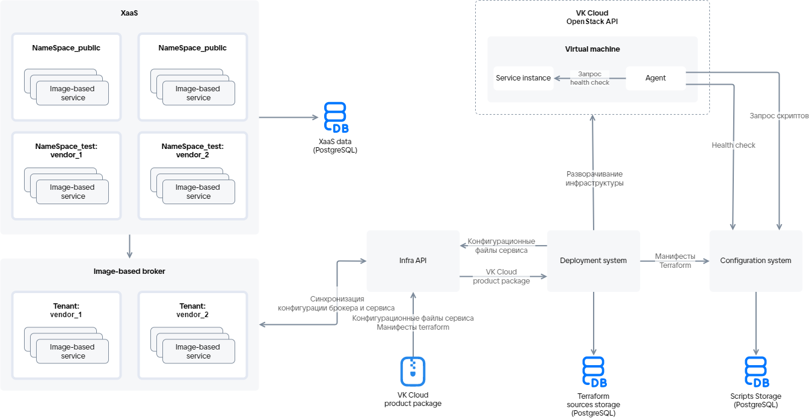

# {heading(Сервистік пакетті дүкенге жүктеу)[id=ibservice_upload_package]}

{include(/kz/_includes/_translated_by_ai_kz.md)}

## {heading(Жүктеу схемасы)[id=upload_scheme]}

Сервистік пакетті дүкенге жүктеу Infra API сервисі арқылы орналастыру жүйесінің көмегімен жүзеге асырылады. Жүктеу схемасы {linkto(#pic_ib_upload)[text=%number суретте]} көрсетілген.

{caption({counter(pic)[id=numb_pic_ib_upload]} сурет — Сервистік пакетті жүктеу схемасы)[align=center;position=under;id=pic_ib_upload;number={const(numb_pic_ib_upload)} ]}
{params[noBorder=true]}
{/caption}

Схеманың негізгі элементтерінің сипаттамасы {linkto(#tab_scheme_elements)[text=%number кестеде]} берілген.

{caption({counter(table)[id=numb_tab_scheme_elements]} кесте — Схеманың негізгі элементтерінің сипаттамасы)[align=right;position=above;id=tab_scheme_elements;number={const(numb_tab_scheme_elements)}]}
[cols="2,5", options="header"]
|===
|Атауы
|Сипаттамасы

|
Infra API
|
image-based қосымшаларды орналастыру үшін дүкен мен бұлтты платформаның интеграция нүктесі болып табылады. Infra API сервистік пакетті жүктеп отырған немесе сервис инстансын орналастырып жатқан пайдаланушы деректерін тексереді. Сәтті тексеруден кейін Infra API Terraform манифестінде сипатталған ресурстарды жасау үшін сервис аралық өзара іс-қимылға қолжетімділік алады. Infra API орналастыру жүйесімен және конфигурацияларды басқару сервисімен өзара іс-қимыл жасайды

|
Орналастыру жүйесі (Deployment system)
|
Бұлтты платформада ВМ-де image-based қосымшаны орналастыруды қамтамасыз етеді. Сервис инфрақұрылымын және ПӘДlocsnbsp;— программалық қамтамасыз етуді басқарады

|
Image-based брокер
|
Сервис инстансының өмірлік циклін басқарады, оған тенанттар кіреді. Тенанттар бір провайдердің (`vendor`) image-based қосымшаларын біріктіреді

|
Конфигурацияларды басқару сервисі (Configuration system)
|
Онда сақталатын сервер:

* Terraform манифесттерінде сипатталған конфигурация.
* Скрипттердің орындалу нәтижелері.
* Сервис инстансының ағымдағы конфигурациясы.

ВМ-ге орнатылатын агенттің өзекті нұсқасына қолжетімділік ұсынады

|
Marketplace агенты (Agent)
|
Сервис орналастыру процесінде ВМ-ге орнатылатын программалық қамтамасыз ету (толығырақ — [Marketplace агенты](/kz/tools-for-using-services/vendor-account/manage-apps/concepts/vendor-preconditions/ib_image_agent) бөлімінде)

|
Сервистік пакет ({var(cloud)} product package)
|
YAML-файлдардың және Terraform манифесттерінің құрылымдалған жиынтығы
|===
{/caption}

Әрбір сервис үшін дүкеннің тестілік (`NameSpace_test`) және ашық (`NameSpace_public`) аттар кеңістіктері сервистік кілтте берілген.

## {heading(Сервистік пакетті дүкенге жүктеу тәртібі)[id=upload_actions]}

1. {linkto(../ibservice_upload_prepare#ibservice_upload_prepare)[text=%text]} орындаңыз.
1. Terraform манифесттерін жергілікті түрде тестілендіріңіз (толығырақ — {linkto(../ibservice_upload_localtest#ibservice_upload_localtest)[text=%text]} бөлімінде).
1. Terraform манифесттерін орналастыру жүйесімен тестілендіріңіз (толығырақ — {linkto(../ibservice_upload_deploysystemtest#ibservice_upload_deploysystemtest)[text=%text]} бөлімінде).
1. Сервистік пакеттің файлдары толтырылғанын және олардың құрылымы JSON-файл генераторының қолданылып жүрген нұсқасына сәйкес келетінін тексеріңіз (толығырақ — {linkto(../../ib_structure#ib_structure)[text=%text]} бөлімінде).
1. Әрбір тарифтік жоспардың ID және ревизия тіркестерінің сервистік пакет шеңберінде бірегей екенін тексеріңіз.
1. Сервистік пакетті (сервистің конфигурациялық файлдары мен Terraform манифесттері бар `<SERVICE_NAME>` директориясы) zip-архивке ораңыз. Архив көлемі 30 МБ-нан аспауы тиіс.
1. Архивті дүкенге мына тәсілдердің бірімен жүктеңіз:

   {tabs}

   {tab(Провайдер кабинеті)}

   1. {var(cloud)} жеке кабинетіне [өтіңіз](https://msk.cloud.vk.ru/app/).
   1. **Қосымшалар дүкені** бөлімінде **Провайдер кабинетіне өту** түймесін басыңыз.
   1. **Сервистерді басқару** қойыншасында **Сервис қосу** түймесін басыңыз.
   1. Жүйеге жүктеу үшін құрылғыңыздан zip-архивті таңдаңыз.
   1. **Қосу** түймесін басыңыз.

   Осыдан кейін қосылған сервис `Жасырын` күйінде сервистер тізімінде пайда болады. Жүктелген архив файлы валидацияға жіберіледі.

   {/tab}

   {tab(Infra API)}

   Infra API сервисіне мына параметрлерімен сұраныс жіберіңіз:

   * Сұраныс әдісі: `POST`.
   * Сұраныс жолы: `https://<CLOUD_HOST>/marketplace/api/infra-api/api/v1-public/product`

      Мұнда `<CLOUD_HOST>` — бұлтты платформаның домендік атауы `https://cloud.vk.ru`.

   * Сұраныс денесі: zip-архив.
   * `x-service-token`: `<SERVICE_TOKEN>` — сервистік кілт.

      {caption(Сервистік пакетті дүкенге жүктеу сұранысының мысалы)[align=left;position=above]}
      {tabs}

      {tab(Linux (bash))}

      ```console
      curl -v -X POST https://cloud.vk.ru/marketplace/api/infra-api/api/v1-public/product \
      -H 'x-service-token: <SERVICE_TOKEN>' \
      -F "upload=@/home/VKservice.zip"
      ```

      {/tab}

      {tab(Windows (cmd))}

      ```console
      curl -v -X POST https://cloud.vk.ru/marketplace/api/infra-api/api/v1-public/product ^
      -H "x-service-token: <SERVICE_TOKEN>" ^
      -F "upload=@/home/VKservice.zip"
      ```

      {/tab}

      {/tabs}
      {/caption}

      Жауаптың HTTP-кодтары:

       * 204 — сервистік пакет жүктелді.
       * 400, 404, 500 — сұранысты орындау қатесі.
       * 401 — авторизация қатесі.

      Тарифтік жоспарларды және сервистің опцияларын сипаттайтын конфигурациялық файлдар image-based брокерге, Terraform манифесттері — орналастыру жүйесіне беріледі.

   {/tab}

   {/tabs}

   Дүкенге жүктелетін сервистік пакет алдымен тестілік аттар кеңістігіне түседі, жарияланғаннан кейін — ашыққа.

1. Сервис жүктелуі аяқталғаннан кейін бұлтты платформаның ЖК-на кіріңіз және сервис дүкенде көрсетілетінін тексеріңіз. Жүктелген сервис сервистік кілтте көрсетілген дүкеннің тестілік аттар кеңістіктерінің пайдаланушыларына ғана қолжетімді болады.

   {note:info}

   Егер жүктегеннен кейін сервис дүкенде көрінбесе, ЖК-дан шығып, қайта кіріңіз.

   {/note}

## {heading(Жариялануға дейін жүктелген сервисді тестілеу)[id=upload_test]}

Сервистің бұлтты платформада қалай жұмыс істейтінін тексеру үшін сервистік пакетті жүктегеннен кейін сервисді дүкеннің тестілік аттар кеңістігінде тестілендіріңіз:

{note:info}

Сервисді тестілеу үшін бонусдар беріледі. Бонус алу үшін [marketplace@cloud.vk.com](mailto:marketplace@cloud.vk.com) мекенжайына хат жіберіңіз. Бонус қаражаты бұлтты платформаның жобасының бонусдық шотына есептеледі.

{/note}

1. VK Cloud жеке кабинетіне [өтіңіз](https://msk.cloud.vk.ru/app/).
1. Әрбір тарифтік жоспардың конфигурация шебері дұрыс көрсетілетінін тексеріңіз.
1. Сервисді қосыңыз. Сервис инстансын орналастырудың сәтті өткенін тексеріңіз.

   Сервис инстансын орналастыру кезінде манифестте сипатталған ресурсты жасау мүмкін болмаса, орналастыру жүйесі сервисді орналастыру процесін қайта іске қосады. Қайталау әрекеттері 1,5 сағатқа дейін уақыт алуы мүмкін және оларды `settings.yaml` файлында өшіруге болады (толығырақ — {linkto(../../tf_manifest/tf_manifest_settings#tf_manifest_settings)[text=%text]} бөлімінде).

   {note:warn}

   Сервисді орналастырудың әрбір жаңа әрекетінде барлық бар ресурстар жойылып, қайта жасалады.

   {/note}

   {note:info}

   Сервисді қосу кезінде қате орын алса, логтерді қараңыз (толығырақ — {linkto(#ibservice_upload_package_log)[text=%text]} бөлімінде).

   {/note}
1. Сервис инстансын жаңартыңыз:

   1. Ағымдағы тарифтік жоспардың тарифтік опцияларының мәндерін өзгертіңіз.
   1. Жаңа тарифтік жоспарға өтіңіз.

      Манифестте сипатталған ресурстардың параметрлерін өзгерту сервис инстансын қайта орнату процесін іске қосады, оның барысында тек өзгертілген ресурстар жаңартылады. Егер орналастыру жүйесі ресурстарды жаңарта алмаса, ол оларды қайта жаңартуға тырысады. Қайталау әрекеттерін ескере отырып, сервис инстансының конфигурациясын жаңарту процесі 1,5 сағатқа дейін уақыт алуы мүмкін. Қайталау әрекеттерін `settings.yaml` файлында өшіруге болады (толығырақ — {linkto(../../tf_manifest/tf_manifest_settings#tf_manifest_settings)[text=%text]} бөлімінде).

   {note:warn}

   Сервис инстансының конфигурациясын жаңарту кезінде орналастыру жүйесі тек өзгертілген ресурстарды жаңартады.

   {/note}
1. Сервисдің негізгі пайдаланушы сценарийлерін тексеріңіз.
1. Сервис инстансын жойыңыз.
1. Қажет болса, сервисдің конфигурациясына өзгерістер енгізіңіз (толығырақ — {linkto(../../../../instructions/manage-ib-apps/update-ib-app#ibservice_update)[text=%text]} бөлімінде).

   {note:warn}

   Егер тестілеу және отладка уақытына сервисдің конфигурациясында сервис құны үшін тестілік мәндер берілген болса, оларды өңдеңіз.

   {/note}
1. Егер тестілеу барысында сервистік пакетке өзгерістер енгізілген болса, сервисдің ревизиясы жаңартылғанын тексеріңіз.

## {heading(Сервис инстансының логтерін қарау)[id=ibservice_upload_package_log]}

1. VK Cloud жеке кабинетіне [өтіңіз](https://msk.cloud.vk.ru/app/).
1. **Қосымшалар дүкені** бөліміне өтіңіз.
1. Консольді ашыңыз және дүкенде авторизацияның JWT-токенін алыңыз:

   {tabs}

   {tab(Linux (bash))}

   ```console
   curl -X POST https://cloud.vk.ru/marketplace/api/um/v1/tokens/sid \
   --cookie 'sid=<SID>'
   ```

   {/tab}

   {tab(Windows (cmd))}

   ```console
   curl -X POST https://cloud.vk.ru/marketplace/api/um/v1/tokens/sid ^
   --cookie "sid=<SID>"
   ```

   {/tab}

   {/tabs}

   Мұнда `<SID>` — веб-браузердегі `sid` cookie файлының мәні.

   Командаға жауапта JWT-токен көрсетіледі.
1. Сервис инстансының логін алыңыз:

   {tabs}

   {tab(Linux (bash))}

   ```console
   curl -v https://cloud.vk.ru/marketplace/api/notifications/api/v1/instance?uuid=<UUID> \
   -H 'Authorization: Bearer <JWT_TOKEN>'
   ```

   {/tab}

   {tab(Windows (cmd))}

   ```console
   curl -v https://cloud.vk.ru/marketplace/api/notifications/api/v1/instance?uuid=<UUID> ^
   -H "Authorization: Bearer <JWT_TOKEN>"
   ```

   {/tab}

   {/tabs}

   Мұнда:

   * `<UUID>` — сервис инстансының идентификаторы. Мән бұлтты платформаның ЖК-нда сервис инстансы бетінде көрсетіледі — **ID** параметрі.
   * `<JWT_TOKEN>` — алдыңғы қадамда алынған авторизацияның JWT-токені.