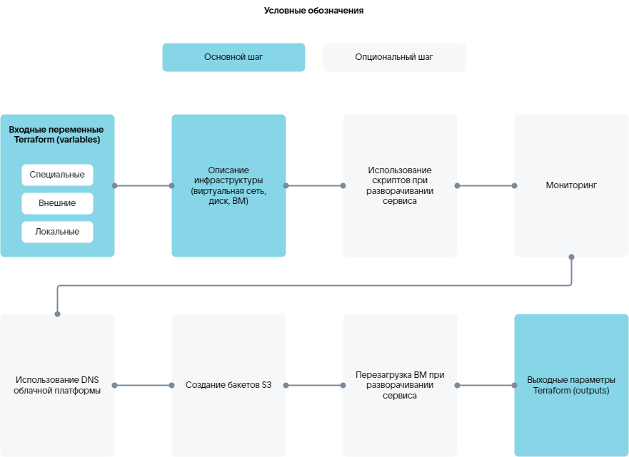

# {heading(Terraform манифесті)[id=tf_manifest_steps]}

{include(/kz/_includes/_translated_by_ai_kz.md)}

image-based қолданбаның инфрақұрылым конфигурациясы `plans/<PLAN_NAME>/deployment/deploy.tf` Terraform манифесті арқылы `HashiCorp Configuration Language (HCL)` тілінде сипатталады (синтаксис — [ресми сайтта](https://developer.hashicorp.com/terraform/language/syntax/configuration)).

`plans/<PLAN_NAME>/deployment/deploy.tf` манифестінде сервис инстансын орнатуға арналған инфрақұрылымды сипаттаңыз. {linkto(#tab_providers)[text=%number кестедегі]} провайдерлердің ресурстары мен деректер көздерін пайдаланыңыз.

{caption({counter(table)[id=numb_tab_providers]} кесте — Terraform провайдерлері)[align=right;position=above;id=tab_providers;number={const(numb_tab_providers)}]}
[cols="2,5,2", options="header"]
|===
|Атауы
|Сипаттамасы
|Манифесттегі белгіленуі

|VK CS
|
Сервис инфрақұрылымын сипаттауға арналған ресурстар мен деректер көздерін қамтиды.

Ресурстар мен деректер көздері [провайдердің ресми құжаттамасында](https://github.com/vk-cs/terraform-provider-vkcs/tree/master/docs) келтірілген.

Ресурстарды жасауды сипаттайтын манифесттердің мазмұн мысалдары Terraform пайдалану бойынша [Практикалық нұсқаулар](/kz/tools-for-using-services/terraform/how-to-guides) бөліміндегі сценарийлерде келтірілген
|
`vkcs`

|VK CS Infra (iVK CS)
|
VK CS провайдерінің мүмкіндіктерін кеңейтетін ресурстар мен деректер көздерін қамтиды. Мысалы, сервис инстансының күйін бақылауға, скрипттерді іске қосуға және олардың нәтижелерін орнату процесінде пайдалануға мүмкіндік беретін. Скрипттер үшін Bash және Python тілдері қолдау көрсетіледі.

Ресурстар мен деректер көздері [VK CS Infra (iVK CS) провайдерінің анықтамалығы](../../../ivkcs) бөлімінде келтірілген
|
`ivkcs`

|Null
|
Провайдер ресурстары инфрақұрылым ресурстарымен тікелей байланыспайтын сыртқы процестерді немесе әрекеттерді іске қосу үшін пайдаланылады
|
`null`

|Random
|
Провайдер ресурстары (толығырақ — [провайдердің ресми құжаттамасында](https://github.com/hashicorp/terraform-provider-random/tree/main/docs)) сервис инстансына кіру құпиясөздерін генерациялау үшін пайдаланылады
|
`random`

|Time
|
Провайдер ресурстары басқа ресурстар арасындағы өзара әрекеттесуді уақыт бойынша баптау үшін пайдаланылады. Мысалы, кідіріс немесе уақыт белгісін жасау
|
`time`
|===
{/caption}

## {heading(Terraform элементтері)[id=tf_elements]}

Манифестте Terraform негізгі элементтерін пайдаланыңыз:

* `variables` — ресурстар конфигурациясына арналған кіріс айнымалылар.
* `resources` — инфрақұрылым нысандарын басқаруға мүмкіндік беретін ресурстар. Мысалы, ВМ жасау. Ресурстарды сипаттағанда `depends on` блогы арқылы тәуелділіктерді көрсетуге болады. Егер кемінде бір тәуелділік орындалмаса, ресурс жасалмайды.
* `data-sources` — провайдерден белгілі бір ақпарат алуға мүмкіндік беретін деректер көздері. Мысалы, қолжетімді ВМ түрлерін алу немесе скрипттердің орындалу нәтижелерін алу.
* `outputs` — шығыс параметрлері, манифесттің орындалу нәтижелері.

## {heading(Terraform манифестіне арналған қадамдар)[id=tf_manifest_steps]}

Terraform манифестінде сипатталатын негізгі және қосымша қадамдар {linkto(#pic_tf_steps)[text=%number суретте]} келтірілген.

{caption({counter(pic)[id=numb_pic_tf_steps]} сурет — Terraform манифестіне арналған қадамдар)[align=center;position=under;id=pic_tf_steps;number={const(numb_pic_tf_steps)} ]}
{params[noBorder=true]}
{/caption}

{note:err}

Сервис орнатуын сипаттаудың нақты қадамдары қажетті инфрақұрылымға және нақты сервис үшін оның баптауларына байланысты.

{/note}

Бұлттық платформада ВМ-де сервис орнатудың негізгі қадамдары:

1. {linkto(../tf_manifest_variable#tf_manifest_variable)[text=Ресурстар конфигурациясына арналған кіріс айнымалыларды сипаттау]}.
1. {linkto(../tf_manifest_image#tf_manifest_image)[text=Инфрақұрылымды сипаттау]}.
1. {linkto(../tf_manifest_output#tf_manifest_output)[text=Шығыс параметрлерін сипаттау]}.

Қосымша мүмкіндіктер:

* {linkto(../tf_manifest_script#tf_manifest_script)[text=Скрипттерді пайдалану]}:

   * Сервис орнату немесе қайта орнату процесінде скрипттерді орындау.
   * Скрипттердің орындалу нәтижелерін манифесттің басқа ресурстарында пайдалану.
   * Скрипттердің орындалу нәтижелерін алу.

* {linkto(../tf_manifest_monitoring#tf_manifest_monitoring)[text=%text]}.
* Бұлттық платформаның DNS-ін пайдалану (толығырақ — [VK CS Infra (iVK CS) провайдерінің анықтамалығы](../../../ivkcs) бөлімінде).

   {note:warn}

   Жасалған ресурс DNS-жазбаларын (мысалы, жоюды) бұлттық платформаның ЛК-нда басқару қолжетімсіз болады.

   {/note}
* {var(s3)} бакеттерін жасау (толығырақ — [VK CS Infra (iVK CS) провайдерінің анықтамалығы](../../../ivkcs) бөлімінде). Жасалған бакеттер бұлттық платформаның ЛК-нда көрсетіледі.
* Сервис орнату процесінде ВМ-ді қайта жүктеу (толығырақ — [VK CS Infra (iVK CS) провайдерінің анықтамалығы](../../../ivkcs) бөлімінде).

Қосымша мүмкіндіктер iVK CS провайдерінің ресурстарымен қамтамасыз етіледі.

{note:info}

iVK CS провайдерінің ресурстары үшін сервис орнату идентификаторын арнайы `instance_uuid` айнымалысы арқылы алыңыз (толығырақ — {linkto(../tf_manifest_variable#tf_manifest_variable)[text=%text]} бөлімінде).

{/note}

ВМ мониторингі мен скрипттерді пайдалану арнайы сервистермен қамтамасыз етіледі (толығырақ — {linkto(../../ibservice_upload/ibservice_upload_package#ibservice_upload_package)[text=%text]} бөлімінде), олармен iVK CS провайдері өзара әрекеттеседі:

* Конфигурацияларды басқару сервисі.
* Агент.

Дайын манифест сервис пакетінің құрамында орнату жүйесіне жүктеледі (толығырақ — [image-based қолданбаны дүкенге жүктеу](../../ibservice_upload) бөлімінде).

## {heading(Terraform манифестінің мысалы)[id=tf_manifest_example]}

Төменде келесілерді пайдалана отырып, бір ВМ-де Grafana сервисін орнатуға арналған манифест келтірілген:

* Сыртқы IP-адрестер.
* Бұлттық платформаның DNS-і.
* Адрестің қолжетімділігі мониторингі.

{caption(Grafana сервисіне арналған манифест мысалы)[align=left;position=above]}
```hcl

# --------------------variables--------------------

# Арнайы айнымалылар

# Сервис орнатуының идентификаторы
variable "instance_uuid" {
  type    = string
  default = "4a57a965-3c83-436c-80e2-428e421538cc"
}

variable "email" {
  type    = string
  default = "user@example.com"
}

# Сыртқы айнымалылар

# Сыртқы немесе ішкі IP-адресі бар орналастыру
variable "grafana_placement" {
  type    = string
  default = "internal"
}

# Резервтік көшірме жасау
variable "backup_style" {
  type    = string
  default = "s3"
}

# Қолжетімділік аймағы
variable "ds-az" {
  type    = string
  default = "ME1"
}

# ВМ түрі
variable "ds-flavor" {
  type    = string
  default = "a493b27d-170d-48eb-a24b-99e9b325f988"
}

# Поджелі идентификаторы
variable "ds-subnet" {
  type    = string
  default = "cd4224ac-0527-4291-a8e0-afae0cee02ed"
}

# Root-диск түрі
variable "root_type" {
  type    = string
  default = "ceph-ssd"
}

# Root-диск өлшемі, ГБ
variable "root_size" {
  type    = number
  default = 10
}

# Деректерді сақтауға арналған диск түрі
variable "data_type" {
  type    = string
  default = "ceph-ssd"
}

# Деректерді сақтауға арналған диск өлшемі, ГБ
variable "data_size" {
  type    = number
  default = 1
}

# Сервис бейнесінің идентификаторы
variable "image_uuid" {
  type        = string
  default     = "8c7a6443-bb79-4f04-884a-14231f0ba6cb"
  description = "grafana image"
}

# Қауіпсіздік тобына кіру порттары
variable "ports" {
  type    = list(number)
  default = [
    22, 80, 443
  ]
  description = "ports for secgroup rule. grafana [80, 443]"
}

locals {

# instance_uuid қысқартылған нұсқасы
  short_name = substr(var.instance_uuid, 0, 8)

# Хост атауын генерациялау
  hosts_name = "${local.short_name}-grafana"
}

# ---------------------data------------------------

# Виртуалды желі деректерін алу
data "vkcs_networking_subnet" subnet {
  id = var.ds-subnet
}

# --------------------backup-----------------------

# VK Object Storage бакеттерін жасау
resource "ivkcs_s3" "s3_backup" {
  count = var.backup_style == "s3" ? 1 : 0
  name  = "${local.hosts_name}-backup"
}

# --------------------security group---------------

# Қауіпсіздік тобын жасау
resource "vkcs_networking_secgroup" "secgroup" {
  name = "${local.short_name}-grafana"
  sdn  = data.vkcs_networking_subnet.subnet.sdn
}

# Қауіпсіздік тобына арналған ережелер
resource "vkcs_networking_secgroup_rule" "rules" {
  count             = length(var.ports)

# Ережелерді қолдану бағытын анықтау — кіріс (ingress) немесе шығыс (egress) қосылымдар үшін
  direction         = "ingress"

# Кіру порттарының тізімі
  port_range_max    = element(var.ports, count.index)
  port_range_min    = element(var.ports, count.index)

# Кіру хаттамасы
  protocol          = "tcp"

# Қашықтан қосылатын желілік префикс
  remote_ip_prefix  = "0.0.0.0/0"

# Ережелер жасалған қауіпсіздік тобының идентификаторы
  security_group_id = vkcs_networking_secgroup.secgroup.id
  description       = "rule_tcp_${element(var.ports, count.index)}"
}

# --------------------network----------------------

# IP-адресті портқа байланыстыру
resource "vkcs_networking_port" "ports" {
  name               = "${local.short_name}-grafana"
  admin_state_up     = "true"
  network_id         = data.vkcs_networking_subnet.subnet.network_id
  sdn                = data.vkcs_networking_subnet.subnet.sdn
  security_group_ids = [
    vkcs_networking_secgroup.secgroup.id
  ]
  fixed_ip {
    subnet_id = var.ds-subnet
  }
}

# --------------------keypair----------------------

# Кілттік жұпты жасау
resource "ivkcs_ssh_keypair" "keypair" {}

# --------------------------vm---------------------

# cloud-config конфигурациясын жасау. Хостта агентті инициализациялауға арналған деректерді алу
resource "ivkcs_user_data" "user_data" {

# Сервис орнатуының идентификаторы
  uuid      = var.instance_uuid
  hosts     = [local.hosts_name]
  target_os = "almalinux9"

# SSH арқылы кіруге арналған кілттер
  ssh_authorized_keys = [
    ivkcs_ssh_keypair.keypair.public_key,
  ]
}

# ВМ жасау
resource "vkcs_compute_instance" "grafana" {
  name              = local.hosts_name
  flavor_id         = var.ds-flavor
  security_groups   = [vkcs_networking_secgroup.secgroup.name]
  availability_zone = var.ds-az
  metadata          = { "sid" : "xaas", "product" : "grafana" }

# Root-диск
  block_device {
    source_type      = "volume"
    destination_type = "volume"
    boot_index       = 0
    uuid             = vkcs_blockstorage_volume.boot.id
  }

# ВМ-ді баптау үшін cloud-config конфигурациясын қолдану. Агентті орнату
  user_data = ivkcs_user_data.user_data.user_data[0]

# ВМ-ге IP-адресті бекіту
  network {
    port = vkcs_networking_port.ports.id
  }

# Жою алдында ВМ-ді тоқтату әрекеті
  stop_before_destroy = true

# ВМ жасау тайм-ауты
  timeouts {
    create = "10m"
  }
}

# --------------------volume-----------------------

# Root-дискті жасау
resource "vkcs_blockstorage_volume" "boot" {
  name              = "${local.short_name}-grafana-boot"

# Метадеректер
  metadata          = { "sid" : "xaas", "product" : "grafana" }

# Сервис бейнесінің идентификаторы
  image_id          = var.image_uuid
  volume_type       = var.root_type
  size              = var.root_size
  availability_zone = var.ds-az
}

# Деректер дискісін жасау
resource "vkcs_blockstorage_volume" "grafana_data" {
  name              = "${local.short_name}-grafana-data"

# Метадеректер
  metadata          = { "sid" : "xaas", "product" : "grafana" }
  size              = var.data_size
  availability_zone = var.ds-az
  volume_type       = var.data_type
}

# Деректер дискісін ВМ-ге қосу
resource "vkcs_compute_volume_attach" "attached" {
  instance_id = vkcs_compute_instance.grafana.id
  volume_id   = vkcs_blockstorage_volume.grafana_data.id
}

# -----------------------external------------------

# Сыртқы IP-адрестер пулын алу
resource "vkcs_networking_floatingip" "fips" {
  count = var.grafana_placement == "external" ? 1 : 0
  pool  = data.vkcs_networking_subnet.subnet.sdn == "neutron" ? "ext-net" : "internet"
}

# ВМ-ге сыртқы IP-адресті тағайындау
resource "vkcs_compute_floatingip_associate" "fip" {
  count       = length(vkcs_networking_floatingip.fips)
  floating_ip = vkcs_networking_floatingip.fips[count.index].address
  instance_id = vkcs_compute_instance.grafana.id
}

# Бұлттық платформаның DNS-інде A-жазба жасау
resource "ivkcs_dns" "grafana" {
  count  = length(vkcs_networking_floatingip.fips)
  name   = "grafana-${local.short_name}"
  domain = "xaas.msk.vkcs.cloud"
  ip     = vkcs_networking_floatingip.fips[count.index].address
}

# --------------------agent-run--------------------
locals {
  grafana_domain   = var.grafana_placement == "external" ? "${ivkcs_dns.grafana[0].name}.${ivkcs_dns.grafana[0].domain}" : vkcs_compute_instance.grafana.access_ip_v4
  grafana_root_url = var.grafana_placement == "external" ? "https://${local.grafana_domain}" : "http://${local.grafana_domain}"

# ivkcs_agent_exec.start ресурсына арналған старттық скрипт
  start = <<-EOT
#!/bin/bash
ansible-playbook start.yml \
  --extra-vars "lego_enabled=${var.grafana_placement == "external" ? "true" : "false"}" \
  --extra-vars "lego_email=${var.email}" \
  --extra-vars "backup_enabled=${var.backup_style == "s3" ? "true" : "false"}" \
  --extra-vars "backup_access_token=${try(ivkcs_s3.s3_backup[0].access, "n/a")}" \
  --extra-vars "backup_secret_token=${try(ivkcs_s3.s3_backup[0].secret, "n/a")}" \
  --extra-vars "backup_bucket_name=${try(ivkcs_s3.s3_backup[0].name, "n/a")}_bucket" \
  --extra-vars "grafana_domain=${local.grafana_domain}" \
  --extra-vars "grafana_root_url=${local.grafana_root_url}"
EOT
}

resource "ivkcs_agent_exec" "start" {
  hosts = [local.hosts_name]
  name  = "start_grafana"
  uuid  = var.instance_uuid
  step {
    index   = 1
    type    = "bash"
    content = local.start
    options {
      timeout  = "20m"
      cwd      = "/opt/playbooks"
      attempts = 1
    }
  }

  depends_on = [
    vkcs_compute_instance.grafana,
    vkcs_compute_volume_attach.attached,
  ]
}

# --------------------health check-----------------

# ВМ мониторингі
resource "ivkcs_agent_check" "health" {
  hosts = [local.hosts_name]
  uuid  = var.instance_uuid

# Адрес бойынша мониторинг
  http_health {
    method     = "GET"
    protocol   = var.grafana_placement == "internal" ? "http" : "https"
    host       = local.grafana_domain
    path       = "/api/health"
    http_codes = [200]
    period     = "30s"
  }

  timeouts {
    create = "5m"
  }

  depends_on = [
    ivkcs_agent_exec.start,
  ]
}

# --------------------outputs----------------------

# ВМ-ге кіруге арналған жабық SSH-кілтін шығару
output "keypair" {
  value     = ivkcs_ssh_keypair.keypair.private_key

# Шығыс параметр сезімтал деректерді қамтиды
  sensitive = true
}

# Grafana URL-ін шығару
output "grafana_url" {
  value = local.grafana_root_url
}

# VK Object Storage бакетінің идентификаторын шығару
output "s3_backup" {
  value = try(ivkcs_s3.s3_backup[0].id, "n/a")
}
```
{/caption}