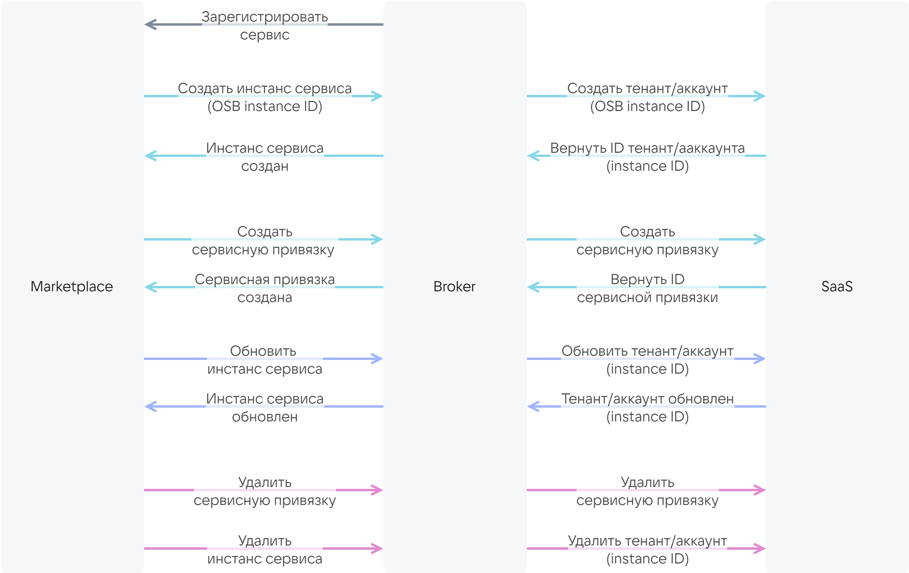

# {heading(SaaS-қосымшасына арналған брокер)[id=saas_broker]}

{include(/kz/_includes/_translated_by_ai_kz.md)}

Дүкен сервиспен брокер көмегімен өзара әрекеттеседі.

VK OSB хаттамасы бойынша SaaS-қосымшасына арналған брокерді әзірлеңіз. VK OSB хаттамасын алу үшін [marketplace@cloud.vk.com](mailto:marketplace@cloud.vk.com) мекенжайына хат жіберіңіз. Брокер сервис инстанстарының өмірлік циклін сипаттайтын әдістерді жүзеге асыруы тиіс ({linkto(#pic_saas_broker)[text=сурет %number]}).

{caption(Сурет {counter(pic)[id=numb_pic_saas_broker]} — Брокердің дүкенмен және SaaS-қосымшасымен өзара әрекеттесуі)[align=center;position=under;id=pic_saas_broker;number={const(numb_pic_saas_broker)} ]}
{params[noBorder=true]}
{/caption}

Брокерде сенімді сертификаттау орталығы шығарған сертификаты бар қауіпсіз HTTPS хаттамасы арқылы basic-аутентификация бапталуы тиіс.

{note:err}

Өзі-өзін қолдаған сертификаттарды пайдалануға тыйым салынады.

{/note}

Брокерді дүкен мен брокердің арасындағы өзара әрекеттесуі бұрыннан жүзеге асырылған үлгі негізінде әзірлеуге болады. Үлгіні брокердің нақты SaaS-қосымшасымен өзара әрекеттесуін сипаттайтын түзетулермен толықтыру қажет.

Үлгі негізінде брокерді әзірлеу үшін:

1. Брокер үлгісін алу үшін [marketplace@cloud.vk.com](mailto:marketplace@cloud.vk.com) мекенжайына хат жіберіңіз. Үлгі [FastAPI](https://fastapi.tiangolo.com/tutorial/first-steps/) фреймворкі негізінде Python тілінде әзірленген.
1. Сервистің API-мен өзара әрекеттесуіне арналған клиентті әзірлеңіз.
1. Брокер мен сервисдің өзара әрекеттесуін сипаттайтын сервис-менеджерді әзірлеңіз:

   1. Кіріс ретінде қабылдайтын:

      * Сервисті қосу кезінде дүкен құратын сервис инстансының OSB ID. OSB ID SaaS-қосымшасына беріледі, сонда SaaS-қосымшасы сервис инстансының ID-сын құрады. Сервис инстансының ID-сы төменде сипатталған әдістерде қолданылады.
      * Тарифтік жоспардың ID-сы.
      * JSON-файлдағы `plans.schemas.service_instance.create` бөлімінде сипатталған жоспардың тарифтік опцияларын қабылдайтын, тракт/аккаунт құру әдісін жүзеге асырыңыз.
      * Контекст (қалау бойынша). Контекст пайдаланушы туралы ақпаратты (email, OpenStack PID) қамтиды.

   1. Кіріс ретінде қабылдайтын:

      * Сервис инстансының ID-сы.
      * Тарифтік жоспардың ID-сы.
      * JSON-файлдағы `plans.schemas.service_instance.update` бөлімінде сипатталған жоспардың тарифтік опцияларын қабылдайтын, тракт/аккаунт жаңарту әдісін жүзеге асырыңыз.

   1. Кіріс ретінде сервис инстансының ID-сын қабылдайтын, тракт/аккаунт алу және жою әдістерін жүзеге асырыңыз.
   1. Кіріс ретінде қабылдайтын:

      * Сервис инстансының ID-сы.
      * JSON-файлдағы `plans.schemas.service_binding.create` бөлімінде сипатталған сервистік байланыстардың параметрлерін қабылдайтын, сервистік байланыстарды құру әдісін жүзеге асырыңыз.
      * Контекст (қалау бойынша). Контекст пайдаланушы туралы ақпаратты (email, OpenStack PID) қамтиды.

   1. Кіріс ретінде қабылдайтын:

      * Сервис инстансының ID-сы.
      * Сервистік байланыстың ID-сы.

1. Клиентті сервис-менеджерге интеграциялаңыз.
1. Брокерде аутентификацияны баптаңыз.

SaaS-қосымшасында кейінгі төлемді тарифтік опциялар болса және олар бойынша метрикалар pull-модель арқылы жиналса (толығырақ — {linkto(../../concepts/about#xaas_billing)[text=%text]} бөлімінде), қосымша әрекеттерді орындаңыз:

1. Сервис-менеджерде SaaS-қосымшасының іс жүзінде пайдаланылған ресурстары бойынша есеп алудың әдісін жүзеге асырыңыз. Сұрауға жауап ретінде брокер дүкенге есепті беруі тиіс.

   {caption(SaaS-қосымшасының іс жүзінде пайдаланылған ресурстары туралы есептің мысалы)[align=left;position=above]}
   ```json
   {
     "batch_id": 35,
     "data": [
        {
         "kind": "vms",
         "type": "cb",
         "unit": "month",
         "price": 600.0,
         "value": 1.0,
         "plan_uuid": "2f070fe3-3e31-4482-bad4-a4d0c36bab31",
         "instance_uuid": "d1dff97c-df6c-45a7-95e1-b539a8d77721"
       },
       {
         "kind": "storage",
         "type": "cb",
         "unit": "GB-month",
         "price": 3.3,
         "value": 2.4474525451660156,
         "plan_uuid": "2f070fe3-3e31-4482-bad4-a4d0c36bab31",
         "instance_uuid": "d1dff97c-df6c-45a7-95e1-b539a8d77721"
       },
       {
         "kind": "vms",
         "type": "cb",
         "unit": "month",
         "price": 600.0,
         "value": 0.0,
         "plan_uuid": "354df2fa-5ec3-45e1-b99b-7d45840cf3df",
         "instance_uuid": "3910e993-63f0-4a90-95d7-5eea35785c29"
       },
       {
         "kind": "storage",
         "type": "cb",
         "unit": "GB-month",
         "price": 3.3,
         "value": 0.0,
         "plan_uuid": "354df2fa-5ec3-45e1-b99b-7d45840cf3df",
         "instance_uuid": "3910e993-63f0-4a90-95d7-5eea35785c29"
       },
       {
         "kind": "storage",
         "type": "cb",
         "unit": "GB-month",
         "price": 7.0,
         "value": 0.0,
         "plan_uuid": "d719f348-3497-4341-8465-a438bfcc2d96",
         "instance_uuid": "f10e67be-dfd7-4dcd-917c-4bfd3cd64ce2"
       }
     ]
   }
   ```
   {/caption}

   Мұнда:

   * `batch_id` — брокер құрған есептің ID-сы.
   * `kind` — тарифтік опцияның атауы. Сервистің конфигурация файлында қолданылатын атауға сәйкес болуы тиіс.
   * `type` — сервис атауы. Сервистің конфигурация файлының атауында көрсетілген `SERVICE_NAME`-ге сәйкес болуы тиіс (`catalog_<SERVICE_NAME>.json`).
   * `unit` — опцияның өлшем бірлігі.
   * `price` — айына опция бірлігінің құны. Сервистің конфигурация файлында көрсетілген нақты опцияның `plans.billing.options.cost` мәніне сәйкес болуы тиіс.
   * `value` — SaaS-қосымшасы құрған, айына опцияның іс жүзінде пайдаланылған мөлшері.
   * `plan_uuid` — тарифтік жоспардың ID-сы.
   * `instance_uuid` — сервис инстансының (тракт/аккаунт) ID-сы.

1. Сервис-менеджерде есеп өңделгенін (есеп бойынша ақша қаражаты алынды немесе алу жоспарланған) брокерге хабарлайтын әдісті жүзеге асырыңыз.