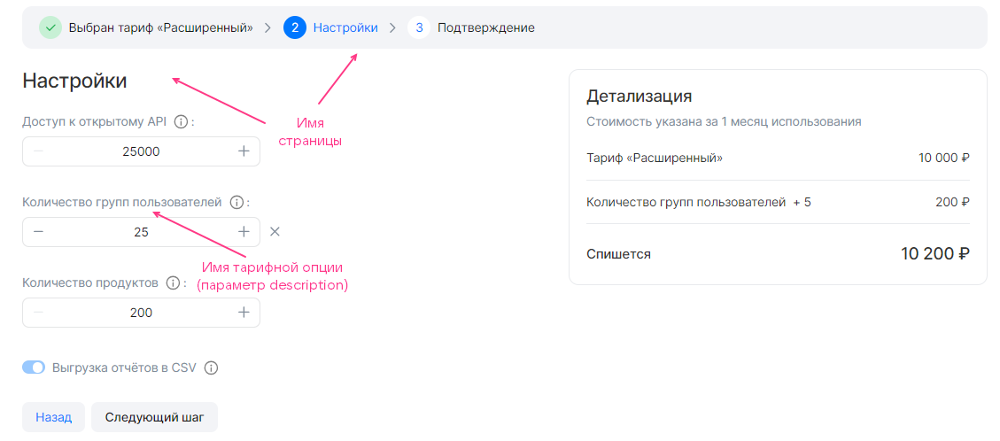
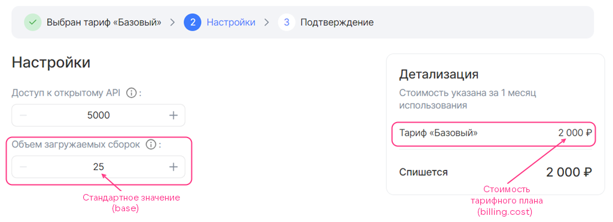
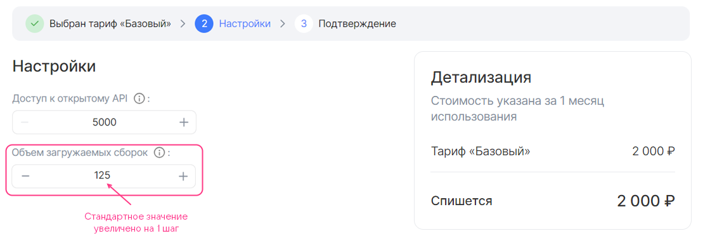
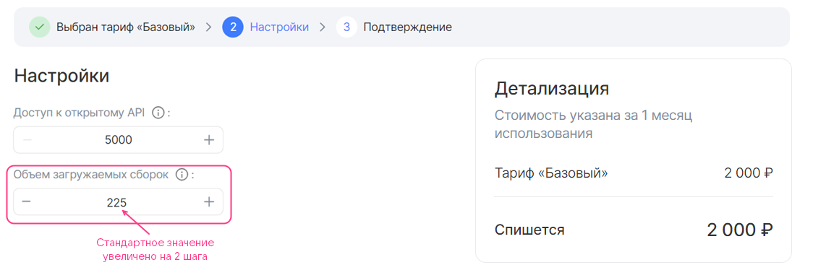
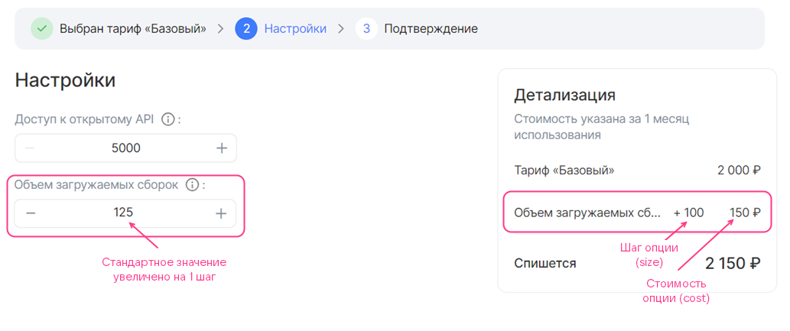
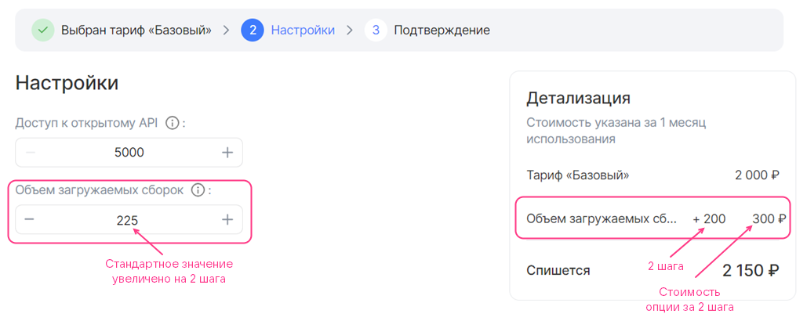
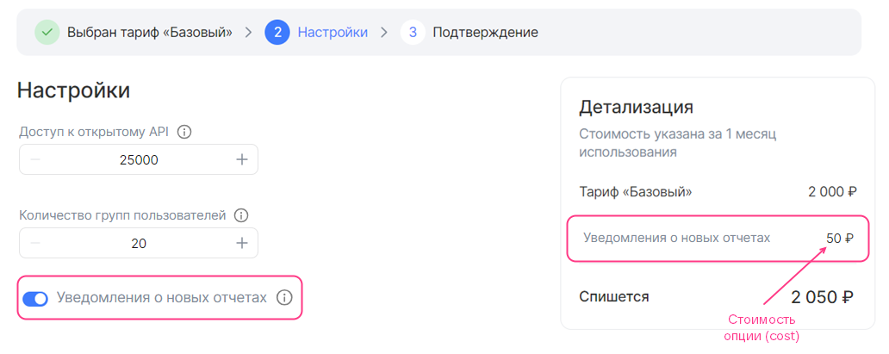
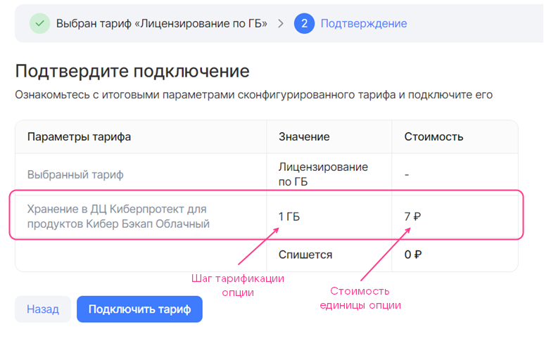

## {heading(Құрылымы)[id=saas_plan_structure]}

{include(/kz/_includes/_translated_by_ai_kz.md)}

`plans` секциясында сервистің тарифтік жоспарларын келесідей құрылым бойынша сипаттаңыз:

```json
      "plans": [
        {
          <PLAN_PARAMETERS>,
          "display": {
          },
          "billing": {
          },
          "schemas": {
          }
        },
        ...
      ]
```

Мұнда:

* `<PLAN_PARAMETERS>` — жоспардың параметрлері (көбірек білу — {linkto(#saas_plan_param)[text=%text]} бөлімінде).
* `display` секциясы — нақты тарифтік жоспардың конфигурация шеберін сипаттайды (көбірек білу — {linkto(#saas_plan_display)[text=%text]} бөлімінде).
* `billing` секциясы — жоспардың және оның опцияларының құнын сипаттайды (көбірек білу — {linkto(#saas_plan_billing)[text=%text]} бөлімінде).
* `schemas` секциясы — жоспардың тарифтік опцияларын сипаттайды (көбірек білу — {linkto(#saas_plan_schema)[text=%text]} бөлімінде).

## {heading(Тарифтік жоспардың параметрлері)[id=saas_plan_param]}

Тарифтік жоспар үшін {linkto(#tab_plan_params)[text=%number кестеде]} келтірілген параметрлерді көрсетіңіз.

{caption({counter(table)[id=numb_tab_plan_params]} кесте — Тарифтік жоспардың параметрлері)[align=right;position=above;id=tab_plan_params;number={const(numb_tab_plan_params)}]}
[cols="2,4,2,1,2", options="header"]
|===
|Аты
|Сипаттамасы
|Форматы
|Міндетті
|Әдепкі мәні

|id
|
UUID4 генераторымен жасалған тарифтік жоспардың UUID4 идентификаторы (ID)
|string (UUID4)
| 
| 

|revision
|
Тарифтік жоспардың ревизиясы. Ревизия мен тарифтік жоспар ID-нің тіркесімі оның сервис ішіндегі бірегейлігін анықтайды. Қалған параметрлер тарифтік жоспардың нақты ревизиясының сипаттамаларын білдіреді
|string, 255 таңбаға дейін
| 
| 

|name
|
Дүкен интерфейсінде көрсетілмейтін тарифтік жоспардың техникалық атауы. Бос орындардың орнына астынғы сызық белгісін қолдана отырып, латын әріптерімен көрсетілуі тиіс
|string, 255 таңбаға дейін
| 
| 

|description
|
Дүкен интерфейсінде көрсетілетін тарифтік жоспардың атауы
|string, 255 таңбаға дейін
| 
| 

|free
|
Тарифтік жоспардың тегін екенін немесе екені емесін анықтайды
|boolean
| 
| 

|plan_updateable
|
Пайдаланушы сервисті жоймай-ақ бір тарифтік жоспардан екіншісіне өте алатынын анықтайды.

Сервистің аттас параметрінде берілген мәнді қайта анықтайды
|boolean
| 
| 

|metadata
|
Тарифтік жоспар қолжетімді болатын дүкеннің тесттік және ашық аттар кеңістіктерін анықтайды.

Тесттік аттар кеңістігі `test_ns` кілтінде көрсетіледі.

Ашық аттар кеңістігі `prod_ns` кілтінде көрсетіледі.

Аттар кеңістіктерінің атауларын алу үшін [marketplace@cloud.vk.com](mailto:marketplace@cloud.vk.com) мекенжайына хат жіберіңіз.

Егер аттар кеңістіктері көрсетілмесе, сервистің аттас параметрінде көрсетілген мәндер қолданылады (көбірек білу — {linkto(../saas_param#saas_param)[text=%text]} бөлімінде)
|map, кілттері — string
| 
| 
|===
{/caption}

{note:err}

Тарифтік жоспардың ID және ревизия тіркесімі сервис аясында бірегей болуы тиіс. Егер осындай идентификаторы және ревизиясы бар жоспар бұл сервисте бұрыннан бар болса, тарифтік жоспар жаңартылмайды.

{/note}

## {heading(display секциясы)[id=saas_plan_display]}

`display` секциясында тарифтік жоспардың конфигурация шеберін (көбірек білу — {linkto(/kz/tools-for-using-services/vendor-account/manage-apps/concepts/about#xaas_wizard)[text=%text]} бөлімінде) келесідей құрылым бойынша сипаттаңыз:

```json
"display": {
  "pages": [
    {
      <PAGE_PARAMETERS>,
      "groups": [
        {
          <GROUP_PARAMETERS>,
          "parameters": [
            {
              <OPTION_PARAMETERS>
            },
            ...
          ]
        }
        ...
      ]
    },
  ...
  ]
}
```

Мұнда:

* `pages` секциясы — тарифтік жоспардың конфигурация шеберінің беттерін сипаттайды. Бос болуы мүмкін.
* `<PAGE_PARAMETERS>` — бір беттің параметрлері.
* `groups` секциясы — бір бет аясындағы тарифтік опциялар топтарын сипаттайды.
* `<GROUP_PARAMETERS>` — тарифтік опциялар тобының параметрлері.
* `parameters` секциясы — бір топ аясындағы тарифтік опцияларды анықтайды.

   {note:warn}

   Бір тарифтік опция тек бір ғана топта көрсетілуі мүмкін.

   {/note}
* `<OPTION_PARAMETERS>` — тарифтік опциялардың параметрлері.

`display` секциясында тарифтік жоспардың конфигурация шеберінің барлық беттері, бірінші және соңғы беттерден басқа, сипатталады. Беттердің максималды саны — 5.

Беттердің, топтардың және топтардағы тарифтік опциялардың параметрлері бірдей және олар {linkto(#tab_plan_params)[text=%number кестеде]} келтірілген.

{caption({counter(table)[id=numb_tab_plan_params]} кесте — Тарифтік жоспардың конфигурация шебері үшін беттердің, топтардың және тарифтік опциялардың параметрлері)[align=right;position=above;id=tab_plan_params;number={const(numb_tab_plan_params)}]}
[cols="2,5,4,2", options="header"]
|===
|Аты
|Сипаттамасы
|Форматы
|Міндетті

|name
|
JSON-файлдағы беттің, топтың немесе тарифтік опцияның атауы.

{note:warn}

Дүкеннің интерфейсінде тарифтік опциялар олардың `description` параметрінде (`plans.schemas` секциясы) берілген атаулармен көрсетіледі.

{/note}
|
string.

Бет атауы — 32 таңбаға дейін.

Топ атауы — 255 таңбаға дейін
| 

|index
|
Беттің, беттегі топтың немесе топтағы тарифтік опцияның реттік нөмірі
|
integer
| 
|===
{/caption}

{linkto(#pic_wizard_saas)[text=%number суретте]} келтірілген тарифтік жоспардың конфигурация шебері `display` секциясының келесідей мазмұнына сәйкес келеді:

```json
"display": {
  "pages": [
    {
      "name": "Настройки", // Бет атауы
      "index": 0,
      "groups": [
        {
          "name": "", // Топ атауы
          "index": 0,
          "parameters": [
            {
              "name": "api_requests_daily_limit", // JSON-файлдағы тарифтік опцияның атауы
              "index": 0,
            },
            {
              "name": "groups",
              "index": 1,
            },
            {
              "name": "products",
              "index": 2,
            },
            {
              "name": "reports",
              "index": 3
            }
          ]
        }
      ]
    }
  ]
}
```

{caption({counter(pic)[id=numb_pic_wizard_saas]} сурет — Тарифтік жоспардың конфигурация шебері)[align=center;position=under;id=pic_wizard_saas;number={const(numb_pic_wizard_saas)} ]}

{/caption}

Әдепкі бойынша тарифтік жоспардың конфигурация шеберінде `groups` тарифтік опцияларының барлық топтары көрсетіледі және бапталады. Топтың белгілі бір шарттар орындалғанда ғана көрсетілуі үшін `when` конструкциясын қолданыңыз. Конструкцияның сипаттамасы {linkto(/kz/tools-for-using-services/vendor-account/manage-apps/ibservice_add/ibservice_configure/ib_display#IBdisplay_when)[text=%text]} бөлімінде берілген.

{note:warn}

Брокер `when` конструкцияларында берілген шарттарды ескере отырып, сервистің инстансын жасауды қолдауы тиіс.

{/note}

{caption(JSON форматындағы `when` құрылымы)[align=left;position=above]}
```json
{
  "when": {
    "in": { // Немесе "not_in"
      "key": {
        "param": "<OPTION>" // Немесе "const": "<VALUE>"
      },
      "values": [
        {
          "const": "<VALUE>"
        },
        {
          "param": "<OPTION>"
        },
      ...
      ]
    }
  },
  "parameters": [
  ...
  ]
}
```
{/caption}

Мұнда:

* `<OPTION>` — JSON-файлдағы тарифтік опцияның атауы.
* `<VALUE>` — константаның мәні.

`pages` секциясындағы `when` конструкциясы image-based қосымшалардағыдай қолданылады (көбірек білу — {linkto(/kz/tools-for-using-services/vendor-account/manage-apps/ibservice_add/ibservice_configure/ib_display#IBdisplay_when_in_pages)[text=%text]} бөлімінде).

{caption(`pages` секциясындағы when конструкциясын қолдану мысалы)[align=left;position=above]}
```json
{
  "pages": [
    {
      "name": "Настройки бекапа", // Бет атауы
      "groups": [
        {
          "name": "High-frequency бекап", // Тарифтік опциялар тобының атауы
          "parameters": [
            {
              "name": "frequency_per_day" // JSON-файлдағы тарифтік опцияның атауы
            }
          ],
          "when": {
            "in": {
              "key": {
                "param": "backup_method" // JSON-файлдағы тарифтік опцияның атауы
              },
              "values": [
                {
                  "const": "high-frequency"
                }
              ]
            }
          }
        }
      ]
    }
  ]
}
```
{/caption}

Жоғарыдағы мысалда high-frequency әдісі үшін бекап жасау жиілігі бапталады: егер `backup_method` тарифтік опциясының мәні `high-frequency` тең болса, тарифтік жоспардың конфигурация шеберінде `frequency_per_day` тарифтік опциясы бар `High-frequency бекап` тобын көрсету керек.

`backup_method` тарифтік опциясы:

* Басқа топтардағы `when` конструкциясында қолданылуы мүмкін.
* Басқа топтың `parameters` бөлігінде берілген болуы тиіс.

`frequency_per_day` тарифтік опциясы басқа топтарда қолданыла алмайды:

* `when` конструкциясында, өйткені тәуелділіктер иерархиясының бір деңгейі ғана қолдау көрсетіледі.
* `parameters` бөлігінде, өйткені бір тарифтік опция тек бір ғана топта көрсетіле алады.

## {heading(billing секциясы)[id=saas_plan_billing]}

`billing` секциясында көрсетіледі:

* Нақты тарифтік жоспардың құны.
* Тарифтеу үшін есепті кезеңнің ұзақтығы.
* Marketplace ресурстарды пайдалану туралы есептерді брокерден сұрайтын жиілік.
* Қолданылмаған бонустармен жасалатын әрекеттер тәртібі.
* `integer` типті тарифтік опциялар үшін өзгертуге арналған пайдаланушы қадамы.
* Жоспардың тарифтік опцияларының құны. Ақылы тарифтік опциялар мына типтердегі опциялар болуы мүмкін:

  * Сандық (`integer`, `number`). Алдын ала төлемді және кейінгі төлемді тарифтеу қолдау көрсетіледі.
  * Логикалық (`boolean`). Алдын ала төлемді тарифтеу қолдау көрсетіледі.

Тарифтеу түрлері туралы толығырақ {linkto(/kz/tools-for-using-services/vendor-account/manage-apps/concepts/about#xaas_billing)[text=%text]} бөлімінде сипатталған.

{note:warn}

Бір тарифтік жоспар аясында бір типті тарифтеудің опцияларына рұқсат етіледі: алдын ала төлемді опциялары бар тарифтік жоспар немесе кейінгі төлемді опциялары бар тарифтік жоспар.

{/note}

Қолданылатын тарифтеу тәсілі тарифтік опциялардың `plans.schemas` секциясында сипатталған орнымен анықталады (көбірек білу — {linkto(#saas_plan_schema)[text=%text]} бөлімінде):

* Егер опциялар `service_instance.create` және `service_instance.update` секцияларында сипатталса, алдын ала төлемді тарифтеу қолданылады.
* Егер опциялар `service_instance.resource_usages` секциясында сипатталса, кейінгі төлемді тарифтеу қолданылады.

`billing` секциясын келесідей құрылым бойынша сипаттаңыз:

```json
"billing": {
            "cost": <COST>,
            "billing_cycle_flat": <PERIOD>,
            "billing_cycle_step": <STEP>,
            "refundable": <IS_REFUNDABLE>,
            "options": {
              "<OPTION>": {
                <OPTION_BILLING>
                },
              ...
              }
            }
```

Мұнда:

* `cost` параметрі — ақылы тарифтік опцияларды есептемегендегі жоспардың есепті кезеңдегі `<COST>` құнын анықтайды. Дүкен орналасқан елдің валютасында көрсетіледі. Егер жоспар тегін болса, `0` көрсетіледі. Тек алдын ала төлемді тарифтеу қолдау көрсетіледі.
* (Қалау бойынша) `billing_cycle_flat` параметрі — тарифтеу үшін есепті кезеңнің ұзақтығын анықтайды. Тек алдын ала төлемді тарифтік жоспар үшін көрсетуге болады. Әдепкі бойынша — `1 mons 0 days`.

  Мына форматта көрсетіледі: `<АЙ_САНЫ> mons <КҮН_САНЫ> days`, мысалы: `1 mons 15 days`, `30 days`. `mons` айындағы күндер саны күнтізбелік мән негізінде есептеледі, сондықтан `1 mons 0 days` және `0 mons 31 days` кезеңдері бір-біріне тең емес.

* (Қалау бойынша) `billing_cycle_step` параметрі — дүкеннің өңделмеген есептердің бар-жоғын брокерден сұрау кезеңінің ұзақтығын анықтайды (көбірек білу — [Тарифтеу](../../../concepts/about#xaas_billing) бөлімінде). Тек кейінгі төлемді тарифтік опциялары бар тарифтік жоспар үшін көрсетуге болады. Әдепкі бойынша — `1 mons 0 days`.

  Мына форматта көрсетіледі: `<АЙ_САНЫ> mons <КҮН_САНЫ> days`, мысалы: `1 mons 15 days`, `30 days`. `mons` айындағы күндер саны күнтізбелік мән негізінде есептеледі, сондықтан `1 mons 0 days` және `0 mons 31 days` кезеңдері бір-біріне тең емес.

* (Қалау бойынша) `refundable` параметрі — пайдаланушы тарифтік жоспарды өзгерткен немесе сервистің инстансын жойған жағдайда, есепті кезеңнің қалған күндері үшін ақшаны жобаның бонусдық шотына қайтару керектігін анықтайды. Тек алдын ала төлемді тарифтік жоспар үшін көрсетуге болады. Әдепкі бойынша — `true`.

  Параметр пайдаланушы тарифтік жоспарды өзгерткенде (тарифтік опцияларды өңдегенде немесе жаңасына ауысқанда) сервиске төлем алу күніне әсер етеді:

  * Егер мәні `true` тең болса, күн өзгеріссіз қалады.
  * Егер мәні `false` тең болса, күн тарифтік жоспар өзгертілген күнге жаңартылады.

* (Қалау бойынша) `options` секциясы — ақылы тарифтік опциялардың құнын сипаттайды.

  * `<OPTION>` — JSON-файлдағы тарифтік опцияның атауы.
  * `<OPTION_BILLING>` — тарифтік опцияның құны және `integer` типті опция үшін өзгерту қадамының параметрлері. Тарифтік опцияның өзі (типі, мәннің баптаулары) {linkto(#saas_plan_schema)[text=%text]} секциясында сипатталады.

{note:info}

Дүкенде сервисті тестілеу және отладкалау үшін берілетін бонустарды тиімді пайдалану үшін (көбірек білу — {linkto(../../saas_upload/saas_upload_testmarketplace#saas_upload_testmarketplace)[text=%text]} бөлімінде) тарифтік жоспардың және оның опцияларының тесттік құнын көрсетіңіз.

{/note}

### {heading(Пайдаланушы өзгерту қадамы бар integer типті тегін тарифтік опциясы бар billing секциясы)[id=option_int_step_free]}

`<OPTION_BILLING>` ішіндегі `integer` типті тарифтік опцияның өзгерту қадамы image-based қосымша үшін берілген параметрлер сияқты сипатталады (көбірек білу — {linkto(/kz/tools-for-using-services/vendor-account/manage-apps/ibservice_add/ibservice_configure/iboption#iboption_billing)[text=%text]} бөлімінде).

Опцияның тегін болуы үшін `billing.options.<OPTION>.cost` параметрінде `0` көрсетіңіз.

{caption(Қадамы бар `integer` типті тегін тарифтік опциясы бар жоспар үшін `billing` секциясын сипаттау мысалы)[align=left;position=above]}
```json
"billing": {
  "cost": 2000,  // Тарифтік жоспардың құны
  "options": {
    "quantity": { // JSON-файлдағы опцияның атауы
      "base": 25, // Опцияның стандартты мәні
      "cost": 0, // Опцияның өзгерту қадамының құны
      "unit": {
        "size": 100 // Опцияның өзгерту қадамы
      }
    }
  }
}
```
{/caption}

1, 2, 3 суреттерде жоғарыда сипатталған тарифтік жоспардың құны мен опциясының тарифтік жоспардың конфигурация шеберінде қалай көрсетілетіні келтірілген.

{caption({counter(pic)[id=numb_pic_option_int_step_prepayed]} сурет — Өзгерту қадамы бар integer типті тегін опциясы бар тарифтік жоспар (base = 25, size = 100))[align=center;position=under;id=pic_option_int_step_prepayed;number={const(numb_pic_option_int_step_prepayed)} ]}
{params[width=90%]}
{/caption}

{caption({counter(pic)[id=numb_pic_option_int_step_free]} сурет — Өзгерту қадамы бар integer типті тегін опциясы бар тарифтік жоспар, опцияның мәні 1 қадамға ұлғайтылған (base = 25, size = 100))[align=center;position=under;id=pic_option_int_step_free;number={const(numb_pic_option_int_step_free)} ]}
{params[width=90%]}
{/caption}

{caption({counter(pic)[id=numb_pic_option_int_step_free1]} сурет — Өзгерту қадамы бар integer типті тегін опциясы бар тарифтік жоспар, опцияның мәні 2 қадамға ұлғайтылған (base = 25, size = 100))[align=center;position=under;id=pic_option_int_step_free1;number={const(numb_pic_option_int_step_free1)} ]}
{params[width=90%]}
{/caption}

### {heading(Өзгерту қадамы бар integer типті алдын ала төлемді тарифтік опциясы бар billing секциясы)[id=option_int_step_prepaid]}

`<OPTION_BILLING>` ішіндегі `integer` типті алдын ала төлемді тарифтік опцияның құны мен өзгерту қадамы image-based қосымша үшін берілген параметрлер сияқты сипатталады (көбірек білу — {linkto(/kz/tools-for-using-services/vendor-account/manage-apps/ibservice_add/ibservice_configure/iboption#iboption_billing)[text=%text]} бөлімінде).

Опцияның алдын ала төлемді болуы үшін 1 өзгерту қадамының құнын `billing.options.<OPTION>.cost` параметрінде көрсетіңіз.

{caption(Өзгерту қадамы бар `integer` типті алдын ала төлемді тарифтік опциясы бар жоспар үшін `billing` секциясын сипаттау мысалы)[align=left;position=above]}
```json
"billing": {
  "cost": 2000, // Тарифтік жоспардың құны
  "options": {
    "quantity": { // JSON-файлдағы опцияның атауы
      "base": 25, // Опцияның стандартты мәні
      "cost": 150, // Опцияның өзгерту қадамының құны
      "unit": {
        "size": 100 // Опцияның өзгерту қадамы
      }
    }
  }
}
```
{/caption}

4, 5, 6 суреттерде жоғарыда сипатталған тарифтік жоспардың құны мен опциясының тарифтік жоспардың конфигурация шеберінде қалай көрсетілетіні келтірілген.

{caption({counter(pic)[id=numb_pic_option_int_step_prepayed4]} сурет — Өзгерту қадамы бар integer типті алдын ала төлемді опциясы бар тарифтік жоспар (base = 25, size = 100))[align=center;position=under;id=pic_option_int_step_prepayed4;number={const(numb_pic_option_int_step_prepayed4)} ]}
{params[width=90%]}
{/caption}

{caption({counter(pic)[id=numb_pic_option_int_step_prepayed1]} сурет — Өзгерту қадамы бар integer типті алдын ала төлемді опциясы бар тарифтік жоспар, опцияның мәні 1 қадамға ұлғайтылған (base = 25, size = 100))[align=center;position=under;id=pic_option_int_step_prepayed1;number={const(numb_pic_option_int_step_prepayed1)} ]}
{params[width=90%]}
{/caption}

{caption({counter(pic)[id=numb_pic_option_int_step_prepayed2]} сурет — Өзгерту қадамы бар integer типті алдын ала төлемді опциясы бар тарифтік жоспар, опцияның мәні 2 қадамға ұлғайтылған (base = 25, size = 100))[align=center;position=under;id=pic_option_int_step_prepayed2;number={const(numb_pic_option_int_step_prepayed2)} ]}
{params[width=90%]}
{/caption}

### {heading(Биллинг секциясы алдын ала төлемді boolean қосқыш тарифтік опциясымен)[id=option_boolean]}

`boolean` қосқыш опциясы алдын ала төлемді болуы үшін, `billing.options.<OPTION>.cost` параметрінде құнын көрсетіңіз.

{caption(Алдын ала төлемді `boolean` қосқыш тарифтік опциясы бар жоспар үшін `billing` секциясын сипаттау мысалы)[align=left;position=above]}
```json
"billing": {
  "cost": 2000, // Тарифтік жоспардың құны
  "options": {
    "notifications": { // JSON-файлдағы опция атауы
      "cost": 50 // Опцияның құны
    }
  }
}
```
{/caption}

{linkto(#pic_option_bool)[text=суретте %number]} жоғарыда сипатталған тарифтік жоспардың құны мен опциясының тарифтік жоспарды конфигурациялау шеберінде қалай көрсетілетіні берілген.

{caption(Сурет {counter(pic)[id=numb_pic_option_bool]} — Алдын ала төлемді boolean қосқыш опциясы бар тарифтік жоспар)[align=center;position=under;id=pic_option_bool;number={const(numb_pic_option_bool)} ]}
{params[width=90%]}
{/caption}

### {heading(Биллинг секциясы кейін төлемді сандық тарифтік опциясымен)[id=option_number]}

`integer` немесе `number` типті кейін төлемді опцияның құны `<OPTION_BILLING>` ішінде {linkto(#tab_option_number)[text=кестеде %number]} келтірілген параметрлермен сипатталады.

{caption(Кесте {counter(table)[id=numb_tab_option_number]} — Сандық кейін төлемді тарифтік опцияның параметрлері)[align=right;position=above;id=tab_option_number;number={const(numb_tab_option_number)}]}
[cols="2,5,2,2", options="header"]
|===
|Атауы
|Сипаттамасы
|Форматы
|Міндетті

|cost
|
Тарифтік опцияның бірлігінің құнын анықтайды.

{note:warn}

Метрикаларды жинау pull-модель бойынша жүргізілсе, құн дүкенге есеп беру үшін брокер әдісінде көрсетілген `price` мәніне сәйкес болуы тиіс ( толығырақ — {linkto(../../saas_broker#saas_broker)[text=%text]} бөлімінде).

{/note}
|float64, >= 0
| 

|unit
|
Опцияның өлшеу бірліктерін анықтайды
| 
| 

4+|`unit` секциясының параметрлері

|unit.size
|
Опцияны тарифттеу қадамы. Мән `1` болуы тиіс
|integer
| 

|unit.measurement
|
Опцияның өлшеу бірліктерін анықтайды
|string, 255 таңбаға дейін
| 
|===
{/caption}

{note:warn}

Кейін төлемді тарифтік опциялар тек тегін тарифтік жоспарда болуы мүмкін.

{/note}

{caption(Кейін төлемді `storage` тарифтік опциясы бар жоспар үшін `billing` секциясын сипаттау мысалы)[align=left;position=above]}
```json
"billing": {
  "cost": 0, // Тарифтік жоспардың құны
  "options": {
    "storage": { // JSON-файлдағы опция атауы
      "cost": 7,
      "unit": {
      "size": 1,
      "measurement": "ГБ"
      }
    }
  }
}
```
{/caption}

Жоғарыдағы мысалда тарифтік жоспар тегін, `storage` тарифтік опциясының бірлігі 7 ақша бірлігіне тұрады ({linkto(#pic_option_postpaid)[text=сурет %number]}).

{caption(Сурет {counter(pic)[id=numb_pic_option_postpaid]} — Кейін төлемді опциясы бар тарифтік жоспар (billing.cost = 7, billing.unit.size = 1))[align=center;position=under;id=pic_option_postpaid;number={const(numb_pic_option_postpaid)} ]}
{params[width=70%]}
{/caption}

## {heading(schemas секциясы)[id=saas_plan_schema]}

`schemas` секциясында нақты жоспардың тарифтік опцияларын сипаттаңыз (толығырақ — {linkto(/kz/tools-for-using-services/vendor-account/manage-apps/concepts/about#xaas_option_types)[text=%text]} бөлімінде) келесі құрылым бойынша:

```json
"schemas": {
            "service_instance": {
              "create": {
                "parameters": {
                  "$schema": "http://json-schema.org/draft-04/schema#",
                  "type": "object",
                  "properties": {
                  }
                }
              },
              "update": {
                "parameters": {
                  "$schema": "http://json-schema.org/draft-04/schema#",
                  "type": "object",
                  "properties": {
                  }
                }
              },
              "resource_usages": {
                "parameters": {
                  "$schema": "http://json-schema.org/draft-04/schema#",
                  "type": "object",
                  "properties": {
                  }
                }
              }
            },
            "service_binding": {
              "create": {
                "parameters": {
                  "type": "object",
                  "properties": {
                  }
                }
              }
            }
          }
```

Мұнда:

* `service_instance` секциясы — жоспардың тарифтік опцияларын сипаттайды және ақылы опциялар үшін ақша алу тәсілін анықтайды.

   * `service_instance.create` секциясы — қызметке қосылған кезде тарифтік жоспарды конфигурациялау шеберінде белсенді болатын тегін және алдын ала төлемді тарифтік опцияларды сипаттайды.
   * `service_instance.update` секциясы — қызметтің тарифтік жоспарын жаңартқан кезде тарифтік жоспарды конфигурациялау шеберінде белсенді болатын тегін және алдын ала төлемді тарифтік опцияларды сипаттайды.
   * `service_instance.resource_usages` секциясы — кейін төлемді тарифтік опцияларды сипаттайды.

   {note:warn}

   Барлық кейін төлемді тарифтік опциялар брокерде сипаталуы тиіс (толығырақ — {linkto(../../saas_broker#saas_broker)[text=%text]} бөлімінде).

   {/note}
* `service_binding` секциясы — сервистік байланыстарды (service binding) жасауды сипаттайды.

{note:warn}

Бір тарифтік жоспар шеңберінде тек бір типті тарифттеуі бар опциялар болуы мүмкін. Сипатталуы мүмкін:

* Тек `service_instance.create` және `service_instance.update` секциялары (екеуі де немесе тек біреуі).
* Немесе тек `service_instance.resource_usages` секциясы.

{/note}

`schemas` ішіндегі барлық секциялар JSON-файлда жариялау үшін міндетті. Секциялар бос болуы мүмкін.

Тарифтік опциялардың параметрлері JSON-схемалармен сипатталады. Ақылы опциялардың құны, сондай-ақ `integer` типті опция үшін өзгеру қадамы `plans.billing.options` секциясында сипатталады (толығырақ — {linkto(#saas_plan_billing)[text=%text]} бөлімінде).

SaaS-қосымшасы үшін `datasource` типінен басқа барлық типті тарифтік опциялар қолданылады (толығырақ — {linkto(/kz/tools-for-using-services/vendor-account/manage-apps/concepts/about#xaas_option_types)[text=%text]} бөлімінде). Тарифтік опциялар image-based қосымша үшінгі сияқты параметрлермен сипатталады (толығырақ — {linkto(/kz/tools-for-using-services/vendor-account/manage-apps/ibservice_add/ibservice_configure/iboption#iboption_schema)[text=%text]} бөлімінде). Опцияның құны {linkto(#saas_plan_billing)[text=%text]} секциясында сипатталады.

Дүкеннің интерфейсінде опциялардың әртүрлі типтерінің көрсетілу мысалдарымен `schema` секциясын толтыру {linkto(/kz/tools-for-using-services/vendor-account/manage-apps/ibservice_add/ibservice_configure/ibopt_fill_in#IB_option_fill_in)[text=%text]} бөлімінде сипатталған.

`JSON` форматындағы опциялардың әртүрлі типтерін сипаттау мысалдары төменде келтірілген.

{caption(Тегін және алдын ала төлемді тарифтік опциялар үшін `schemas` секциясын сипаттау мысалы)[align=left;position=above]}
```json
"schemas": {
            "service_instance": {
              "create": {
                "parameters": {
                  "$schema": "http://json-schema.org/draft-04/schema#",
                  "type": "object",
                  "properties": {
                    "int_const": {  // integer типті тұрақты тарифтік опция-константа
                      "type": "integer",
                      "description": "Жүйелік дискінің көлемі",
                      "hint": "ГБ есебінен",
                      "const": 20
                    },
                    "int_enum": {  // Тізімнен мән таңдау мүмкіндігі бар integer типті тарифтік опция
                      "type": "integer",
                      "description": "Кластердегі серверлер саны",
                      "enum": [3, 5, 7],
                      "default": 5
                    },
                    "int_step_1": {  // Өзгеру қадамы 1 болатын integer типті тарифтік опция
                      "type": "integer",
                      "description": "Қатысушылар саны",
                      "hint": "Тапсырыс беруші компанияның тестілеу инфрақұрылымын пайдалана алатын және VK Testers тестерлерінің есептерін өңдей алатын қызметкерлер саны.",
                      "default": 20,
                      "minimum": 20
                    },
                    "int_step_user": {  // Пайдаланушылық өзгеру қадамы бар integer типті тарифтік опция. Қадам параметрлері billing секциясында сипатталады
                      "type": "integer",
                      "description": "Жүктеп салынатын жинақтардың көлемі",
                      "hint": "Платформаға тапсырыс берушінің қызметкерлеріне және VK Testers тестерлеріне тарату үшін қосымшалардың тесттік жинақтарын жүктеп салуға болады. Сақтау орны неғұрлым үлкен болса, платформада тестілеуде соғұрлым көп өнім нұсқаларын сақтауға болады. Қолдау көрсетілетін платформалар: iOS, Android, Windows, MacOS, Linux.",
                      "default": 0
                    },
                    "string_const": {  // string типті тұрақты тарифтік опция-константа
                      "type": "string",
                      "description": "Әкімшінің логині",
                      "const": "admin@example.ru"
                    },
                    "string_input": {  // Мәнді енгізу мүмкіндігі бар string типті тарифтік опция
                      "type": "string",
                      "description": "Әкімшінің Email мекенжайы",
                      "hint": "SSL-сертификат шығаруға арналған Email"
                    },
                    "string_enum": {  // Тізімнен мән таңдау мүмкіндігі бар string типті тарифтік опция
                      "type": "string",
                      "description": "OS түрі",
                      "hint": "Операциялық жүйе",
                      "enum": ["Ubuntu 20.4", "Windows 8.1", "Windows 10"],
                      "default": "Windows 8.1"
                    },
                    "boolean_const": {  // boolean типті тұрақты тарифтік опция-константа
                      "type": "boolean",
                      "description": "Premium қолдау көрсету",
                      "hint": "Тәулік бойы техникалық қолдау көрсету",
                      "const": false
                    },
                    "boolean": {  // boolean типті қосқыш тарифтік опция
                      "type": "boolean",
                      "description": "Жаңартулар туралы хабарламалар",
                      "hint": "Қызметтің жаңа нұсқалары туралы хабарламаларды поштаға алу қажет пе.",
                      "default": true
                    }
                  }
                }
              },
              "update": {
                "parameters": {
                  "$schema": "http://json-schema.org/draft-04/schema#",
                  "type": "object",
                  "properties": {
                  }
                }
              },
              "resource_usages": {
                "parameters": {
                  "$schema": "http://json-schema.org/draft-04/schema#",
                  "type": "object",
                  "properties": {
                  }
                }
              }
            },
            "service_binding": {
              "create": {
                "parameters": {
                  "type": "object",
                  "properties": {
                  }
                }
              }
            }
}
```
{/caption}

{caption(Кейін төлемді тарифтік опциялар үшін `schemas` секциясын сипаттау мысалы)[align=left;position=above]}
```json
"schemas": {
            "service_instance": {
              "create": {
                "parameters": {
                  "$schema": "http://json-schema.org/draft-04/schema#",
                  "type": "object",
                  "properties": {
                  }
                }
              },
              "update": {
                "parameters": {
                  "$schema": "http://json-schema.org/draft-04/schema#",
                  "type": "object",
                  "properties": {
                  }
                }
              },
              "resource_usages": {
                "parameters": {
                  "$schema": "http://json-schema.org/draft-04/schema#",
                  "type": "object",
                  "properties": {
                    "storage": {
                      "description": "Бэкап Облачный өнімдері үшін ДЦ Киберпротектте сақтау",
                      "type": "number"
                    }
                  }
                }
              }
            },
            "service_binding": {
              "create": {
                "parameters": {
                  "type": "object",
                  "properties": {
                  }
                }
              }
            }
          }
```
{/caption}

{note:warn}

Метрикаларды жинау pull-модель бойынша жүргізілсе, JSON-файлдағы опция атауы дүкенге есеп беру үшін брокер әдісінде көрсетілген `kind` мәніне сәйкес болуы тиіс (толығырақ — {linkto(../../saas_broker#saas_broker)[text=%text]} бөлімінде).

Метрикаларды жинау push-модель бойынша жүргізілсе, JSON-файлдағы опция атауы метрикаларды беру бойынша API-сұраныстағы `param` мәніне сәйкес болуы тиіс (толығырақ — {linkto(/kz/tools-for-using-services/vendor-account/manage-apps/concepts/about#billing_push)[text=%text]} бөлімінде).

{/note}