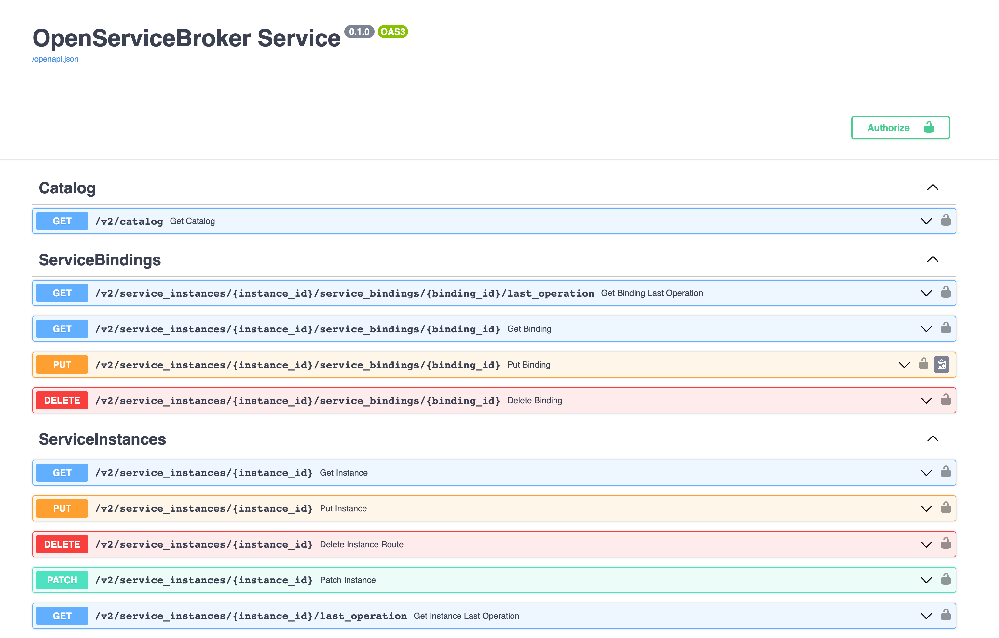
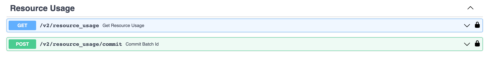

# {heading(Брокерді жергілікті тестілеу)[id=saas_upload_localtest]}

{include(/kz/_includes/_translated_by_ai_kz.md)}

Брокерді жергілікті тестілеңіз.

Үлгі негізінде әзірленген брокерді жергілікті тестілеу үшін мына әрекеттерді орындаңыз:

1. Брокер каталогындағы `.env` файлында орта айнымалыларын сипаттаңыз:

   * `BROKER_PROVIDER_CLIENT_ID` — SaaS-қосымшаға кіру үшін брокердің аты.
   * `BROKER_PROVIDER_SECRET` — брокердің SaaS-қосымшаға кіру құпиясөзі.
   * `BROKER_PROVIDER_URL` — SaaS-қосымшаның URL мекенжайы.
   * `BROKER_USERNAME` — брокермен қызметаралық өзара әрекеттесу үшін дүкеннің аты.
   * `BROKER_PASSWORD` — брокермен қызметаралық өзара әрекеттесу үшін дүкеннің құпиясөзі.

   {note:err}

   `BROKER_USERNAME` айнымалосының мәні `username` мәніне, ал `BROKER_PASSWORD` мәні — брокерді тіркеу туралы өтініште көрсетілген `password` мәніне сәйкес болуы тиіс.

   {/note}
1. Брокер каталогындағы `.env` файлында брокердің БД-на кіру үшін айнымалылардың мәндерін көрсетіңіз.
1. Python-жинақтарды орнату үшін команданы орындаңыз:

   ```console
   $ pip install -r requirements/prod.txt
   ```

1. Брокерді іске қосу үшін команданы орындаңыз:

   ```console
   $ gunicorn app.main:app --log-file - --workers ${UVICORN_WORKERS:-1} --worker-class uvicorn.workers.UvicornWorker --bind 0.0.0.0:${BROKER_PORT:-8000} --timeout ${WORKER_TIMEOUT:-90}
   ```

   {caption(Брокерді іске қосу командасына жауап мысалы)[align=left;position=above]}
   ```console
   INFO:     Started server process [34934]
   INFO:     Waiting for application startup.
   INFO:     Application startup complete.
   INFO:     Uvicorn running on http://0.0.0.0:8000 (Press CTRL+C to quit)
   ```
   {/caption}

   Брокер орнатылғаннан кейін `http://0.0.0.0:8000/docs` мекенжайы бойынша swagger UI редакторында API қолжетімді болады ({linkto(#pic_saas_swagger_broker)[text=сурет %number]}, {linkto(#pic_saas_swagger_resourceusage)[text=сурет %number]}).

   {caption(Сурет {counter(pic)[id=numb_pic_saas_swagger_broker]} — swagger UI API мысалы)[align=center;position=under;id=pic_saas_swagger_broker;number={const(numb_pic_saas_swagger_broker)} ]}
   
   {/caption}

   {caption(Сурет {counter(pic)[id=numb_pic_saas_swagger_resourceusage]} — постаплатtarifi опцияларына арналған сұраулары бар swagger UI API мысалы)[align=center;position=under;id=pic_saas_swagger_resourceusage;number={const(numb_pic_saas_swagger_resourceusage)} ]}
   
   {/caption}
1. swagger UI API-нде сипатталған сұрауларды орындаңыз.

   Сұрауларда мыналарды пайдаланыңыз:

   * VK OSB хаттамасының `x-broker-api-version` нұсқасының мәні (мысалы, `"0.1"`).
   * `.env` файлынан алынған `BROKER_USERNAME` мәні.
   * `.env` файлынан алынған `BROKER_PASSWORD` мәні.